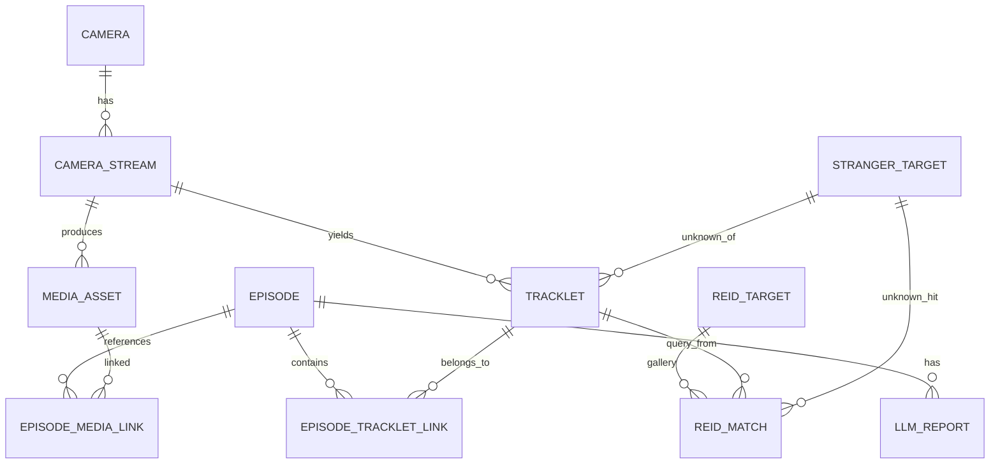

## 核心主线

- **Camera（物理摄像头）**
  → **Camera Stream（流/任务实例：camera_1_reid、camera_2_sam…）**
  → **Tracklet（轨迹：合并后的一条“行人轨迹”，内含轨迹点+关键帧观测）**
  → **ReID**
  - **gallery=内部人员库 `reid_target`**
  - **unknown=陌生人库 `stranger_target`**
  - **reid_match=比对结果**
    → **Episode（事件容器）**
    → **LLM Report（报告）**
- 视频/截图/回溯片段在 OSS（或已有播放 url），DB 存索引：**start_time + duration + url**

------

## ER 关系图（Mermaid，已加入陌生人表）

> 说明：
>
> - `tracklet` 仍然是核心。
> - 轨迹命中内部人员：写 `tracklet.gallery_target_id`
> - 轨迹未命中内部人员：写 `tracklet.stranger_target_id`（归档到陌生人库）
> - `reid_match` 用于记录“检索过程”，既可以命中 `reid_target`，也可以命中 `stranger_target`（可选）

------

# 1) `camera`（物理摄像头表）

（原样不变）

| 字段        | 类型        | 约束             | 说明                                    |
| ----------- | ----------- | ---------------- | --------------------------------------- |
| id          | uuid        | PK               | 摄像头ID                                |
| camera_code | text        | unique, not null | 设备编号/通道号（如 CAM01）             |
| name        | text        | not null         | 显示名称                                |
| location    | text        | null             | 位置描述（实验室A门口等）               |
| vendor      | text        | null             | 设备厂商                                |
| model       | text        | null             | 型号                                    |
| stream_uri  | text        | null             | RTSP/WEBRTC 源地址（可选）              |
| timezone    | text        | null             | 默认 Asia/Singapore 或现场时区          |
| calibration | jsonb       | null             | 标定/映射参数（未来做 world_x/world_y） |
| meta        | jsonb       | null             | 其他扩展信息（分辨率/镜头/安装高度等）  |
| created_at  | timestamptz | not null         | 创建时间                                |
| updated_at  | timestamptz | not null         | 更新时间                                |

------

# 2) `camera_stream`（流 / 任务实例表）

（原样不变）

| 字段        | 类型        | 约束             | 说明                                          |
| ----------- | ----------- | ---------------- | --------------------------------------------- |
| id          | uuid        | PK               | 流/任务实例ID                                 |
| camera_id   | uuid        | FK camera.id     | 属于哪个物理摄像头                            |
| stream_name | text        | unique, not null | 例如 `camera_1_reid`、`camera_2_sam`          |
| task_type   | text        | not null         | `reid` / `yolo` / `sam` / `pose` / `track` 等 |
| shm_name    | text        | unique, null     | 对应 meta["shmName"]（强烈建议有）            |
| zmq_addr    | text        | null             | 对应服务 IPC/ZMQ 地址（可选）                 |
| is_active   | boolean     | not null         | 是否启用                                      |
| meta        | jsonb       | null             | 任务参数（阈值、模型版本、ROI等）             |
| created_at  | timestamptz | not null         | 创建时间                                      |
| updated_at  | timestamptz | not null         | 更新时间                                      |

------

# 3) `media_asset`（媒体索引表：start_time/duration/url）

（原样不变）

| 字段         | 类型        | 约束                | 说明                                       |
| ------------ | ----------- | ------------------- | ------------------------------------------ |
| id           | uuid        | PK                  | 媒体ID                                     |
| stream_id    | uuid        | FK camera_stream.id | 来自哪个流/任务实例                        |
| asset_type   | text        | not null            | `segment` / `clip` / `snapshot`            |
| start_ts     | timestamptz | not null            | 视频开始时间 / 截图时间                    |
| duration_ms  | bigint      | not null            | 视频时长（毫秒）/ snapshot 可为 0          |
| path     | text        | not null            | 前端播放地址 / 图片地址                    | |
| content_type | text        | null                | video/mp4、image/jpeg 等                   |
| meta         | jsonb       | null                | 码率、分辨率、fps、切片序号、hash等        |
| created_at   | timestamptz | not null            | 创建时间                                   |

------

# 4) `tracklet`（核心：合并后的轨迹表）

> ✅ 新增一列：`stranger_target_id`
> 让轨迹可以直接挂到“陌生人库”。

| 字段                 | 类型          | 约束                        | 说明                                         |
|--------------------|-------------| --------------------------- |--------------------------------------------|
| id                 | uuid        | PK                          | 轨迹ID（主键）                                   |
| stream_id          | uuid        | FK camera_stream.id         | 属于哪个流/任务实例                                 |
| start_ts           | timestamptz | not null                    | 轨迹开始时间                                     |
| end_ts             | timestamptz | null                        | 轨迹结束时间                                     |
| cls_name           | text        | not null                    | 默认 `person`                                |
| color_rgb          | int2        | null                        | 轨迹颜色（rgb版本）                                |
| query_asset_base64 | text        | FK media_asset.id, null     | 该轨迹代表的行人图片（query）                          |
| frame_asset_base64 | text        | FK media_asset.id, null     | 开始记录轨迹首帧的整个画面                              |
| frame_end_base64   | text        | FK media_asset.id, null     | 开始记录轨迹尾帧的整个画面                              |
| gallery_target_id  | uuid        | FK reid_target.id, null     | 命中内部人员（gallery）                            |
| gallery_similarity | float       | null                        | 命中时相似度（可选）                                 |
| stranger_target_id | uuid        | FK stranger_target.id, null | **未命中内部人员时，归档到陌生人库**                       |
| repr_embedding     | vector(512) | null                        | 轨迹级代表 embedding                            |
| embedding_model    | text        | null                        | 模型版本                                       |
| trajectory_points  | jsonb       | null                        | 中心点轨迹序列（降采样）                               |
| meta               | jsonb       | null                        | 额外信息（合并前 tracker_ids、算法版本等）                |
| created_at         | timestamptz | not null                    | 创建时间                                       |
| updated_at         | timestamptz | not null                    | 更新时间                                       |

> 建议加一个规则（可用 CHECK 约束表达）：
>
> - `gallery_target_id` 和 `stranger_target_id` **不能同时有值**
> - 两个都为空 = 尚未归类
> - 最长3min，start_ts - end_ts 上限3min

------

# 5) `reid_target`（内部人员库 / Gallery）

（原样不变）

| 字段              | 类型          | 约束                    | 说明                |
|-----------------|-------------| ----------------------- |-------------------|
| id              | uuid        | PK                      | gallery 目标ID      |
| employee_id     | text        | null                    | 可选：关联内部人员主表       |
| name            | text        | not null                | 姓名/别名             |
| source_asset_id | uuid        | FK media_asset.id, null | 目标图/证件照等来源        |
| embedding       | vector(512) | not null                | gallery embedding |
| embedding_model | text        | not null                | 模型版本              |
| is_active       | boolean     | not null                | 是否有效（离职/停用）       |
| created_at      | timestamptz | not null                | 创建时间              |
| updated_at      | timestamptz | not null                | 更新时间              |
| image_base64    | text        | not null                | 用于提取特征的图片         |

------

# 6) ✅ 新增：`stranger_target`（陌生人库 / Unknown Gallery）

> 这张表逻辑上“像 reid_target”，但用于管理“未命中 gallery 的人”。
> 你之前要求加的字段：`code / status / promoted_target_id` 都在这张表里。

| 字段               | 类型        | 约束                    | 说明                                 |
| ------------------ | ----------- | ----------------------- |------------------------------------|
| id                 | uuid        | PK                      | 陌生人档案ID                            |
| code               | text        | unique, not null        | 展示用编号：如 `STR-000001`               |
| status             | text        | not null                | `new / watch / cleared / promoted` |
| embedding          | vector(512) | not null                | 陌生人代表 embedding                    |
| embedding_model    | text        | not null                | 模型版本                               |
| is_active          | boolean     | not null                | 是否有效（合并/误报可停用）                     |
| promoted_target_id | uuid        | FK reid_target.id, null | 后续确认身份并加入 gallery 后，指向新 target     |
| created_at         | timestamptz | not null                | 创建时间                               |
| updated_at         | timestamptz | not null                | 更新时间                               |
| image_base64    | text        | not null                | 新建行人（陌生人）时画面中的行人图片                 |

------

# 7) `reid_match`（ReID 结果表：支持命中 gallery 或陌生人库）

> 你之前的版本只命中 `reid_target`。
> 现在为了“记录检索过程”更完整，建议 `reid_match` 支持两种命中目标（二选一）：
>
> - 命中内部人员：`target_id`
> - 命中陌生人库：`stranger_target_id`

| 字段               | 类型          | 约束                        | 说明               |
| ------------------ |-------------| --------------------------- |------------------|
| id                 | uuid        | PK                          | 匹配ID             |
| tracklet_id        | uuid        | FK tracklet.id              | 来自哪条轨迹           |
| ts                 | timestamptz | not null                    | 执行 ReID 的时间      |
| similarity         | float       | not null                    | 相似度              |
| threshold          | float       | not null                    | 阈值               |
| matched            | boolean     | not null                    | 是否命中             |
| target_id          | uuid        | FK reid_target.id, null     | 命中内部人员目标（可空）     |
| stranger_target_id | uuid        | FK stranger_target.id, null | 命中陌生人目标（可空）      |
| query_asset_base64     | text        | FK media_asset.id, null     | 内部人员或陌生人数据库的行人图片 |
| evidence_asset_base64  | text        | FK media_asset.id, null     | 匹配成功时刻的行人证据图     |
| meta               | jsonb       | null                        | 耗时/模型/来源帧等       |
| created_at         | timestamptz | not null                    | 创建时间             |

> 同样建议一个 CHECK：`target_id` 和 `stranger_target_id` 不能同时有值。

------

# 8) `episode`（事件容器）

（原样不变）

| 字段           | 类型        | 约束                    | 说明                         |
| -------------- | ----------- | ----------------------- | ---------------------------- |
| id             | uuid        | PK                      | episode ID                   |
| title          | text        | null                    | 标题                         |
| start_ts       | timestamptz | not null                | 事件开始                     |
| end_ts         | timestamptz | not null                | 事件结束                     |
| main_target_id | uuid        | FK reid_target.id, null | 可选：事件明确对应某内部人员 |
| status         | text        | not null                | `open`/`closed`/`reviewed`   |
| meta           | jsonb       | null                    | 结构化摘要/标签等            |
| created_at     | timestamptz | not null                | 创建时间                     |
| updated_at     | timestamptz | not null                | 更新时间                     |

------

# 9) `episode_tracklet_link`（Episode ↔ Tracklet）

（原样不变）

| 字段        | 类型        | 约束           | 说明                  |
| ----------- | ----------- | -------------- | --------------------- |
| id          | uuid        | PK             | 关联ID                |
| episode_id  | uuid        | FK episode.id  | 哪个 episode          |
| tracklet_id | uuid        | FK tracklet.id | 哪条轨迹              |
| role        | text        | not null       | `primary`/`secondary` |
| note        | text        | null           | 备注                  |
| created_at  | timestamptz | not null       | 创建时间              |

------

# 10) `episode_media_link`（Episode ↔ Media）

（原样不变）

| 字段           | 类型        | 约束              | 说明                                     |
| -------------- | ----------- | ----------------- | ---------------------------------------- |
| id             | uuid        | PK                | 关联ID                                   |
| episode_id     | uuid        | FK episode.id     | 哪个 episode                             |
| media_asset_id | uuid        | FK media_asset.id | 引用的媒体                               |
| role           | text        | not null          | `recording`/`clip`/`snapshot`/`keyframe` |
| note           | text        | null              | 备注                                     |
| created_at     | timestamptz | not null          | 创建时间                                 |

------

# 11) `llm_report`（大模型报告）

（原样不变）

| 字段           | 类型        | 约束          | 说明             |
| -------------- | ----------- | ------------- | ---------------- |
| id             | uuid        | PK            | 报告ID           |
| episode_id     | uuid        | FK episode.id | 属于哪个 episode |
| prompt_version | text        | null          | 提示词版本       |
| report_json    | jsonb       | not null      | LLM 输出 JSON    |
| report_text    | text        | null          | 可读摘要         |
| created_at     | timestamptz | not null      | 生成时间         |

------

## 陌生人加入后的“写入规则”（一句话版）

- ReID 命中内部人员：
  `tracklet.gallery_target_id = reid_target.id`
- ReID 未命中内部人员：
  建/更新 `stranger_target`（embedding），然后：
  `tracklet.stranger_target_id = stranger_target.id`
- `reid_match` 记录每次检索过程（命中谁就填谁，另一个字段为空）

------

如果你愿意，我下一步可以直接给你**对应这份“加了陌生人表”的建库 SQL（pgvector + 外键 + check 约束 + 索引）**，并且保证能在你 `pgvector/pgvector:pg16` 镜像上顺利执行。