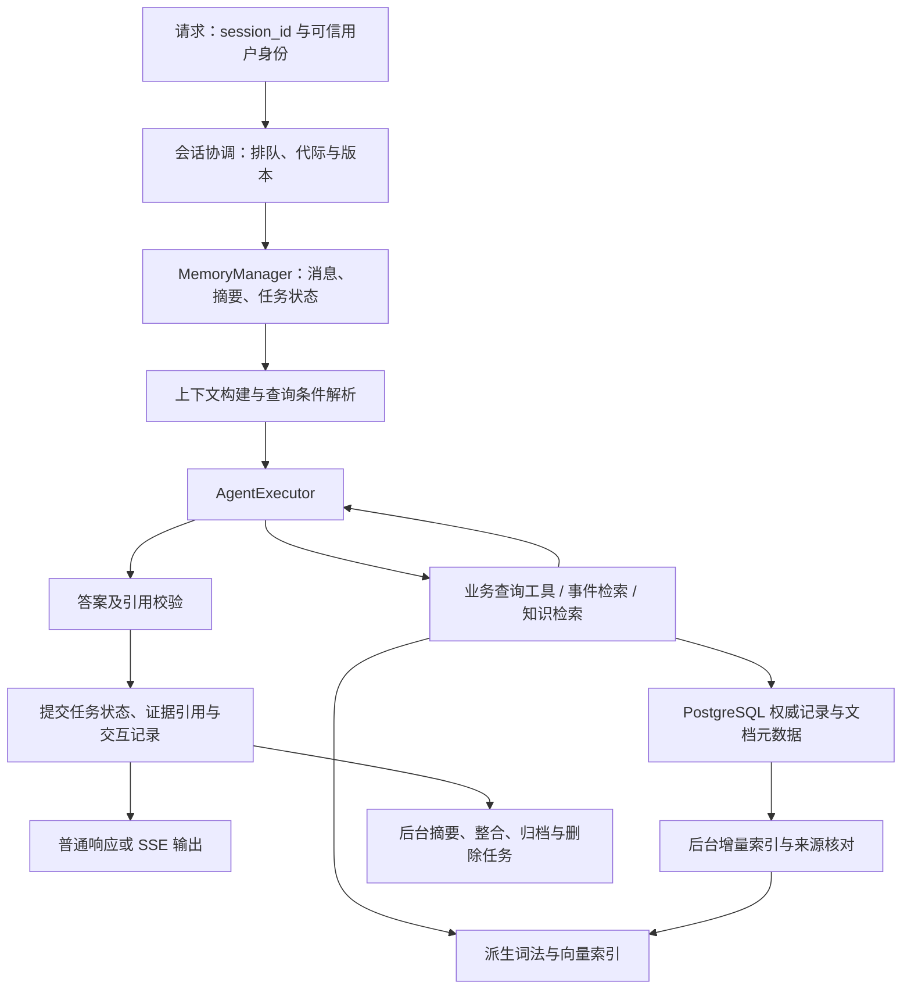

# 视频监控 Agent 记忆模块优化计划

编写日期：2026年10月2日。依据：[第八章 记忆与检索](../第八章%20记忆与检索.md)及当前仓库代码。

本文是下一阶段的实施计划，所有新增接口、表、配置和指标均为规划项，不代表已经实现。建议按“可靠的任务上下文 → 可恢复的会话 → 可溯源的历史事件 → 业务知识 → 生命周期治理 → 多模态与关系查询”推进。首先让 Agent 正确记住“正在查谁、哪个时间范围、上一条事件是什么”，再扩大长期记忆能力。

## 1. 当前能力与实际问题

### 1.1 以运行入口的代码为准

当前 `app.py` 创建 `AgentService + AgentExecutor + ToolRegistry`，普通和流式请求都进入 Agent 工具决策流程，复用 `ReidService` 提供的数据库、人员缓存和图片处理能力。README 开头仍有“规则路由”的旧描述；原四天完善计划也包含尚未采用的模式和回退设计，不能直接当作当前实现。

| 位置 | 已有能力 | 对本次优化的影响 |
|---|---|---|
| `service/memory.py` | LangChain 进程内消息历史，按 `session_id` 分隔；默认最多1000个会话、每会话20条消息；按访问顺序淘汰会话 | 已有最近约10轮问答，尚无 TTL、持久化、摘要或长期检索 |
| `agent/executor.py` | 读取历史，执行工具，最终保存用户文本和回答；工具观察只进入本轮消息 | 下一轮缺少结构化查询条件、事件指针和完整证据来源 |
| `service/agent_service.py` | 普通响应与 SSE；流式阶段再次调用模型输出最终正文 | `run()` 已写入的回答可能与用户实际收到的正文不一致 |
| `tools/default_tools.py` | 人员轨迹、人员报告、时间范围报告、VAD、名单、时间解析、图片超分 | 是结构化记忆和事件证据的主要接入点 |
| `llm_chat_service/db/`、`llm_api_service/db/` | PostgreSQL 轨迹、事件报告与异常查询 | 可以继续作为监控事实和证据关联的权威数据源 |
| `llm_report_service/db/report_repo.py` | 保存关联 `episode_id` 或 `vad_id` 的模型报告 | 长期事件索引应覆盖已落库报告，不只覆盖用户问过的事件 |
| `observability.py`、现有 Agent 测试 | `trace_id`、工具结果和最终回复日志；会话和流式相关测试 | 可用于建立基线；日志不能直接当作可信长期知识 |

### 1.2 优先解决的问题

1. **上下文只有文字，没有任务状态。** “张三昨天在哪里？”之后追问“那前天呢？”目前主要依赖模型从历史推断姓名和时间；“第二条异常”没有稳定的结果列表指针。人员轨迹工具没有返回轨迹 ID，人员报告工具主要返回报告文本，下一轮难以准确回查。
2. **记忆有条数上限，没有上下文 token 预算。** 原样带入最近消息，工具观察按字符截断。长报告容易挤占上下文，也可能截断 JSON，损失证据字段。
3. **同一会话整轮请求并未串行。** 存储对象有锁，但新执行器在读取与写入时分别加锁，中间模型和工具调用没有持锁。两个请求可能读到同一旧历史并乱序提交；旧 `ReidService.process()` 的整轮锁不能覆盖当前入口。
4. **清空与淘汰可能和在途请求竞争。** 会话对象被删除或淘汰后，旧请求仍可能完成并重新写入同一个 ID。需要代际版本和在途保护，防止清空后记忆“复活”。
5. **服务重启和多实例无法恢复或共享会话。** 当前没有 PostgreSQL 会话表或共享协调机制；浏览器保存 `session_id` 不能解决后端历史丢失。
6. **图片只能在当前请求中使用。** 历史没有可重新读取的图片引用；待超分意图还依赖上一条用户文本中的关键词，容易把旧任务带入新图片。
7. **历史回答缺少来源分级。** 模型回答、模型生成的监控报告、数据库结构化记录、用户陈述需要区别标记；否则长期记忆会放大一次错误。
8. **记忆尚未覆盖完整生命周期。** 没有整合、纠错、失效、归档、跨索引删除和检索效果评估。

## 2. 从教程借鉴什么，如何适配监控场景

教程的核心价值是四类记忆、统一管理器、编码—存储—检索—整合—遗忘闭环，以及 Memory 与 RAG 分工。建议采用这些设计原则，在现有服务中逐步实现，不直接整体替换为 HelloAgents。

| 教程能力 | 在本项目中的对应内容 | 实施选择 |
|---|---|---|
| 工作记忆 | 当前人员、时间范围、摄像头、事件列表、待上传图片任务、最近问答 | 结构化状态 + 最近消息 + 滚动摘要；首先实施 |
| 情景记忆 | 用户查询经历、已核验事件的引用、处置记录（未来有来源后） | 区分“交互经历”和“监控事件”；以数据库实体 ID 关联 |
| 语义记忆 | 摄像头与位置映射、业务术语、异常定义、处置 SOP、明确偏好 | 确定映射先结构化存储；SOP 走有版本的知识库 RAG |
| 感知记忆 | 原始关键帧、视频片段、图片描述及其来源 | 先持久化受控资源引用，再评估多模态检索 |
| MemoryManager / MemoryTool | 统一管理不同类型记忆 | 自动读写由服务编排；显式回顾采用只读工具；删除由管理接口处理 |
| 向量 + 结构化过滤 | 类似事件检索与历史追踪 | 权限、人物、时间、摄像头先过滤，相关性排序后执行 |
| 整合与遗忘 | 会话摘要、重要事件引用、规则版本、保留期限 | 按来源和用途决定保留，不能只看模型打的“重要性分” |
| 文档解析与分块 | SOP、设备说明、异常业务定义 | 按标题/条款分块；事件报告按事件单元组织 |

需要调整教程中的几个具体做法：

- 不把教程的 SQLite、Qdrant、Neo4j 同时作为第一阶段依赖。项目已有 PostgreSQL，优先复用它；向量后端选择需结合部署条件和实测结果。
- 不照搬固定的近因性权重。查询“上个月”必须限定上个月，“最新异常”必须按数据库时间排序，不能用向量相似度代替。
- TF-IDF 是词法检索兜底，不能标称为语义检索；中文稠密嵌入模型需要单独评估，InternVL 的视觉问答能力不能直接视为可用的统一嵌入接口。
- 教程示例中的向量截断、补零或异常时写零向量不采用。不同模型的向量空间不能混用，即便维度相同；失败应进入重试或词法降级。
- MQE 仅在模糊事件描述和知识问答上做实验，固定保留人物、摄像头、时间与权限条件。HyDE 暂不用于监控事实查询，假设内容也不得进入事实记忆。
- 教程声称的召回率提升不能当作本项目收益承诺。是否启用扩展查询、重排、图查询，由本项目评测决定。

## 3. 目标业务体验与事实边界

| 场景 | 目标行为 | 需要的记忆 |
|---|---|---|
| “张三昨天出现在哪？”→“前天呢？” | 保留张三，替换时间范围，重新查询真实轨迹 | 任务状态、参数来源 |
| “最近三天的异常”→“第二条是哪台摄像头？” | 根据上轮展示顺序定位事件 ID，按证据回答 | 有顺序的结果引用、来源快照 |
| “给我看看刚才那张图”→“放大它” | 根据授权图片引用重新加载；失效时说明需要重新上传 | 图片引用、待执行任务 |
| 重启后继续“刚才查的那个人” | 恢复属于当前用户的会话状态；过期内容明确提示 | 持久化会话、归属与 TTL |
| “找与这次类似的徘徊事件” | 限定授权范围，检索相关历史报告并展示事件时间和来源 | 历史事件索引、混合检索 |
| “这种异常按规定怎么处理？” | 检索现行 SOP，引用文档版本与条款；缺少依据时说明 | 业务知识 RAG |
| “以后报告按时间表列出” | 保存用户明确表达的格式偏好；当前要求优先 | 有作用域的偏好记忆 |

必须坚持的边界：

1. 问“我之前问过什么”可以用交互记忆；问“实际发生了什么”要查业务记录或有效证据引用。摘要只帮助定位，不替代事实。
2. `llm_report` 是对视频/事件的模型解释，需标为“报告描述”，不自动升级为人工确认事实；VAD 标签也不等于已确认事故。
3. 一次出现记录不能固化为“这个人总是在某地”；没有可信关联时，不推断跨摄像头人员身份或因果关系。
4. 返回20条不能表述为“总共20起”。精确统计需要独立聚合查询；“相似事件”结果不代表全部历史事件。
5. 用户明确的新条件覆盖继承条件；涉及多个人或多条事件且无法唯一定位时澄清；新任务不自动继承无关人物和时间。
6. 记忆中的用户内容、报告和文档按资料处理，不得作为系统指令改变工具权限、查询范围或记忆归属。

## 4. 建议架构与数据契约

### 4.1 在线流程与后台流程

图中提交的是规范回答与执行事实。SSE 的完整/中断交付状态单独记录；如果保留第二次正文生成，必须另存实际输出并核对一致性，不把半截文字固化成事实。

### 4.2 工作记忆：明确存“任务状态”

建议定义 `WorkingContext`，至少包含：

- `session_id`、可信 `owner_id`/`tenant_id`、`session_epoch`、`state_version`、`updated_at`、`expires_at`。
- `active_task`、`person_names`/`person_ids`、`stream_ids`、`event_ids`。
- `time_range`：起止时间、时区、原始表达、解析基准时间、来源轮次。
- `last_result_refs`：事件/报告/轨迹的稳定 ID、有序列表、查询条件、查询时间、是否分页或截断、来源版本。
- `pending_action`：例如超分任务类型、倍率、关联图片引用、创建轮次和过期时间；完成、取消或切换任务后清除。
- `summary` 与摘要覆盖到的消息序号。每个继承字段记录来源，区分用户明确指定、上轮继承和系统默认。

“昨天”在原轮次应保存解析后的绝对范围。次日追问“刚才那段时间”沿用该范围；新问题明确说“今天”则按新请求的当前时间解析。工具目前只接收 `time_prompt`，需增加可校验的绝对时间范围输入或等价内部契约，不能把旧“昨天”字符串再次按新日期解析。

摄像头使用稳定 `stream_id`，展示名称与位置来自真实映射。`ReidService._get_camera_from_stream_id()` 存在推测名称的回退路径，其输出不能固化为可信位置知识；无法解析时保留原 ID 并标记未知。

### 4.3 长期记忆：统一 MemoryItem，但不混淆来源

| 字段组 | 建议字段 | 用途 |
|---|---|---|
| 标识与隔离 | `memory_id`、`memory_type`、`scope`、`tenant_id`、`owner_id`、`session_id` | 区分会话、用户及授权站点知识 |
| 内容与实体 | `content`、`entity_refs`、`source_type`、`source_refs` | 指向 report、episode、vad、tracklet、文档或用户消息 |
| 时间 | `event_start/end`、`observed_at`、`created_at`、`valid_from/to`、`expires_at` | 区分事件时间、记录时间和规则有效期 |
| 可信状态 | `verification_status`、`confidence`（若有来源）、`importance`、`status` | 未核验、报告推断、已确认、冲突、失效等独立表达 |
| 版本与派生 | `source_version/hash`、`schema_version`、`embedding_model/version/dim`、`derived_from` | 来源纠正、摘要追溯与索引重建 |
| 生命周期 | `last_accessed_at`、`access_count`、`deleted_at` | 归档、保留及删除 |

`importance` 不等于真实性；被频繁检索也不能提升为“已确认”。用户偏好与公共业务知识分开作用域，事件索引按站点权限共享，不挂在最先查询它的用户下面。

### 4.4 存储与模块选择

建议新增独立模块 `llm_agent_service/memory/`，包含 `schemas.py`、`manager.py`、`context_builder.py`、`repositories.py`、`retrieval.py`、`lifecycle.py`。原 `service/memory.py` 暂时保留适配层，避免一次修改全部调用点。

- PostgreSQL 存会话元数据、消息、任务状态、长期记忆与来源关系，建议新表 `agent_session`、`agent_message`、`agent_memory`、`agent_memory_source`、`agent_memory_job`；这些是规划表，不是已有表。
- pgvector 可用且规模允许时先评估 pgvector，以减少双库一致性成本；若扩展不可安装或隔离、规模要求更适合 Qdrant，再启用 Qdrant。阶段3必须定下一个后端，不同时维护两套产品实现。
- 词法检索需评估中文分词；原生全文索引的默认分词不能直接假设适合中文，可选字符 n-gram/经分词的 BM25 方案。
- 首次持久化采用 PostgreSQL 会话协调，避免跨模型调用持有数据库事务；Redis 在排队、TTL 缓存或高并发确有需求时再引入。
- 媒体保留在已有媒体服务或受控文件/对象存储，记忆中存引用，不存 Base64；临时播放 URL 在访问时生成。
- Neo4j 暂列扩展项，已有 `episode_tracklet_link`、人员与摄像头关联先用关系表完成。

## 5. 分阶段实施计划

按1名熟悉项目的后端工程师、前端与数据库负责人配合估算。采用相对工作日，不指定上线日期；基础阶段0～5约25～33个工作日，阶段6另外5～8个工作日，仅在前置验收通过且业务有需求时启动。数据授权、标注及资源不足时应重新估时。

| 阶段 | 工作量 | 依赖 | 可交付能力 |
|---|---|---|---|
| 0：基线与契约 | 2～3日 | 当前服务 | 明确问题、测试数据和指标口径 |
| 1：可靠工作记忆 | 4～5日 | 阶段0 | 多轮指代、时间继承、摘要预算和并发正确性 |
| 2：会话持久化 | 4～5日 | 阶段1 | 重启恢复、多实例一致性与归属隔离 |
| 3：事件情景记忆 | 5～7日 | 阶段2 | 可溯源事件回顾、历史类似事件检索 |
| 4：语义记忆与规则 RAG | 5～6日 | 阶段3 | 业务规则引用、明确偏好、知识版本管理 |
| 5：生命周期与灰度 | 5～7日 | 阶段3、4 | 纠错、整合、归档、删除、可观测性与发布验证 |
| 6：感知记忆与关系扩展 | 5～8日 | 阶段5 | 历史图片复用；按需试验跨模态与关系查询 |

### 阶段0：建立基线和冻结记忆契约

**完成任务**

- [ ] 梳理 `/chat`、`/chat/stream`、清空接口和图片超分各条路径，确定唯一的会话读写责任点。
- [ ] 修正文档中的旧路由、并发保证及工具命名描述；例如提示词中的 `query_person_history` 与注册工具 `query_person_tracklets` 不一致，需要统一。
- [ ] 用脱敏业务样本整理80个评测案例：20个指代/条件继承、10个跨日期、10个图片/待办、10个并发/清空、15个事件检索、10个知识问答、5个隔离/来源冲突；另建固定并发压力脚本。
- [ ] 为每个案例标注预期实体 ID、时间范围、引用来源、是否应澄清；对尚无对应能力的案例记录失败，不虚构基线。
- [ ] 定义 `WorkingContext`、`MemoryItem`、证据引用和交付状态；确认可信用户身份由现有网关/后端何处提供。
- [ ] 清点报告量、媒体引用、数据库扩展权限、embedding 可用资源，输出存储选型约束。

**交付物**：契约说明、脱敏评测集、当前基线报告、入口流程图和后端选型记录。

**验收**：每条评测都有预期结果；普通与流式链路都能复现并发/清空风险；区分代码事实、实验结果与待验证假设。历史日志只用于筛选样本，人工核对后才能进入评测。

### 阶段1：先让工作记忆可靠

**主要改动**：`service/memory.py`、`agent/executor.py`、`service/agent_service.py`、`agent/prompts.py`、`tools/default_tools.py`、`config.py`。

- [ ] 接入结构化 `WorkingContext`；在工具参数校验通过后保存实际条件，成功返回后保存证据引用。工具失败可记录执行状态，但不得产生事件事实。
- [ ] 实现指代与条件继承：明确输入优先；任务切换清除无关槽位；多个候选人物或事件时澄清，不取名单中的第一个。
- [ ] 增加绝对时间范围契约、固定本轮解析基准和时区；区分“最近一次”排序与“最近三天”范围。
- [ ] 保存有序结果引用；给轨迹/人员报告补齐已有数据库 ID、事件时间和 stream ID；保留展示字段兼容前端。
- [ ] 将超分意图变成有 TTL 的 `pending_action`；当前图片明确用于新问题时覆盖旧意图，执行完成后清除。
- [ ] 在进程内用会话级协调器串行完整的 Agent 执行；会话淘汰跳过在途对象；清空增加 `session_epoch`，拒绝旧代际请求提交。
- [ ] 建立 token 预算：系统提示、工具定义、当前输入、输出预留优先；其余按任务状态、必要证据、最近消息和摘要分配。采用实际 tokenizer 或经过校准的估算，超预算裁剪消息/证据单元，禁止简单截断结构化 JSON。
- [ ] 用“最近完整轮次 + 有来源的滚动摘要”替代仅按条数截断。摘要记录实体、时间、结论出处和未完成事项，不能把否定、未知或空结果压成确定事实。
- [ ] 统一写入规范回答；SSE 优先直接分段发送规范回答。如果保留模型再次生成，记录最终正文与规范回答并做一致性核对；中断只记交付状态，下一轮可说明上轮执行完成但输出中断。

**交付物**：工作记忆管理器、上下文构建器、完整请求协调器、多轮与竞态回归测试。

**验收**：阶段0的确定指代/时间案例全部正确或按标注澄清；100次同会话双请求竞态测试无丢轮和乱序；清空后旧请求不能回写；达到会话容量上限时在途状态不分裂；普通与 SSE 保存内容的差异可解释、可追溯；图片描述不误触发旧超分任务。

### 阶段2：持久化会话，并支持多实例

**主要改动**：新增记忆 Repository、数据库迁移；接入 `app.py`、`config.py`、服务启动配置。

- [ ] 建立会话和消息表，保存角色、轮次、规范正文、任务状态版本、代际、交付状态及时间戳；消息对与状态更新使用短事务原子提交。
- [ ] 所有会话读取、检索、清空校验可信用户/租户归属；`session_id` 仅用于定位，不当作授权凭据。若身份系统尚未接入，暂仅部署在可信单用户环境，跨用户长期记忆不开启。
- [ ] 使用有超时的会话租约/排队与递增 fencing token；提交时检查租约、代际及状态版本。租约丢失后旧执行不能提交；不能仅用单机 `RLock`，也不在模型等待期间持有数据库长事务。
- [ ] 引入规划参数 `MEMORY_BACKEND`、会话 TTL、上下文预算；保持已有 `session_id` 请求方式，TTL 到期后状态明确，不静默沿用过期上下文。
- [ ] 引入服务生成或客户端可提供的 `request_id`；同一作用域同一 ID 且相同载荷复用既有执行结果，不重复写消息；载荷冲突拒绝。SSE 重试发送新完整响应，暂不要求断点恢复 token。
- [ ] 设计故障模式：长期检索故障可降级；共享会话存储故障时明确返回无法恢复上下文，不能静默切换到不同实例的本地旧记忆。
- [ ] 兼容现有清空接口，扩展到消息、摘要、任务状态和会话派生引用；更新前端会话文档。

**交付物**：迁移脚本、持久化适配器、恢复流程、双实例集成测试、前端契约更新。

**验收**：重启后继续同一会话；请求轮流落在两个实例仍正确；模拟执行崩溃、租约过期、重复请求及删除竞态，无旧状态回写；用户不能读取/清空其他用户会话；清空操作不删除共享监控原始记录。

### 阶段3：情景记忆与可溯源事件检索

**主要改动**：`tools/default_tools.py`、`agent/schemas.py`、执行结果与响应结构、报告/轨迹/VAD Repository；新增事件索引作业和只读检索工具。

- [ ] 区分两类情景：查询经历保存问题、实际参数、执行状态和来源引用；监控事件索引由业务报告/事件独立构建，覆盖未被用户查询的历史。
- [ ] 统一证据结构：`source_type/id`、`episode_id/vad_id/tracklet_id/report_id`（实际存在的字段）、事件时间、记录时间、stream ID、来源 hash、有效性；没有的字段不编造。
- [ ] 处理人员报告 JOIN 重复：同一报告按 ID 去重，人物关联单独保留。VAD 当前主要给出 `created_at`，没有核实媒体时间之前不能直接当作精确事件发生时间。
- [ ] 报告按事件完整单元构建检索文本；超长报告使用父事件 + 子块，每块保留父 ID、时间和人物关联，检索后合并。
- [ ] 完成一种向量后端选型与一种中文 embedding 方案；记录模型/维度/版本，查询和文档用同一配置，服务不可用时走词法检索。
- [ ] 构建权限及结构化过滤 + 词法/向量召回 + RRF 合并 + 可选重排。权限条件在召回时生效，最终返回前再次核对；空结果不得偷偷扩展时间或人物。
- [ ] 建立全量回填 + 增量轮询：按记录创建时间与稳定 ID 保存游标，有重叠窗口和幂等 upsert；处理迟到记录，周期核对来源 hash 与删除状态。现有报告保存接口没有更新通知，本阶段不假设 CDC 已存在。
- [ ] 长期保存来源 hash，引用前回查源记录；变更重建派生索引，源被删除则停止提供该证据。向量库是可重建索引，不能成为唯一事实存储。
- [ ] 增加只读 `recall_events` 或 `search_similar_events`，接受查询文本及结构化限制；服务自动加载工作上下文，避免为了记忆再多调用一次工具。类似事件查询采用一个封装工具，保留现有有限步执行约束。
- [ ] 打通 citations：当前动作模型有字段，但 `AgentRunResult` 和响应没有完整传递；由服务校验引用必须来自实际检索结果，普通响应提供引用，SSE 在完成事件传结构化引用并确认前端兼容。

**交付物**：事件记忆表/来源关系、索引与回填作业、检索工具、可展示证据引用、离线检索评测报告。

**验收**：回填重复执行不增加重复记录；报告修正/删除后索引可收敛；新增记录不依赖用户问过才能检索；“最新”始终走时间排序；指向来源的引用100%可解析；未授权事件召回/输出为0；固定评测集上相似事件 Recall@10 建议达到85%，且不低于词法基线。

### 阶段4：语义记忆、明确偏好和业务规则 RAG

**主要改动**：知识文档导入、版本与检索模块；新增只读 `search_monitoring_knowledge`；提示词与用户偏好管理。

- [ ] 首批只纳入经业务负责人确认的异常定义、摄像头位置说明、值班/处置 SOP；不将当前未核验的摄像头回退名称导入知识。
- [ ] 文档登记来源、发布者、版本、生效时间、站点和权限；按标题/条款分块，保留章节路径、父文档和原文定位。结构化摄像头映射直接查表。
- [ ] 实现问法路由：“发生过什么”查事件，“应该如何处理”查知识，“刚才查什么”读交互记忆。复合问题使用范围明确的组合工具/服务流程，需要时调整提示词的单工具限制，避免模型自由扩大查询。
- [ ] 基于语义检索共用 embedding 服务，知识与事件使用不同类型过滤/命名空间；只能引用当前有效版本，旧版保留供审计但不默认召回。
- [ ] 明确偏好单独存储：仅保存用户直接提出的格式、语言等要求；跨会话记忆归属于可信用户，展示可查看/修改/删除入口；当前任务显式要求优先。
- [ ] 将从历史事件总结出的经验置为候选，保留推导来源，由业务负责人确认后进入规则库；不自动把模型总结变成正式 SOP。
- [ ] 对用词差异明显的知识问答试验最多2条 MQE；固定授权、时间等过滤条件，比较召回和延迟后再决定启用。HyDE 保持关闭，另做知识问答实验后再讨论。

**交付物**：带版本的业务知识库、规则检索工具、用户偏好表与管理契约、知识问答评测结果。

**验收**：知识回答有真实原文与版本引用；没有依据时说明；失效规则不进入默认答案；同一用户可以跨会话沿用明确偏好，其他用户不可见；监控事实问题不会因知识库包含类似案例而编造事件。

### 阶段5：整合、纠错、遗忘、观测与灰度

**主要改动**：记忆生命周期作业、管理接口、日志、运维配置与评测脚本。

- [ ] 建立异步整合任务：达到摘要 token 阈值、任务结束或会话空闲时触发；带覆盖消息序号和来源版本，重复执行幂等，不覆盖更新后的摘要。
- [ ] 重要事件默认提升为“证据引用 + 有来源摘要”，不复制所有原始正文；高重要性不改变核验状态。
- [ ] 来源纠错沿 `derived_from/source_refs` 失效摘要、向量与缓存；新知识版本替代旧版，冲突状态对查询可见，禁止仅按创建时间猜测哪条为真。
- [ ] 分类型配置 TTL 和归档策略：待办短期、工作状态按会话、交互历史按业务保留期、规则按有效期；原始监控证据保留期沿用业务制度，不受记忆评分自动删除。
- [ ] 删除先写逻辑墓碑并阻断读取，再异步清理消息、摘要、向量、缓存及资源引用；任务幂等、可重试、可查询完成状态。共享事件资料与个人会话派生资料明确分开。
- [ ] 定义“清空当前上下文”与“删除用户长期记忆”的接口语义；前者阻断被清空会话的派生历史重新注入，不代表删除全站监控事件。日志和备份按单独保留周期处理，不能把在线删除称作已经物理删除所有副本。
- [ ] 在现有 `trace_id` 链路记录读取、召回、过滤、预算、命中来源、版本、写入与删除状态；记录记忆条数、token 消耗、检索 P95、索引滞后和失败队列，不默认把所有长期资料全文写入日志。
- [ ] 使用固定评测集与更大事件样本执行回归，按可信用户/会话灰度开启；异常时关闭长期记忆注入和高级检索，继续保留已验证的持久化会话。

**交付物**：生命周期作业、管理接口、监控指标、灰度/回滚方案与完整验收报告。

**验收**：删除一旦确认就不再被任何在线召回路径看到；异步任务失败后可重试且不复活已删内容；摘要纠正及索引重建可追溯；全部阶段回归通过，新增依赖故障有明确降级结果。

### 阶段6：感知记忆与关系查询扩展

本阶段先做图片引用复用；跨模态搜索和图查询分别设实验开关，根据需求与效果选择投入。

- [ ] 为上传图片和已有事件关键帧登记 `asset_id`、所有者、hash、事件/轨迹来源、创建时间与保留期；以授权引用重新读取，历史不保存 Base64。
- [ ] 将图片描述标记为模型观察，保留原始图片与描述来源；超分结果注明处理方式，不能作为新发现细节的事实证据。
- [ ] 完成“刚才那张图”的唯一定位、过期提示和多图歧义澄清；图片删除联动派生描述与图片索引，未经授权的媒体不进入模型上下文。
- [ ] 在中文衣着、姿态、场景样本上评估文本—图像检索。必须使用同一跨模态模型的文本/图像编码器，文本知识 embedding 不能直接与图像向量比较。
- [ ] 视觉相似只输出候选图，不标称为同一身份；若需人员身份关联，使用已有可验证 ReID 关联及来源置信信息，不靠记忆推断。
- [ ] 先利用关系表实现人员→轨迹→事件→摄像头/媒体的可解释关联；只有实际多跳查询用关系表难以满足，且评测有收益时，才评估 Neo4j。

**交付物**：受控媒体引用服务、历史图片复用、多模态实验报告、关系查询方案。

**验收**：历史图片可按权限重用，过期/删除后不能继续加载；图像相似结果有真实图片和事件来源；“像同一人”不自动转成身份事实；报告分别说明可上线能力和未达标实验。

## 6. 评测口径、建议指标与资源约束

以下是初始验收目标，不是当前测量结果。阶段0记录基线和运行环境，后续固定样本、候选池规模、模型版本与硬件；80例用于基础回归，检索阶段需增加至少100条有相关性标注的查询，性能阶段按真实数据量扩样。

| 指标 | 口径 | 建议目标 |
|---|---|---|
| 指代/条件正确性 | 正确实体、绝对时间范围或预期澄清；不能仅看回答是否流畅 | 确定性回归集100%，扩展集≥95% |
| 并发及清空 | 同会话压力、跨实例、代际与租约过期测试 | 无丢轮、重复提交和清空后回写 |
| 授权隔离 | 测试用户不在允许范围的记录召回及展示数量 | 0 |
| 证据可追溯 | 返回引用能解析到授权来源及正确版本 | 100% |
| 相似事件召回 | 人工标注相关事件的 Recall@10；按查询宏平均 | 初始≥85%，不低于词法基线 |
| 引用支撑度 | 人工核对结论是否由引用支持；单列事实编造 | 固定回归集无编造；扩展集支撑度≥95% |
| 上下文占用 | 同一批长会话输入 token，与原消息窗口方案比较 | 平均减少≥30%，关键槽位与来源不丢失 |
| 在线额外延迟 | 单独统计记忆加载/构建、检索、重排和新增 LLM 调用 | 缓存读取/构建 P95≤150ms，混合检索 P95≤1s；重排/MQE另预算 |
| 索引时效 | 从来源落库到可检索，另测变更和删除收敛 | 初始目标≤5分钟；来源回查保障输出有效性 |
| 删除 | 墓碑提交后在线不可见；物理清理作业耗时 | 在线立即阻断，活动索引清理目标≤5分钟 |

优先用 fake LLM/Repository 验证状态机与竞态，再用 PostgreSQL/向量后端做集成测试，最后在真实模型上做业务评测。已有会话测试主要覆盖原 `ReidService` 路径，新入口需独立测试；一次成功聊天不能证明整轮并发正确。

embedding 与 reranker 的部署需要检查当前 InternVL 推理服务的剩余 GPU/CPU 资源。首轮评估可以使用独立低成本服务或 CPU，固定批量和缓存；不能默认与现有模型共享 GPU 后仍满足延迟目标。无足够资源时先上线持久化与词法检索，保留同一检索契约。

## 7. 发布、回滚与第一批待办

阶段1、2可以作为第一批上线能力，阶段3增加事件检索，阶段4、5形成长期记忆闭环。每次发布先跑固定回归，再在测试用户范围验证，最后按会话灰度；不在同一批次同时开启 MQE、多模态和图查询。

规划独立开关控制结构化上下文、摘要、事件检索和知识检索。数据库迁移先做兼容性新增；派生索引按版本构建，校验后切换，不立即删除旧索引。回滚高级检索时继续使用可信会话状态与原有 SQL 工具，不能回到会导致重启丢历史的行为而不提示用户。

建议下一轮开发直接从以下任务开始：

1. 补齐新入口的并发、清空竞态和普通/SSE 记忆一致性回归用例。
2. 定义 `WorkingContext`、代际版本、证据引用与绝对时间范围契约。
3. 给人员轨迹与人员报告补齐稳定 ID、来源时间、stream ID 和有序结果引用。
4. 用结构化待办替换超分关键词继承，修正提示词与注册工具名称不一致。
5. 接入会话级完整请求协调、在途淘汰保护和 token 预算，再选择性增加滚动摘要。
6. 通过阶段1验收后，开始 PostgreSQL 会话迁移；此时再完成向量存储和 embedding 资源选型。

## 8. 阅读与核对依据

- [教程：第八章 记忆与检索](../第八章%20记忆与检索.md)：8.1分层架构、8.2记忆类型和生命周期、8.3分块与扩展检索、8.4工具协作案例。
- [会话内存实现](../service/memory.py)、[执行器](../agent/executor.py)、[普通与流式服务](../service/agent_service.py)、[应用入口](../app.py)。
- [工具实现](../tools/default_tools.py)、[动作与引用字段](../agent/schemas.py)、[提示词](../agent/prompts.py)、[配置](../config.py)。
- [报告查询](../../llm_chat_service/db/report_repo.py)、[轨迹查询](../../llm_chat_service/db/tracklet_repo.py)、[VAD查询](../../llm_api_service/db/vad_repo.py)、[报告保存](../../llm_report_service/db/report_repo.py)。
- [前端会话接入文档](前端会话接入开发文档.md)、[原四天完善计划](Agent模块四天完善计划.md)、[执行器测试](../../tests/test_agent_executor.py)、[流式测试](../../tests/test_agent_stream.py)、[原服务会话测试](../../tests/test_sglang_agent_service.py)。
