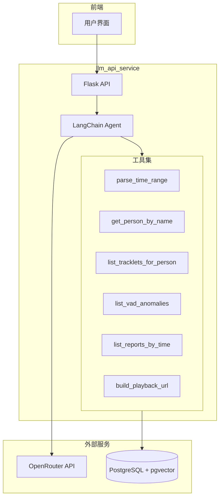
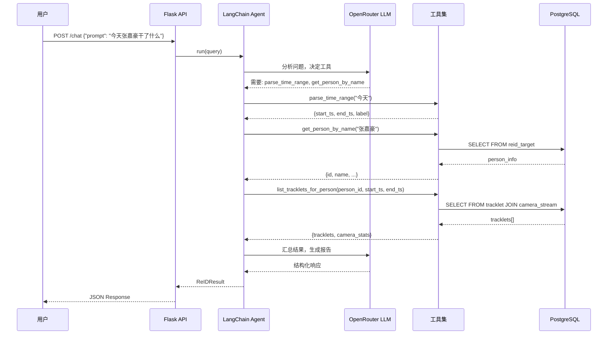
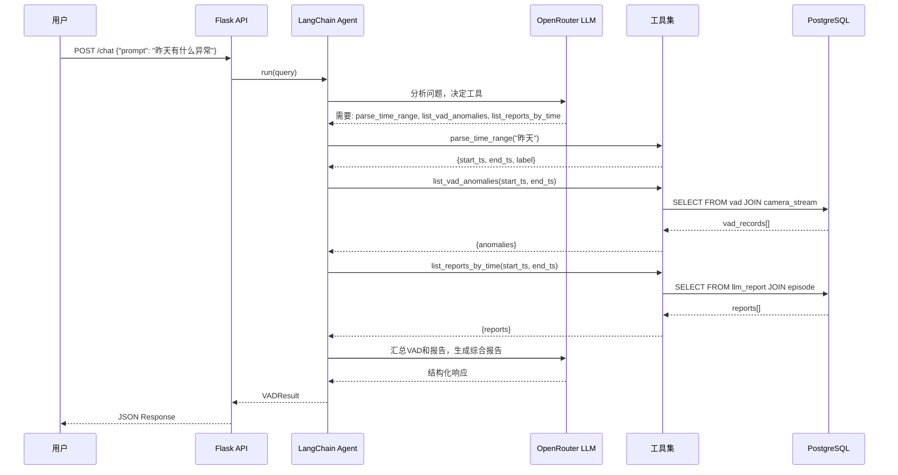

# LLM API Service 设计文档

## 1. 项目概述

`llm_api_service` 是一个基于 LangChain Agent + OpenRouter API 的智能监控问答服务。该服务能够：

- 回答关于特定人员活动的问题（如"今天张嘉豪干了什么"）
- 查询和汇总异常事件（如"昨天有什么异常"）
- 返回前端可直接使用的结构化数据

## 2. 核心架构



## 3. 数据流

### 3.1 行人查询流程



### 3.2 异常查询流程



## 4. 返回数据结构

### 4.1 行人查询响应 (ReID)

```json
{
  "type": "reid_result",
  "title": "REID行人结果如下",
  "person": {
    "id": "uuid",
    "name": "张嘉豪"
  },
  "time_range": {
    "start": "2026-01-04T00:00:00+08:00",
    "end": "2026-01-04T23:59:59+08:00",
    "label": "今天"
  },
  "summary": "张嘉豪今天共出现5次，主要在实验室A和会议室B活动...",
  "camera_stats": [
    {"camera_name": "camera_1", "location": "实验室A门口", "count": 3},
    {"camera_name": "camera_2", "location": "会议室B", "count": 2}
  ],
  "tracklets": [
    {
      "id": "tracklet_uuid",
      "stream_id": "camera_1_reid",
      "start_ts": "2026-01-04T09:30:00+08:00",
      "end_ts": "2026-01-04T09:32:00+08:00",
      "duration_seconds": 120,
      "thumbnail_base64": "...",
      "playback_url": "http://192.168.108.238:9996/get?duration=120&path=live%2Fcamera_1_boxmot&start=2026-01-04T09%3A30%3A00%2B08%3A00"
    }
  ]
}
```

### 4.2 异常查询响应 (VAD)

```json
{
  "type": "vad_result",
  "title": "VAD异常结果如下",
  "time_range": {
    "start": "2026-01-03T00:00:00+08:00",
    "end": "2026-01-03T23:59:59+08:00",
    "label": "昨天"
  },
  "summary": "昨天共检测到3起异常事件，包括1起跌倒、2起烟雾报警...",
  "anomalies": [
    {
      "id": "vad_id",
      "anomaly_name": "fall",
      "anomaly_name_cn": "跌倒",
      "anomaly_level": 2,
      "time": "2026-01-03T14:30:00+08:00",
      "stream_id": "camera_1_vad",
      "camera_name": "camera_1",
      "location": "走廊",
      "thumbnail_base64": "...",
      "playback_url": "http://192.168.108.238:9996/get?duration=30&path=live%2Fcamera_1_boxmot&start=2026-01-03T14%3A30%3A00%2B08%3A00",
      "report_text": "检测到一名老年人在走廊跌倒，已持续30秒无动作..."
    }
  ],
  "level_stats": {
    "level_1": 0,
    "level_2": 1,
    "level_3": 2,
    "level_4": 0
  }
}
```

## 5. 工具设计

### 5.1 工具列表

| 工具名称 | 功能 | 输入参数 | 输出 | 数据表 |
|---------|------|----------|------|--------|
| parse_time_range | 解析自然语言时间 | query: str | {start_ts, end_ts, label} | - |
| get_person_by_name | 根据姓名查人员 | name: str | {id, name, image_base64} | reid_target |
| list_tracklets_for_person | 获取人员轨迹 | person_id, start_ts, end_ts | {tracklets[], camera_stats[]} | tracklet, camera_stream |
| list_vad_anomalies | 获取VAD异常 | start_ts, end_ts | {anomalies[]} | vad, camera_stream |
| list_reports_by_time | 获取时间范围内报告 | start_ts, end_ts | {reports[]} | llm_report, episode |
| build_playback_url | 构建回放URL | stream_id, start_ts, duration | url: str | - |

### 5.2 工具详细说明

#### parse_time_range
- **功能**: 将自然语言时间描述转换为精确的时间范围
- **支持的输入**: "今天"、"昨天"、"上周"、"本月"、"2026年1月4日"等
- **输出示例**:
```json
{
  "start_ts": "2026-01-04T00:00:00+08:00",
  "end_ts": "2026-01-04T23:59:59+08:00",
  "label": "今天"
}
```

#### get_person_by_name
- **功能**: 从 reid_target 表中模糊匹配人员姓名
- **输入**: 人员姓名（支持模糊匹配）
- **输出示例**:
```json
{
  "found": true,
  "id": "uuid-xxx",
  "name": "张嘉豪",
  "image_base64": "..."
}
```

#### list_tracklets_for_person
- **功能**: 获取指定人员在时间范围内的所有轨迹
- **SQL逻辑**: 
  - 从 tracklet 表查询 gallery_target_id = person_id
  - JOIN camera_stream 获取摄像头信息
  - 按 start_ts 排序
- **输出包含**: 轨迹详情、各摄像头统计

#### list_vad_anomalies
- **功能**: 获取时间范围内的VAD异常检测结果
- **SQL逻辑**:
  - 从 vad 表查询指定时间范围
  - JOIN camera_stream 获取摄像头信息
  - 按 created_at 排序
- **异常等级说明**:
  - 1: ROI区域停留
  - 2: 跌倒
  - 3: 打架
  - 4: 火灾/烟雾

#### list_reports_by_time
- **功能**: 获取时间范围内的LLM报告
- **SQL逻辑**:
  - 从 llm_report 表 JOIN episode 表
  - 筛选 episode.start_ts 在时间范围内
- **用途**: 获取详细的事件描述和分析

#### build_playback_url
- **功能**: 根据流ID和时间构建回放URL
- **URL格式**: `http://{host}:{port}/get?duration={seconds}&path=live%2F{stream_name}&start={iso_time}`
- **配置**: 从环境变量或配置文件读取 host/port

## 6. 数据库表关系

基于 `监控数据表涉及V2.md` 的设计：

```
reid_target (内部人员库)
    ↓ gallery_target_id
tracklet (轨迹)
    ↓ stream_id
camera_stream (流/任务实例)
    ↓ camera_id
camera (物理摄像头)

vad (异常检测)
    ↓ stream_id
camera_stream

episode (事件容器)
    ↓ episode_id
llm_report (LLM报告)
```

## 7. API 端点

### POST /chat

文本问答接口

**请求**:
```json
{
  "prompt": "今天张嘉豪干了什么"
}
```

**响应**:
```json
{
  "type": "reid_result",
  "title": "REID行人结果如下",
  "person": {...},
  "time_range": {...},
  "summary": "...",
  "camera_stats": [...],
  "tracklets": [...]
}
```

### POST /chat_with_image

带图片的问答接口（用于通过图片识别人员）

**请求**: multipart/form-data
- prompt: 文本问题
- file: 图片文件

### GET /health

健康检查

**响应**:
```json
{"status": "ok"}
```

### GET /tools

列出可用工具

**响应**:
```json
{
  "tools": [
    {"name": "parse_time_range", "description": "..."},
    ...
  ]
}
```

## 8. 配置项

| 配置项 | 说明 | 默认值 |
|-------|------|--------|
| OPENROUTER_API_KEY | OpenRouter API密钥 | 必填 |
| OPENROUTER_MODEL | 使用的模型 | minimax/minimax-m1 |
| DB_HOST | 数据库主机 | 192.168.108.238 |
| DB_PORT | 数据库端口 | 5432 |
| DB_USER | 数据库用户 | root |
| DB_PASSWORD | 数据库密码 | 123456 |
| DB_NAME | 数据库名 | postgres |
| DB_SCHEMA | 数据库schema | public |
| PLAYBACK_HOST | 回放服务主机 | 192.168.108.238 |
| PLAYBACK_PORT | 回放服务端口 | 9996 |
| TZ | 时区 | Asia/Shanghai |
| MAX_ITERATIONS | Agent最大迭代次数 | 10 |

## 9. 文件结构

```
llm_api_service/
├── __init__.py
├── DESIGN.md              # 本设计文档
├── app.py                 # Flask 应用入口
├── main.py                # 启动脚本
├── config.py              # 配置类
├── requirements.txt       # Python依赖
├── llm/
│   ├── __init__.py
│   └── openrouter.py      # OpenRouter LLM 封装
├── agent/
│   ├── __init__.py
│   └── monitor_agent.py   # LangChain Agent 定义
├── tools/
│   ├── __init__.py
│   ├── time_parser.py     # 时间解析工具
│   ├── person_tools.py    # 人员相关工具
│   ├── anomaly_tools.py   # 异常相关工具
│   └── playback.py        # 回放URL构建
├── db/
│   ├── __init__.py
│   ├── session.py         # 数据库连接
│   ├── reid_repo.py       # 人员数据访问
│   ├── tracklet_repo.py   # 轨迹数据访问
│   ├── vad_repo.py        # VAD数据访问
│   └── report_repo.py     # 报告数据访问
└── schemas/
    ├── __init__.py
    └── response.py        # 响应数据结构定义
```

## 10. 启动命令

```bash
cd llm_api_service
python main.py \
  --host 0.0.0.0 \
  --port 8003 \
  --openrouter-api-key "sk-or-v1-xxx" \
  --openrouter-model "minimax/minimax-m1" \
  --db-host 192.168.108.238 \
  --db-port 5432 \
  --playback-host 192.168.108.238 \
  --playback-port 9996
```

或使用环境变量:

```bash
export OPENROUTER_API_KEY="sk-or-v1-xxx"
export DB_HOST="192.168.108.238"
python main.py
```

