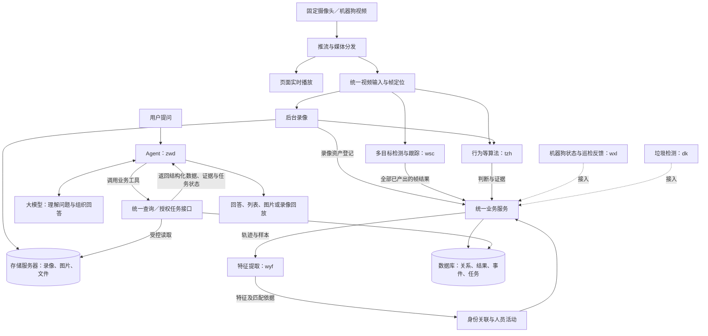

# HXJM v0.2 开发协调会议准备

日期：2026-10-29。会议目标：统一开发位置和业务流程，明确每个人下一步的交付及接入边界。本文只说明工作方向，具体实现由模块负责人决定，公共接口和数据含义共同协调。

## 一、代码和数据现在放在哪里

| 对比项 | 之前 | 当前状态与后续建议 |
|---|---|---|
| 项目代码 | 多人分别在 `/home/guest/hxjm-*` 等目录开发，代码、配置和成果分散，集成时需要核对各自版本 | 主项目已在 `/data/nfs_storage/hxjm`。建议后续相关源码和个人工作区统一放到 `/data/nfs_storage` 下，不再继续在 `/home` 新建项目副本 |
| 多人协作 | 部分开发共用guest账户，部分目录通过Git worktree维护，开发目录与运行相互关联 | 每人使用独立服务器账号和独立克隆的仓库；不再使用worktree。每个功能从稳定main创建短期分支，审查与验证后合并，由指定人员部署 |
| 录像、图片、模型和待保存结果 | 曾分散在项目目录及各自配置的路径，容易与源码、测试文件混在一起 | 已统一到 `/data/nfs_storage/hxjm_datas`，分别保存录像、图片、上传素材、模型和待投递成果；文件通过统一资产关系使用 |
| 实际运行 | 启动方式和路径随个人目录变化，可能重复启动相同服务 | 主项目已有统一启动入口；计算环境继续使用各计算服务器本机环境，构建副本、日志、进程和临时状态按主机隔离，不放进共享源码目录互相覆盖 |

**需要落实：** 由管理员准备各自账号和共享存储目录权限，每人核对已有代码、未交付改动、输入输出路径和启动入口后再迁移。`/data/nfs_storage/hxjm`作为主分支集成与稳定部署的源码入口，个人功能在自己的仓库开发，不在稳定目录切分支。源码迁移不要求把计算环境和运行状态搬到存储端。

## 二、整个业务如何流转

本地基础主链已经贯通，后续开发沿用这条链路完善各模块。设备接入所需数据库也已建立；新增设备接口、实际设备和Agent完整联合流程仍需各负责人接入、验收。

图中虚线表示待接入；大模型通过Agent的业务工具取得数据，不直接读取数据库或猜测文件路径。用户可以直接问人员、轨迹、事件、设备或任务，**不需要先生成一份报告**。录像和结果保存、非实时分析不应拖住实时播放。

关键数据只记住四类：

- **来源与时间：** 哪个摄像头、哪次输入、哪一帧、对应哪段录像，保证后续结果能找回原画面。
- **人员链路：** 检测框与轨迹 → 样本 → 特征 → 身份与活动；跨摄像头使用统一身份关系，不把每路算法自己的编号当成同一个人。
- **算法事实：** 类型、发生时间、实际判断、可用证据及处理范围。打架、跌倒保存疑似、确认、排除、证据不足等实际输出，近期不保存骨骼等中间数据。
- **设备链路：** 设备、状态、本次巡检请求、执行反馈及文件成果。状态上报不等于巡检完成，巡检结果须明确属于哪次任务。

数据库负责结构化数据与关系，存储服务器负责文件。详细表字段和输入输出继续以现有数据库、接口文档为准，本次会议不重新设计一套存储。

## 三、各模块具体交接什么数据

### 先统一存储与调用方式

**JSON不是与数据库二选一。** 模块通过HTTP提交JSON，公共业务服务把需要查询的字段和关系保存到PostgreSQL `postgres.public`；算法专有载荷以数据库JSONB保存。图片、录像和大型文件保存到 `/data/nfs_storage/hxjm_datas`，数据库通过资产ID记录位置、状态和用途。接入完成以业务服务的保存确认为准，不能只在个人目录留一个JSON文件。

| 内容 | 正式保存位置 | 下游怎样取得 |
|---|---|---|
| 帧、框、轨迹、样本关系、身份、活动、事件、任务 | 数据库对应关系表，核心查询字段独立落列 | 调公共业务接口，不直接依赖其他人的私有表 |
| 特征向量与算法差异字段 | 向量进入数据库 `feature` 的pgvector字段；行为／垃圾专有内容进入 `algorithm_result.payload_json`（JSONB） | 特征由检索与身份服务使用，算法成果通过结果／事件接口查询 |
| 录像、选中的样本图片、截图与大型文件 | NFS文件，数据库 `media_asset` 登记，必要时建立用途引用 | 先取得 `asset_id`，再由媒体接口返回读取方式，不扫描目录找文件 |
| 尚未取得保存确认的结果 | NFS的 `result-spool` 待投递区 | 由可靠投递链路重试；它不是Agent或其他模块的业务查询入口 |

下面的业务接口均以 `/api/v1/business` 为前缀。接口中的JSON字段与数据库列不一定同名，例如通用成果请求项使用 `payload`，业务服务落入 `payload_json`；完整字段以现有接口卡片及实际路由为准。后台写入继续使用服务身份，开发者Linux账号不代替接口权限。

### 1. wsc：让逐帧跟踪结果可靠交给后续模块

**重点问题：** 完善多路检测跟踪的持续性、框更新和编号稳定性，优先复现已有记录中的摄像头2结果更新稀少问题。实时视频不能因为等待算法、保存或特征处理而卡住。

| 环节 | 需要提供的数据 | 保存／交接方式 |
|---|---|---|
| 输入依据 | `source_id`、`stream_session_id`、公共 `frame_id`、原始 `frame_seq`、实际发生时间、原图宽高及可用视频时间 | 复用统一输入，公共服务维护 `input_frame`；不为算法抽帧重新编号，也不把算法处理完成时间当作画面时间 |
| 每帧全部目标 | 每个目标的帧内序号、类别、归一化xyxy框、实际置信度、真实观测／预测标记、局部跟踪号；实际处理过的零目标帧也要提交 | 通过 `POST /results/register` 提交 `detection.frame` JSON；服务保存 `analysis_frame` 和 `detection_observation`，不是把整批框只存成一个私有JSON文件 |
| 轨迹上下文 | `tracking_context_id`与局部跟踪号；重启或重置跟踪时更换上下文 | 公共服务建立稳定 `tracklet_id`并返回映射，保存在 `tracklet`；wsc保留映射交给选样／特征链路，不能用局部编号直接当身份ID |
| 给wyf的选样依据 | 对应轨迹的真实观测、原帧／裁剪可获取方式、实际时间及框；选中图片还需关联稳定轨迹与原帧 | 沿用现有采样适配链路，图片上传后通过 `POST /samples/register`登记为样本；保存 `media_asset`、`sample`及用途关系。采哪张由可替换策略决定，不要求每一帧另存图片 |
| 保存完成范围 | 本次任务和执行、成果标识、实际处理帧清单及缺口 | 由可靠投递组件保留未确认结果，取得accepted／duplicate确认后才视为保存成功；页面实时推送与历史保存分别负责 |

**与wyf的交接点：** wsc负责让原帧、真实框和稳定轨迹可对应，wyf负责选样／特征策略；复用现有采样适配器，不各自再造一套样本编号。下游能够通过 `POST /results/query`读历史框，通过 `POST /samples/query`按轨迹找已登记图片样本。

### 2. wyf：从明确样本提取特征，回到统一身份链路

**重点问题：** 接好历史轨迹、正式图库和用户查询三种入口，保证特征知道“从哪张图片、哪个模型空间、哪次执行产生”。选样、聚合或模型更换时，其他模块仍沿用相同样本和特征契约。

| 入口 | 从哪里读 | 拿什么去提取 |
|---|---|---|
| 历史轨迹 | 接收现有采样链路交接的 `tracklet_id`／`sample_id`，必要时调用 `POST /samples/query` | 已登记 `sample`中的 `asset_id`、原帧、框及时间；通过受控媒体接口读取图片。不能仅凭框坐标猜图片文件；也不反复扫描NFS目录 |
| 正式登记图库 | `GET /samples/pending`，指定目标特征空间 | 待提取的 `sample_id`、`asset_id`和 `identity_id`。**当前此接口仅支持enrollment，不是所有样本的统一待处理队列** |
| 用户以图查询 | `GET /queries/pending`读取待处理查询；候选人员通过 `POST /queries/candidates`提交，沿用用户选人状态 | 查询原图及明确选中的人员样本，保留 `query_id`、`sample_id`；多人图片不能默认选第一个人 |

提取后的交付分为三步：

1. **声明空间并保存向量。** 通过 `POST /feature-spaces/register`明确权重、预处理、维度、归一化和度量；通过 `POST /features/register`提交JSON数值数组及 `feature_id`、`feature_space_id`、`run_id`、样本／轨迹引用、聚合方式、贡献样本和期限。业务服务写入 `feature_space`、`feature`及 `feature_contribution`，向量正式存数据库，不用 `.npy`或自建JSON文件作为其他模块的公共入口。
2. **接回人员业务。** 历史轨迹特征保存确认后调用 `POST /identities/associate`，由身份服务维护轨迹归属、临时／正式身份关联和活动；用户图片查询沿用 `POST /search`得到命中。不要让Agent自行比较向量，也不由wsc根据局部跟踪号跨镜认人。
3. **确认本次处理完成。** 特征及需要的关联可靠保存后，再确认相应任务完成。保留原样本、特征空间和贡献关系；不能把无效图片或提取失败保存成零向量。

**交付结果：** 给定一条轨迹或一张登记／查询图片，可以追到样本、特征、身份或检索命中；zwd不需要了解向量内部实现即可查询人员活动。历史补处理如需新的任务发现入口，由wyf和公共后端共同协调，不假定现有pending接口已经支持。

### 3. tzh：取得公共输入，保存算法事实与事件

**重点问题：** 先列清现有及近期打架、跌倒算法各自需要什么输入、是否实时、部署在哪台服务器、输出什么结果。内部模型可不同，外部输入与结果语义统一。

| 所需输入 | 取得方式 | 要保留的依据 |
|---|---|---|
| 实时画面 | 在现有统一输入／算法适配组件中取得帧；跨服务器运行时先与公共接入方对齐帧传输和公共编号适配 | 来源、会话、公共帧和发生时间。只含框坐标的实时订阅不是像素输入；不自行编造同一帧的对应关系 |
| 历史录像片段 | `POST /assets/query`按摄像头和时间找到录像，再用 `POST /media/resolve`及受控媒体读取取得文件或区间 | `asset_id`、真实时间范围及录像定位；跨分段时不能只处理第一段却声称整个窗口已完成 |
| 已有框、轨迹或其他成果 | `POST /results/query`按来源、时间和结果类型读取；明确人员时还可使用轨迹／活动接口 | 原成果、轨迹或样本标识及处理覆盖；无目标、未分析和缺失数据分别表达 |

处理完成后的保存顺序：

- **先保存算法成果。** 在公共任务和执行下，通过 `POST /results/register`提交来源、输入引用、发生区间、成果类型、结构版本和类型化 `payload`。服务组织 `result_set`，将通用成果保存到 `algorithm_result`；算法专有字段进入JSONB，初筛、复核分别保存，不覆盖原成果。
- **再形成业务事件。** 打架、跌倒使用 `behavior.assessment/1`，载荷包含行为类型、实际判断、说明及可选分数／目标框；判断区分疑似、确认、排除、证据不足，近期不保存骨骼和内部张量。通过 `POST /events/register`引用已保存 `result_id`，维护 `business_event`当前判断、参与对象和证据；人员未知不影响保存。
- **文件单独登记。** 证据截图走图片上传，录像或大型文件完成后走资产登记，再由成果或事件建立引用。需要留下的证据必须可通过 `asset_id`读取，不能只在结论里写一个本机路径。结果可直接被查询，生成报告不是保存成功的条件。

**交付结果：** 至少一条真实“公共输入 → 算法处理 → 成果保存 → 事件／证据查询”样例。近期两类结果结构已登记，但新算法适配、补充业务校验和远端帧接入仍需实施；算法启停和部署地址走实例／配置管理，不散落到各调用方代码中。

### 4. zwd：让Agent通过工具取得事实，再组织回答

**重点问题：** 把用户的问题转换为明确业务条件，读取已保存事实，处理多轮选择、分页和图片／录像展示；不直接查库、扫描NFS，也不依赖预先生成的报告。

| 用户要问什么 | Agent使用的主要业务入口 | 取得并继续使用的数据 |
|---|---|---|
| 查登记人员、按姓名找人 | `POST /identities/query`；确定身份后使用 `POST /tracklets/query`、`POST /activities/query` | 身份、轨迹、活动和真实发生范围；重名让用户选，不能取第一项冒充唯一 |
| 用图片找人 | 上传素材、创建 `POST /queries`、读取 `GET /queries/{id}`、提交 `POST /queries/select`，按现有工具链查询命中 | `query_id`、候选、选中对象、命中及后续活动。后台由特征处理器负责，不把提取工作搬进Agent |
| 某摄像头某时段发生什么 | `POST /events/query`、`GET /events/{id}`；需要原始算法事实时调用 `POST /results/query` | 实际事件类别、判断、原成果、证据与缺口；不能把每条业务事件都称为异常 |
| 看已有报告或录像证据 | `POST /reports/search`、`POST /reports/query`及媒体解析／播放凭证接口 | 当前报告修订、正文／结构化内容、全部相关录像分段与偏移；无报告仍可回答已有事实 |
| 查机器狗状态或发起巡检 | 设备状态、任务及反馈契约就绪后接入相应工具 | 设备状态、任务ID、反馈和成果；新增设备接口尚待实现，控制工具须有明确授权，不能因聊天免登录就开放控制 |

模型负责理解问题、选择工具和组织回答，业务服务负责数据查询、关联与权限；业务侧返回结构化数据后，再交给模型形成回答，并向页面保留可点击的证据。Agent保留真实业务ID、时间条件、分页和本轮全部结果，接口错误或处理缺口不能被改写成“没有发生”。

**交付结果：** 以真实业务HTTP接口分别跑通姓名查询、图片选人、事件查询及录像回放；登记姓名、轨迹、报告等查询代码已具备，但应核对实际部署路由，不能把旧部署404当作空数据。新算法和设备工具按真实接口状态逐项开放。

### 5. wxl：先独立打通机器狗，再接统一视频、状态与任务

独立阶段先证明视频可读、设备状态可得、设备侧已有路线／任务可发起且可获得反馈。接主系统时：视频按普通摄像头链路接入；设备与通道建立明确映射；状态变化和周期采样保存到 `device_state_observation`，实时展示不受历史采样频率限制。

人工巡检复用 `business_task`／`task_attempt`；`device_task_binding`记录本次执行与设备任务的对应，`device_task_feedback`保存接收、进度、阶段产物及结束反馈。反馈文件保存到NFS并登记资产用途；巡检算法成果通过成果集明确绑定执行，不按摄像头和时间碰巧重合来猜归属。四张设备表已经建立，主系统设备接口仍待实现，wxl需与公共后端确认各自承接范围。

**交付结果：** 从一次巡检请求能查到设备、执行状态、反馈和全部成果。下发确认不等于完成；主系统首期调用设备已有路线／任务，不编辑路线。与dk确定设备能提供哪些图片或视频作为检测输入。

### 6. dk：先独立打通垃圾检测，再接设备素材和公共成果

独立阶段跑通“图片／视频输入 → 检测 → 结果展示与保存”，明确类别、框和实际提供的分数。之后与wxl对齐素材获取方式，接入主系统时使用真实摄像头、资产和任务引用。

单次垃圾分析使用 `garbage.detection/1`，通过公共成果接口提交 `has_target`、`targets`以及实际提供的场景说明／建议，最终进入 `algorithm_result.payload_json`；图片及证据文件进入NFS并登记 `media_asset`。若采用连续逐帧检测，复用逐帧框契约，不把同一观测在两条链路重复计数。

**交付结果：** zwd可以按来源、时间及结果类型查到检出／未检出及对应证据。处理失败不能保存为“未检出”；垃圾处理建议不自动变成设备动作。先完成独立样例，再联调机器狗素材，最后验收主系统保存与查询。

## 四、独立账号与功能分支协作

### 1. 账号、目录和主分支

- 每位成员使用自己的Linux账号及自己的Git身份／认证，不再多人共用guest作为开发账户。账号和共享存储权限由管理员准备，本次会议文档不执行账号创建。
- 每人独立克隆仓库，建议路径 `/data/nfs_storage/<账号>/hxjm`；不再创建或使用worktree。旧目录及未提交代码核对后再迁移，不直接删除或搬坏现有工作区。
- `main`维护可集成、可部署的稳定版本；`/data/nfs_storage/hxjm`由指定集成／部署人员维护。个人不能在这个目录切换自己的功能分支或直接改动正在使用的版本。
- 功能按需求创建短期分支，例如 `feat/wsc/tracking-stability`、`feat/wyf/feature-pipeline`；修复可用 `fix/<账号>/<问题>`。不是每个人长期维护一条自己的总分支。

### 2. 一项功能的交付流程

**同步main → 从main新建功能分支 → 在个人仓库开发与验证 → 推送并发起PR／MR → 审查、解决冲突和集成验证 → 合并main → 指定人员部署 → 删除已完成分支。**

功能开发期间及时同步main；公共接口、表字段或业务含义需要调整时先协调并更新v0.2规格。PR／MR说明本次解决的问题、输入输出变化、验证结果、依赖及迁移需求。不得把凭据、录像、模型权重和个人运行状态提交仓库。接口兼容和主链验证通过后再合并；合并代码与部署运行分开，不让每次个人推送都自动覆盖稳定服务。

## 五、公共服务复用与个人调试

目标是**每个人只启动自己正在改的部分，其余通过地址和配置复用**，减少重复拉流、重复录像、模型加载与数据库实例带来的内存／显存占用。共享物理资源不等于共享可任意修改的运行状态和测试数据。

| 资源或服务 | 正常开发如何复用 | 需要单独运行的情况 |
|---|---|---|
| PostgreSQL、MySQL、Redis | 复用公共基础实例及明确的访问权限；Redis按环境／账号隔离键前缀或逻辑库 | 迁移、破坏性测试和实验写入使用分配的测试库／隔离范围，不直接污染稳定业务数据 |
| 视频接入、直播与录像 | 优先使用公共视频服务及已登记录像，不因每个人打开页面就重复拉全部摄像头和录制 | 调试采集／录像模块时，仅启动必要来源和独立输出；不能覆盖公共录像和来源状态 |
| 检测推理、特征提取、大模型 | 没有改模型／服务代码时调用公共服务，复用已有模型加载 | wsc、wyf、tzh、zwd调试自己修改的模型服务时，仅启动必要私有实例，使用独立端口和实例身份；算力较重的试验协调运行时间 |
| 跟踪与业务任务状态 | 可以复用同一份已发布稳定结果；不同开发执行有各自上下文、任务和生产标识 | 跟踪器有状态，不把不同版本的局部编号或多人的执行状态混在一起；调试结果不覆盖稳定链路 |
| 模型文件和计算环境 | 权重可按版本只读复用；确认兼容后复用公共环境 | 需要不同依赖时使用个人环境，不在公共环境直接升级包；共享模型文件不等于模型在内存中只加载一次 |
| 前端、后端和业务文件 | 未修改服务的功能调用公共稳定入口；个人联调使用自己的端口、日志和缓存 | 修改前后端时单独启动对应模块；测试上传和产物使用个人命名空间，清理仅影响本人测试数据 |

### 启动脚本需要落实的规则

1. **明确选择启动哪些模块、复用哪些服务。** 使用已有配置或启动参数表达服务地址和模式，不要求每位开发者都启动全系统。启动前打印本次要启动和要复用的清单；不能只改端口却仍重复加载所有模型。
2. **服务身份与启停范围明确。** 公共服务由指定维护人启动，个人停止脚本只停止自己实际启动的实例，不按端口或模糊进程名杀公共服务，也不停止共享数据库。
3. **端口、状态和数据隔离。** 个人端口、日志、进程记录、缓存和写入配置独立；需要稳定数据时走只读业务查询。参与正式联调的写入范围另行明确，避免每个人都向同一稳定摄像头重复登记一套结果。
4. **复用不可用时明确提示。** 不能静默再拉起一套重型模型；需要私有实例时由开发者显式选择并协调资源。复用能够减少OOM风险，但单份模型、输入规模或并发仍超出容量时，需要相应模块处理。

**当前状态：** 已有启动脚本具备共享／本地视频模式及部分算法启停开关，可在此基础上调整。独立账号和独立仓库下的路径、模块选择、公共服务归属及隔离行为仍需逐项核对，不能宣称完整的新协作启动方案已经实现。本次更新只形成规则，不修改脚本或启停任何服务。

## 六、本次会议要确定的交付与协调项

| 协调项 | 需要形成的明确结论 |
|---|---|
| 账号与仓库 | 管理员／集成人员是谁、每人目录在哪、旧改动如何保留、新功能分支如何提交 |
| wsc ↔ wyf | 原帧与真实框的获取、稳定轨迹映射、样本登记、现有采样适配器由谁维护；先用一条轨迹验证到特征／身份 |
| tzh／dk ↔ 公共后端 | 每种算法输入、成果类型、事件与文件引用；已有接口可复用什么、哪些适配尚缺 |
| zwd ↔ 业务侧 | 工具对应的实际HTTP路由、条件与返回字段、页面展示和真实样例，不用模拟响应替代最终联调 |
| wxl ↔ dk及公共后端 | 先分别完成独立样例，再确定设备素材、人工巡检反馈和新增设备接口的交接人 |
| 资源与部署 | 公共视频、模型、数据库和大模型服务由谁维护、地址是什么、个人需要启动哪些模块；谁负责调整启动脚本与部署main |
| 下一次交付 | 每人明确当前卡点、下一次可演示的完整样例和预计时间；以“输入可取、结果可存、关系可追、下游可查”为完成标准 |

优先打通正常业务，再逐项优化精度和处理复杂极端情况。公共后端、页面适配、数据库迁移和部署由项目统筹明确承接人，不默认由某位算法负责人包办，也不要求项目负责人代做每个模块内部实现。

关联规格：[接口文档](接口文档.md)、[数据库说明文档](数据库说明文档.md)、[系统架构说明书](系统架构说明书.md)、[NFS主目录启动说明](NFS主目录启动说明.md)。本文件为会议材料，规格保持v0.2；协作操作见[协同开发流程](../COLLABORATION_WORKFLOW.md)。
