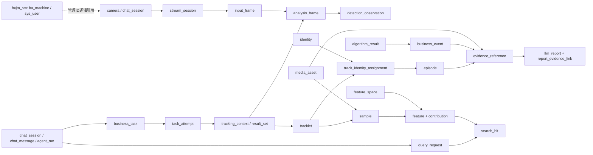
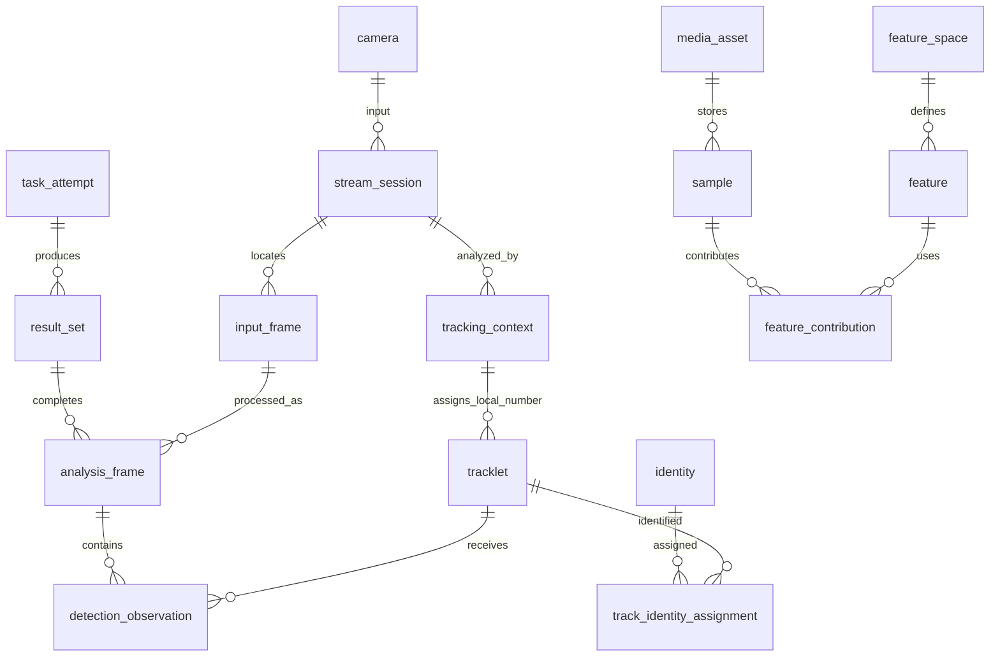
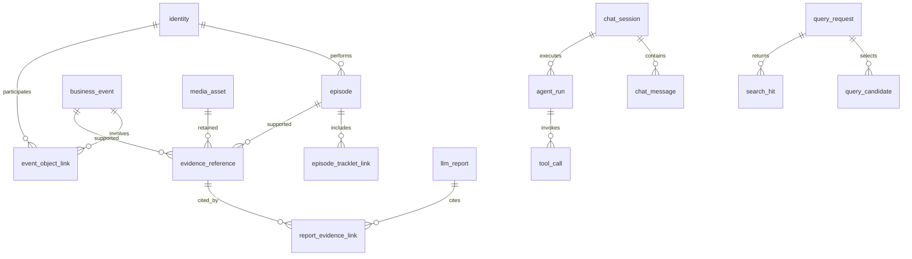
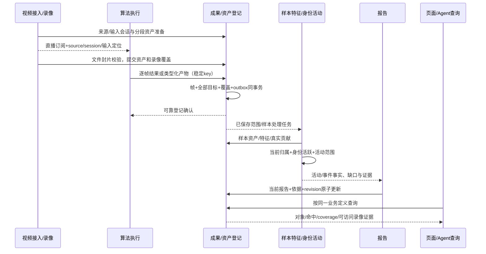
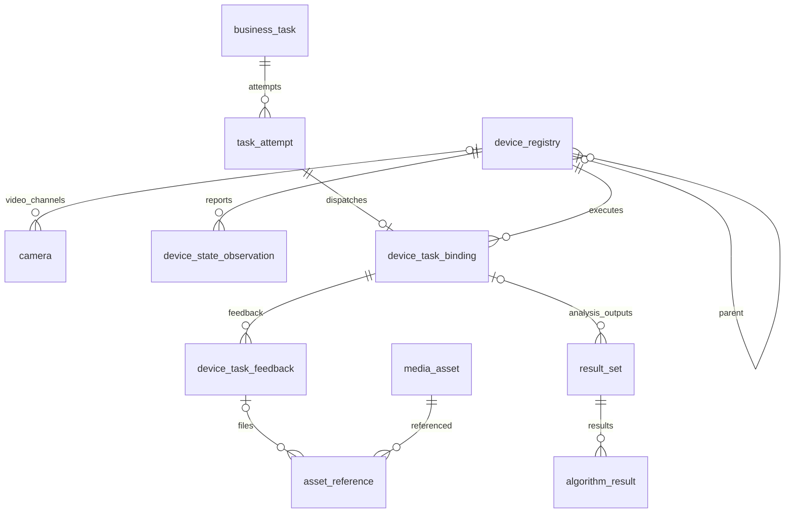

# HXJM 数据库说明文档

| 项目 | 内容 |
|---|---|
| 文档编号 | HXJM-DATA-001 |
| 版本 | v0.2 |
| 状态 | 开发设计基线 |
| 日期 | 2026-10-29 |
| 适用范围 | MySQL管理库、PostgreSQL监控业务库、关联知识应用、Redis及NFS资产 |
| 目标读者 | 产品、系统设计、后端、算法、模型、前端、数据与测试开发人员 |
| 关联文档 | [导航](README.md)、[需求](软件需求规格说明书.md)、[架构](系统架构说明书.md)、[接口](接口文档.md) |

| 版本 | 日期 | 修订内容 |
|---|---|---|
| v0.1 | 2026-10-22 | 建立数据说明。 |
| v0.2 | 2026-10-27 | 完善库表边界、全部字段、ID与唯一约束、DDL、事务、生命周期和兼容迁移；补充统一输入录像时钟映射与双向帧定位，继续使用v0.2。 |
| v0.2 | 2026-10-28 | 补充yh Agent恢复能力的数据边界；仅新增HTTP适配与进程内状态，不修改业务数据库。 |
| v0.2 | 2026-10-29 | 增补近期行为／垃圾结果载荷、四张设备表与三项衔接字段的目标DDL、事务和生命周期；仅设计，未迁移。 |
| v0.2 | 2026-10-29 | 随后完成005迁移、临时隔离库验证及当前业务库应用；新增设备接口和适配仍待实施，详见12.9。 |

**近期接入设计：** 第12章完整定义打架、跌倒、垃圾和设备巡检的增量；原建库章节中的六用途结构在该增量实施后扩展为七用途。

## 1. 数据系统与设计边界

本设计用于视频接入、录像和逐帧成果保存、样本特征、身份、活动事件、业务查询、Agent及报告。表结构是开发目标；新增表和字段按迁移顺序接入，已存在的主键和有效历史关联保持不变。模块通过业务接口维护权威数据。

| 数据系统 | 库与Schema | 权威数据 | 读写边界 |
|---|---|---|---|
| MySQL | `hxjm_sm`，MySQL库即命名空间 | 用户、组织、权限、设备与算法管理、人脸登记及管理辅助 | 管理服务维护；监控服务引用管理主体和设备映射 |
| PostgreSQL | `postgres.public` | 来源、资产、任务执行、观测轨迹、样本特征、身份、活动事件、查询会话及报告 | 业务服务维护；算法提交成果，页面和Agent经相同查询读取 |
| Redis | 逻辑库0及应用配置的独立命名空间 | 登录、校验、目录和运行缓存 | 不承担录像、算法历史或持久任务唯一保存职责 |
| NFS | `/data/nfs_storage` | 录像、图片、证据文件、大型类型化产物 | 资产管理解析相对存储键；浏览器不直接提供任意服务器路径 |
| 独立知识应用 | 按第7章应用数据库定义 | 知识文档、片段、知识任务及知识问答 | 独立权限和数据边界；通过业务引用与监控协作 |

管理数据源名称`MASTER`与监控数据源名称`SLAVE`只作为连接路由标识，两者是不同引擎的业务库。跨库关系使用明确的逻辑引用与映射，不建立跨引擎外键或跨库JOIN。

**首轮Agent直接调用的接入边界。** Agent不执行004_shared_queries.sql，不向业务接口提交owner_user_id、对话session_id或owner_actor_key；NULL归属和shared:business元数据由业务侧维护。进程内会话不写入chat_session表，不因该表用户字段非空而伪造用户。

本版历史查询、录像读取与播放、以图查人、人员登记及人员、样本、活动、事件、报告查询均直接访问，不要求用户登录、JWT或Cookie。页面与Agent使用同一共享业务范围：全部已登记视频来源及有效共享业务数据。新查询的 `query_request.owner_user_id` 为NULL，查询图的 `media_asset.meta.owner_actor_key` 为 `shared:business`；查询图最长七天，正式登记图按登记资料保存。不同对话仍由Agent的session_id区分，session_id不是数据权限。原有非空用户归属查询及其私有查询图片不自动改为共享。算法写入、输入会话、录像登记、特征写入和后台生成、修改及管理继续校验身份、操作和来源。

### 1.1 文档约定

- 表目录包含每张有效自有表；可选组件与历史原型单独定义适用范围。
- 表规格说明一行的业务含义、所有字段、约束、索引、读写与生命周期；DDL使用所属引擎方言。
- `PK`表示主键，`UK`表示业务唯一，`FK`表示同库物理外键；跨库引用明确标为逻辑关联。
- 已有表保留原列名和主键；新模型通过新增列、独立关系及兼容适配接入。旧含义不同的列不通过强制类型转换冒充新标识。
- 数据时区、统计与保留行为以需求规则为准；表内约束和字段落实这些规则。


### 1.2 第一阶段实施范围与兼容规则

第一阶段建立“来源→输入会话→录像资产→逐帧成果可靠登记→历史查询”公共链路。后续样本、特征、身份、活动、事件、报告及 Agent 通过这条链路的稳定标识和成果引用衔接，不重新定义摄像头、帧、录像或局部跟踪号。

| 处理 | 表 | 本阶段写入职责 |
|---|---|---|
| 增量调整 | camera | 保留原ID、camera_code；增加管理设备/通道映射、来源类别和启用状态 |
| 原样复用 | camera_stream | 保留现有ID、stream_name、task_type及删除行为；接入配置明确指定流目录 |
| 增量调整 | media_asset | 登记录像和有视频来源/会话/非空时间范围的大型算法文件，维护状态、文件校验、修订、定位和到期 |
| 增量调整 | tracklet | 局部号在tracking_context内映射稳定轨迹；区分真实观测与预测 |
| 新增 | stream_session | 统一视频输入及时间基准；算法状态重建不产生视频重连 |
| 新增 | capability_definition、capability_instance、result_type | 发布能力与类型契约，保存具体实现及启用状态 |
| 新增 | business_task、task_attempt | 业务输入、当前执行及实际实例配置快照 |
| 新增 | request_deduplication、outbox_event | 请求去重、保存事实与事务通知 |
| 新增 | tracking_context、result_set、result_selection | 跟踪状态范围、执行产物集合与历史查询采用范围 |
| 新增 | input_frame、analysis_frame、detection_observation、algorithm_result | 公共帧、含零目标的完整帧结果、全部检测框及其他类型成果 |
| 新增 | processing_coverage、asset_reference | 实际处理/保存范围、缺口和大型算法文件引用 |

本阶段共涉及21张表，其中17张新增；不调整其他表。增量脚本为 `python/base/postgresql/stage1/001_video_results.sql`，使用单个事务，先核对旧结构，再建表及约束；已执行或部分执行的结构明确拒绝再次套用。先在独立测试库分别验证路径版与UUID版旧stream_id，再安排业务库切换。

- `media_asset.stream_id`、`tracklet.stream_id` 保留原类型和NOT NULL。UUID版填写camera_stream.id；路径版填写该目录的stream_name，不将UUID文本伪装为旧流路径。新视频输入必须有明确camera_stream映射，多目录来源须显式选择。
- `media_asset.play_url` 允许NULL；准备中的资产没有播放入口。`state` 允许NULL且不设默认值，NULL归旧兼容写入；新接口显式写入状态，只查询自己管理的有效记录。旧接口的返回及播放方式不改动。
- `tracklet.expires_at` 在兼容期允许NULL；新成果必须按真实输入时刻填写期限。旧写入方完成适配前，不执行该列收紧NOT NULL。
- 旧资产类型segment/clip/snapshot保留；CHECK并集允许recording/crop/evidence_clip/algorithm_output/query_image/enrollment_image。本阶段新登记开放recording及上述有视频上下文的algorithm_output。
- `processing_coverage.coverage_key` 为1—128字符稳定窗口键，`closed` 默认false；`(source_id,stage,coverage_key)`唯一，revision必须大于0。成果登记使用 `set:{result_set_id}:{窗口摘要前32位}`；窗口摘要对规范化的 `start/end/result_type/schema_version` 计算 SHA256。不同成果类型或载荷版本分别维护覆盖，重传复用原键，不以换请求标识重复创建窗口。清单只允许增加，已闭合窗口不能重新打开；同一执行请求的全部输出类型在该范围可靠保存后，才将尚未采用的范围纳入默认历史查询。
- `asset_reference` 保留六类归属字段，本阶段只接受result_id，retain_until必填，仅建立media_asset及algorithm_result两条业务外键；其他用途在对应业务接入时开放。
- 逐帧结果、全部目标、轨迹映射、可靠保存覆盖及outbox同库事务提交。一帧失败不留下半帧；批次逐帧返回accepted、duplicate或rejected。重试子集使用新request_id，复用成果ID及原完整帧清单。
- 持续输入只推进会话、当前任务/执行、成果集与跟踪上下文的目录期限；旧帧、检测结果和录像的原到期日不变。没有新成果的重复请求不刷新期限。

录像保存目录为 `/data/nfs_storage/hxjm_datas/recordings`；待发送区为 `/data/nfs_storage/hxjm_datas/result-spool`。资产服务的受控文件根为 `/data/nfs_storage/hxjm_datas`，storage_key按此根保存相对路径。待发送区不使用本机应急目录。文件完成并通过大小/SHA256校验后，数据库才确认available；文件和数据库不共享原子提交，文件写入完成与数据库可靠确认是两个明确阶段。

## 2. 公共数据规约

### 2.1 命名、类型与空值

- 保留表与列沿用既有名称；新增 PostgreSQL 表、列、约束和索引使用小写下划线。约束名使用 `pk_`、`uk_`、`fk_`、`ck_`，普通索引使用 `ix_`。主键、业务唯一键分别说明。
- 新增监控实体以 `uuid` 存储，不在字符串列中存放UUID；管理数据保留原整数、字符串及组合主键。跨库管理ID以对应整数值保存，不将其转换为摄像头UUID。
- 字典的“N/无默认”表示必填且调用方必须给值；“Y/NULL”表示允许缺省。空字符串不代替未知时间、外键或向量；空集合 `[]` 代表已明确为空，不代表尚未分析。
- 新增业务时间用 `timestamptz(6)`；持久层以UTC处理，对外使用含偏移的RFC3339，按来源时区解释展示日期。MySQL旧 `datetime`、PG旧无时区时间由兼容适配明确所属时区后转换，不按服务器本地时区猜测。
- 时间范围采用左闭右开 `[start_at,end_at)`；瞬时观测有单独发生时间。毫秒、像素、字节、相似度分别使用列名与字典标注单位。经纬度如被能力使用，载荷必须声明坐标系；检测框使用相对源画面的归一化 `xyxy`，坐标在[0,1]。
- 新增结构化类型使用 `jsonb`，大文件内容存NFS。公共来源、身份、时间、任务、到期日和唯一条件落列。JSON有类型、版本及字段定义；不把任意未定义JSON当作跨模块契约。
- 向量用pgvector的 `vector` 保存完整float32值；跨空间不直接比较。向量维度、有限值和L2范数由登记校验，维度同时有数据库检查。
- 新表正文中的 `created_at` 是首次登记时间；`updated_at` 由维护模块在变更事务中更新。`revision` 从1递增，更新携带预期值，`UPDATE ... WHERE revision=:expected` 影响0行返回冲突。发生时间、生成时间和到期时间不相互替代。
- `expires_at` 到期立即退出普通查询，即使物理文件尚未删除。允许永久保存的正式登记资料才使用NULL到期日；其他新增业务表均有明确期限。对已禁用、到期的记录，唯一键仍生效，不允许因过期重用历史ID。

### 2.2 标识、生成与作用域

| 标识 | 物理载体 | 生成方与时机 | 唯一、重试和兼容规则 |
|---|---|---|---|
| 管理用户/设备/算法ID | MySQL原主键整数 | 对应管理服务按原自增规则 | 保留原值；JS可能失真的大整数在接口传十进制字符串 |
| `source_id` | `camera.id uuid` | 来源管理首次登记通道 | 一个通道一个稳定ID；设备ID、通道号和流路径是映射，地址/名称变化不换ID |
| 旧流目录ID | `camera_stream.id uuid` | 来源管理登记目录项 | 与 `camera_id` 关联；`stream_name` 是可变路径，不作为新业务FK |
| `stream_session_id` | `stream_session.id uuid` | 视频接入开始一次连续输入时 | 算法重启不更换输入会话；输入重连或时间轴重置建立新会话 |
| `tracking_context_id` | `tracking_context.id uuid` | 跟踪执行创建/重置状态时 | 更换执行、计数器、尺寸或状态代次建立新上下文；同输入会话可有多个 |
| `local_track_id` | `tracklet.local_track_id bigint` | 跟踪算法 | 仅在tracking_context内唯一；与上下文组成UK映射稳定tracklet_id |
| `frame_id` | `input_frame.id uuid` | 接入/帧定位适配首次登记 | `(stream_session_id,frame_seq)`唯一；frame_seq是会话内输入序号，不是处理帧计数 |
| 新实体ID | 各新实体 `id uuid`；task用task_id、执行用run_id | 所属业务在首次受理时UUIDv4，应用生成并持久化；DB `gen_random_uuid()` 为等价后备 | 对外小写36字符带连字符；同一实体补交/重传复用原ID，不重新随机；重新执行新run_id |
| 旧任务执行ID | `ai_task_run.run_id varchar(64)` | 旧调度服务 | 不是新task_attempt的UUID列；用legacy_run_id显式映射 |
| 旧异常ID | `vad.id integer identity` | PG序列 | 不重编号；business_event.legacy_vad_id唯一映射 |
| 人脸ID/外部编号 | 原bigint主键及face_id字符串 | 原人脸业务 | 主键与外部编号分别保留；不推导为监控身份，不以姓名唯一 |
| 新展示编号 | `identity.display_no bigint`，序列分配 | 身份登记时 `nextval` | 全局单调分配但允许空洞；不连续计数，不通过MAX+1分配；不是主键 |
| 查询候选号 | `query_candidate.candidate_id varchar(32)` | 本次查询的候选检测 | 只在query_id内唯一；“1/2”必须带会话/查询上下文 |
| 请求标识 | `request_deduplication`组合键 | 调用方首次请求 | `(actor_key,operation,request_id)`唯一，同键同规范内容返回原结果，不同内容冲突 |
| 特征空间ID | `feature_space.id varchar(128)` | 特征实现发布时 | 按确定的处理定义计算，保存完整SHA256与序列化版本；旧96bit截断标识保留并核验完整摘要 |
| 可选知识应用ID | 第7章原bigint/字符串主键 | 原应用ASSIGN_ID/Snowflake等 | 独立命名空间，不与监控UUID或管理自增ID混用 |

UUID随机生成不表达顺序或权限。客户端提供ID必须校验格式、归属和请求主体；不因知道ID而获得数据访问权。全零UUID、空标识禁止作为缺省引用。

新请求摘要采用RFC 8785 JCS规范化后计算SHA256，校验对象使用已解析的业务标识、参数和不可变内容摘要；排除trace_id、签名、临时URL和传输字段。同一产物摘要也固定序列化版本。旧特征空间继续使用其原始定义文本版本，不用JCS重新计算历史空间ID。

### 2.3 来源映射与当前有效关系

`camera.management_device_id`逻辑引用MySQL `ba_machine.machine_id`；`camera.channel_code`表示设备内稳定通道。两者均非空时使用联合UK；无设备映射的独立来源可为空，不能以NULL绕过已有映射的重复登记。每条camera_stream必须关联一个camera；旧 `tracklet.stream_id`、`media_asset.stream_id`路径继续保留，新增FK引用source/session。旧路径有多义时不自动选取其一。

当前身份归属采用 `valid_to IS NULL` 的部分唯一索引；修改时锁定轨迹，关闭旧关系，再插入新关系。同一临时身份到登记身份的当前对应同样处理。到期清理先终止关系，再移除无引用记录；唯一条件不用 `now()` 等动态函数。历史关闭关系不参与当前唯一，但保留其原标识及有效区间。

报告以稳定主题、报告类型唯一；正文更新修订号，不因模型/提示版本变化建立第二份当前报告。局部编号、请求去重和业务主题各自有约束，不能只靠一次接口查重。

### 2.4 状态与JSON的公共含义

| 域 | 取值与含义 |
|---|---|
| 业务任务/执行 | `pending,running,waiting_input,succeeded,partial,failed,cancelled,expired`；partial为本次执行终态。报告已部分可读但任务还在进行时，任务保持running/waiting_input |
| 资产状态 | `preparing,available,unavailable,missing,delete_pending,deleted`；unavailable表示存储暂不可访问，不等于确认文件丢失 |
| 覆盖状态 | `complete,partial,gap,unavailable`；阶段必须同时说明input/recording/analysis/registration/features；单凭时间窗口不能解释为每个录像帧已分析 |
| 轨迹/活动/事件结束 | `normal,observation_interrupted,cancelled`；未结束的end_reason为空 |
| 观测 | `observed,predicted`；预测不刷新last_seen，不作为出现次数或登记样本依据 |
| 报告完整度 | `partial,complete`；报告失败属于生成任务状态，不以空正文冒充partial |
| 修订载荷 | `schema_version`独立于文档v0.2、报告revision及模型版本 |

JSON字段采用下列基础结构；专用字段在对应表补充：
- `scope_json` v1：`{"schema_version":"1","source_ids":[],"object_types":["person"],"start_at":"...","end_at":"...","timezone":"Asia/Shanghai"}`。来源数组为UUID，时间范围非倒置，服务校验各来源权限。
- `coverage_json` v1：`{"schema_version":"1","completed":[],"gaps":[{"stage":"features","start_at":"...","end_at":"...","reason_code":"PENDING_INPUT"}]}`。区间均含来源与阶段，已完成与缺口不能混用。
- `provenance_json` v1：输入对象类型/ID、产出run_id、源时间范围、原帧定位与处理版本；复制到证据的原ID作为溯源值，不因此延长原事实访问资格。
- `bbox_json` v1：`{"schema_version":"1","xyxy":[0.1,0.2,0.3,0.6],"source_width":1920,"source_height":1080}`，左上小于右下且各坐标在[0,1]，源尺寸用于解释与像素还原。
- 自由文本不含路径凭据、令牌和原始人脸Base64。日志与去重响应也遵守相同数据范围和到期规则。

## 3. 物理对象目录与关系

### 3.0 近期设备增量目录（005已建库，业务接口待实施）

| 库与Schema | 物理表 | 记录粒度 | 维护方 | 完整字段与DDL |
|---|---|---|---|---|
| postgres.public | device_registry | 实际设备／独立组件 | 设备接入 | 12.4.1、12.5 |
| postgres.public | device_state_observation | 保留的一次状态变化／采样 | 状态服务 | 12.4.2、12.5 |
| postgres.public | device_task_binding | 一次执行的设备映射 | 巡检服务 | 12.4.3、12.5 |
| postgres.public | device_task_feedback | 一条执行反馈 | 反馈服务 | 12.4.4、12.5 |

### 3.1 库表目录的阅读规则

第4章逐表目录覆盖MySQL管理、调度、人脸及历史原型；第5章覆盖PG保留表和管理路由业务；第6章列出新增主链表及兼容增列；第7章覆盖可选知识应用、文件与缓存。逐表目录按数据库列出物理名、粒度、关系与维护方；每个条目再定位到完整字段字典。同名历史快照按同一保留表解释，不建立第二套同名业务表。

| 主链数据域 | 库与表 | 一行粒度/主要关系 | 维护职责 |
|---|---|---|---|
| 来源/输入 | postgres.public.camera、camera_stream、stream_session、input_frame | 通道、流目录、一次输入、一个输入帧 | 来源与视频接入 |
| 录像/文件 | media_asset、asset_reference | 一个可独立引用资产、一条用途引用 | 资产管理 |
| 能力/成果 | capability_definition、result_type、result_set、result_selection、analysis_frame、detection_observation、algorithm_result、processing_coverage | 能力、类型、一套产物、采用范围、帧完成记录、一个目标、其他类型成果、一段覆盖 | 能力目录与成果登记 |
| 执行/可靠衔接 | business_task、task_attempt、request_deduplication、outbox_event | 业务任务、尝试、去重请求、事务事件 | 任务与各权威写入方 |
| 轨迹/身份 | tracking_context、tracklet、identity、identity_link、track_identity_assignment、legacy_identity_map | 跟踪状态、片段、主体、当前/历史关系、旧ID映射 | 跟踪适配与身份业务 |
| 样本/特征 | sample、feature_space、feature、feature_contribution | 样本、比较空间、向量、有效贡献 | 样本特征业务 |
| 活动/事件/证据 | episode、episode_tracklet_link、episode_media_link、business_event、evidence_reference | 活动、活动轨迹/媒体、事件、一份独立业务证据 | 活动事件业务 |
| 报告 | llm_report、report_evidence_link | 当前主题报告、一条当前依据 | 报告业务 |
| 检索 | query_request、query_candidate、search_hit | 请求、多人候选、一次命中 | 查询业务 |
| Agent | chat_session、chat_message、agent_run、tool_call、message_reference | 用户会话、消息、一次编排、工具调用、一条引用 | Agent交互服务 |
| 兼容业务 | reid_target、reid_target_vit、stranger_target、reid_match、vad、ai_task_run | 兼容图库/匹配/异常/旧执行记录 | 原业务适配层 |

`episode.id=activity_id`、`llm_report.id=report_id`、`camera.id=source_id`。对象名与旧物理名的映射固定，不为同一活动和报告再建一张同义主表。

#### PostgreSQL逐表目录

本表均属于`postgres.public`；MySQL逐表目录见4.1，独立知识应用逐表目录见7.2。可选/历史表在各自目录标注，不能据表数量推导部署实例必须全部启用。

| 物理表名 | 中文名称 | 记录粒度 | 主要关系 | 权威维护方 | 规格 |
|---|---|---|---|---|---|
| `ai_task_run` | 旧算法运行 | 一次旧任务运行 | camera_id逻辑映射管理设备；task_attempt兼容映射 | 旧调度适配 | 5.1、6.2 |
| `camera` | 视频来源 | 一个稳定输入通道 | MySQL ba_machine.machine_id逻辑引用 | 来源管理 | 5.2、6.2 |
| `camera_stream` | 流目录 | 来源的一条流目录项 | camera | 来源管理 | 5.3、6.2 |
| `episode` | 活动 | 一次人员等业务活动 | identity、轨迹和证据关联 | 活动业务 | 5.4、6.2 |
| `episode_media_link` | 活动媒体关联 | 一项活动的一条媒体关联 | episode、media_asset | 活动业务 | 5.5、6.2 |
| `episode_tracklet_link` | 活动轨迹关联 | 一项活动的一条轨迹关联 | episode、tracklet | 活动业务 | 5.6、6.2 |
| `llm_report` | 当前报告 | 一种主题/类型的当前报告 | episode/business_event/query_request、证据 | 报告业务 | 5.7、6.2 |
| `media_asset` | 数据资产 | 一个不可变文件资产目录 | source/session及用途引用 | 资产管理 | 5.8、6.2 |
| `reid_match` | 旧匹配记录 | 一次匹配尝试 | tracklet、统一身份/空间兼容引用 | 身份适配 | 5.9、6.2 |
| `reid_target` | 登记图库投影 | 一条旧登记样本记录 | legacy_identity_map、sample、feature | 图库适配 | 5.10、6.2 |
| `reid_target_vit` | 可选登记图库投影 | 一条另一模型图库样本 | legacy_identity_map、sample、feature | 图库适配 | 5.11、6.2 |
| `stranger_target` | 临时图库投影 | 一条旧临时身份代表记录 | identity、sample、feature | 身份适配 | 5.12、6.2 |
| `tracklet` | 连续轨迹 | 一个稳定跟踪片段/规范出现 | tracking_context、帧观测与身份关系 | 跟踪/身份业务 | 5.13、6.2 |
| `vad` | 旧异常记录 | 一次旧异常观测 | media_asset、business_event | 异常适配 | 5.14、6.2 |
| `alg_bk_management` | 兼容布控目录 | 一个算法服务布控配置 | 管理设备/算法逻辑资料 | 布控业务 | 5.17.1、6.2 |
| `alg_bk_machine_fr` | 兼容人脸布控 | 设备的一项人脸布控状态 | 管理设备逻辑引用 | 布控业务 | 5.17.2、6.2 |
| `face_recognition_events` | 兼容人脸观测 | 一次旧人脸识别观测 | 布控及人员逻辑引用 | 人脸业务 | 5.17.3、6.2 |
| `face_recognition_events_v1` | 兼容人脸观测V1 | 一次版本化人脸识别观测 | 布控及人员逻辑引用 | 人脸业务 | 5.17.4、6.2 |
| `stream_session` | 视频输入会话 | 一路来源的一次连续输入 | camera、camera_stream | 视频接入 | 6.3.1 |
| `capability_definition` | 处理能力目录 | 一个稳定能力契约 | 组合键/业务引用 | 能力目录 | 6.3.2 |
| `result_type` | 成果类型结构目录 | 一种结果类型的一个结构版本 | 组合键/业务引用 | 成果登记 | 6.3.3 |
| `business_task` | 业务任务 | 一次独立于浏览器的业务目标 | capability_definition | 任务管理 | 6.3.4 |
| `task_attempt` | 执行尝试 | 一次任务执行或重试 | business_task、ai_task_run | 执行器 | 6.3.5 |
| `request_deduplication` | 请求去重 | 一个主体的一种操作的一次逻辑请求 | business_task | 每个业务受理边界 | 6.3.6 |
| `outbox_event` | 事务衔接事件 | 一次已提交事实的下游通知 | 组合键/业务引用 | 事实维护方 | 6.3.7 |
| `tracking_context` | 跟踪状态上下文 | 一套不会重置的局部跟踪编号空间 | stream_session、task_attempt | 跟踪接入 | 6.3.8 |
| `result_set` | 执行成果集 | 一次执行针对一个来源或输入资产的成果集合 | task_attempt、camera、stream_session、capability_definition、media_asset | 成果登记 | 6.3.9 |
| `result_selection` | 当前采用的成果范围 | 一个来源/能力的一段非重叠业务时间范围 | result_set | 成果选择业务 | 6.3.10 |
| `input_frame` | 输入帧定位 | 实际需持久分析的一个输入帧 | stream_session、media_asset | 接入与成果适配 | 6.3.11 |
| `analysis_frame` | 已登记检测帧 | 某成果集对一个输入帧完成的整帧登记 | result_set、input_frame | 成果登记 | 6.3.12 |
| `detection_observation` | 逐帧目标观测 | 一个已登记帧里的一个目标 | analysis_frame、tracklet | 成果登记 | 6.3.13 |
| `algorithm_result` | 其他类型化成果 | 某次执行的一份有类型产物 | result_set、result_type、input_frame、tracklet、media_asset | 成果登记 | 6.3.14 |
| `processing_coverage` | 处理与保存覆盖 | 一个来源/执行/阶段的一段实际完成或缺口记录 | camera、stream_session、task_attempt、result_set | 输入/录像/分析/成果/特征各维护方 | 6.3.15 |
| `identity` | 统一身份 | 一个临时或正式登记的业务主体 | 组合键/业务引用 | 身份业务 | 6.3.16 |
| `identity_link` | 临时与登记对应 | 一条有有效区间的临时到登记身份关系 | identity、task_attempt | 身份业务 | 6.3.17 |
| `track_identity_assignment` | 轨迹归属 | 轨迹到统一身份的一次有效区间判断 | tracklet、identity、task_attempt | 身份业务 | 6.3.18 |
| `legacy_identity_map` | 旧身份映射 | 一个旧命名空间主键到统一身份的映射 | identity、sample、feature_space | 兼容适配 | 6.3.19 |
| `sample` | 样本 | 一份可计算/展示的图片或明确裁剪区域 | media_asset、input_frame、tracklet、identity、query_request | 样本业务 | 6.3.20 |
| `feature_space` | 特征空间 | 一套可比较向量的完整处理定义 | 组合键/业务引用 | 特征能力目录 | 6.3.21 |
| `feature` | 特征向量 | 一次已形成的单样本或聚合向量 | feature_space、sample、tracklet、identity、task_attempt | 特征登记 | 6.3.22 |
| `feature_contribution` | 聚合特征贡献 | 一个向量的一个叶样本贡献 | feature、sample | 特征登记 | 6.3.23 |
| `business_event` | 业务事件 | 一次按业务类型组织的事件 | camera、vad、task_attempt | 事件业务 | 6.3.24 |
| `evidence_reference` | 独立业务证据 | 一项活动或事件的一份可独立保留证据 | episode、business_event、camera、media_asset、tracklet、algorithm_result | 活动事件/资产业务 | 6.3.25 |
| `asset_reference` | 文件用途引用 | 一个资产被一项用途引用 | media_asset、sample、evidence_reference、query_request、identity、chat_message、algorithm_result | 资产管理 | 6.3.26 |
| `report_evidence_link` | 当前报告依据 | 一条当前报告到独立业务证据的引用 | llm_report、evidence_reference | 报告业务 | 6.3.27 |
| `query_request` | 业务检索请求 | 一次可在多轮交互继续的查询 | chat_session、media_asset、sample、identity、feature_space、business_task | 查询业务 | 6.3.28 |
| `query_candidate` | 图片候选目标 | 一张查询图里的一个可选择目标 | query_request、sample | 候选检测/查询业务 | 6.3.29 |
| `search_hit` | 检索命中 | 一次查询排序后的一个可复查命中 | query_request、identity、tracklet、sample、feature、feature_space | 查询业务 | 6.3.30 |
| `chat_session` | 用户问答会话 | 一个用户的一段连续对话上下文 | 组合键/业务引用 | Agent服务 | 6.3.31 |
| `chat_message` | 问答消息 | 会话中一条消息及当前结构化展示 | chat_session | Agent服务 | 6.3.32 |
| `agent_run` | Agent编排执行 | 一次用户输入触发的推理与工具编排 | chat_session、chat_message、business_task | Agent执行器 | 6.3.33 |
| `tool_call` | 工具调用 | 一次编排的一次业务工具调用 | agent_run、business_task、query_request | Agent工具适配 | 6.3.34 |
| `message_reference` | 消息业务引用 | 一条消息里的一个带有效期业务引用 | chat_message、identity、media_asset、episode、business_event、llm_report、query_request、business_task | Agent服务 | 6.3.35 |
| `event_object_link` | 事件参与对象 | 一个事件的一个角色对象 | business_event、identity/tracklet/sample | 事件业务 | 6.3.36 |
| `chat_count` | 对话累计计数 | 一个兼容单例计数 | id=1，无监控事实关联 | 旧问答计数适配 | 7.5 |

### 3.2 全局数据关系

下图实线表示PG库内关联及主数据流；虚线表示跨引擎逻辑引用。方向表达业务衔接，物理FK的精确方向以逐表约束为准，省略非主链辅助表。



### 3.3 各域ER图





跨域证据保存必要事实快照与独立资产引用；原轨迹/结果过期不级联删除仍有效证据。正式登记样本和查询临时素材使用不同purpose及期限。


## 4. MySQL管理库及兼容组件物理设计

### 4.1 库表目录及通用维护约定

本章主库为`hxjm_sm`，引擎为InnoDB。管理记录不作为逐帧观测、业务活动或报告正文的存储位置。`datetime`保留管理接口的本地时间语义；跨库业务交换明确使用带时区的时间。整数类型括号内数值是兼容显示宽度，不代表可存储位数；ID对外传输遵循第2章的大整数规则。主键列均不可为NULL，即使旧建表片段省略显式NOT NULL，也按主键约束解释。

| 数据库 | 表 | 中文名称／记录粒度 | 维护模块 | 主要关系 |
|---|---|---|---|---|
| `hxjm_sm` | `sys_dept` | 部门表；一个部门节点 | 组织权限 | 逻辑parent_id→sys_dept.dept_id |
| `hxjm_sm` | `sys_user` | 用户信息表；一个后台登录账号 | 用户权限 | 逻辑dept_id→sys_dept |
| `hxjm_sm` | `sys_post` | 岗位信息表；一个岗位定义 | 岗位权限 | post_code为岗位业务编码，服务维护编码重复检查 |
| `hxjm_sm` | `sys_role` | 角色信息表；一个角色定义 | 角色权限 | role_key为权限字符串 |
| `hxjm_sm` | `sys_menu` | 菜单权限表；一个菜单、目录或按钮权限节点 | 菜单权限 | 逻辑parent_id→sys_menu.menu_id |
| `hxjm_sm` | `sys_user_role` | 用户和角色关联表；一个用户与角色的授权关系 | 用户权限 | 逻辑user_id→sys_user、role_id→sys_role |
| `hxjm_sm` | `sys_role_menu` | 角色和菜单关联表；一个角色的菜单权限关系 | 角色权限 | 逻辑role_id→sys_role、menu_id→sys_menu |
| `hxjm_sm` | `sys_role_dept` | 角色和部门关联表；一个角色自定义数据范围内的部门 | 角色权限 | 逻辑role_id→sys_role、dept_id→sys_dept |
| `hxjm_sm` | `sys_user_post` | 用户与岗位关联表；一个用户的岗位关系 | 用户权限 | 逻辑user_id→sys_user、post_id→sys_post |
| `hxjm_sm` | `sys_oper_log` | 操作日志记录；一次管理操作日志 | 管理审计 | oper_id为日志行ID |
| `hxjm_sm` | `sys_dict_type` | 字典类型表；一个字典类别 | 系统字典 | UK(dict_type) |
| `hxjm_sm` | `sys_dict_data` | 字典数据表；一个字典类别内的枚举项 | 系统字典 | dict_type逻辑引用sys_dict_type.dict_type |
| `hxjm_sm` | `sys_config` | 参数配置表；一个管理配置项 | 系统参数 | config_key为配置检索键 |
| `hxjm_sm` | `sys_logininfor` | 系统访问记录；一次登录尝试 | 登录审计 | user_name、IP、地点为尝试时快照 |
| `hxjm_sm` | `sys_job` | 定时任务调度表；一个管理端定时调用配置 | 业务定时任务 | 复合PK(job_id,job_name,job_group)，原列顺序保持 |
| `hxjm_sm` | `sys_job_log` | 定时任务调度日志表；一次管理定时任务执行日志 | 业务定时任务 | job_name/job_group/invoke_target为执行时快照 |
| `hxjm_sm` | `sys_notice` | 通知公告表；一份后台通知或公告 | 后台公告 | notice_type=1通知、2公告 |
| `hxjm_sm` | `gen_table` | 代码生成业务表；一个代码生成模型 | 可选代码生成 | 逻辑table_name为目标表名 |
| `hxjm_sm` | `gen_table_column` | 代码生成业务表字段；一个生成模型的字段配置 | 可选代码生成 | 逻辑table_id→gen_table.table_id |
| `hxjm_sm` | `face_person` | 正式人员表；一条正式登记人员记录 | 人脸登记 | 逻辑dept_id→sys_dept.dept_id |
| `hxjm_sm` | `face_stranger` | 陌生人表；一条临时陌生人目录记录 | 临时人脸目录 | 逻辑bind_person_id→face_person.id |
| `hxjm_sm` | `ba_machine` | 设备目录；一个管理端视频设备 | 设备目录 | machine_id为管理整数ID |
| `hxjm_sm` | `ba_algtype` | 算法分类目录；一个算法类别 | 算法目录 | 算法类别是管理分类 |
| `hxjm_sm` | `ba_algmodel` | 算法模型目录；一个可管理的模型条目 | 算法目录 | 逻辑algtype_id→ba_algtype.algtype_id |
| `hxjm_sm` | `face_database` | 兼容人脸目录；旧接口使用的一条人脸样本目录记录 | 兼容人脸目录 | 保留id、face_id和UTF8序列化face_encoding调用格式 |
| `hxjm_sm`（启用持久化Quartz时） | `QRTZ_JOB_DETAILS` | 任务详细信息表 | Quartz调度器 | 调度名称限定同一调度空间 |
| `hxjm_sm`（启用持久化Quartz时） | `QRTZ_TRIGGERS` | 触发器详细信息表 | Quartz调度器 | 调度名称限定同一调度空间 |
| `hxjm_sm`（启用持久化Quartz时） | `QRTZ_SIMPLE_TRIGGERS` | 简单触发器的信息表 | Quartz调度器 | 触发器子表→QRTZ_TRIGGERS |
| `hxjm_sm`（启用持久化Quartz时） | `QRTZ_CRON_TRIGGERS` | Cron类型的触发器表 | Quartz调度器 | 触发器子表→QRTZ_TRIGGERS |
| `hxjm_sm`（启用持久化Quartz时） | `QRTZ_BLOB_TRIGGERS` | Blob类型的触发器表 | Quartz调度器 | 触发器子表→QRTZ_TRIGGERS |
| `hxjm_sm`（启用持久化Quartz时） | `QRTZ_CALENDARS` | 日历信息表 | Quartz调度器 | 调度名称限定同一调度空间 |
| `hxjm_sm`（启用持久化Quartz时） | `QRTZ_PAUSED_TRIGGER_GRPS` | 暂停的触发器表 | Quartz调度器 | 调度名称限定同一调度空间 |
| `hxjm_sm`（启用持久化Quartz时） | `QRTZ_FIRED_TRIGGERS` | 已触发的触发器表 | Quartz调度器 | 调度名称限定同一调度空间 |
| `hxjm_sm`（启用持久化Quartz时） | `QRTZ_SCHEDULER_STATE` | 调度器状态表 | Quartz调度器 | 调度名称限定同一调度空间 |
| `hxjm_sm`（启用持久化Quartz时） | `QRTZ_LOCKS` | 存储的悲观锁信息表 | Quartz调度器 | 调度名称限定同一调度空间 |
| `hxjm_sm`（启用持久化Quartz时） | `QRTZ_SIMPROP_TRIGGERS` | 基础属性序列化的触发器扩展表 | Quartz调度器 | 触发器子表→QRTZ_TRIGGERS |
| `hxjm_db`（独立历史原型） | `tbl_cameras` | 摄像头配置 | 历史原型应用 | floorid→tbl_floors.id（逻辑） |
| `hxjm_db`（独立历史原型） | `tbl_floors` | 楼层配置 | 历史原型应用 | 独立主键 |
| `hxjm_db`（独立历史原型） | `tbl_testTexts` | 测试文本 | 历史原型应用 | 独立主键 |
| `hxjm_db`（独立历史原型） | `tbl_videos` | 录像索引 | 历史原型应用 | cameraId→tbl_cameras.id（逻辑） |

表中注明“保留定义”的字段及约束按本章完整字典维护；第4.4节的四张兼容目录给出增量目标DDL。主键、索引和列的既有值不重新编号。所有未声明的关系不据此创建物理外键或复制跨库数据。监控服务使用的`alg_bk_management`、`alg_bk_machine_fr`和两版人脸识别事件表属于PostgreSQL业务范围，见第5章。

管理写入的原子范围包括主体及其关系更新。复合PK关系表使用INSERT并处理重复键作为已存在关系；不通过“先查不存在”保证并发唯一。更新已有主键行在同一事务内取得行锁并重新校验；新增AUTO_INCREMENT行由数据库分配ID，接口重试使用统一请求去重记录返回原ID。字典唯一键直接由数据库判冲突；其他管理编码的服务层重复检查不宣称具有数据库唯一约束。

### 4.2 组织、用户、权限、字典及管理记录（保留定义）

#### 4.2.1 `hxjm_sm.sys_dept` — 部门表

一行代表一个部门节点；写入由组织权限模块负责，读取由其业务接口提供。

| 字段 | 类型（含长度/精度） | 可空 | 默认/分配 | 含义、单位及取值 |
|---|---|---|---|---|
| `dept_id` | `bigint(20)` | 否 | `数据库分配` | 部门id；由MySQL AUTO_INCREMENT分配，兼容迁移可显式保留原ID |
| `parent_id` | `bigint(20)` | 是 | `0` | 父部门id |
| `ancestors` | `varchar(50)` | 是 | `''` | 祖级列表 |
| `dept_name` | `varchar(30)` | 是 | `''` | 部门名称 |
| `order_num` | `int(4)` | 是 | `0` | 显示顺序 |
| `leader` | `varchar(20)` | 是 | `null` | 负责人 |
| `phone` | `varchar(11)` | 是 | `null` | 联系电话 |
| `email` | `varchar(50)` | 是 | `null` | 邮箱 |
| `status` | `char(1)` | 是 | `'0'` | 部门状态（0正常 1停用） |
| `del_flag` | `char(1)` | 是 | `'0'` | 删除标志（0代表存在 2代表删除） |
| `create_by` | `varchar(64)` | 是 | `''` | 创建者 |
| `create_time` | `datetime` | 是 | `NULL（隐式）` | 创建时间；应用时区本地时间，跨库交换时附时区转换为UTC |
| `update_by` | `varchar(64)` | 是 | `''` | 更新者 |
| `update_time` | `datetime` | 是 | `NULL（隐式）` | 更新时间；应用时区本地时间，跨库交换时附时区转换为UTC |

约束与索引（字段顺序按定义）：
- `primary key (dept_id)`。
- 除主键外不附加业务唯一键；普通索引允许重复及多个NULL。
- 物理FK：无；逻辑关系由所属维护模块在同一业务操作中校验。
- CHECK：无；状态和值域按字段说明由所属业务校验。

关联与取值：逻辑parent_id→sys_dept.dept_id；0为根，ancestors为逗号分隔祖先ID序列；组织调整在同一事务更新后代路径。

读写及生命周期：部门目录按管理操作维护；del_flag=2退出正常目录；存在用户或子部门时先处理引用再删除。

#### 4.2.2 `hxjm_sm.sys_user` — 用户信息表

一行代表一个后台登录账号；写入由用户权限模块负责，读取由其业务接口提供。

| 字段 | 类型（含长度/精度） | 可空 | 默认/分配 | 含义、单位及取值 |
|---|---|---|---|---|
| `user_id` | `bigint(20)` | 否 | `数据库分配` | 用户ID；由MySQL AUTO_INCREMENT分配，兼容迁移可显式保留原ID |
| `dept_id` | `bigint(20)` | 是 | `null` | 部门ID |
| `user_name` | `varchar(30)` | 否 | `无，写入必填` | 用户账号 |
| `nick_name` | `varchar(30)` | 否 | `无，写入必填` | 用户昵称 |
| `user_type` | `varchar(2)` | 是 | `'00'` | 用户类型（00系统用户） |
| `email` | `varchar(50)` | 是 | `''` | 用户邮箱 |
| `phonenumber` | `varchar(11)` | 是 | `''` | 手机号码 |
| `sex` | `char(1)` | 是 | `'0'` | 用户性别（0男 1女 2未知） |
| `avatar` | `varchar(100)` | 是 | `''` | 头像地址 |
| `password` | `varchar(100)` | 是 | `''` | 密码散列；只写入密码散列，不记录明文 |
| `status` | `char(1)` | 是 | `'0'` | 帐号状态（0正常 1停用） |
| `del_flag` | `char(1)` | 是 | `'0'` | 删除标志（0代表存在 2代表删除） |
| `login_ip` | `varchar(128)` | 是 | `''` | 最后登录IP |
| `login_date` | `datetime` | 是 | `NULL（隐式）` | 最后登录时间 |
| `create_by` | `varchar(64)` | 是 | `''` | 创建者 |
| `create_time` | `datetime` | 是 | `NULL（隐式）` | 创建时间；应用时区本地时间，跨库交换时附时区转换为UTC |
| `update_by` | `varchar(64)` | 是 | `''` | 更新者 |
| `update_time` | `datetime` | 是 | `NULL（隐式）` | 更新时间；应用时区本地时间，跨库交换时附时区转换为UTC |
| `remark` | `varchar(500)` | 是 | `null` | 备注 |

约束与索引（字段顺序按定义）：
- `primary key (user_id)`。
- 除主键外不附加业务唯一键；普通索引允许重复及多个NULL。
- 物理FK：无；逻辑关系由所属维护模块在同一业务操作中校验。
- CHECK：无；状态和值域按字段说明由所属业务校验。

关联与取值：逻辑dept_id→sys_dept；角色与岗位分别通过sys_user_role、sys_user_post关联。user_name作为登录名进行服务层判重，物理结构保留既有PK；姓名、昵称、手机号不作为自然人唯一键。

读写及生命周期：用户、角色、岗位变更在同一管理事务内完成；del_flag=2或status=1立即退出可登录范围。用户禁用不删除其监控历史关联；密码只保存密码散列。

#### 4.2.3 `hxjm_sm.sys_post` — 岗位信息表

一行代表一个岗位定义；写入由岗位权限模块负责，读取由其业务接口提供。

| 字段 | 类型（含长度/精度） | 可空 | 默认/分配 | 含义、单位及取值 |
|---|---|---|---|---|
| `post_id` | `bigint(20)` | 否 | `数据库分配` | 岗位ID；由MySQL AUTO_INCREMENT分配，兼容迁移可显式保留原ID |
| `post_code` | `varchar(64)` | 否 | `无，写入必填` | 岗位编码 |
| `post_name` | `varchar(50)` | 否 | `无，写入必填` | 岗位名称 |
| `post_sort` | `int(4)` | 否 | `无，写入必填` | 显示顺序 |
| `status` | `char(1)` | 否 | `无，写入必填` | 状态（0正常 1停用） |
| `create_by` | `varchar(64)` | 是 | `''` | 创建者 |
| `create_time` | `datetime` | 是 | `NULL（隐式）` | 创建时间；应用时区本地时间，跨库交换时附时区转换为UTC |
| `update_by` | `varchar(64)` | 是 | `''` | 更新者 |
| `update_time` | `datetime` | 是 | `NULL（隐式）` | 更新时间；应用时区本地时间，跨库交换时附时区转换为UTC |
| `remark` | `varchar(500)` | 是 | `null` | 备注 |

约束与索引（字段顺序按定义）：
- `primary key (post_id)`。
- 除主键外不附加业务唯一键；普通索引允许重复及多个NULL。
- 物理FK：无；逻辑关系由所属维护模块在同一业务操作中校验。
- CHECK：无；状态和值域按字段说明由所属业务校验。

关联与取值：post_code为岗位业务编码，服务维护编码重复检查；用户通过sys_user_post关联。

读写及生命周期：岗位持续保存至管理删除；有绑定关系时先解绑，禁止以删除岗位级联删除用户。

#### 4.2.4 `hxjm_sm.sys_role` — 角色信息表

一行代表一个角色定义；写入由角色权限模块负责，读取由其业务接口提供。

| 字段 | 类型（含长度/精度） | 可空 | 默认/分配 | 含义、单位及取值 |
|---|---|---|---|---|
| `role_id` | `bigint(20)` | 否 | `数据库分配` | 角色ID；由MySQL AUTO_INCREMENT分配，兼容迁移可显式保留原ID |
| `role_name` | `varchar(30)` | 否 | `无，写入必填` | 角色名称 |
| `role_key` | `varchar(100)` | 否 | `无，写入必填` | 角色权限字符串 |
| `role_sort` | `int(4)` | 否 | `无，写入必填` | 显示顺序 |
| `data_scope` | `char(1)` | 是 | `'1'` | 数据范围（1：全部数据权限 2：自定数据权限 3：本部门数据权限 4：本部门及以下数据权限） |
| `menu_check_strictly` | `tinyint(1)` | 是 | `1` | 菜单树选择项是否关联显示 |
| `dept_check_strictly` | `tinyint(1)` | 是 | `1` | 部门树选择项是否关联显示 |
| `status` | `char(1)` | 否 | `无，写入必填` | 角色状态（0正常 1停用） |
| `del_flag` | `char(1)` | 是 | `'0'` | 删除标志（0代表存在 2代表删除） |
| `create_by` | `varchar(64)` | 是 | `''` | 创建者 |
| `create_time` | `datetime` | 是 | `NULL（隐式）` | 创建时间；应用时区本地时间，跨库交换时附时区转换为UTC |
| `update_by` | `varchar(64)` | 是 | `''` | 更新者 |
| `update_time` | `datetime` | 是 | `NULL（隐式）` | 更新时间；应用时区本地时间，跨库交换时附时区转换为UTC |
| `remark` | `varchar(500)` | 是 | `null` | 备注 |

约束与索引（字段顺序按定义）：
- `primary key (role_id)`。
- 除主键外不附加业务唯一键；普通索引允许重复及多个NULL。
- 物理FK：无；逻辑关系由所属维护模块在同一业务操作中校验。
- CHECK：无；状态和值域按字段说明由所属业务校验。

关联与取值：role_key为权限字符串；data_scope还允许5=仅本人数据权限，按权限服务枚举解释。菜单/部门/用户通过关系表关联。

读写及生命周期：角色与其关系更新在同一事务；status=1停用、del_flag=2删除。停用阻断授权，关系清理由权限服务维护。

#### 4.2.5 `hxjm_sm.sys_menu` — 菜单权限表

一行代表一个菜单、目录或按钮权限节点；写入由菜单权限模块负责，读取由其业务接口提供。

| 字段 | 类型（含长度/精度） | 可空 | 默认/分配 | 含义、单位及取值 |
|---|---|---|---|---|
| `menu_id` | `bigint(20)` | 否 | `数据库分配` | 菜单ID；由MySQL AUTO_INCREMENT分配，兼容迁移可显式保留原ID |
| `menu_name` | `varchar(50)` | 否 | `无，写入必填` | 菜单名称 |
| `parent_id` | `bigint(20)` | 是 | `0` | 父菜单ID |
| `order_num` | `int(4)` | 是 | `0` | 显示顺序 |
| `path` | `varchar(200)` | 是 | `''` | 路由地址 |
| `component` | `varchar(255)` | 是 | `null` | 组件路径 |
| `query` | `varchar(255)` | 是 | `null` | 路由参数 |
| `route_name` | `varchar(50)` | 是 | `''` | 路由名称 |
| `is_frame` | `int(1)` | 是 | `1` | 是否为外链（0是 1否） |
| `is_cache` | `int(1)` | 是 | `0` | 是否缓存（0缓存 1不缓存） |
| `menu_type` | `char(1)` | 是 | `''` | 菜单类型（M目录 C菜单 F按钮） |
| `visible` | `char(1)` | 是 | `0` | 菜单状态（0显示 1隐藏） |
| `status` | `char(1)` | 是 | `0` | 菜单状态（0正常 1停用） |
| `perms` | `varchar(100)` | 是 | `null` | 权限标识 |
| `icon` | `varchar(100)` | 是 | `'#'` | 菜单图标 |
| `create_by` | `varchar(64)` | 是 | `''` | 创建者 |
| `create_time` | `datetime` | 是 | `NULL（隐式）` | 创建时间；应用时区本地时间，跨库交换时附时区转换为UTC |
| `update_by` | `varchar(64)` | 是 | `''` | 更新者 |
| `update_time` | `datetime` | 是 | `NULL（隐式）` | 更新时间；应用时区本地时间，跨库交换时附时区转换为UTC |
| `remark` | `varchar(500)` | 是 | `''` | 备注 |

约束与索引（字段顺序按定义）：
- `primary key (menu_id)`。
- 除主键外不附加业务唯一键；普通索引允许重复及多个NULL。
- 物理FK：无；逻辑关系由所属维护模块在同一业务操作中校验。
- CHECK：无；状态和值域按字段说明由所属业务校验。

关联与取值：逻辑parent_id→sys_menu.menu_id；0为根。perms为操作权限标识，非主键；route_name为前端路由名。

读写及生命周期：目录持久维护；删除前处理子节点和sys_role_menu关系；status=1停用、visible=1仅隐藏展示，隐藏不代替权限校验。

#### 4.2.6 `hxjm_sm.sys_user_role` — 用户和角色关联表

一行代表一个用户与角色的授权关系；写入由用户权限模块负责，读取由其业务接口提供。

| 字段 | 类型（含长度/精度） | 可空 | 默认/分配 | 含义、单位及取值 |
|---|---|---|---|---|
| `user_id` | `bigint(20)` | 否 | `无，写入必填` | 用户ID |
| `role_id` | `bigint(20)` | 否 | `无，写入必填` | 角色ID |

约束与索引（字段顺序按定义）：
- `primary key(user_id, role_id)`。
- 除主键外不附加业务唯一键；普通索引允许重复及多个NULL。
- 物理FK：无；逻辑关系由所属维护模块在同一业务操作中校验。
- CHECK：无；状态和值域按字段说明由所属业务校验。

关联与取值：逻辑user_id→sys_user、role_id→sys_role；复合PK阻止同一授权重复。

读写及生命周期：与用户或角色授权变更同事务增删；删除关系不删除两侧实体。

#### 4.2.7 `hxjm_sm.sys_role_menu` — 角色和菜单关联表

一行代表一个角色的菜单权限关系；写入由角色权限模块负责，读取由其业务接口提供。

| 字段 | 类型（含长度/精度） | 可空 | 默认/分配 | 含义、单位及取值 |
|---|---|---|---|---|
| `role_id` | `bigint(20)` | 否 | `无，写入必填` | 角色ID |
| `menu_id` | `bigint(20)` | 否 | `无，写入必填` | 菜单ID |

约束与索引（字段顺序按定义）：
- `primary key(role_id, menu_id)`。
- 除主键外不附加业务唯一键；普通索引允许重复及多个NULL。
- 物理FK：无；逻辑关系由所属维护模块在同一业务操作中校验。
- CHECK：无；状态和值域按字段说明由所属业务校验。

关联与取值：逻辑role_id→sys_role、menu_id→sys_menu；复合PK阻止重复授权。

读写及生命周期：与角色授权同事务增删；菜单/角色删除前由权限服务显式清理。

#### 4.2.8 `hxjm_sm.sys_role_dept` — 角色和部门关联表

一行代表一个角色自定义数据范围内的部门；写入由角色权限模块负责，读取由其业务接口提供。

| 字段 | 类型（含长度/精度） | 可空 | 默认/分配 | 含义、单位及取值 |
|---|---|---|---|---|
| `role_id` | `bigint(20)` | 否 | `无，写入必填` | 角色ID |
| `dept_id` | `bigint(20)` | 否 | `无，写入必填` | 部门ID |

约束与索引（字段顺序按定义）：
- `primary key(role_id, dept_id)`。
- 除主键外不附加业务唯一键；普通索引允许重复及多个NULL。
- 物理FK：无；逻辑关系由所属维护模块在同一业务操作中校验。
- CHECK：无；状态和值域按字段说明由所属业务校验。

关联与取值：逻辑role_id→sys_role、dept_id→sys_dept；复合PK阻止重复范围。

读写及生命周期：data_scope=2时参与权限计算；范围更新在同一事务替换关系。

#### 4.2.9 `hxjm_sm.sys_user_post` — 用户与岗位关联表

一行代表一个用户的岗位关系；写入由用户权限模块负责，读取由其业务接口提供。

| 字段 | 类型（含长度/精度） | 可空 | 默认/分配 | 含义、单位及取值 |
|---|---|---|---|---|
| `user_id` | `bigint(20)` | 否 | `无，写入必填` | 用户ID |
| `post_id` | `bigint(20)` | 否 | `无，写入必填` | 岗位ID |

约束与索引（字段顺序按定义）：
- `primary key (user_id, post_id)`。
- 除主键外不附加业务唯一键；普通索引允许重复及多个NULL。
- 物理FK：无；逻辑关系由所属维护模块在同一业务操作中校验。
- CHECK：无；状态和值域按字段说明由所属业务校验。

关联与取值：逻辑user_id→sys_user、post_id→sys_post；复合PK阻止重复岗位。

读写及生命周期：用户岗位修改时同事务更新；删除关系不删除用户或岗位。

#### 4.2.10 `hxjm_sm.sys_oper_log` — 操作日志记录

一行代表一次管理操作日志；写入由管理审计模块负责，读取由其业务接口提供。

| 字段 | 类型（含长度/精度） | 可空 | 默认/分配 | 含义、单位及取值 |
|---|---|---|---|---|
| `oper_id` | `bigint(20)` | 否 | `数据库分配` | 日志主键；由MySQL AUTO_INCREMENT分配，兼容迁移可显式保留原ID |
| `title` | `varchar(50)` | 是 | `''` | 模块标题 |
| `business_type` | `int(2)` | 是 | `0` | 业务类型（0其它 1新增 2修改 3删除） |
| `method` | `varchar(200)` | 是 | `''` | 方法名称 |
| `request_method` | `varchar(10)` | 是 | `''` | 请求方式 |
| `operator_type` | `int(1)` | 是 | `0` | 操作类别（0其它 1后台用户 2手机端用户） |
| `oper_name` | `varchar(50)` | 是 | `''` | 操作人员 |
| `dept_name` | `varchar(50)` | 是 | `''` | 部门名称 |
| `oper_url` | `varchar(255)` | 是 | `''` | 请求URL |
| `oper_ip` | `varchar(128)` | 是 | `''` | 主机地址 |
| `oper_location` | `varchar(255)` | 是 | `''` | 操作地点 |
| `oper_param` | `varchar(2000)` | 是 | `''` | 请求参数 |
| `json_result` | `varchar(2000)` | 是 | `''` | 返回参数 |
| `status` | `int(1)` | 是 | `0` | 操作状态（0正常 1异常） |
| `error_msg` | `varchar(2000)` | 是 | `''` | 错误消息 |
| `oper_time` | `datetime` | 是 | `NULL（隐式）` | 操作时间；应用时区本地时间，跨库交换时附时区转换为UTC |
| `cost_time` | `bigint(20)` | 是 | `0` | 消耗时间 |

约束与索引（字段顺序按定义）：
- `primary key (oper_id)`。
- `key idx_sys_oper_log_bt (business_type)`。
- `key idx_sys_oper_log_s (status)`。
- `key idx_sys_oper_log_ot (oper_time)`。
- 除主键外不附加业务唯一键；普通索引允许重复及多个NULL。
- 物理FK：无；逻辑关系由所属维护模块在同一业务操作中校验。
- CHECK：无；状态和值域按字段说明由所属业务校验。

关联与取值：oper_id为日志行ID；oper_name及dept_name是操作发生时快照，不作为强引用。cost_time单位毫秒；business_type完整取值由sys_oper_type字典维护。

读写及生命周期：操作审计追加写入，管理日志清理功能删除；不套用监控业务七天期限。请求和响应在入库前排除口令、令牌、敏感图片及不必要的个人信息。

#### 4.2.11 `hxjm_sm.sys_dict_type` — 字典类型表

一行代表一个字典类别；写入由系统字典模块负责，读取由其业务接口提供。

| 字段 | 类型（含长度/精度） | 可空 | 默认/分配 | 含义、单位及取值 |
|---|---|---|---|---|
| `dict_id` | `bigint(20)` | 否 | `数据库分配` | 字典主键；由MySQL AUTO_INCREMENT分配，兼容迁移可显式保留原ID |
| `dict_name` | `varchar(100)` | 是 | `''` | 字典名称 |
| `dict_type` | `varchar(100)` | 是 | `''` | 字典类型 |
| `status` | `char(1)` | 是 | `'0'` | 状态（0正常 1停用） |
| `create_by` | `varchar(64)` | 是 | `''` | 创建者 |
| `create_time` | `datetime` | 是 | `NULL（隐式）` | 创建时间；应用时区本地时间，跨库交换时附时区转换为UTC |
| `update_by` | `varchar(64)` | 是 | `''` | 更新者 |
| `update_time` | `datetime` | 是 | `NULL（隐式）` | 更新时间；应用时区本地时间，跨库交换时附时区转换为UTC |
| `remark` | `varchar(500)` | 是 | `null` | 备注 |

约束与索引（字段顺序按定义）：
- `primary key (dict_id)`。
- `unique (dict_type)`。
- 物理FK：无；逻辑关系由所属维护模块在同一业务操作中校验。
- CHECK：无；状态和值域按字段说明由所属业务校验。

关联与取值：UK(dict_type)；可空字段的NULL按MySQL唯一索引语义可多行，新建字典类型要求非空。dict_type逻辑关联sys_dict_data.dict_type。

读写及生命周期：字典持久维护；修改类型名和对应字典项在同事务内完成并使缓存失效。

#### 4.2.12 `hxjm_sm.sys_dict_data` — 字典数据表

一行代表一个字典类别内的枚举项；写入由系统字典模块负责，读取由其业务接口提供。

| 字段 | 类型（含长度/精度） | 可空 | 默认/分配 | 含义、单位及取值 |
|---|---|---|---|---|
| `dict_code` | `bigint(20)` | 否 | `数据库分配` | 字典编码；由MySQL AUTO_INCREMENT分配，兼容迁移可显式保留原ID |
| `dict_sort` | `int(4)` | 是 | `0` | 字典排序 |
| `dict_label` | `varchar(100)` | 是 | `''` | 字典标签 |
| `dict_value` | `varchar(100)` | 是 | `''` | 字典键值 |
| `dict_type` | `varchar(100)` | 是 | `''` | 字典类型 |
| `css_class` | `varchar(100)` | 是 | `null` | 样式属性（其他样式扩展） |
| `list_class` | `varchar(100)` | 是 | `null` | 表格回显样式 |
| `is_default` | `char(1)` | 是 | `'N'` | 是否默认（Y是 N否） |
| `status` | `char(1)` | 是 | `'0'` | 状态（0正常 1停用） |
| `create_by` | `varchar(64)` | 是 | `''` | 创建者 |
| `create_time` | `datetime` | 是 | `NULL（隐式）` | 创建时间；应用时区本地时间，跨库交换时附时区转换为UTC |
| `update_by` | `varchar(64)` | 是 | `''` | 更新者 |
| `update_time` | `datetime` | 是 | `NULL（隐式）` | 更新时间；应用时区本地时间，跨库交换时附时区转换为UTC |
| `remark` | `varchar(500)` | 是 | `null` | 备注 |

约束与索引（字段顺序按定义）：
- `primary key (dict_code)`。
- 除主键外不附加业务唯一键；普通索引允许重复及多个NULL。
- 物理FK：无；逻辑关系由所属维护模块在同一业务操作中校验。
- CHECK：无；状态和值域按字段说明由所属业务校验。

关联与取值：dict_type逻辑引用sys_dict_type.dict_type；dict_value为该类别的业务值。PK为dict_code，字典标签不承担唯一键职责。

读写及生命周期：字典持久维护；status=1退出正常选项；改动后失效字典缓存，旧业务值仍按其原含义解释。

#### 4.2.13 `hxjm_sm.sys_config` — 参数配置表

一行代表一个管理配置项；写入由系统参数模块负责，读取由其业务接口提供。

| 字段 | 类型（含长度/精度） | 可空 | 默认/分配 | 含义、单位及取值 |
|---|---|---|---|---|
| `config_id` | `int(5)` | 否 | `数据库分配` | 参数主键；由MySQL AUTO_INCREMENT分配，兼容迁移可显式保留原ID |
| `config_name` | `varchar(100)` | 是 | `''` | 参数名称 |
| `config_key` | `varchar(100)` | 是 | `''` | 参数键名 |
| `config_value` | `varchar(500)` | 是 | `''` | 参数键值 |
| `config_type` | `char(1)` | 是 | `'N'` | 系统内置（Y是 N否） |
| `create_by` | `varchar(64)` | 是 | `''` | 创建者 |
| `create_time` | `datetime` | 是 | `NULL（隐式）` | 创建时间；应用时区本地时间，跨库交换时附时区转换为UTC |
| `update_by` | `varchar(64)` | 是 | `''` | 更新者 |
| `update_time` | `datetime` | 是 | `NULL（隐式）` | 更新时间；应用时区本地时间，跨库交换时附时区转换为UTC |
| `remark` | `varchar(500)` | 是 | `null` | 备注 |

约束与索引（字段顺序按定义）：
- `primary key (config_id)`。
- 除主键外不附加业务唯一键；普通索引允许重复及多个NULL。
- 物理FK：无；逻辑关系由所属维护模块在同一业务操作中校验。
- CHECK：无；状态和值域按字段说明由所属业务校验。

关联与取值：config_key为配置检索键；config_id是物理主键；config_type=Y表示内置参数。

读写及生命周期：持续保存至明确维护；修改后失效缓存；此表不保存服务连接口令或替代运行配置。

#### 4.2.14 `hxjm_sm.sys_logininfor` — 系统访问记录

一行代表一次登录尝试；写入由登录审计模块负责，读取由其业务接口提供。

| 字段 | 类型（含长度/精度） | 可空 | 默认/分配 | 含义、单位及取值 |
|---|---|---|---|---|
| `info_id` | `bigint(20)` | 否 | `数据库分配` | 访问ID；由MySQL AUTO_INCREMENT分配，兼容迁移可显式保留原ID |
| `user_name` | `varchar(50)` | 是 | `''` | 用户账号 |
| `ipaddr` | `varchar(128)` | 是 | `''` | 登录IP地址 |
| `login_location` | `varchar(255)` | 是 | `''` | 登录地点 |
| `browser` | `varchar(50)` | 是 | `''` | 浏览器类型 |
| `os` | `varchar(50)` | 是 | `''` | 操作系统 |
| `status` | `char(1)` | 是 | `'0'` | 登录状态（0成功 1失败） |
| `msg` | `varchar(255)` | 是 | `''` | 提示消息 |
| `login_time` | `datetime` | 是 | `NULL（隐式）` | 访问时间；应用时区本地时间，跨库交换时附时区转换为UTC |

约束与索引（字段顺序按定义）：
- `primary key (info_id)`。
- `key idx_sys_logininfor_s (status)`。
- `key idx_sys_logininfor_lt (login_time)`。
- 除主键外不附加业务唯一键；普通索引允许重复及多个NULL。
- 物理FK：无；逻辑关系由所属维护模块在同一业务操作中校验。
- CHECK：无；状态和值域按字段说明由所属业务校验。

关联与取值：user_name、IP、地点为尝试时快照；失败记录不要求存在sys_user实体。

读写及生命周期：审计追加写入，后台日志清理功能维护；不随监控录像一起到期。

#### 4.2.15 `hxjm_sm.sys_job` — 定时任务调度表

一行代表一个管理端定时调用配置；写入由业务定时任务模块负责，读取由其业务接口提供。

| 字段 | 类型（含长度/精度） | 可空 | 默认/分配 | 含义、单位及取值 |
|---|---|---|---|---|
| `job_id` | `bigint(20)` | 否 | `数据库分配` | 任务ID；由MySQL AUTO_INCREMENT分配，兼容迁移可显式保留原ID |
| `job_name` | `varchar(64)` | 否 | `''` | 任务名称 |
| `job_group` | `varchar(64)` | 否 | `'DEFAULT'` | 任务组名 |
| `invoke_target` | `varchar(500)` | 否 | `无，写入必填` | 调用目标字符串 |
| `cron_expression` | `varchar(255)` | 是 | `''` | cron执行表达式 |
| `misfire_policy` | `varchar(20)` | 是 | `'3'` | 计划执行错误策略（1立即执行 2执行一次 3放弃执行） |
| `concurrent` | `char(1)` | 是 | `'1'` | 是否并发执行（0允许 1禁止） |
| `status` | `char(1)` | 是 | `'0'` | 状态（0正常 1暂停） |
| `create_by` | `varchar(64)` | 是 | `''` | 创建者 |
| `create_time` | `datetime` | 是 | `NULL（隐式）` | 创建时间；应用时区本地时间，跨库交换时附时区转换为UTC |
| `update_by` | `varchar(64)` | 是 | `''` | 更新者 |
| `update_time` | `datetime` | 是 | `NULL（隐式）` | 更新时间；应用时区本地时间，跨库交换时附时区转换为UTC |
| `remark` | `varchar(500)` | 是 | `''` | 备注信息 |

约束与索引（字段顺序按定义）：
- `primary key (job_id, job_name, job_group)`。
- 除主键外不附加业务唯一键；普通索引允许重复及多个NULL。
- 物理FK：无；逻辑关系由所属维护模块在同一业务操作中校验。
- CHECK：无；状态和值域按字段说明由所属业务校验。

关联与取值：复合PK(job_id,job_name,job_group)，原列顺序保持；job_id由AUTO_INCREMENT生成。不能将此配置行ID当作算法任务或某次执行ID。

读写及生命周期：任务持续维护；status=1暂停；cron、misfire和并发策略更新后同步调度器；清理作业使用业务到期条件，补运行不得延长到期日。

#### 4.2.16 `hxjm_sm.sys_job_log` — 定时任务调度日志表

一行代表一次管理定时任务执行日志；写入由业务定时任务模块负责，读取由其业务接口提供。

| 字段 | 类型（含长度/精度） | 可空 | 默认/分配 | 含义、单位及取值 |
|---|---|---|---|---|
| `job_log_id` | `bigint(20)` | 否 | `数据库分配` | 任务日志ID；由MySQL AUTO_INCREMENT分配，兼容迁移可显式保留原ID |
| `job_name` | `varchar(64)` | 否 | `无，写入必填` | 任务名称 |
| `job_group` | `varchar(64)` | 否 | `无，写入必填` | 任务组名 |
| `invoke_target` | `varchar(500)` | 否 | `无，写入必填` | 调用目标字符串 |
| `job_message` | `varchar(500)` | 是 | `NULL（隐式）` | 日志信息 |
| `status` | `char(1)` | 是 | `'0'` | 执行状态（0正常 1失败） |
| `exception_info` | `varchar(2000)` | 是 | `''` | 异常信息 |
| `create_time` | `datetime` | 是 | `NULL（隐式）` | 创建时间；应用时区本地时间，跨库交换时附时区转换为UTC |

约束与索引（字段顺序按定义）：
- `primary key (job_log_id)`。
- 除主键外不附加业务唯一键；普通索引允许重复及多个NULL。
- 物理FK：无；逻辑关系由所属维护模块在同一业务操作中校验。
- CHECK：无；状态和值域按字段说明由所属业务校验。

关联与取值：job_name/job_group/invoke_target为执行时快照；没有到sys_job的物理FK，删配置不破坏日志。

读写及生命周期：执行结束追加写入；管理任务日志清理功能维护，不据此认定监控数据写入成功。

#### 4.2.17 `hxjm_sm.sys_notice` — 通知公告表

一行代表一份后台通知或公告；写入由后台公告模块负责，读取由其业务接口提供。

| 字段 | 类型（含长度/精度） | 可空 | 默认/分配 | 含义、单位及取值 |
|---|---|---|---|---|
| `notice_id` | `int(4)` | 否 | `数据库分配` | 公告ID；由MySQL AUTO_INCREMENT分配，兼容迁移可显式保留原ID |
| `notice_title` | `varchar(50)` | 否 | `无，写入必填` | 公告标题 |
| `notice_type` | `char(1)` | 否 | `无，写入必填` | 公告类型（1通知 2公告） |
| `notice_content` | `longblob` | 是 | `null` | 公告内容 |
| `status` | `char(1)` | 是 | `'0'` | 公告状态（0正常 1关闭） |
| `create_by` | `varchar(64)` | 是 | `''` | 创建者 |
| `create_time` | `datetime` | 是 | `NULL（隐式）` | 创建时间；应用时区本地时间，跨库交换时附时区转换为UTC |
| `update_by` | `varchar(64)` | 是 | `''` | 更新者 |
| `update_time` | `datetime` | 是 | `NULL（隐式）` | 更新时间；应用时区本地时间，跨库交换时附时区转换为UTC |
| `remark` | `varchar(255)` | 是 | `null` | 备注 |

约束与索引（字段顺序按定义）：
- `primary key (notice_id)`。
- 除主键外不附加业务唯一键；普通索引允许重复及多个NULL。
- 物理FK：无；逻辑关系由所属维护模块在同一业务操作中校验。
- CHECK：无；状态和值域按字段说明由所属业务校验。

关联与取值：notice_type=1通知、2公告；notice_content保留longblob，通过既有接口编码读写。

读写及生命周期：持续维护，status=1关闭展示；不与监控事件和报告混用。

#### 4.2.18 `hxjm_sm.gen_table` — 代码生成业务表

一行代表一个代码生成模型；写入由可选代码生成模块负责，读取由其业务接口提供。

| 字段 | 类型（含长度/精度） | 可空 | 默认/分配 | 含义、单位及取值 |
|---|---|---|---|---|
| `table_id` | `bigint(20)` | 否 | `数据库分配` | 编号；由MySQL AUTO_INCREMENT分配，兼容迁移可显式保留原ID |
| `table_name` | `varchar(200)` | 是 | `''` | 表名称 |
| `table_comment` | `varchar(500)` | 是 | `''` | 表描述 |
| `sub_table_name` | `varchar(64)` | 是 | `null` | 关联子表的表名 |
| `sub_table_fk_name` | `varchar(64)` | 是 | `null` | 子表关联的外键名 |
| `class_name` | `varchar(100)` | 是 | `''` | 实体类名称 |
| `tpl_category` | `varchar(200)` | 是 | `'crud'` | 使用的模板（crud单表操作 tree树表操作） |
| `tpl_web_type` | `varchar(30)` | 是 | `''` | 前端模板类型（element-ui模版 element-plus模版） |
| `package_name` | `varchar(100)` | 是 | `NULL（隐式）` | 生成包路径 |
| `module_name` | `varchar(30)` | 是 | `NULL（隐式）` | 生成模块名 |
| `business_name` | `varchar(30)` | 是 | `NULL（隐式）` | 生成业务名 |
| `function_name` | `varchar(50)` | 是 | `NULL（隐式）` | 生成功能名 |
| `function_author` | `varchar(50)` | 是 | `NULL（隐式）` | 生成功能作者 |
| `gen_type` | `char(1)` | 是 | `'0'` | 生成代码方式（0zip压缩包 1自定义路径） |
| `gen_path` | `varchar(200)` | 是 | `'/'` | 生成路径（不填默认项目路径） |
| `options` | `varchar(1000)` | 是 | `NULL（隐式）` | 其它生成选项 |
| `create_by` | `varchar(64)` | 是 | `''` | 创建者 |
| `create_time` | `datetime` | 是 | `NULL（隐式）` | 创建时间；应用时区本地时间，跨库交换时附时区转换为UTC |
| `update_by` | `varchar(64)` | 是 | `''` | 更新者 |
| `update_time` | `datetime` | 是 | `NULL（隐式）` | 更新时间；应用时区本地时间，跨库交换时附时区转换为UTC |
| `remark` | `varchar(500)` | 是 | `null` | 备注 |

约束与索引（字段顺序按定义）：
- `primary key (table_id)`。
- 除主键外不附加业务唯一键；普通索引允许重复及多个NULL。
- 物理FK：无；逻辑关系由所属维护模块在同一业务操作中校验。
- CHECK：无；状态和值域按字段说明由所属业务校验。

关联与取值：逻辑table_name为目标表名；sub_table_name/sub_table_fk_name定义生成器子表关系，非实际数据库FK。options为生成器选项JSON文本，由生成器消费。

读写及生命周期：仅代码生成组件使用；删除元数据不执行目标业务表DROP，也不删除业务数据。

#### 4.2.19 `hxjm_sm.gen_table_column` — 代码生成业务表字段

一行代表一个生成模型的字段配置；写入由可选代码生成模块负责，读取由其业务接口提供。

| 字段 | 类型（含长度/精度） | 可空 | 默认/分配 | 含义、单位及取值 |
|---|---|---|---|---|
| `column_id` | `bigint(20)` | 否 | `数据库分配` | 编号；由MySQL AUTO_INCREMENT分配，兼容迁移可显式保留原ID |
| `table_id` | `bigint(20)` | 是 | `NULL（隐式）` | 归属表编号 |
| `column_name` | `varchar(200)` | 是 | `NULL（隐式）` | 列名称 |
| `column_comment` | `varchar(500)` | 是 | `NULL（隐式）` | 列描述 |
| `column_type` | `varchar(100)` | 是 | `NULL（隐式）` | 列类型 |
| `java_type` | `varchar(500)` | 是 | `NULL（隐式）` | JAVA类型 |
| `java_field` | `varchar(200)` | 是 | `NULL（隐式）` | JAVA字段名 |
| `is_pk` | `char(1)` | 是 | `NULL（隐式）` | 是否主键（1是） |
| `is_increment` | `char(1)` | 是 | `NULL（隐式）` | 是否自增（1是） |
| `is_required` | `char(1)` | 是 | `NULL（隐式）` | 是否必填（1是） |
| `is_insert` | `char(1)` | 是 | `NULL（隐式）` | 是否为插入字段（1是） |
| `is_edit` | `char(1)` | 是 | `NULL（隐式）` | 是否编辑字段（1是） |
| `is_list` | `char(1)` | 是 | `NULL（隐式）` | 是否列表字段（1是） |
| `is_query` | `char(1)` | 是 | `NULL（隐式）` | 是否查询字段（1是） |
| `query_type` | `varchar(200)` | 是 | `'EQ'` | 查询方式（等于、不等于、大于、小于、范围） |
| `html_type` | `varchar(200)` | 是 | `NULL（隐式）` | 显示类型（文本框、文本域、下拉框、复选框、单选框、日期控件） |
| `dict_type` | `varchar(200)` | 是 | `''` | 字典类型 |
| `sort` | `int` | 是 | `NULL（隐式）` | 排序 |
| `create_by` | `varchar(64)` | 是 | `''` | 创建者 |
| `create_time` | `datetime` | 是 | `NULL（隐式）` | 创建时间；应用时区本地时间，跨库交换时附时区转换为UTC |
| `update_by` | `varchar(64)` | 是 | `''` | 更新者 |
| `update_time` | `datetime` | 是 | `NULL（隐式）` | 更新时间；应用时区本地时间，跨库交换时附时区转换为UTC |

约束与索引（字段顺序按定义）：
- `primary key (column_id)`。
- 除主键外不附加业务唯一键；普通索引允许重复及多个NULL。
- 物理FK：无；逻辑关系由所属维护模块在同一业务操作中校验。
- CHECK：无；状态和值域按字段说明由所属业务校验。

关联与取值：逻辑table_id→gen_table.table_id；is_pk/is_increment/is_required/is_insert/is_edit/is_list/is_query值1表示是；sort是显示顺序。

读写及生命周期：与生成模型一并维护；删除gen_table时同事务删除字段元数据，不修改目标表的真实列。

### 4.3 正式与临时人脸资料（保留定义）

#### 4.3.1 `hxjm_sm.face_person` — 正式人员表

一行代表一条正式登记人员记录；由人脸登记模块维护，查询经人员资料权限校验。

| 字段 | 类型（含长度/精度） | 可空 | 默认/分配 | 含义、单位及取值 |
|---|---|---|---|---|
| `id` | `bigint` | 否 | `数据库分配` | 主键ID；由MySQL AUTO_INCREMENT分配，兼容迁移可显式保留原ID |
| `face_id` | `varchar(64)` | 是 | `NULL` | 算法侧人脸ID |
| `user_name` | `varchar(50)` | 否 | `无，写入必填` | 姓名 |
| `face_encoding` | `blob` | 是 | `NULL（隐式）` | 人脸特征向量 |
| `face_image` | `varchar(255)` | 是 | `NULL` | 人脸原始图片路径 |
| `face_image_thumbnail` | `varchar(255)` | 是 | `NULL` | 人脸缩略图路径 |
| `metadata` | `text` | 是 | `NULL（隐式）` | 兼容扩展JSON文本；新写入校验对象结构及schema_version |
| `status` | `tinyint(1)` | 是 | `'1'` | 状态：1启用,0停用 |
| `gender` | `tinyint(1)` | 是 | `'0'` | 性别：0未知,1男,2女 |
| `age` | `int` | 是 | `NULL` | 年龄；年，可为空 |
| `quality` | `float` | 是 | `NULL` | 算法质量分；量纲由算法及其版本定义 |
| `person_type` | `varchar(20)` | 是 | `'EMPLOYEE'` | 人员类型：EMPLOYEE/VISITOR/BLACKLIST 等 |
| `job_no` | `varchar(32)` | 是 | `NULL` | 工号/学号 |
| `id_card` | `varchar(32)` | 是 | `NULL` | 证件号 |
| `phone` | `varchar(20)` | 是 | `NULL` | 手机号 |
| `location` | `varchar(100)` | 是 | `NULL` | 位置 |
| `dept_id` | `bigint` | 是 | `NULL` | 部门ID |
| `dept_name` | `varchar(50)` | 是 | `NULL` | 部门名称 |
| `remark` | `varchar(500)` | 是 | `NULL` | 备注 |
| `create_time` | `datetime` | 是 | `NULL` | 创建时间；应用时区本地时间，跨库交换时附时区转换为UTC |
| `update_time` | `datetime` | 是 | `NULL` | 更新时间；应用时区本地时间，跨库交换时附时区转换为UTC |

约束与索引（字段顺序按定义）：
- `PRIMARY KEY (id)`。
- `KEY idx_face_id (face_id)`。
- `KEY idx_user_name (user_name)`。
- `KEY idx_person_type (person_type)`。
- `KEY idx_dept_id (dept_id)`。
- `KEY idx_status (status)`。
- 除主键外不附加业务唯一键；普通索引允许重复及多个NULL。
- 物理FK：无；逻辑关系由所属维护模块在同一业务操作中校验。
- CHECK：无；状态和值域按字段说明由所属业务校验。

关联与取值：逻辑dept_id→sys_dept.dept_id；face_id是算法外部标识且仅普通索引；姓名、工号、证件、电话不新增唯一约束。face_encoding为兼容二进制编码，不与PG向量或face_database文本直接互转。

读写及生命周期：明确登记的数据持续保存至注销或删除；status=0停止参与新识别。登记照片通过独立资产引用保留，注销不级联删除仍在有效期内的事件证据。

#### 4.3.2 `hxjm_sm.face_stranger` — 陌生人表

一行代表一条临时陌生人目录记录；由临时人脸目录模块维护，查询经人员资料权限校验。

| 字段 | 类型（含长度/精度） | 可空 | 默认/分配 | 含义、单位及取值 |
|---|---|---|---|---|
| `id` | `bigint` | 否 | `数据库分配` | 陌生人ID；由MySQL AUTO_INCREMENT分配，兼容迁移可显式保留原ID |
| `face_id` | `varchar(64)` | 是 | `NULL` | 算法侧人脸ID（可为空） |
| `display_name` | `varchar(100)` | 否 | `无，写入必填` | 展示名，如：陌生人_20251105_150935 |
| `face_encoding` | `blob` | 是 | `NULL（隐式）` | 人脸特征向量 |
| `face_image` | `varchar(255)` | 是 | `NULL` | 代表图路径 |
| `face_image_thumbnail` | `varchar(255)` | 是 | `NULL` | 缩略图路径 |
| `metadata` | `text` | 是 | `NULL（隐式）` | 兼容扩展JSON文本；新写入校验对象结构及schema_version |
| `status` | `varchar(20)` | 是 | `'PENDING'` | 状态：PENDING/CONFIRMED/IGNORED |
| `gender` | `tinyint(1)` | 是 | `'0'` | 性别估计：0未知,1男,2女 |
| `age` | `int` | 是 | `NULL` | 估计年龄；年，可为空 |
| `quality` | `float` | 是 | `NULL` | 算法质量分；量纲由算法及其版本定义 |
| `first_seen_time` | `datetime` | 是 | `NULL` | 首次出现时间；应用时区本地时间，跨库交换时附时区转换为UTC |
| `last_seen_time` | `datetime` | 是 | `NULL` | 最近一次出现时间；应用时区本地时间，跨库交换时附时区转换为UTC |
| `seen_count` | `int` | 是 | `'1'` | 出现次数 |
| `bind_person_id` | `bigint` | 是 | `NULL` | 若已转正，对应的正式人员ID |
| `remark` | `varchar(500)` | 是 | `NULL` | 备注 |
| `create_time` | `datetime` | 是 | `NULL` | 创建时间；应用时区本地时间，跨库交换时附时区转换为UTC |
| `update_time` | `datetime` | 是 | `NULL` | 更新时间；应用时区本地时间，跨库交换时附时区转换为UTC |

约束与索引（字段顺序按定义）：
- `PRIMARY KEY (id)`。
- `KEY idx_face_id (face_id)`。
- `KEY idx_display_name (display_name)`。
- `KEY idx_status (status)`。
- `KEY idx_last_seen_time (last_seen_time)`。
- `KEY idx_bind_person_id (bind_person_id)`。
- 除主键外不附加业务唯一键；普通索引允许重复及多个NULL。
- 物理FK：无；逻辑关系由所属维护模块在同一业务操作中校验。
- CHECK：无；状态和值域按字段说明由所属业务校验。

关联与取值：逻辑bind_person_id→face_person.id；status=PENDING待处理、CONFIRMED已确认、IGNORED忽略。face_id和display_name仅普通索引，不能替代统一identity_id。seen_count按真实出现更新，不因预测帧递增。

读写及生命周期：最后一次真实出现加七天到期；持续出现可延续目录行，但旧图样本与特征分别到期。转正建立正式主体及映射后维护绑定。单行代表图片与blob只作为兼容摘要，随有效样本替换或到期清空；向量有效期与贡献样本在统一特征模型中独立维护，身份续期不延长旧特征期限。

两表的`metadata`新写入采用JSON对象文本：`{"schema_version":1,"source":{"kind":"enrollment","ref":null},"feature":{"encoding":"legacy","space_ref":null}}`。`source.kind`为`enrollment`或`observation`，`ref`为对应主体/观测引用；`feature.encoding`声明旧特征实际序列化方式，`space_ref`只填写已完成兼容验证的特征空间。已有扩展键保留；缺少空间定义的编码只在原算法域使用。`blob`没有向量维度与归一化约束，不据字节长度直接认定可跨算法检索。图片字段是兼容资源位置，资产适配层关联NFS资源和权限，不直接将任意服务器路径返回浏览器。

### 4.4 设备、算法及旧人脸入口的兼容目标

本节DDL为兼容目标结构，适用于补建缺失表或按第9章逐列增量对齐；不能对已有表执行覆盖重建。新建时使用UTF8MB4，已有排序规则和主键值保持。字段长度缩短、编码改变和NULL收紧均须先完成数据校验。目录编码只建普通索引，不能凭字段名自行增加唯一约束。

#### 4.4.1 `hxjm_sm.ba_machine` — 设备目录

一行代表一个管理端视频设备；写入与读取由设备目录业务接口管理。

| 字段 | 类型（含长度/精度） | 可空 | 默认/分配 | 含义、单位及取值 |
|---|---|---|---|---|
| `machine_id` | `bigint` | 否 | `数据库分配` | 管理设备ID；AUTO_INCREMENT，迁移保留原ID |
| `machine_code` | `varchar(64)` | 是 | `NULL` | 设备编码 |
| `machine_name` | `varchar(255)` | 否 | `无，写入必填` | 设备名称 |
| `video_url` | `varchar(2048)` | 是 | `NULL` | 受控视频接入地址 |
| `location_id` | `bigint` | 是 | `NULL` | 管理区域标识 |
| `status` | `bigint` | 是 | `NULL` | 0离线1在线2检修 |
| `isvalid` | `bigint` | 是 | `NULL` | 0停用1启用 |
| `resolution` | `varchar(64)` | 是 | `NULL` | 分辨率显示值 |
| `decoder` | `varchar(128)` | 是 | `NULL` | 解码器描述 |

约束与索引（字段顺序按定义）：
- `PRIMARY KEY (machine_id)`。
- `KEY idx_ba_machine_code (machine_code)`。
- `KEY idx_ba_machine_state (isvalid,status,machine_id)`。
- 除主键外不附加业务唯一键；普通索引允许重复及多个NULL。
- 物理FK：无；逻辑关系由所属维护模块在同一业务操作中校验。
- CHECK：无；状态和值域按字段说明由所属业务校验。

关联与兼容：machine_id为管理整数ID；对应来源使用PG camera.id作为source_id，经跨库映射关联。location_id为管理区域引用，不假定等于历史tbl_floors.id；video_url、名称、编码都不作为来源UUID。

生命周期与更新：管理目录持续保存；status=0离线、1在线、2检修；isvalid=0停用、1启用。停用不删除录像和历史来源映射，映射切换单独记录。

#### 4.4.2 `hxjm_sm.ba_algtype` — 算法分类目录

一行代表一个算法类别；写入与读取由算法目录业务接口管理。

| 字段 | 类型（含长度/精度） | 可空 | 默认/分配 | 含义、单位及取值 |
|---|---|---|---|---|
| `algtype_id` | `bigint` | 否 | `数据库分配` | 算法分类ID；AUTO_INCREMENT，迁移保留原ID |
| `algtype_code` | `varchar(64)` | 是 | `NULL` | 分类编码 |
| `algtype_name` | `varchar(255)` | 否 | `无，写入必填` | 分类名称 |
| `isvalid` | `bigint` | 是 | `NULL` | 0不展示1展示 |
| `remark` | `varchar(500)` | 是 | `NULL` | 备注 |

约束与索引（字段顺序按定义）：
- `PRIMARY KEY (algtype_id)`。
- `KEY idx_ba_algtype_code (algtype_code)`。
- `KEY idx_ba_algtype_state (isvalid,algtype_id)`。
- 除主键外不附加业务唯一键；普通索引允许重复及多个NULL。
- 物理FK：无；逻辑关系由所属维护模块在同一业务操作中校验。
- CHECK：无；状态和值域按字段说明由所属业务校验。

关联与兼容：算法类别是管理分类；不能将类别ID作为算法执行版本或特征空间。isvalid=0不展示、1展示。

生命周期与更新：类别持久维护；被模型引用时先停用或解除引用再删除；分类变化不改历史执行解释。

#### 4.4.3 `hxjm_sm.ba_algmodel` — 算法模型目录

一行代表一个可管理的模型条目；写入与读取由算法目录业务接口管理。

| 字段 | 类型（含长度/精度） | 可空 | 默认/分配 | 含义、单位及取值 |
|---|---|---|---|---|
| `algmodel_id` | `bigint` | 否 | `数据库分配` | 算法模型目录ID；AUTO_INCREMENT，迁移保留原ID |
| `algmodel_code` | `varchar(64)` | 是 | `NULL` | 模型编码 |
| `algmodel_name` | `varchar(255)` | 否 | `无，写入必填` | 模型名称 |
| `algmodel_engines` | `varchar(128)` | 是 | `NULL` | 引擎描述 |
| `algmodel_input` | `varchar(64)` | 是 | `NULL` | 输入类别字典值 |
| `algmodel_output` | `varchar(64)` | 是 | `NULL` | 输出类别字典值 |
| `path` | `varchar(2048)` | 是 | `NULL` | 受控模型资源位置 |
| `algtype_id` | `bigint` | 是 | `NULL` | 算法分类ID |
| `isvalid` | `bigint` | 是 | `NULL` | 0停用1启用 |
| `remark` | `varchar(500)` | 是 | `NULL` | 备注 |
| `preview` | `varchar(2048)` | 是 | `NULL` | 封面资源位置 |
| `icon` | `varchar(2048)` | 是 | `NULL` | 图标资源位置 |

约束与索引（字段顺序按定义）：
- `PRIMARY KEY (algmodel_id)`。
- `KEY idx_ba_algmodel_code (algmodel_code)`。
- `KEY idx_ba_algmodel_type (algtype_id,isvalid,algmodel_id)`。
- 除主键外不附加业务唯一键；普通索引允许重复及多个NULL。
- 物理FK：无；逻辑关系由所属维护模块在同一业务操作中校验。
- CHECK：无；状态和值域按字段说明由所属业务校验。

关联与兼容：逻辑algtype_id→ba_algtype.algtype_id；algtype_name由查询关联取得，非本表物理列。algmodel_input/output按basedata_alg_in_out字典解释，模型目录不替代带版本的输入输出契约或特征空间定义。

生命周期与更新：目录持久维护；isvalid=0停用、1启用。权重、引擎或预处理变化由监控执行/特征空间记录新版本，不能原地修改已产出数据的来源。

#### 4.4.4 `hxjm_sm.face_database` — 兼容人脸目录

一行代表旧接口使用的一条人脸样本目录记录；写入与读取由兼容人脸目录业务接口管理。

| 字段 | 类型（含长度/精度） | 可空 | 默认/分配 | 含义、单位及取值 |
|---|---|---|---|---|
| `id` | `bigint` | 否 | `数据库分配` | 旧人脸目录行ID；AUTO_INCREMENT，迁移保留原ID |
| `face_id` | `varchar(64)` | 是 | `NULL` | 算法外部人脸标识 |
| `user_name` | `varchar(50)` | 是 | `NULL` | 展示姓名 |
| `face_encoding` | `longtext` | 是 | `NULL（隐式）` | 旧接口UTF8特征序列化文本 |
| `face_image` | `varchar(255)` | 是 | `NULL` | 原图资源位置 |
| `face_image_thumbnail` | `varchar(255)` | 是 | `NULL` | 缩略图资源位置 |
| `metadata` | `text` | 是 | `NULL（隐式）` | 带版本的扩展JSON文本 |
| `status` | `bigint` | 是 | `NULL` | 1启用0停用 |
| `gender` | `int` | 是 | `NULL` | 0未知1男2女 |
| `age` | `int` | 是 | `NULL` | 年龄，年 |
| `quality` | `double` | 是 | `NULL` | 算法质量分 |
| `create_time` | `datetime` | 是 | `NULL` | 创建时间；应用时区本地时间，跨库交换时附时区转换为UTC |
| `update_time` | `datetime` | 是 | `NULL` | 更新时间；应用时区本地时间，跨库交换时附时区转换为UTC |

约束与索引（字段顺序按定义）：
- `PRIMARY KEY (id)`。
- `KEY idx_face_database_face (face_id)`。
- `KEY idx_face_database_state (status,id)`。
- 除主键外不附加业务唯一键；普通索引允许重复及多个NULL。
- 物理FK：无；逻辑关系由所属维护模块在同一业务操作中校验。
- CHECK：无；状态和值域按字段说明由所属业务校验。

关联与兼容：保留id、face_id和UTF8序列化face_encoding调用格式。status=1启用、0停用；gender=0未知、1男、2女。质量分按对应算法定义，不能混排不同量纲。

生命周期与更新：作为兼容入口维护，正式主体、多个样本与特征按统一模型关联；本表不增加姓名唯一约束。行的临时或登记来源经兼容映射决定期限，未知来源不自动提升为正式登记。

#### 4.4.5 兼容目录DDL

```sql
CREATE TABLE ba_machine (
  machine_id bigint NOT NULL AUTO_INCREMENT COMMENT '管理设备ID',
  machine_code varchar(64) DEFAULT NULL COMMENT '设备编码',
  machine_name varchar(255) NOT NULL COMMENT '设备名称',
  video_url varchar(2048) DEFAULT NULL COMMENT '受控视频接入地址',
  location_id bigint DEFAULT NULL COMMENT '管理区域标识',
  status bigint DEFAULT NULL COMMENT '0离线1在线2检修',
  isvalid bigint DEFAULT NULL COMMENT '0停用1启用',
  resolution varchar(64) DEFAULT NULL COMMENT '分辨率显示值',
  decoder varchar(128) DEFAULT NULL COMMENT '解码器描述',
  PRIMARY KEY (machine_id),
  KEY idx_ba_machine_code (machine_code),
  KEY idx_ba_machine_state (isvalid,status,machine_id)
) ENGINE=InnoDB DEFAULT CHARSET=utf8mb4;
CREATE TABLE ba_algtype (
  algtype_id bigint NOT NULL AUTO_INCREMENT COMMENT '算法分类ID',
  algtype_code varchar(64) DEFAULT NULL COMMENT '分类编码',
  algtype_name varchar(255) NOT NULL COMMENT '分类名称',
  isvalid bigint DEFAULT NULL COMMENT '0不展示1展示',
  remark varchar(500) DEFAULT NULL COMMENT '备注',
  PRIMARY KEY (algtype_id),
  KEY idx_ba_algtype_code (algtype_code),
  KEY idx_ba_algtype_state (isvalid,algtype_id)
) ENGINE=InnoDB DEFAULT CHARSET=utf8mb4;
CREATE TABLE ba_algmodel (
  algmodel_id bigint NOT NULL AUTO_INCREMENT COMMENT '算法模型目录ID',
  algmodel_code varchar(64) DEFAULT NULL COMMENT '模型编码',
  algmodel_name varchar(255) NOT NULL COMMENT '模型名称',
  algmodel_engines varchar(128) DEFAULT NULL COMMENT '引擎描述',
  algmodel_input varchar(64) DEFAULT NULL COMMENT '输入类别字典值',
  algmodel_output varchar(64) DEFAULT NULL COMMENT '输出类别字典值',
  path varchar(2048) DEFAULT NULL COMMENT '受控模型资源位置',
  algtype_id bigint DEFAULT NULL COMMENT '算法分类ID',
  isvalid bigint DEFAULT NULL COMMENT '0停用1启用',
  remark varchar(500) DEFAULT NULL COMMENT '备注',
  preview varchar(2048) DEFAULT NULL COMMENT '封面资源位置',
  icon varchar(2048) DEFAULT NULL COMMENT '图标资源位置',
  PRIMARY KEY (algmodel_id),
  KEY idx_ba_algmodel_code (algmodel_code),
  KEY idx_ba_algmodel_type (algtype_id,isvalid,algmodel_id)
) ENGINE=InnoDB DEFAULT CHARSET=utf8mb4;
CREATE TABLE face_database (
  id bigint NOT NULL AUTO_INCREMENT COMMENT '旧人脸目录行ID',
  face_id varchar(64) DEFAULT NULL COMMENT '算法外部人脸标识',
  user_name varchar(50) DEFAULT NULL COMMENT '展示姓名',
  face_encoding longtext COMMENT '旧接口UTF8特征序列化文本',
  face_image varchar(255) DEFAULT NULL COMMENT '原图资源位置',
  face_image_thumbnail varchar(255) DEFAULT NULL COMMENT '缩略图资源位置',
  metadata text COMMENT '带版本的扩展JSON文本',
  status bigint DEFAULT NULL COMMENT '1启用0停用',
  gender int DEFAULT NULL COMMENT '0未知1男2女',
  age int DEFAULT NULL COMMENT '年龄，年',
  quality double DEFAULT NULL COMMENT '算法质量分',
  create_time datetime DEFAULT NULL COMMENT '创建时间',
  update_time datetime DEFAULT NULL COMMENT '更新时间',
  PRIMARY KEY (id),
  KEY idx_face_database_face (face_id),
  KEY idx_face_database_state (status,id)
) ENGINE=InnoDB DEFAULT CHARSET=utf8mb4;
```

### 4.5 Quartz持久化组件（可选）

仅使用JDBC持久化JobStore时创建以下表，使用内存调度不要求部署。各表位于调度器配置的数据源，本系统管理库部署使用`hxjm_sm`。`sched_name`属于复合主键的第一列，将多调度器空间隔离；其他名称只在该空间及所属组内唯一。由Quartz独占维护，业务服务通过调度接口操作，不直接编辑序列化BLOB。任务配置`sys_job`、Quartz内部执行状态和监控业务任务是三个不同对象。

#### 4.5.1 `hxjm_sm.QRTZ_JOB_DETAILS`

一行代表一个调度空间内的持久任务定义。维护方：Quartz调度器；查询方：调度器及运维诊断。

| 字段 | 类型（含长度/精度） | 可空 | 默认/分配 | 含义、单位及取值 |
|---|---|---|---|---|
| `sched_name` | `varchar(120)` | 否 | `无，写入必填` | 调度名称 |
| `job_name` | `varchar(200)` | 否 | `无，写入必填` | 任务名称 |
| `job_group` | `varchar(200)` | 否 | `无，写入必填` | 任务组名 |
| `description` | `varchar(250)` | 是 | `NULL（隐式）` | 相关介绍 |
| `job_class_name` | `varchar(250)` | 否 | `无，写入必填` | 执行任务类名称 |
| `is_durable` | `varchar(1)` | 否 | `无，写入必填` | 是否持久化 |
| `is_nonconcurrent` | `varchar(1)` | 否 | `无，写入必填` | 是否并发 |
| `is_update_data` | `varchar(1)` | 否 | `无，写入必填` | 是否更新数据 |
| `requests_recovery` | `varchar(1)` | 否 | `无，写入必填` | 是否接受恢复执行 |
| `job_data` | `blob` | 是 | `NULL（隐式）` | 存放持久化job对象 |

约束与索引（字段顺序按定义）：
- `primary key (sched_name, job_name, job_group)`。
- 除主键外不附加业务唯一键；普通索引允许重复及多个NULL。
- 物理FK：无；逻辑关系由所属维护模块在同一业务操作中校验。
- CHECK：无；状态和值域按字段说明由所属业务校验。

取值：is_durable、is_nonconcurrent、is_update_data、requests_recovery由Quartz JDBC以布尔值写入MySQL字符列，1表示真、0表示假；is_nonconcurrent=1表示禁止并发执行。

生命周期：随调度对象、实例心跳和执行状态维护；不按监控业务七天清理。并发、锁定、故障实例恢复与删除顺序由Quartz JobStore事务控制；业务补清理仍按对象到期日判断，不依赖每次定时触发必然执行。

#### 4.5.2 `hxjm_sm.QRTZ_TRIGGERS`

一行代表一个调度空间及组内的触发器。维护方：Quartz调度器；查询方：调度器及运维诊断。

| 字段 | 类型（含长度/精度） | 可空 | 默认/分配 | 含义、单位及取值 |
|---|---|---|---|---|
| `sched_name` | `varchar(120)` | 否 | `无，写入必填` | 调度名称 |
| `trigger_name` | `varchar(200)` | 否 | `无，写入必填` | 触发器的名字 |
| `trigger_group` | `varchar(200)` | 否 | `无，写入必填` | 触发器所属组的名字 |
| `job_name` | `varchar(200)` | 否 | `无，写入必填` | qrtz_job_details表job_name的外键 |
| `job_group` | `varchar(200)` | 否 | `无，写入必填` | qrtz_job_details表job_group的外键 |
| `description` | `varchar(250)` | 是 | `NULL（隐式）` | 相关介绍 |
| `next_fire_time` | `bigint(13)` | 是 | `NULL（隐式）` | 下一次计划触发时间；Unix epoch毫秒；无下一次可为空 |
| `prev_fire_time` | `bigint(13)` | 是 | `NULL（隐式）` | 上一次触发时间；Unix epoch毫秒；尚未触发可为-1 |
| `priority` | `integer` | 是 | `NULL（隐式）` | 优先级 |
| `trigger_state` | `varchar(16)` | 否 | `无，写入必填` | 触发器状态 |
| `trigger_type` | `varchar(8)` | 否 | `无，写入必填` | 触发器的类型 |
| `start_time` | `bigint(13)` | 否 | `无，写入必填` | 触发器起始时间；Unix epoch毫秒 |
| `end_time` | `bigint(13)` | 是 | `NULL（隐式）` | 触发器终止时间；Unix epoch毫秒，可为空 |
| `calendar_name` | `varchar(200)` | 是 | `NULL（隐式）` | 日程表名称 |
| `misfire_instr` | `smallint(2)` | 是 | `NULL（隐式）` | 补偿执行的策略 |
| `job_data` | `blob` | 是 | `NULL（隐式）` | 存放持久化job对象 |

约束与索引（字段顺序按定义）：
- `primary key (sched_name, trigger_name, trigger_group)`。
- `foreign key (sched_name, job_name, job_group) references QRTZ_JOB_DETAILS(sched_name, job_name, job_group)`。
- 外键支撑索引以前导列`(sched_name,job_name,job_group)`建立；本表PK不能支撑这一列顺序，InnoDB建表时自动补建或复用显式同序索引。
- 除主键外不附加业务唯一键；普通索引允许重复及多个NULL。
- CHECK：无；状态和值域按字段说明由所属业务校验。

关联删除：外键未指定ON DELETE/ON UPDATE，使用InnoDB限制语义；调度器先删触发器子行，再删触发器，最后删任务定义，不作级联业务删除。

取值：trigger_type由Quartz实现定义，如SIMPLE、CRON、CAL_INT、DAILY_I、BLOB；trigger_state由调度器维护，如WAITING、ACQUIRED、EXECUTING、COMPLETE、PAUSED、BLOCKED、PAUSED_BLOCKED、ERROR；不将这些状态映射为业务分析任务状态。

生命周期：随调度对象、实例心跳和执行状态维护；不按监控业务七天清理。并发、锁定、故障实例恢复与删除顺序由Quartz JobStore事务控制；业务补清理仍按对象到期日判断，不依赖每次定时触发必然执行。

#### 4.5.3 `hxjm_sm.QRTZ_SIMPLE_TRIGGERS`

一行代表一个简单触发器的扩展参数。维护方：Quartz调度器；查询方：调度器及运维诊断。

| 字段 | 类型（含长度/精度） | 可空 | 默认/分配 | 含义、单位及取值 |
|---|---|---|---|---|
| `sched_name` | `varchar(120)` | 否 | `无，写入必填` | 调度名称 |
| `trigger_name` | `varchar(200)` | 否 | `无，写入必填` | qrtz_triggers表trigger_name的外键 |
| `trigger_group` | `varchar(200)` | 否 | `无，写入必填` | qrtz_triggers表trigger_group的外键 |
| `repeat_count` | `bigint(7)` | 否 | `无，写入必填` | 重复次数；-1表示持续重复，实际语义由Quartz触发器定义 |
| `repeat_interval` | `bigint(12)` | 否 | `无，写入必填` | 重复间隔；毫秒 |
| `times_triggered` | `bigint(10)` | 否 | `无，写入必填` | 已经触发的次数 |

约束与索引（字段顺序按定义）：
- `primary key (sched_name, trigger_name, trigger_group)`。
- `foreign key (sched_name, trigger_name, trigger_group) references QRTZ_TRIGGERS(sched_name, trigger_name, trigger_group)`。
- 除主键外不附加业务唯一键；普通索引允许重复及多个NULL。
- CHECK：无；状态和值域按字段说明由所属业务校验。

关联删除：外键未指定ON DELETE/ON UPDATE，使用InnoDB限制语义；调度器先删触发器子行，再删触发器，最后删任务定义，不作级联业务删除。

生命周期：随调度对象、实例心跳和执行状态维护；不按监控业务七天清理。并发、锁定、故障实例恢复与删除顺序由Quartz JobStore事务控制；业务补清理仍按对象到期日判断，不依赖每次定时触发必然执行。

#### 4.5.4 `hxjm_sm.QRTZ_CRON_TRIGGERS`

一行代表一个Cron触发器的扩展参数。维护方：Quartz调度器；查询方：调度器及运维诊断。

| 字段 | 类型（含长度/精度） | 可空 | 默认/分配 | 含义、单位及取值 |
|---|---|---|---|---|
| `sched_name` | `varchar(120)` | 否 | `无，写入必填` | 调度名称 |
| `trigger_name` | `varchar(200)` | 否 | `无，写入必填` | qrtz_triggers表trigger_name的外键 |
| `trigger_group` | `varchar(200)` | 否 | `无，写入必填` | qrtz_triggers表trigger_group的外键 |
| `cron_expression` | `varchar(200)` | 否 | `无，写入必填` | cron表达式 |
| `time_zone_id` | `varchar(80)` | 是 | `NULL（隐式）` | 时区 |

约束与索引（字段顺序按定义）：
- `primary key (sched_name, trigger_name, trigger_group)`。
- `foreign key (sched_name, trigger_name, trigger_group) references QRTZ_TRIGGERS(sched_name, trigger_name, trigger_group)`。
- 除主键外不附加业务唯一键；普通索引允许重复及多个NULL。
- CHECK：无；状态和值域按字段说明由所属业务校验。

关联删除：外键未指定ON DELETE/ON UPDATE，使用InnoDB限制语义；调度器先删触发器子行，再删触发器，最后删任务定义，不作级联业务删除。

生命周期：随调度对象、实例心跳和执行状态维护；不按监控业务七天清理。并发、锁定、故障实例恢复与删除顺序由Quartz JobStore事务控制；业务补清理仍按对象到期日判断，不依赖每次定时触发必然执行。

#### 4.5.5 `hxjm_sm.QRTZ_BLOB_TRIGGERS`

一行代表一个序列化触发器的扩展参数。维护方：Quartz调度器；查询方：调度器及运维诊断。

| 字段 | 类型（含长度/精度） | 可空 | 默认/分配 | 含义、单位及取值 |
|---|---|---|---|---|
| `sched_name` | `varchar(120)` | 否 | `无，写入必填` | 调度名称 |
| `trigger_name` | `varchar(200)` | 否 | `无，写入必填` | qrtz_triggers表trigger_name的外键 |
| `trigger_group` | `varchar(200)` | 否 | `无，写入必填` | qrtz_triggers表trigger_group的外键 |
| `blob_data` | `blob` | 是 | `NULL（隐式）` | 存放持久化Trigger对象 |

约束与索引（字段顺序按定义）：
- `primary key (sched_name, trigger_name, trigger_group)`。
- `foreign key (sched_name, trigger_name, trigger_group) references QRTZ_TRIGGERS(sched_name, trigger_name, trigger_group)`。
- 除主键外不附加业务唯一键；普通索引允许重复及多个NULL。
- CHECK：无；状态和值域按字段说明由所属业务校验。

关联删除：外键未指定ON DELETE/ON UPDATE，使用InnoDB限制语义；调度器先删触发器子行，再删触发器，最后删任务定义，不作级联业务删除。

生命周期：随调度对象、实例心跳和执行状态维护；不按监控业务七天清理。并发、锁定、故障实例恢复与删除顺序由Quartz JobStore事务控制；业务补清理仍按对象到期日判断，不依赖每次定时触发必然执行。

#### 4.5.6 `hxjm_sm.QRTZ_CALENDARS`

一行代表一个调度空间内的排除日历。维护方：Quartz调度器；查询方：调度器及运维诊断。

| 字段 | 类型（含长度/精度） | 可空 | 默认/分配 | 含义、单位及取值 |
|---|---|---|---|---|
| `sched_name` | `varchar(120)` | 否 | `无，写入必填` | 调度名称 |
| `calendar_name` | `varchar(200)` | 否 | `无，写入必填` | 日历名称 |
| `calendar` | `blob` | 否 | `无，写入必填` | 存放持久化calendar对象 |

约束与索引（字段顺序按定义）：
- `primary key (sched_name, calendar_name)`。
- 除主键外不附加业务唯一键；普通索引允许重复及多个NULL。
- 物理FK：无；逻辑关系由所属维护模块在同一业务操作中校验。
- CHECK：无；状态和值域按字段说明由所属业务校验。

生命周期：随调度对象、实例心跳和执行状态维护；不按监控业务七天清理。并发、锁定、故障实例恢复与删除顺序由Quartz JobStore事务控制；业务补清理仍按对象到期日判断，不依赖每次定时触发必然执行。

#### 4.5.7 `hxjm_sm.QRTZ_PAUSED_TRIGGER_GRPS`

一行代表一个被暂停的触发器组。维护方：Quartz调度器；查询方：调度器及运维诊断。

| 字段 | 类型（含长度/精度） | 可空 | 默认/分配 | 含义、单位及取值 |
|---|---|---|---|---|
| `sched_name` | `varchar(120)` | 否 | `无，写入必填` | 调度名称 |
| `trigger_group` | `varchar(200)` | 否 | `无，写入必填` | qrtz_triggers表trigger_group的外键 |

约束与索引（字段顺序按定义）：
- `primary key (sched_name, trigger_group)`。
- 除主键外不附加业务唯一键；普通索引允许重复及多个NULL。
- 物理FK：无；逻辑关系由所属维护模块在同一业务操作中校验。
- CHECK：无；状态和值域按字段说明由所属业务校验。

生命周期：随调度对象、实例心跳和执行状态维护；不按监控业务七天清理。并发、锁定、故障实例恢复与删除顺序由Quartz JobStore事务控制；业务补清理仍按对象到期日判断，不依赖每次定时触发必然执行。

#### 4.5.8 `hxjm_sm.QRTZ_FIRED_TRIGGERS`

一行代表一次正在被调度实例执行的触发登记。维护方：Quartz调度器；查询方：调度器及运维诊断。

| 字段 | 类型（含长度/精度） | 可空 | 默认/分配 | 含义、单位及取值 |
|---|---|---|---|---|
| `sched_name` | `varchar(120)` | 否 | `无，写入必填` | 调度名称 |
| `entry_id` | `varchar(95)` | 否 | `无，写入必填` | 调度器实例id |
| `trigger_name` | `varchar(200)` | 否 | `无，写入必填` | qrtz_triggers表trigger_name的外键 |
| `trigger_group` | `varchar(200)` | 否 | `无，写入必填` | qrtz_triggers表trigger_group的外键 |
| `instance_name` | `varchar(200)` | 否 | `无，写入必填` | 调度器实例名 |
| `fired_time` | `bigint(13)` | 否 | `无，写入必填` | 实际触发时间；Unix epoch毫秒 |
| `sched_time` | `bigint(13)` | 否 | `无，写入必填` | 计划触发时间；Unix epoch毫秒 |
| `priority` | `integer` | 否 | `无，写入必填` | 优先级 |
| `state` | `varchar(16)` | 否 | `无，写入必填` | 状态 |
| `job_name` | `varchar(200)` | 是 | `NULL（隐式）` | 任务名称 |
| `job_group` | `varchar(200)` | 是 | `NULL（隐式）` | 任务组名 |
| `is_nonconcurrent` | `varchar(1)` | 是 | `NULL（隐式）` | 是否并发 |
| `requests_recovery` | `varchar(1)` | 是 | `NULL（隐式）` | 是否接受恢复执行 |

约束与索引（字段顺序按定义）：
- `primary key (sched_name, entry_id)`。
- 除主键外不附加业务唯一键；普通索引允许重复及多个NULL。
- 物理FK：无；逻辑关系由所属维护模块在同一业务操作中校验。
- CHECK：无；状态和值域按字段说明由所属业务校验。

生命周期：随调度对象、实例心跳和执行状态维护；不按监控业务七天清理。并发、锁定、故障实例恢复与删除顺序由Quartz JobStore事务控制；业务补清理仍按对象到期日判断，不依赖每次定时触发必然执行。

#### 4.5.9 `hxjm_sm.QRTZ_SCHEDULER_STATE`

一行代表一个调度实例的心跳。维护方：Quartz调度器；查询方：调度器及运维诊断。

| 字段 | 类型（含长度/精度） | 可空 | 默认/分配 | 含义、单位及取值 |
|---|---|---|---|---|
| `sched_name` | `varchar(120)` | 否 | `无，写入必填` | 调度名称 |
| `instance_name` | `varchar(200)` | 否 | `无，写入必填` | 实例名称 |
| `last_checkin_time` | `bigint(13)` | 否 | `无，写入必填` | 最近实例签到时间；Unix epoch毫秒 |
| `checkin_interval` | `bigint(13)` | 否 | `无，写入必填` | 实例签到间隔；毫秒 |

约束与索引（字段顺序按定义）：
- `primary key (sched_name, instance_name)`。
- 除主键外不附加业务唯一键；普通索引允许重复及多个NULL。
- 物理FK：无；逻辑关系由所属维护模块在同一业务操作中校验。
- CHECK：无；状态和值域按字段说明由所属业务校验。

生命周期：随调度对象、实例心跳和执行状态维护；不按监控业务七天清理。并发、锁定、故障实例恢复与删除顺序由Quartz JobStore事务控制；业务补清理仍按对象到期日判断，不依赖每次定时触发必然执行。

#### 4.5.10 `hxjm_sm.QRTZ_LOCKS`

一行代表一个调度空间内的悲观锁名。维护方：Quartz调度器；查询方：调度器及运维诊断。

| 字段 | 类型（含长度/精度） | 可空 | 默认/分配 | 含义、单位及取值 |
|---|---|---|---|---|
| `sched_name` | `varchar(120)` | 否 | `无，写入必填` | 调度名称 |
| `lock_name` | `varchar(40)` | 否 | `无，写入必填` | 悲观锁名称 |

约束与索引（字段顺序按定义）：
- `primary key (sched_name, lock_name)`。
- 除主键外不附加业务唯一键；普通索引允许重复及多个NULL。
- 物理FK：无；逻辑关系由所属维护模块在同一业务操作中校验。
- CHECK：无；状态和值域按字段说明由所属业务校验。

生命周期：随调度对象、实例心跳和执行状态维护；不按监控业务七天清理。并发、锁定、故障实例恢复与删除顺序由Quartz JobStore事务控制；业务补清理仍按对象到期日判断，不依赖每次定时触发必然执行。

#### 4.5.11 `hxjm_sm.QRTZ_SIMPROP_TRIGGERS`

一行代表一个使用基础属性序列化的触发器扩展。维护方：Quartz调度器；查询方：调度器及运维诊断。

| 字段 | 类型（含长度/精度） | 可空 | 默认/分配 | 含义、单位及取值 |
|---|---|---|---|---|
| `sched_name` | `varchar(120)` | 否 | `无，写入必填` | 调度名称 |
| `trigger_name` | `varchar(200)` | 否 | `无，写入必填` | qrtz_triggers表trigger_name的外键 |
| `trigger_group` | `varchar(200)` | 否 | `无，写入必填` | qrtz_triggers表trigger_group的外键 |
| `str_prop_1` | `varchar(512)` | 是 | `NULL（隐式）` | String类型的trigger的第一个参数 |
| `str_prop_2` | `varchar(512)` | 是 | `NULL（隐式）` | String类型的trigger的第二个参数 |
| `str_prop_3` | `varchar(512)` | 是 | `NULL（隐式）` | String类型的trigger的第三个参数 |
| `int_prop_1` | `int` | 是 | `NULL（隐式）` | int类型的trigger的第一个参数 |
| `int_prop_2` | `int` | 是 | `NULL（隐式）` | int类型的trigger的第二个参数 |
| `long_prop_1` | `bigint` | 是 | `NULL（隐式）` | long类型的trigger的第一个参数 |
| `long_prop_2` | `bigint` | 是 | `NULL（隐式）` | long类型的trigger的第二个参数 |
| `dec_prop_1` | `numeric(13,4)` | 是 | `NULL（隐式）` | decimal类型的trigger的第一个参数 |
| `dec_prop_2` | `numeric(13,4)` | 是 | `NULL（隐式）` | decimal类型的trigger的第二个参数 |
| `bool_prop_1` | `varchar(1)` | 是 | `NULL（隐式）` | Boolean类型的trigger的第一个参数 |
| `bool_prop_2` | `varchar(1)` | 是 | `NULL（隐式）` | Boolean类型的trigger的第二个参数 |

约束与索引（字段顺序按定义）：
- `primary key (sched_name, trigger_name, trigger_group)`。
- `foreign key (sched_name, trigger_name, trigger_group) references QRTZ_TRIGGERS(sched_name, trigger_name, trigger_group)`。
- 除主键外不附加业务唯一键；普通索引允许重复及多个NULL。
- CHECK：无；状态和值域按字段说明由所属业务校验。

关联删除：外键未指定ON DELETE/ON UPDATE，使用InnoDB限制语义；调度器先删触发器子行，再删触发器，最后删任务定义，不作级联业务删除。

生命周期：随调度对象、实例心跳和执行状态维护；不按监控业务七天清理。并发、锁定、故障实例恢复与删除顺序由Quartz JobStore事务控制；业务补清理仍按对象到期日判断，不依赖每次定时触发必然执行。

### 4.6 独立历史原型库`hxjm_db`

以下表只用于独立历史原型应用，不属于`hxjm_sm`或`postgres`主链部署。其整数主键、大小写列名和日期精度保持，不能与统一来源UUID、资产UUID强制等同。已有记录通过显式映射迁移时保留原库、表、行ID。

#### 4.6.1 `hxjm_db.tbl_cameras`

一行代表一个原型摄像头配置。维护及读取方：独立历史原型应用。

| 字段 | 类型（含长度/精度） | 可空 | 默认/分配 | 含义、单位及取值 |
|---|---|---|---|---|
| `id` | `int` | 否 | `数据库分配` | 原型摄像头行ID；AUTO_INCREMENT生成 |
| `ip` | `varchar(255)` | 是 | `NULL` | 原型设备IP文本 |
| `name` | `varchar(255)` | 是 | `NULL` | 设备显示名 |
| `pos_rows` | `int` | 否 | `无，写入必填` | 平面布局行坐标；原型界面单位 |
| `pos_cols` | `int` | 否 | `无，写入必填` | 平面布局列坐标；原型界面单位 |
| `floorid` | `int` | 否 | `无，写入必填` | 逻辑关联tbl_floors.id |

约束与索引（字段顺序按定义）：
- `PRIMARY KEY (id)`。
- 除主键外不附加业务唯一键；普通索引允许重复及多个NULL。
- 物理FK：无；逻辑关系由所属维护模块在同一业务操作中校验。
- CHECK：无；状态和值域按字段说明由所属业务校验。

生命周期：由原型应用显式维护；不由监控清理作业跨库删除。若纳入统一主链，先迁移资产、补足时间及来源映射，再按主链期限管理；不能仅依据date字段伪造精确时间。

#### 4.6.2 `hxjm_db.tbl_floors`

一行代表一个楼层配置。维护及读取方：独立历史原型应用。

| 字段 | 类型（含长度/精度） | 可空 | 默认/分配 | 含义、单位及取值 |
|---|---|---|---|---|
| `id` | `int` | 否 | `数据库分配` | 楼层行ID；AUTO_INCREMENT生成 |
| `name` | `varchar(255)` | 是 | `NULL` | 楼层名称 |
| `address` | `varchar(255)` | 是 | `NULL` | 楼层地址描述 |

约束与索引（字段顺序按定义）：
- `PRIMARY KEY (id)`。
- 除主键外不附加业务唯一键；普通索引允许重复及多个NULL。
- 物理FK：无；逻辑关系由所属维护模块在同一业务操作中校验。
- CHECK：无；状态和值域按字段说明由所属业务校验。

生命周期：由原型应用显式维护；不由监控清理作业跨库删除。若纳入统一主链，先迁移资产、补足时间及来源映射，再按主链期限管理；不能仅依据date字段伪造精确时间。

#### 4.6.3 `hxjm_db.tbl_testTexts`

一行代表一条测试消息。维护及读取方：独立历史原型应用。

| 字段 | 类型（含长度/精度） | 可空 | 默认/分配 | 含义、单位及取值 |
|---|---|---|---|---|
| `id` | `int unsigned` | 否 | `数据库分配` | 测试消息行ID；AUTO_INCREMENT生成 |
| `msg` | `varchar(255)` | 是 | `NULL` | 测试文本 |

约束与索引（字段顺序按定义）：
- `PRIMARY KEY (id)`。
- 除主键外不附加业务唯一键；普通索引允许重复及多个NULL。
- 物理FK：无；逻辑关系由所属维护模块在同一业务操作中校验。
- CHECK：无；状态和值域按字段说明由所属业务校验。

生命周期：由原型应用显式维护；不由监控清理作业跨库删除。若纳入统一主链，先迁移资产、补足时间及来源映射，再按主链期限管理；不能仅依据date字段伪造精确时间。

#### 4.6.4 `hxjm_db.tbl_videos`

一行代表一个录像目录项。维护及读取方：独立历史原型应用。

| 字段 | 类型（含长度/精度） | 可空 | 默认/分配 | 含义、单位及取值 |
|---|---|---|---|---|
| `id` | `int` | 否 | `数据库分配` | 录像目录行ID；AUTO_INCREMENT生成 |
| `name` | `varchar(255)` | 是 | `NULL` | 录像显示名 |
| `cameraId` | `int` | 是 | `NULL` | 逻辑关联tbl_cameras.id |
| `position` | `varchar(255)` | 是 | `NULL` | 录像位置描述 |
| `createData` | `date` | 是 | `NULL` | 创建业务日期；仅日期无时间与时区，不能作为精确帧定位 |
| `url` | `varchar(255)` | 是 | `NULL` | 原型播放地址 |

约束与索引（字段顺序按定义）：
- `PRIMARY KEY (id)`。
- 除主键外不附加业务唯一键；普通索引允许重复及多个NULL。
- 物理FK：无；逻辑关系由所属维护模块在同一业务操作中校验。
- CHECK：无；状态和值域按字段说明由所属业务校验。

生命周期：由原型应用显式维护；不由监控清理作业跨库删除。若纳入统一主链，先迁移资产、补足时间及来源映射，再按主链期限管理；不能仅依据date字段伪造精确时间。


## 5. PostgreSQL 保留表与兼容数据字典

本章表均属于 `postgres.public`。这些表作为现有消费者的兼容接口保留，新增字段及统一对象见第6章。本章列出保留字段的兼容基准，第6章明确的增量调整（包括非视频资产stream_id放宽为空）组成v0.2最终规则。`—`表示没有列默认值，NULL只能用于字段字典允许为空的列；`varchar（不限长）`是未指定长度的PostgreSQL类型，不是255字符。`float8`为双精度浮点数，`int8/int4/int2`分别为64/32/16位有符号整数，`timestamptz(6)`保留微秒且表示绝对时刻。所有UUID主键保持已有值；新建记录优先由写入服务首次分配UUIDv4，数据库 `gen_random_uuid()`只作直接插入后备，同一次业务重试不得再次依赖默认值生成新ID。`updated_at DEFAULT now()`仅在插入时生效，更新必须由写入方或已有更新时间触发器维护。

字段表列出兼容列全集；新增主键、唯一键和关联约束按5.16以及第9章分批建立，不把字段导出定义当作已经部署的完整约束。

### 5.1 `ai_task_run` — 算法运行兼容记录

**记录粒度与维护：** 一条现有算法布控运行；保留字符串运行号，区别于统一任务及执行尝试。 布控服务写入与查询；终态运行按其关联业务最晚有效引用清理，活动状态不因浏览器断开删除。

| 字段 | 类型/精度 | 可空 | 默认值 | 含义、单位与生成规则 |
|---|---|---|---|---|
| `run_id` | `varchar(64)` | 否 | `—` | 运行标识；调用端首次建运行时分配，最长64字符；同次运行重试复用 |
| `camera_id` | `int8` | 否 | `—` | 管理设备整数ID；逻辑引用hxjm_sm.ba_machine.machine_id，不是camera.id |
| `task_code` | `varchar(64)` | 否 | `—` | 算法任务编码；原值保留，不作为版本或执行唯一标识 |
| `status` | `varchar(16)` | 否 | `—` | 旧运行状态原值；适配为统一任务状态后对外查询，保留旧消费者的大小写 |
| `input_path` | `varchar(255)` | 否 | `—` | 输入流路径；最长255字符，不作为稳定来源ID |
| `output_path` | `varchar(255)` | 否 | `—` | 输出流路径；最长255字符 |
| `output_url` | `text` | 否 | `—` | 输出播放地址；由布控服务生成，查询响应按访问权限返回 |
| `failure_reason` | `text` | 是 | `—` | 本次运行失败原因；成功时NULL |
| `started_at` | `timestamptz(6)` | 是 | `—` | 实际启动成功时刻；尚未启动为NULL |
| `stopped_at` | `timestamptz(6)` | 是 | `—` | 实际停止时刻；未停止为NULL |
| `created_at` | `timestamptz(6)` | 否 | `now()` | 首次登记时刻；不作为业务到期基准 |
| `updated_at` | `timestamptz(6)` | 否 | `now()` | 最近更新时刻；每次有效修改由写入方更新 |

**约束、索引与重复处理：** PK `(run_id)`；索引 `idx_ai_task_run_camera_status(camera_id,status)`、`idx_ai_task_run_camera_task_status(camera_id,task_code,status)`。camera_id是跨库逻辑引用；无跨库FK。相同输入可产生不同运行，不以路径去重。旧状态值通过适配映射到统一任务，原列不强加新的状态CHECK。

### 5.2 `camera` — 视频来源

**记录粒度与维护：** 一个稳定摄像头通道；主键同时作为source_id。名称、地址改变不重建主键。 来源管理写入；录像、算法、业务查询读取。配置长期保留，停用后保留被历史资产引用的行。

| 字段 | 类型/精度 | 可空 | 默认值 | 含义、单位与生成规则 |
|---|---|---|---|---|
| `id` | `uuid` | 否 | `gen_random_uuid()` | UUIDv4来源标识；来源管理在首次登记生成；重试沿用 |
| `camera_code` | `text` | 否 | `—` | 兼容摄像头编码；独立于名称与地址，非空且在本库唯一 |
| `name` | `text` | 否 | `—` | 展示名称；允许重复 |
| `location` | `text` | 是 | `—` | 地点说明；未登记为NULL |
| `vendor` | `text` | 是 | `—` | 厂商说明 |
| `model` | `text` | 是 | `—` | 设备型号 |
| `stream_uri` | `text` | 是 | `—` | 兼容接入地址；含鉴权的地址不得回传普通查询或写入示例 |
| `timezone` | `text` | 是 | `—` | 来源时区；IANA时区名；缺省时按部署配置解析，不改写已保存时刻 |
| `calibration` | `jsonb` | 是 | `—` | 标定载荷JSON对象；使用schema_version和坐标系定义，未标定为NULL |
| `meta` | `jsonb` | 是 | `—` | 来源扩展元数据JSON对象；不得替代设备映射和稳定标识 |
| `created_at` | `timestamptz(6)` | 否 | `now()` | 首次登记时刻；不作为业务到期基准 |
| `updated_at` | `timestamptz(6)` | 否 | `now()` | 最近更新时刻；每次有效修改由写入方更新 |

**约束、索引与重复处理：** PK `(id)`；UK `(camera_code)`在包括停用来源的全表生效。名称、URI均不唯一；更换地址不能占用另一个来源ID。JSON对象检查见5.16。删除先处理历史引用，不CASCADE。

### 5.3 `camera_stream` — 来源流通道

**记录粒度与维护：** 一个来源下的原始或处理输出流通道；不等于某次连接会话。 来源与布控管理写入，接入/播放/算法读。停用is_active=false不删除已录视频的来源解释。

| 字段 | 类型/精度 | 可空 | 默认值 | 含义、单位与生成规则 |
|---|---|---|---|---|
| `id` | `uuid` | 否 | `gen_random_uuid()` | UUIDv4流通道ID；登记流通道时分配并重试复用 |
| `camera_id` | `uuid` | 否 | `—` | 来源UUID；FK camera.id |
| `stream_name` | `text` | 否 | `—` | 兼容流名称；不作为输入会话、轨迹或任务主键 |
| `task_type` | `text` | 否 | `—` | 流用途或兼容任务编码；raw及算法编码均可，不用固定算法清单做CHECK |
| `shm_name` | `text` | 是 | `—` | 共享内存定位名；仅运行适配使用，未分配为NULL |
| `zmq_addr` | `text` | 是 | `—` | 算法消息通道地址；未分配为NULL |
| `is_active` | `bool` | 否 | `true` | 流通道是否允许继续使用；false不表示文件已删除 |
| `meta` | `jsonb` | 是 | `—` | 运行连接扩展JSON对象；不得把重启后的新会话覆盖成同一会话 |
| `created_at` | `timestamptz(6)` | 否 | `now()` | 首次登记时刻；不作为业务到期基准 |
| `updated_at` | `timestamptz(6)` | 否 | `now()` | 最近更新时刻；每次有效修改由写入方更新 |

**约束、索引与重复处理：** PK `(id)`；FK `(camera_id)→camera(id)`，删除RESTRICT；索引 `(camera_id,is_active)`。保留既有stream_name、shm_name唯一约束时，不让NULL伪装成空字符串；新会话不靠重用这些运行名字建立同一性。task_type开放给登记的算法编码。

### 5.4 `episode` — 业务活动兼容主表

**记录粒度与维护：** 一次业务活动；主键即activity_id。活动的身份、状态、覆盖及到期扩展见第6章。 活动服务写，页面/Agent/报告读取。活动结束后七天到期；报告更新不顺延。

| 字段 | 类型/精度 | 可空 | 默认值 | 含义、单位与生成规则 |
|---|---|---|---|---|
| `id` | `uuid` | 否 | `gen_random_uuid()` | UUIDv4活动ID；首次组织活动时分配，同一活动更新不换ID |
| `title` | `text` | 是 | `—` | 活动标题；不参与唯一性 |
| `start_ts` | `timestamptz(6)` | 否 | `—` | 活动业务开始时刻；以实际观测范围为准 |
| `end_ts` | `timestamptz(6)` | 否 | `—` | 兼容活动范围末端时刻；开放活动保存当前已知末端，结束与否由活动状态判断 |
| `target_id` | `uuid` | 是 | `—` | 旧登记图库行UUID；通过兼容身份映射解释，不等同统一身份ID |
| `stranger_target_id` | `uuid` | 是 | `—` | 旧临时图库行UUID；通过兼容身份映射解释 |
| `meta` | `jsonb` | 是 | `—` | 活动扩展JSON对象；新身份、状态、到期字段不得只藏在本列 |

**约束、索引与重复处理：** PK `(id)`；CHECK `(end_ts>=start_ts)`；索引 `(start_ts,end_ts)`。target_id和stranger_target_id是兼容缓存，统一身份权威关系见第6章；新写入最多选择一个旧归属。业务身份修正不删活动和报告。

### 5.5 `episode_media_link` — 活动媒体关联

**记录粒度与维护：** 一项活动与一项媒体证据的关联；一项媒体可服务多项业务。 活动/证据服务写，报告和回放读。随活动到期解除；有效业务引用未解除不得删除资产。

| 字段 | 类型/精度 | 可空 | 默认值 | 含义、单位与生成规则 |
|---|---|---|---|---|
| `id` | `uuid` | 否 | `gen_random_uuid()` | UUIDv4关联ID；首次建立关联分配；重复请求返回已有行 |
| `episode_id` | `uuid` | 否 | `—` | 活动UUID；FK episode.id |
| `media_asset_id` | `uuid` | 否 | `—` | 媒体资产UUID；FK media_asset.id |
| `note` | `text` | 是 | `—` | 关联说明；不参与唯一性 |
| `created_at` | `timestamptz(6)` | 否 | `now()` | 首次登记时刻；不作为业务到期基准 |

**约束、索引与重复处理：** PK `(id)`；UK `(episode_id,media_asset_id)`，两个字段均非空，重复插入返回原关系；FK分别指向episode与media_asset，删除RESTRICT；反向索引 `(media_asset_id,episode_id)`。业务到期先显式解除关联，不由录像清理反向级联。

### 5.6 `episode_tracklet_link` — 活动轨迹关联

**记录粒度与维护：** 一项活动包含一条轨迹的关系；一条轨迹可被多个不同业务对象引用。 活动服务写，路线、回放、统计和报告读。随活动清理；普通轨迹过期前先保全有效证据所需事实。

| 字段 | 类型/精度 | 可空 | 默认值 | 含义、单位与生成规则 |
|---|---|---|---|---|
| `id` | `uuid` | 否 | `gen_random_uuid()` | UUIDv4关联ID；首次建立关系分配 |
| `episode_id` | `uuid` | 否 | `—` | 活动UUID；FK episode.id |
| `tracklet_id` | `uuid` | 否 | `—` | 轨迹UUID；FK tracklet.id |
| `note` | `text` | 是 | `—` | 业务关联说明 |
| `created_at` | `timestamptz(6)` | 否 | `now()` | 首次登记时刻；不作为业务到期基准 |

**约束、索引与重复处理：** PK `(id)`；UK `(episode_id,tracklet_id)`；FK分别指向episode与tracklet，删除RESTRICT；反向索引 `(tracklet_id,episode_id)`。多行写入与活动修订同一事务提交。

### 5.7 `llm_report` — 报告当前内容

**记录粒度与维护：** 某一业务对象和报告类型的当前报告；稳定ID、唯一性和修订扩展见第6章。 报告服务写，页面及Agent读。同业务报告在同一行更新正文和revision，不按提示版本重复新增；与业务结束后七天共同到期。

| 字段 | 类型/精度 | 可空 | 默认值 | 含义、单位与生成规则 |
|---|---|---|---|---|
| `id` | `uuid` | 否 | `gen_random_uuid()` | UUIDv4报告ID；首次创建业务报告分配，后续补全复用 |
| `episode_id` | `uuid` | 是 | `—` | 活动报告关联的episode.id；必须与subject_id相等，非活动报告为NULL |
| `vad_id` | `int4` | 是 | `—` | 保留的旧异常整数ID列；新报告不写入，不用于确定报告主题 |
| `prompt_type` | `text` | 是 | `—` | 旧提示/报告类型标签；映射到稳定report_type，NULL历史值按映射归类 |
| `prompt_version` | `text` | 是 | `—` | 提示模板版本；属于生成元数据，不参与业务报告唯一键 |
| `report_json` | `jsonb` | 否 | `—` | 结构化正文JSON对象；当前报告载荷，公共覆盖与引用按第6章约束 |
| `report_text` | `text` | 是 | `—` | 可展示的自然语言正文；未生成文本时NULL |
| `created_at` | `timestamptz(6)` | 否 | `now()` | 首次登记时刻；不作为业务到期基准 |

**约束、索引与重复处理：** PK `(id)`；兼容FK `(episode_id)→episode(id)`、`(vad_id)→vad(id)`均删除RESTRICT；普通索引 `(episode_id,created_at DESC)`和`(vad_id,created_at DESC)`。业务唯一键与更新冲突由第6章的subject/report_type和revision落实，不能用prompt_version分裂业务报告，也不能check-then-insert代替UK。

### 5.8 `media_asset` — 媒体资产兼容主表

**记录粒度与维护：** 一个媒体资产登记；文件定位与可用状态通过第6章资产扩展维护。 录像/资产服务写；分析、检索和证据服务读。普通录像结束后七天退出历史访问；有效证据按其独立业务授权保留。

| 字段 | 类型/精度 | 可空 | 默认值 | 含义、单位与生成规则 |
|---|---|---|---|---|
| `id` | `uuid` | 否 | `gen_random_uuid()` | UUIDv4媒体资产ID；准备文件时分配，登记重试复用 |
| `stream_id` | `varchar（不限长）` | 否 | `—` | 旧流路径字符串；varchar无长度限制；不得转换为camera_stream UUID |
| `asset_type` | `text` | 否 | `—` | segment录像段、clip片段、snapshot图片；新增类型由资产类型规约登记 |
| `start_ts` | `timestamptz(6)` | 否 | `—` | 资产对应的视频业务开始时刻；图片为拍摄时刻 |
| `duration_ms` | `int8` | 否 | `—` | 时长，毫秒，非负；图片0；结束时刻=start_ts+本值 |
| `play_url` | `text` | 是 | `—` | 兼容播放定位；准备中的新资产允许NULL，受控访问由资产状态与权限决定 |
| `oss_bucket` | `text` | 是 | `—` | 旧对象存储桶名；NFS部署可NULL |
| `oss_key` | `text` | 是 | `—` | 旧文件/对象定位键；转NFS相对键后保持旧读取适配 |
| `content_type` | `text` | 是 | `—` | MIME类型，例如video/mp4、image/jpeg；NULL表示历史未登记 |
| `meta` | `jsonb` | 是 | `—` | 媒体扩展JSON对象；真实存储状态、校验和、到期与引用落独立字段/表 |
| `created_at` | `timestamptz(6)` | 否 | `now()` | 首次登记时刻；不作为业务到期基准 |

**约束、索引与重复处理：** PK `(id)`；CHECK `(duration_ms>=0)`；索引 `(stream_id,start_ts)`、`(asset_type,start_ts)`。stream_id为兼容路径逻辑值，无UUID FK；文件登记去重使用稳定存储定位与请求规则，不依赖易变播放URL。

### 5.9 `reid_match` — 重识别匹配历史

**记录粒度与维护：** 一次轨迹匹配判断；可保存不匹配的结论，区别于当前身份归属。 身份匹配服务写，检索解释读；普通记录随其观测到期，事件引用事实保存在证据范围。新执行结果保留原执行关系，不覆盖旧判断。

| 字段 | 类型/精度 | 可空 | 默认值 | 含义、单位与生成规则 |
|---|---|---|---|---|
| `id` | `uuid` | 否 | `gen_random_uuid()` | UUIDv4判断记录ID；同一判断登记重试复用 |
| `tracklet_id` | `uuid` | 否 | `—` | 所判断的稳定轨迹UUID；FK tracklet.id |
| `ts` | `timestamptz(6)` | 否 | `—` | 判断所依据的业务观测时刻，不是数据库插入时刻 |
| `similarity` | `float8` | 否 | `—` | 算法相似度原值；度量和特征空间从执行/特征定义解释，不一律限制0到1 |
| `threshold` | `float8` | 否 | `—` | 该次判断阈值原值；与similarity同一度量 |
| `matched` | `bool` | 否 | `—` | 该次阈值判断是否匹配；不等于已正式登记人员 |
| `target_id` | `uuid` | 是 | `—` | 匹配到的旧登记图库行UUID；通过legacy_identity_map解释 |
| `stranger_target_id` | `uuid` | 是 | `—` | 匹配到的旧临时图库行UUID；通过legacy_identity_map解释 |
| `query_asset_base64` | `text` | 是 | `—` | 旧查询图片Base64正文；兼容期只读/适配，目标存储转资产引用 |
| `evidence_asset_base64` | `text` | 是 | `—` | 旧证据图片Base64正文；目标存储转资产引用 |
| `meta` | `jsonb` | 是 | `—` | 匹配扩展JSON对象；输入特征、执行和候选标识需与第6章对象关联 |
| `created_at` | `timestamptz(6)` | 否 | `now()` | 首次登记时刻；不作为业务到期基准 |

**约束、索引与重复处理：** PK `(id)`；FK `(tracklet_id)→tracklet(id)`删除RESTRICT；索引 `(tracklet_id,ts)`、`(target_id,ts)`、`(stranger_target_id,ts)`、`(matched,ts)`。新判断最多有一个旧目标归属；不建立name或相似分数唯一键。登记图库存在多入口，target_id通过带表命名空间映射解析。

### 5.10 `reid_target` — 登记图库兼容行

**记录粒度与维护：** 一条旧登记图库样本及向量，不保证一行代表一个自然人。 登记/图库兼容适配写；旧检索读取。正式登记资产独立持久保存，注销后退出检索；一人多图及多空间由统一样本/特征表表达。

| 字段 | 类型/精度 | 可空 | 默认值 | 含义、单位与生成规则 |
|---|---|---|---|---|
| `id` | `uuid` | 否 | `gen_random_uuid()` | UUIDv4旧图库行ID；现有值不重新编号 |
| `employee_id` | `text` | 是 | `—` | 原工号/外部编号；可空、可重复，不自动承担人员唯一性 |
| `name` | `text` | 否 | `—` | 登记展示名；允许同名，禁止唯一索引 |
| `source_asset_id` | `uuid` | 是 | `—` | 旧登记来源媒体UUID；FK media_asset.id；NULL表示历史以内联图保存 |
| `embedding` | `vector` | 否 | `—` | pgvector vector，未固定维数；保留真实float32向量；跨空间不得直接混检 |
| `embedding_model` | `text` | 否 | `—` | 旧模型标签原值；标签相同不证明特征空间兼容 |
| `is_active` | `bool` | 否 | `true` | 兼容图库是否可检索；false不改变历史关联 |
| `created_at` | `timestamptz(6)` | 否 | `now()` | 首次登记时刻；不作为业务到期基准 |
| `updated_at` | `timestamptz(6)` | 否 | `now()` | 最近更新时刻；每次有效修改由写入方更新 |
| `image_base64` | `text` | 否 | `—` | 旧登记图片Base64正文；兼容保留，目标图片通过资产管理 |

**约束、索引与重复处理：** PK `(id)`；FK `(source_asset_id)→media_asset(id)`删除RESTRICT；索引 `(is_active,id)`。employee_id、name不唯一；embedding不直接设固定维数或跨空间ANN索引。历史行必须逐行映射到人员/样本/特征，不能按同名合并。

### 5.11 `reid_target_vit` — 可选登记图库兼容行

**记录粒度与维护：** 可选模型图库中的一条样本及向量；与reid_target表的ID命名空间分开。 选用该图库的登记/检索适配维护；生命周期与登记数据一致。仅选择此组件时启用其读写。

| 字段 | 类型/精度 | 可空 | 默认值 | 含义、单位与生成规则 |
|---|---|---|---|---|
| `id` | `uuid` | 否 | `gen_random_uuid()` | UUIDv4旧图库行ID；映射键包含表名，不能仅凭UUID跨图库合并 |
| `employee_id` | `text` | 是 | `—` | 原工号/外部编号，可空可重复 |
| `name` | `text` | 否 | `—` | 登记展示名，允许重复 |
| `source_asset_id` | `uuid` | 是 | `—` | 来源媒体UUID；FK media_asset.id |
| `embedding` | `vector` | 否 | `—` | 未固定维数pgvector向量；根据真实生成流水线建立特征空间映射 |
| `embedding_model` | `text` | 否 | `—` | 旧模型标签；保留原文，不当作空间唯一标识 |
| `is_active` | `bool` | 否 | `true` | 是否参与旧图库检索 |
| `created_at` | `timestamptz(6)` | 否 | `now()` | 首次登记时刻；不作为业务到期基准 |
| `updated_at` | `timestamptz(6)` | 否 | `now()` | 最近更新时刻；每次有效修改由写入方更新 |
| `image_base64` | `text` | 否 | `—` | 兼容登记图片Base64正文；目标为独立资产 |

**约束、索引与重复处理：** PK `(id)`；FK `(source_asset_id)→media_asset(id)`删除RESTRICT；索引 `(is_active,id)`。与reid_target分别保留旧行；相同名称/维度/标签不构成合并或向量可比依据。

### 5.12 `stranger_target` — 临时图库兼容行

**记录粒度与维护：** 一条旧陌生人员库行；统一临时身份通过映射关联。 身份服务维护，匹配和展示读取。持续真实出现可沿用ID；旧样本/特征逐项过期；最后真实出现七天后且无有效业务引用再清理。

| 字段 | 类型/精度 | 可空 | 默认值 | 含义、单位与生成规则 |
|---|---|---|---|---|
| `id` | `uuid` | 否 | `gen_random_uuid()` | UUIDv4临时图库行ID；保留历史值 |
| `code` | `text` | 否 | `—` | 临时展示编码；全表唯一；新分配采用原子序列，禁止max+1 |
| `status` | `text` | 否 | `—` | 兼容状态new/watch/cleared/promoted；与is_active分别表示审核语义与可检索性 |
| `embedding` | `vector` | 是 | `—` | 旧临时代表向量；可NULL；贡献样本过期后不得继续作为有效代表 |
| `embedding_model` | `text` | 否 | `—` | 旧特征模型标签；有向量也须通过真实流水线建立空间映射 |
| `is_active` | `bool` | 否 | `true` | 是否允许旧检索；到期后false并按统一身份访问过滤 |
| `promoted_target_id` | `uuid` | 是 | `—` | 旧登记图库行UUID；显式登记映射，不能由查询上传自动产生 |
| `created_at` | `timestamptz(6)` | 否 | `now()` | 首次登记时刻；不作为业务到期基准 |
| `updated_at` | `timestamptz(6)` | 否 | `now()` | 最近更新时刻；每次有效修改由写入方更新 |
| `image_base64` | `text` | 是 | `—` | 旧代表图Base64正文；来源过期后退出检索，正式登记需独立资产 |

**约束、索引与重复处理：** PK `(id)`；UK `(code)`在全部行生效，停用不释放旧展示编码；CHECK status属于new/watch/cleared/promoted；索引 `(is_active,id)`、`(status,id)`。promoted_target_id通过旧图库映射解释。新code采用5.16序列；事务重试复用已分配结果，序列允许有空洞。

### 5.13 `tracklet` — 轨迹摘要

**记录粒度与维护：** 一个跟踪上下文内的一次局部轨迹；逐帧框另存，不把本表摘要当逐帧全集。 跟踪结果服务写摘要，匹配/活动/回放读取；上下文内串行或修订号并发更新。结束后七天到期；开放轨迹经覆盖与中断状态结束后计算。

| 字段 | 类型/精度 | 可空 | 默认值 | 含义、单位与生成规则 |
|---|---|---|---|---|
| `id` | `uuid` | 否 | `gen_random_uuid()` | UUIDv4稳定轨迹ID；在首次登记局部轨迹时分配，重试不换ID |
| `stream_id` | `varchar（不限长）` | 否 | `—` | 旧流路径varchar无长度限制；非camera_stream UUID |
| `start_ts` | `timestamptz(6)` | 否 | `—` | 首次真实观测业务时刻 |
| `end_ts` | `timestamptz(6)` | 是 | `—` | 最后真实观测时刻；进行中为NULL；预测不推进真实观测时间 |
| `cls_name` | `text` | 否 | `—` | 目标类别原码；不限于person，类别由结果类型/算法说明解释 |
| `color_rgb` | `int2[]` | 是 | `—` | 展示颜色smallint数组；非空时恰为[R,G,B]且各0至255，不参与身份 |
| `query_asset_base64` | `text` | 是 | `—` | 旧代表目标裁剪图Base64正文；转样本资产引用 |
| `frame_asset_base64` | `text` | 是 | `—` | 旧开始全画面图Base64正文；转资产引用 |
| `frame_end_base64` | `text` | 是 | `—` | 旧结束全画面图Base64正文；转资产引用 |
| `gallery_target_id` | `uuid` | 是 | `—` | 旧登记图库归属缓存；权威当前归属由统一身份关系维护 |
| `gallery_similarity` | `float8` | 是 | `—` | 旧图库匹配相似度缓存；度量来自匹配定义 |
| `stranger_target_id` | `uuid` | 是 | `—` | 旧临时图库归属缓存；不与统一identity_id混用 |
| `repr_embedding` | `vector` | 是 | `—` | 旧轨迹代表向量；真实贡献及期限由新特征模型维护 |
| `embedding_model` | `text` | 是 | `—` | 旧代表向量模型标签；不证明跨样本兼容 |
| `trajectory_points` | `jsonb` | 是 | `—` | 兼容轨迹点JSON对象；points数组内x/y为像素，ts为业务时刻；非逐帧全集 |
| `meta` | `jsonb` | 是 | `—` | 兼容扩展JSON对象；稳定上下文/局部号/修订/到期由第6章字段落列 |
| `created_at` | `timestamptz(6)` | 否 | `now()` | 首次登记时刻；不作为业务到期基准 |
| `updated_at` | `timestamptz(6)` | 否 | `now()` | 最近更新时刻；每次有效修改由写入方更新 |

**约束、索引与重复处理：** PK `(id)`；CHECK `(end_ts IS NULL OR end_ts>=start_ts)`、`color_rgb`形状/值范围见5.16；索引 `(stream_id,start_ts)`、`(gallery_target_id,start_ts)`、`(stranger_target_id,start_ts)`。稳定局部轨迹唯一键通过第6章tracking_context_id+local_track_id建立，禁止以路径+局部数字全局去重。旧归属为缓存；并发修正必须与权威归属事务同步。

### 5.14 `vad` — 异常检测兼容记录

**记录粒度与维护：** 一次旧异常产物；保留整数ID，由统一事件兼容映射衔接。 异常接入服务写，事件和报告适配读取。媒体有效性与业务事件保留相同；created_at仅记录登记，不替代新事件业务时间。

| 字段 | 类型/精度 | 可空 | 默认值 | 含义、单位与生成规则 |
|---|---|---|---|---|
| `id` | `int4` | 否 | `IDENTITY` | int4 GENERATED ALWAYS AS IDENTITY；数据库分配1至2147483647；保留现值，不转UUID |
| `created_at` | `timestamptz(6)` | 否 | `now()` | 首次登记时刻；不作为业务到期基准 |
| `media_asset_id` | `uuid` | 否 | `—` | 关联媒体UUID；FK media_asset.id；必须保全有效证据后才能清理 |
| `stream_id` | `varchar（不限长）` | 是 | `—` | 旧异常输出流路径字符串；可NULL |
| `frame_vad_base64` | `text` | 是 | `—` | 旧异常帧Base64正文；目标存储转证据资产 |
| `anomaly_name` | `varchar（不限长）` | 是 | `—` | 算法异常类别原码；不强行等同人工确认事件 |
| `anomaly_level` | `int4` | 是 | `—` | 算法原始整数等级；等级含义来自算法输出类型，不设跨算法统一数值上限 |

**约束、索引与重复处理：** PK `(id)`；FK `(media_asset_id)→media_asset(id)`删除RESTRICT；索引 `(created_at DESC)`、`(media_asset_id)`。int4序列无业务排序保证；导入旧ID后以已保留最大ID调整序列，禁止修改已有ID。异常新模型通过兼容映射关联，不直接把本ID当成事件UUID。

### 5.15 兼容载荷与旧字段映射

| 字段/范围 | 明确结构及适配规则 |
|---|---|
| `camera.calibration` | 新载荷为对象：`schema_version`正整数、`coordinate_system`字符串、`parameters`对象；原标定内容保留并通过对应版本解析。NULL表示未配置，不伪造单位矩阵。 |
| 各表`meta` | 新写入为对象，首层含`schema_version:1`；扩展值按结果类型定义。既有对象原值保留；禁止覆盖来源、身份、任务、过期时间等权威列。 |
| `tracklet.trajectory_points` | 旧格式`{"points":[{"x":12.5,"y":23.5,"ts":"2026-10-25T01:00:00Z"}]}`；x/y是该帧画面像素坐标，ts是业务时刻。新摘要附`schema_version:1`与`coordinate_system:"pixel_xy"`，原逐点时区按来源时区解析后规范输出。空数组是没有摘要点，不证明没有逐帧产物。 |
| `tracklet.color_rgb` | PostgreSQL数组`ARRAY[128,64,32]::smallint[]`表示RGB；长度3、非NULL元素且每项0至255。NULL表示由展示端分配颜色。旧单值颜色编号经适配转换后才写入该列。 |
| 所有旧`embedding/repr_embedding` | `vector`保留原维数和float32精度；映射时记录真实权重、代码、预处理与归一化信息。无法等价进入已定义空间的旧向量保持兼容检索边界，禁止凭模型标签强行混检；新特征按第6章存储。 |
| 所有旧Base64图片列 | 只表达图片编码正文；HTTP响应依据适配接口添加MIME与编码说明。迁移为图片文件与资产引用后，旧消费者通过兼容适配读取；不得直接清空仍被旧消费者依赖的列。 |
| `llm_report.report_json` | 结构化报告正文对象；覆盖范围、结构化证据引用、生成状态及到期由第6章报告字段统一管理。旧正文中来源字符串不充当新的FK或有效证据授权。 |

旧结构兼容列必须完整保留，按下表映射后再切换消费者；列名相同但类型不同不能直接复用：

| 适用旧结构 | 原字段定义 | v0.2衔接 |
|---|---|---|
| `media_asset/tracklet`旧UUID流列 | `stream_id uuid NOT NULL`，指向`camera_stream.id` | 保留该UUID关联到camera_stream；先增建旧路径兼容字段与来源/会话映射，迁移调用后再按本章路径接口提供字符串；禁止直接把UUID文本当流路径。 |
| `episode`旧主人员列 | `main_target_id uuid NULL` | 保留原值，通过`reid_target`命名空间映射到统一身份；旧消费者适配到`target_id`，不同时维护两个独立权威身份。 |
| `episode`旧管理列 | `status text NOT NULL DEFAULT 'open'`，`created_at/updated_at timestamptz(6) NOT NULL DEFAULT now()` | 保留既有列；open/closed/reviewed原值按新活动状态映射，updated_at随业务修订维护。 |
| `episode_media_link`旧角色列 | `role text NOT NULL`；recording/clip/snapshot/keyframe | 保留，作为证据媒体用途；新资产类型可扩展，不靠删CHECK绕过字段定义。 |
| `episode_tracklet_link`旧角色列 | `role text NOT NULL DEFAULT 'primary'`；primary/secondary | 保留；与同活动同轨迹唯一规则一起使用，不因角色变化新增重复关系。 |
| `reid_match`旧图片引用 | `query_asset_id/evidence_asset_id uuid NULL` | 保留并接入资产引用；不覆盖为Base64文本。 |
| `tracklet`旧质量列 | `quality float8 NULL` | 原值及算法度量保留在兼容读取，不把不同算法质量分数直接比较。 |
| `tracklet`旧图片引用 | `query_asset_id uuid NULL` | 保留，映射到样本及资产；不覆盖成图像正文。 |
| `tracklet`旧关键帧列 | `keyframes jsonb NULL` | 保留原载荷；结构化样本逐项映射，旧JSON不作为所有帧已保存的凭证。 |
| 旧`tracklet.cls_name` | `text NOT NULL DEFAULT 'person'` | 保留已配置默认值；新通用结果必须显式提交类别，不能依赖默认值将其他对象标为人员。 |
| 旧`stranger_target` | `embedding vector NOT NULL`，`status text NOT NULL DEFAULT 'new'` | 适配新允许无向量临时行时只放宽embedding可空；旧状态默认值可保留。 |
| 旧`llm_report.episode_id` | `uuid NOT NULL` | 为非活动业务报告增量放宽为空；新增业务主体字段完成分类后再建立新唯一约束。 |

### 5.16 保留表约束DDL

以下是增量目标约束，执行条件是第9章的数据清理、唯一冲突处理和旧消费者适配完成。每个`ADD CONSTRAINT`仅对尚无同等约束的表执行；已有等价约束保持原名称，不重复添加。PK缺失时先建立PK，再建引用它的FK。旧UUID流结构不得执行路径类型的转换脚本。本节不导入示例INSERT、不DROP表、不自行重建pgvector内部类型。

```sql
-- 既有主键缺失时逐项补齐；现有主键值保持不变。
ALTER TABLE public.ai_task_run ADD CONSTRAINT ai_task_run_pkey PRIMARY KEY (run_id);
ALTER TABLE public.camera ADD CONSTRAINT camera_pkey PRIMARY KEY (id);
ALTER TABLE public.camera_stream ADD CONSTRAINT camera_stream_pkey PRIMARY KEY (id);
ALTER TABLE public.episode ADD CONSTRAINT episode_pkey PRIMARY KEY (id);
ALTER TABLE public.episode_media_link ADD CONSTRAINT episode_media_link_pkey PRIMARY KEY (id);
ALTER TABLE public.episode_tracklet_link ADD CONSTRAINT episode_tracklet_link_pkey PRIMARY KEY (id);
ALTER TABLE public.llm_report ADD CONSTRAINT llm_report_pkey PRIMARY KEY (id);
ALTER TABLE public.media_asset ADD CONSTRAINT media_asset_pkey PRIMARY KEY (id);
ALTER TABLE public.reid_match ADD CONSTRAINT reid_match_pkey PRIMARY KEY (id);
ALTER TABLE public.reid_target ADD CONSTRAINT reid_target_pkey PRIMARY KEY (id);
ALTER TABLE public.reid_target_vit ADD CONSTRAINT reid_target_vit_pkey PRIMARY KEY (id);
ALTER TABLE public.stranger_target ADD CONSTRAINT stranger_target_pkey PRIMARY KEY (id);
ALTER TABLE public.tracklet ADD CONSTRAINT tracklet_pkey PRIMARY KEY (id);
ALTER TABLE public.vad ADD CONSTRAINT vad_pkey PRIMARY KEY (id);

-- 唯一键在NULL、停用和到期时的语义由本章对应表定义。
ALTER TABLE public.camera ADD CONSTRAINT camera_camera_code_key UNIQUE (camera_code);
ALTER TABLE public.stranger_target ADD CONSTRAINT stranger_target_code_key UNIQUE (code);
ALTER TABLE public.episode_media_link ADD CONSTRAINT uq_episode_media_v02 UNIQUE (episode_id, media_asset_id);
ALTER TABLE public.episode_tracklet_link ADD CONSTRAINT uq_episode_tracklet UNIQUE (episode_id, tracklet_id);
ALTER TABLE public.media_asset ADD CONSTRAINT ck_media_duration_v02 CHECK (duration_ms >= 0);
ALTER TABLE public.episode ADD CONSTRAINT ck_episode_time_v02 CHECK (end_ts >= start_ts);
ALTER TABLE public.tracklet ADD CONSTRAINT ck_tracklet_time_v02 CHECK (end_ts IS NULL OR end_ts >= start_ts);
ALTER TABLE public.tracklet ADD CONSTRAINT ck_tracklet_color_v02 CHECK (
 color_rgb IS NULL OR (array_ndims(color_rgb)=1 AND cardinality(color_rgb)=3
 AND array_position(color_rgb,NULL) IS NULL AND 0 <= ALL(color_rgb) AND 255 >= ALL(color_rgb))
);
ALTER TABLE public.stranger_target ADD CONSTRAINT chk_stranger_status CHECK (status IN ('new','watch','cleared','promoted'));
ALTER TABLE public.camera ADD CONSTRAINT ck_camera_calibration_v02 CHECK (calibration IS NULL OR jsonb_typeof(calibration)='object');
ALTER TABLE public.tracklet ADD CONSTRAINT ck_tracklet_points_v02 CHECK (trajectory_points IS NULL OR
 (jsonb_typeof(trajectory_points)='object' AND trajectory_points ? 'points' AND jsonb_typeof(trajectory_points->'points')='array'));
ALTER TABLE public.llm_report ADD CONSTRAINT ck_report_object_v02 CHECK (jsonb_typeof(report_json)='object');

-- 阻止普通上游删除穿透到有效历史和业务证据。
ALTER TABLE public.camera_stream ADD CONSTRAINT camera_stream_camera_id_fkey FOREIGN KEY (camera_id) REFERENCES public.camera(id) ON DELETE RESTRICT;
ALTER TABLE public.episode_media_link ADD CONSTRAINT episode_media_link_episode_id_fkey FOREIGN KEY (episode_id) REFERENCES public.episode(id) ON DELETE RESTRICT;
ALTER TABLE public.episode_media_link ADD CONSTRAINT episode_media_link_media_asset_id_fkey FOREIGN KEY (media_asset_id) REFERENCES public.media_asset(id) ON DELETE RESTRICT;
ALTER TABLE public.episode_tracklet_link ADD CONSTRAINT episode_tracklet_link_episode_id_fkey FOREIGN KEY (episode_id) REFERENCES public.episode(id) ON DELETE RESTRICT;
ALTER TABLE public.episode_tracklet_link ADD CONSTRAINT episode_tracklet_link_tracklet_id_fkey FOREIGN KEY (tracklet_id) REFERENCES public.tracklet(id) ON DELETE RESTRICT;
ALTER TABLE public.reid_match ADD CONSTRAINT reid_match_tracklet_id_fkey FOREIGN KEY (tracklet_id) REFERENCES public.tracklet(id) ON DELETE RESTRICT;
ALTER TABLE public.reid_target ADD CONSTRAINT reid_target_source_asset_id_fkey FOREIGN KEY (source_asset_id) REFERENCES public.media_asset(id) ON DELETE RESTRICT;
ALTER TABLE public.reid_target_vit ADD CONSTRAINT reid_target_vit_source_asset_id_fkey FOREIGN KEY (source_asset_id) REFERENCES public.media_asset(id) ON DELETE RESTRICT;
ALTER TABLE public.vad ADD CONSTRAINT vad_media_asset_id_fkey FOREIGN KEY (media_asset_id) REFERENCES public.media_asset(id) ON DELETE RESTRICT;
ALTER TABLE public.llm_report ADD CONSTRAINT llm_report_episode_id_fkey FOREIGN KEY (episode_id) REFERENCES public.episode(id) ON DELETE RESTRICT;
ALTER TABLE public.llm_report ADD CONSTRAINT llm_report_vad_id_fkey FOREIGN KEY (vad_id) REFERENCES public.vad(id) ON DELETE RESTRICT;

-- 以下索引与字典中的字段顺序一致；等价索引存在时不重复创建。
CREATE INDEX idx_ai_task_run_camera_status ON public.ai_task_run(camera_id,status);
CREATE INDEX idx_ai_task_run_camera_task_status ON public.ai_task_run(camera_id,task_code,status);
CREATE INDEX ix_camera_stream_source_active_v02 ON public.camera_stream(camera_id,is_active);
CREATE INDEX idx_episode_time ON public.episode(start_ts,end_ts);
CREATE INDEX ix_episode_media_reverse_v02 ON public.episode_media_link(media_asset_id,episode_id);
CREATE INDEX ix_episode_track_reverse_v02 ON public.episode_tracklet_link(tracklet_id,episode_id);
CREATE INDEX idx_llm_report_episode_time ON public.llm_report(episode_id,created_at DESC);
CREATE INDEX ix_llm_report_vad_time_v02 ON public.llm_report(vad_id,created_at DESC);
CREATE INDEX idx_media_asset_stream_start ON public.media_asset(stream_id,start_ts);
CREATE INDEX idx_media_asset_type_start ON public.media_asset(asset_type,start_ts);
CREATE INDEX idx_reid_match_tracklet_ts ON public.reid_match(tracklet_id,ts);
CREATE INDEX idx_reid_match_target_ts ON public.reid_match(target_id,ts);
CREATE INDEX idx_reid_match_stranger_ts ON public.reid_match(stranger_target_id,ts);
CREATE INDEX idx_reid_match_matched_ts ON public.reid_match(matched,ts);
CREATE INDEX ix_reid_target_active_v02 ON public.reid_target(is_active,id);
CREATE INDEX ix_reid_target_vit_active_v02 ON public.reid_target_vit(is_active,id);
CREATE INDEX ix_stranger_active_v02 ON public.stranger_target(is_active,id);
CREATE INDEX ix_stranger_status_v02 ON public.stranger_target(status,id);
CREATE INDEX idx_tracklet_stream_start ON public.tracklet(stream_id,start_ts);
CREATE INDEX idx_tracklet_gallery_start ON public.tracklet(gallery_target_id,start_ts);
CREATE INDEX idx_tracklet_stranger_start ON public.tracklet(stranger_target_id,start_ts);
CREATE INDEX ix_vad_created_v02 ON public.vad(created_at DESC);
CREATE INDEX ix_vad_media_v02 ON public.vad(media_asset_id);

-- 展示编号在库内原子分配；初始化时先核对已占用编号，不重置已有code。
CREATE SEQUENCE public.stranger_display_no_seq AS bigint START WITH 1 INCREMENT BY 1 NO CYCLE;
ALTER TABLE public.stranger_target ALTER COLUMN code
 SET DEFAULT ('TMP-' || nextval('public.stranger_display_no_seq')::text);
```

`stranger_display_no_seq`新前缀`TMP-`与既有展示格式同时保留。迁移时若已有该前缀，先将序列置于其最大已用整数之后；`nextval`原子分配且不保证连续。旧插入未提交code时使用默认值；显式传入NULL仍拒绝。序列生成失败/唯一冲突使事务回滚，调用方不得退回max+1。

各`meta`的新载荷对象及schema_version由对应写入接口校验；历史非对象值先保留原值完成版本适配，不能直接加CHECK使有效历史丢失。采用旧固定枚举、跨版本不适用的UUID流FK或CASCADE删除行为时，按第9章先解除对应旧约束、转换引用，再建立本章约束，不能并存互相矛盾的约束。

### 5.17 兼容算法布控与人脸观测表

下列四表属于`postgres.public`的兼容业务接口。管理资料仍以`hxjm_sm`为权威；摄像头、人员名称和登记资料通过管理查询接口组合，不能在PostgreSQL中直接JOIN MySQL管理表。新建兼容表使用本节DDL，已有同名表保留ID并按第9章列映射调整，不用DDL覆盖旧表。

#### 5.17.1 `alg_bk_management` — 布控算法目录

一行代表一项可布控算法服务配置。布控管理服务维护，布控选择读取；长期保存，停用配置仍保留历史运行引用。算法类型整数码逻辑引用管理字典`alg_bk_type`，由字典维护标签，不预先穷举算法种类。

| 字段 | 类型/长度 | 可空 | 默认值 | 含义及规则 |
|---|---|---|---|---|
| `id` | bigint | 否 | IDENTITY BY DEFAULT | 兼容整数主键；已有值不变，新增由数据库分配 |
| `alg_bk_name` | text | 否 | — | 配置展示名，可重复 |
| `alg_bk_type` | integer | 否 | — | 算法类型字典整数码，跨库逻辑引用 |
| `alg_bk_api_head` | text | 是 | — | 算法服务API路由前缀/路径段；服务端白名单校验，非HTTP鉴权请求头 |
| `status` | integer | 否 | 1 | 0停用、1启用；停用不删历史运行 |
| `table_name` | text | 是 | — | 兼容状态表注册名称；只允许服务端白名单映射，不拼接外来SQL |
| `remark` | text | 是 | — | 配置说明 |

PK`(id)`；索引`(alg_bk_type,status)`；没有name或table_name唯一约束。更新由配置管理事务串行保存，运行引用配置ID与执行定义，不靠名称绑定版本。

#### 5.17.2 `alg_bk_machine_fr` — 兼容人脸布控状态

一行代表一台管理设备当前人脸布控状态，不是每次执行的历史。布控服务维护，管理页面读取；设备注销前先停用并解除当前布控，历史任务保留在运行表。仅保留现有调用使用的两列，通用算法运行不继续按算法复制状态表。

| 字段 | 类型/长度 | 可空 | 默认值 | 含义及规则 |
|---|---|---|---|---|
| `machine_id` | bigint | 否 | — | 管理设备ID，逻辑引用hxjm_sm.ba_machine.machine_id；PK |
| `status` | text | 否 | 'inactive' | active布控、inactive停止；运行失败原因在任务记录保存 |

PK`(machine_id)`保证同设备一项当前人脸布控状态；单行条件更新与统一任务状态衔接，跨库无FK。新服务对相同启停请求复用请求去重记录，不因状态响应丢失重复启动运行。

#### 5.17.3 `face_recognition_events` — 旧人脸识别观测

一行代表旧接入方提交的一次识别出现。兼容人脸接入写入，旧大屏/管理查询读取；出现记录通常按最后真实观测结束后七天清理。旧track_id只在原接入上下文内解释，不宣称跨设备、跨重启唯一。新写入通过请求去重和统一轨迹映射，不给`(machine_id,track_id)`追加错误全局唯一。

| 字段 | 类型/长度 | 可空 | 默认值 | 含义及规则 |
|---|---|---|---|---|
| `id` | bigint | 否 | IDENTITY BY DEFAULT | 数据库原子分配的旧观测主键；导入保留原值 |
| `track_id` | text | 是 | — | 旧算法局部轨迹号字符串 |
| `machine_id` | bigint | 否 | — | 管理设备ID，跨库逻辑关联 |
| `face_id` | text | 是 | — | 旧外部人脸编码，逻辑关联hxjm_sm.face_database.face_id；不保证其全局唯一 |
| `confidence` | real | 是 | — | 原始单精度置信值，度量由接入算法解释 |
| `recognition_time` | timestamptz(6) | 否 | — | 首次识别业务时刻，接口提交带偏移时间 |
| `departure_time` | timestamptz(6) | 是 | — | 最后真实观测时刻；进行中NULL，中断不能伪造离开 |
| `detection_img` | bytea | 是 | — | 旧接口图片二进制，兼容保留；目标转独立资产 |

PK`(id)`；索引`(machine_id,recognition_time DESC)`、`(face_id,recognition_time DESC)`；CHECK结束不早于开始；与管理人物无物理FK。多次出现允许多个观测行；预测帧不能续期。并发更新末端时刻不得倒退，归属纠正由统一身份关系事务处理。

#### 5.17.4 `face_recognition_events_v1` — 分类身份人脸观测

一行代表采用正式/陌生人分型身份引用的一次出现。人脸接入维护，大屏读；与旧表是两种兼容输入接口，不能把相同出现分别计两次，统计归一到统一轨迹。

| 字段 | 类型/长度 | 可空 | 默认值 | 含义及规则 |
|---|---|---|---|---|
| `id` | bigint | 否 | IDENTITY BY DEFAULT | 数据库分配旧观测ID；与其他旧表通过命名空间区分 |
| `machine_id` | bigint | 否 | — | 管理设备ID，跨库逻辑引用 |
| `identity_type` | text | 否 | — | PERSON正式人员、STRANGER临时人员 |
| `face_id` | bigint | 否 | — | PERSON时为hxjm_sm.face_person.id，STRANGER时为hxjm_sm.face_stranger.id；不同表相同数字不视为同一人 |
| `confidence` | real | 是 | — | 原始置信分值 |
| `recognition_time` | timestamptz(6) | 否 | — | 首次真实观测时刻 |
| `departure_time` | timestamptz(6) | 是 | — | 最后真实观测时刻；尚进行中NULL |
| `detection_img` | text | 是 | — | 旧展示图片字符串；接入适配保留其编码/URL含义，新写入优先资产引用 |

PK`(id)`；索引`(machine_id,recognition_time DESC)`、`(identity_type,face_id,recognition_time DESC)`；CHECK身份分型与时间范围。显式登记后的旧引用改写须与登记映射衔接；历史原关联在兼容映射保留，不静默将同号人物跨表合并。记录与图片退出查询、清理规则与普通观测一致。

```sql
CREATE TABLE public.alg_bk_management (
 id bigint GENERATED BY DEFAULT AS IDENTITY PRIMARY KEY,
 alg_bk_name text NOT NULL,
 alg_bk_type integer NOT NULL,
 alg_bk_api_head text,
 status integer NOT NULL DEFAULT 1 CHECK (status IN (0,1)),
 table_name text,
 remark text
);
CREATE INDEX ix_alg_bk_type_status_v02 ON public.alg_bk_management(alg_bk_type,status);
CREATE TABLE public.alg_bk_machine_fr (
 machine_id bigint PRIMARY KEY,
 status text NOT NULL DEFAULT 'inactive' CHECK (status IN ('active','inactive'))
);
CREATE TABLE public.face_recognition_events (
 id bigint GENERATED BY DEFAULT AS IDENTITY PRIMARY KEY,
 track_id text,
 machine_id bigint NOT NULL,
 face_id text,
 confidence real,
 recognition_time timestamptz(6) NOT NULL,
 departure_time timestamptz(6),
 detection_img bytea,
 CONSTRAINT ck_face_event_time_v02 CHECK (departure_time IS NULL OR departure_time>=recognition_time)
);
CREATE INDEX ix_face_event_source_time_v02 ON public.face_recognition_events(machine_id,recognition_time DESC);
CREATE INDEX ix_face_event_face_time_v02 ON public.face_recognition_events(face_id,recognition_time DESC);
CREATE TABLE public.face_recognition_events_v1 (
 id bigint GENERATED BY DEFAULT AS IDENTITY PRIMARY KEY,
 machine_id bigint NOT NULL,
 identity_type text NOT NULL CHECK (identity_type IN ('PERSON','STRANGER')),
 face_id bigint NOT NULL,
 confidence real,
 recognition_time timestamptz(6) NOT NULL,
 departure_time timestamptz(6),
 detection_img text,
 CONSTRAINT ck_face_event_v1_time_v02 CHECK (departure_time IS NULL OR departure_time>=recognition_time)
);
CREATE INDEX ix_face_event_v1_source_time_v02 ON public.face_recognition_events_v1(machine_id,recognition_time DESC);
CREATE INDEX ix_face_event_v1_face_time_v02 ON public.face_recognition_events_v1(identity_type,face_id,recognition_time DESC);
```

这些兼容表不决定通用算法新产物的存储布局。新算法按第6章的输入、执行、类型化结果和关系契约接入；布控目录的`table_name`只服务旧白名单适配，不要求每增加一个算法就新建结果表。跨库展示按设备ID/人员分型批量查询管理服务，再与监控记录组合；时间统计使用请求时区生成时间边界，禁止由数据库本地日期隐含改变业务统计范围。


## 6. 监控主链的物理设计

本章在第5章保留结构上增量扩展，不替换既有主键。表目录与字典描述最终开发目标；迁移采用“先可空增列、回填及校验、再收紧”的顺序。新表DDL的库内FK在6.4统一建立，避免循环依赖及建表顺序问题；每个表的约束目录仍完整列出。

### 6.1 引擎能力与建模约定

- 目标使用支持UUID、jsonb、部分索引、范围排斥的PostgreSQL，以及pgvector与btree_gist扩展；数据库仍为postgres，Schema仍为public。
- 下列扩展和序列是DDL依赖；UUID默认函数沿用gen_random_uuid，目标环境须支持该函数。新增UUID均遵循2.2，显示序列不保证无空洞。
- 每个CREATE/ALTER在隔离迁移验证通过后才进入变更执行；第9章规定已有约束、旧类型及冲突数据的兼容步骤。这里的DDL不是导入历史SQL dump的命令。

```sql
CREATE EXTENSION IF NOT EXISTS vector;
CREATE EXTENSION IF NOT EXISTS btree_gist;
CREATE SEQUENCE public.identity_display_no_seq AS bigint START WITH 1 INCREMENT BY 1 NO CYCLE;
```

### 6.2 保留表增列字典及增量DDL

本节仅列新增字段，第5章给出保留列全集。第一阶段保留media_asset及tracklet的stream_id原类型与非空约束；无视频来源的登记/查询图片在相应业务接入时单独调整该约束。既有录像路径值不修改。视频资产的start_ts/duration_ms按真实媒体范围，非视频图片用收到/制作时刻和0毫秒表示，不伪造摄像头。Y/NULL的兼容字段不代表新请求可以省略必需业务标识；接入校验按各表规则执行。N列在回填并校验完成后收紧NOT NULL，原有主键和外部引用不改编号。

#### 6.2.1 `camera` 增列

| 字段 | 类型/精度 | 可空 | 默认 | 含义/单位/生成规则 |
|---|---|---|---|---|
| `management_device_id` | `bigint` | Y | NULL | 跨库逻辑引用hxjm_sm.ba_machine.machine_id；保留整数 |
| `channel_code` | `varchar(64)` | Y | NULL | 管理设备内稳定通道；与管理设备同时提供或同时为空 |
| `source_kind` | `varchar(24)` | N | `'camera'` | 来源类别camera/device_video/imported_video；设备以后按统一视频输入接入 |
| `enabled` | `boolean` | N | `true` | 是否接受新输入，不表示录像/算法都在线 |

不通过流地址或名称推断设备关联。已有camera_code保留原UK；停用后保留历史引用。

#### 6.2.2 `media_asset` 增列

| 字段 | 类型/精度 | 可空 | 默认 | 含义/单位/生成规则 |
|---|---|---|---|---|
| `source_id` | `uuid` | Y | NULL | camera.id；登记上传图可以无来源 |
| `stream_session_id` | `uuid` | Y | NULL | 真实输入会话；源录像必须提供 |
| `producer_key` | `varchar(128)` | Y | NULL | 新产物必须提供全局稳定键：生产方命名空间+产物键；旧行映射期允许空 |
| `storage_key` | `text` | Y | NULL | NFS根下相对键；外部URL兼容资产允许空 |
| `byte_size` | `bigint` | Y | NULL | 完成文件字节数>=0；preparing可空 |
| `checksum_sha256` | `char(64)` | Y | NULL | 内容SHA256小写hex；完成NFS文件必填 |
| `write_attempt_id` | `uuid` | Y | NULL | 当前文件写入尝试UUID，重写未完成文件创建新尝试 |
| `write_lease_until` | `timestamptz(6)` | Y | NULL | 写入租约到期；过期先检查文件，不能覆盖已可用内容 |
| `state` | `varchar(24)` | Y | NULL | NULL保留旧写入；新登记显式取preparing/available/unavailable/missing/delete_pending/deleted |
| `delete_attempts` | `integer` | N | `0` | 失败删除次数，非负 |
| `last_error_code` | `varchar(64)` | Y | NULL | 存储不可用/损坏/删除错误 |
| `revision` | `bigint` | N | `1` | 乐观并发修订号，更新+1 |
| `expires_at` | `timestamptz(6)` | Y | NULL | 正式登记可NULL；历史用途按原发生时间到期 |

expires_at是普通用途的到期，文件保留还需检查asset_reference。录像以start_ts+duration_ms计算结束，结束+7天。storage_key与producer_key各有非空部分UK；同一文件通过同asset_id的多个引用共享，不建立冲突资产键。

**统一输入录像时钟元数据：** media_asset.meta.recording_alignment 为版本1的JSON对象，四个字段为 schema_version（字符串1）、stream_start_pts_ms（非负整数）、stream_end_pts_ms（正整数）、media_start_pts_ms（整数0）。前两项为同一输入会话中的媒体 PTS 半开区间；差值等于本行 duration_ms。文件内媒体时间从零开始，输入帧的文件内位置为 input_frame.stream_pts_ms-stream_start_pts_ms。来源、会话、时间范围与映射一起登记，映射范围不得在同一输入会话中重叠。结构示例：

~~~json
{"recording_alignment":{"schema_version":"1","stream_start_pts_ms":5000,"stream_end_pts_ms":65000,"media_start_pts_ms":0}}
~~~

录像登记事务持有输入会话锁，核验文件后补齐已保存帧的 media_asset_id、media_pts_ms；帧成果登记事务使用同一会话锁，定位后到帧。因此两个入口的先后顺序不改变定位结果。stream_session.started_at 保存实际接入开始时刻，time_origin_at 保存该会话 PTS 零点对应的时间原点，两者可以不同；input_frame.occurred_at 根据固定原点及该帧 PTS 计算，decode_ts_ms 只在采集运行上下文表达解码到达时间，不写成录像媒体位置。

NFS录像路径为 recordings/{source_id}/{stream_session_id}/{asset_id}.mp4，位于 /data/nfs_storage/hxjm_datas 根目录下。旁置 .manifest.json 保存稳定登记请求及原始会话信息，.manifest.json.ack 保存清单摘要和业务登记确认。清单及确认标记属于文件生产与登记的运行数据，不增加业务实体或替代数据库状态。

#### 6.2.3 `tracklet` 增列

| 字段 | 类型/精度 | 可空 | 默认 | 含义/单位/生成规则 |
|---|---|---|---|---|
| `source_id` | `uuid` | Y | NULL | camera.id；新主链必填，旧路径解析成功后回填 |
| `stream_session_id` | `uuid` | Y | NULL | 输入会话；旧行无会话时保留兼容读取，不虚造 |
| `tracking_context_id` | `uuid` | Y | NULL | 局部编号解释上下文；新跟踪记录必填 |
| `local_track_id` | `bigint` | Y | NULL | 局部号>=0，与tracking_context共同唯一 |
| `origin_result_set_id` | `uuid` | Y | NULL | 首次产生本轨迹的成果集 |
| `canonical_tracklet_id` | `uuid` | Y | NULL | 重算时指向已确定为同次出现的根轨迹；NULL表示自身 |
| `first_observed_at` | `timestamptz(6)` | Y | NULL | 首个真实检测时刻，不能以预测起点代替 |
| `last_observed_at` | `timestamptz(6)` | Y | NULL | 最后真实检测时刻 |
| `end_reason` | `varchar(32)` | Y | NULL | normal/observation_interrupted/cancelled；NULL仍跟踪 |
| `revision` | `bigint` | N | `1` | 乐观并发修订号，更新+1 |
| `expires_at` | `timestamptz(6)` | Y | NULL | 旧写入兼容可空；新链路必填，按原输入/观测时刻到期 |

旧stream_id原字符串继续保留。新start_ts/end_ts是业务轨迹边界，first/last_observed用于真实出现统计和身份活跃。重算不确定对应时保留结果但不切换采用集，不自动建立两个计数对象。canonical链只允许一步指向无父根，服务锁双方后校验无环。

#### 6.2.4 `episode` 增列

| 字段 | 类型/精度 | 可空 | 默认 | 含义/单位/生成规则 |
|---|---|---|---|---|
| `identity_id` | `uuid` | Y | NULL | 活动主体identity.id；主链人员活动必填，兼容历史可空 |
| `activity_type` | `varchar(64)` | N | `'person_activity'` | 活动业务类型 |
| `state` | `varchar(16)` | N | `'open'` | open/closed/interrupted |
| `end_reason` | `varchar(32)` | Y | NULL | normal/observation_interrupted/cancelled |
| `coverage_json` | `jsonb` | N | `'{}'::jsonb` | 公共覆盖v1快照 |
| `revision` | `bigint` | N | `1` | 乐观并发修订号，更新+1 |
| `expires_at` | `timestamptz(6)` | N | 无默认 | 到期后立即退出普通查询；重试不延长 |

已有start_ts/end_ts保持NOT NULL；open时end_ts是最后可靠业务末端，不是等待定时器的当前时间。正常关闭按连续无真实出现等待+覆盖条件；closed/interrupted固定end_ts+7天。

#### 6.2.5 `episode_tracklet_link` 增列

| 字段 | 类型/精度 | 可空 | 默认 | 含义/单位/生成规则 |
|---|---|---|---|---|
| `ordinal` | `integer` | Y | NULL | 活动内展示顺序>=0；按业务时间、轨迹ID稳定排序，不用MAX+1并发分配 |

组合UK(episode_id,tracklet_id)保留；ordinal不是关系主键。轨迹普通数据到期前转存证据后解除关联，活动还有效时不能级联删除活动。

#### 6.2.6 `llm_report` 增列

| 字段 | 类型/精度 | 可空 | 默认 | 含义/单位/生成规则 |
|---|---|---|---|---|
| `subject_kind` | `varchar(16)` | N | 无默认 | 新报告为activity/event/query；物理约束保留的legacy分支仅供内部历史记录使用 |
| `subject_id` | `uuid` | N | 无默认 | 相应episode/business_event/query_request的稳定UUID |
| `event_id` | `uuid` | Y | NULL | 事件报告的真实FK，与subject_id相等 |
| `query_id` | `uuid` | Y | NULL | 查询范围报告的真实FK，与subject_id相等 |
| `report_type` | `varchar(64)` | N | 无默认 | 业务报告类型；本地为person_route，Agent可用独立类型如person_analysis，不包含模型或提示版本 |
| `completeness` | `varchar(16)` | N | `'partial'` | partial/complete |
| `coverage_json` | `jsonb` | N | `'{}'::jsonb` | 公共覆盖v1：当前正文实际覆盖及缺口 |
| `task_id` | `uuid` | Y | NULL | 通过报告登记接口提交时，填写该主题/报告类型的稳定生成任务，重试复用；内置 `local_structured_v1` 的 `person_route` 自动报告为NULL |
| `run_id` | `uuid` | Y | NULL | 通过报告登记接口提交时，填写本次正文生成的有效尝试；内置 `local_structured_v1` 的 `person_route` 自动报告为NULL |
| `model_version` | `varchar(128)` | Y | NULL | 实际模型版本元数据 |
| `processed_at` | `timestamptz(6)` | N | 无默认 | 最近成功更新正文的处理时刻 |
| `revision` | `bigint` | N | `1` | 乐观并发修订号，更新+1 |
| `expires_at` | `timestamptz(6)` | N | 无默认 | 到期后立即退出普通查询；重试不延长 |

新报告必须明确填写subject_kind、subject_id和report_type，三者组成业务唯一键。主题与关联字段由 `ck_report_subject` 按以下规则约束：

| subject_kind | subject_id指向 | episode_id | event_id | query_id |
|---|---|---|---|---|
| activity | episode.id | 与subject_id相等且非空 | NULL | NULL |
| event | business_event.id | NULL | 与subject_id相等且非空 | NULL |
| query | query_request.id | NULL | NULL | 与subject_id相等且非空 |

新报告不写vad_id，也不以旧VAD外键确定事件主题。移除旧 `ck_llm_report_source_exclusive` 约束，由上述主题规则统一表达活动、事件和查询报告。物理约束中的legacy分支仅供内部历史记录使用，不作为新报告输入。

正文、依据、coverage与revision在同事务更新。通过报告登记接口提交时，同时更新run并校验当前执行，迟到run不得覆盖更新正文；内置 `local_structured_v1` 的 `person_route` 自动报告由本地服务直接维护，不建立报告任务或执行记录，task_id与run_id保持NULL。同一主题下，本地结构化报告与Agent文字报告使用不同report_type，分别维护各自report_id、当前内容和revision；模型或提示版本不改变报告业务类型。

#### 6.2.7 `reid_target` 增列

| 字段 | 类型/精度 | 可空 | 默认 | 含义/单位/生成规则 |
|---|---|---|---|---|
| `identity_id` | `uuid` | Y | NULL | 统一正式登记身份 |
| `sample_id` | `uuid` | Y | NULL | 此图库行对应样本 |
| `feature_id` | `uuid` | Y | NULL | 经验证空间后登记的新特征 |
| `expires_at` | `timestamptz(6)` | Y | NULL | 正式登记可NULL；历史用途按原发生时间到期 |

作为旧图库读取投影；姓名/employee_id不唯一。新登记独立保存，多样本可映射同identity。旧向量未验证空间保持原模型边界，不冒充feature。

#### 6.2.8 `reid_target_vit` 增列

| 字段 | 类型/精度 | 可空 | 默认 | 含义/单位/生成规则 |
|---|---|---|---|---|
| `identity_id` | `uuid` | Y | NULL | 统一正式登记身份 |
| `sample_id` | `uuid` | Y | NULL | 此图库行对应样本 |
| `feature_id` | `uuid` | Y | NULL | 经验证空间后登记的新特征 |
| `expires_at` | `timestamptz(6)` | Y | NULL | 正式登记可NULL；历史用途按原发生时间到期 |

作为旧图库读取投影；姓名/employee_id不唯一。新登记独立保存，多样本可映射同identity。旧向量未验证空间保持原模型边界，不冒充feature。

#### 6.2.9 `stranger_target` 增列

| 字段 | 类型/精度 | 可空 | 默认 | 含义/单位/生成规则 |
|---|---|---|---|---|
| `identity_id` | `uuid` | Y | NULL | 统一临时身份 |
| `sample_id` | `uuid` | Y | NULL | 当前兼容代表图片样本 |
| `feature_id` | `uuid` | Y | NULL | 当前仍有效的代表特征 |
| `last_seen_at` | `timestamptz(6)` | Y | NULL | 最后真实观测 |
| `expires_at` | `timestamptz(6)` | N | 无默认 | 到期后立即退出普通查询；重试不延长 |

行身份可持续存在，但过期代表sample/feature与对应Base64/embedding须替换或清空；无有效贡献时不能继续用旧向量匹配。

#### 6.2.10 `reid_match` 增列

| 字段 | 类型/精度 | 可空 | 默认 | 含义/单位/生成规则 |
|---|---|---|---|---|
| `identity_id` | `uuid` | Y | NULL | 本次有效对应统一身份 |
| `run_id` | `uuid` | Y | NULL | 产生匹配的执行 |
| `feature_space_id` | `varchar(128)` | Y | NULL | 真实已验证空间，未验证旧数据空 |
| `expires_at` | `timestamptz(6)` | N | 无默认 | 到期后立即退出普通查询；重试不延长 |

旧图片和向量类信息随ts原业务时间到期；新归属权威为track_identity_assignment，匹配尝试不等同当前结论。

#### 6.2.11 `vad` 增列

| 字段 | 类型/精度 | 可空 | 默认 | 含义/单位/生成规则 |
|---|---|---|---|---|
| `event_id` | `uuid` | Y | NULL | 通用事件UUID；与business_event.legacy_vad_id双向一致 |
| `occurred_at` | `timestamptz(6)` | N | 无默认 | 异常真实发生时刻；有实际媒体定位后回填 |
| `expires_at` | `timestamptz(6)` | N | 无默认 | 到期后立即退出普通查询；重试不延长 |

旧int4 ID、created_at保留。新发生时间独立于登记时间，不能把晚生成报告时间当事件时间。

#### 6.2.12 增列DDL（先放宽迁移阶段）

既有列存在时不重复添加。下面字段先不加NOT NULL，DEFAULT只影响新插入，不作为历史业务依据；回填必须按9.1的来源规则执行。特别是新state默认preparing不等于历史资产未完成，须逐条核对原资产状态后回填。

```sql
ALTER TABLE public.camera
  ADD COLUMN management_device_id bigint,
  ADD COLUMN channel_code varchar(64),
  ADD COLUMN source_kind varchar(24) DEFAULT 'camera',
  ADD COLUMN enabled boolean DEFAULT true;
ALTER TABLE public.media_asset
  ADD COLUMN source_id uuid,
  ADD COLUMN stream_session_id uuid,
  ADD COLUMN producer_key varchar(128),
  ADD COLUMN storage_key text,
  ADD COLUMN byte_size bigint,
  ADD COLUMN checksum_sha256 char(64),
  ADD COLUMN write_attempt_id uuid,
  ADD COLUMN write_lease_until timestamptz(6),
  ADD COLUMN state varchar(24),
  ADD COLUMN delete_attempts integer DEFAULT 0,
  ADD COLUMN last_error_code varchar(64),
  ADD COLUMN revision bigint DEFAULT 1,
  ADD COLUMN expires_at timestamptz(6),
  ALTER COLUMN play_url DROP NOT NULL;
ALTER TABLE public.tracklet
  ADD COLUMN source_id uuid,
  ADD COLUMN stream_session_id uuid,
  ADD COLUMN tracking_context_id uuid,
  ADD COLUMN local_track_id bigint,
  ADD COLUMN origin_result_set_id uuid,
  ADD COLUMN canonical_tracklet_id uuid,
  ADD COLUMN first_observed_at timestamptz(6),
  ADD COLUMN last_observed_at timestamptz(6),
  ADD COLUMN end_reason varchar(32),
  ADD COLUMN revision bigint DEFAULT 1,
  ADD COLUMN expires_at timestamptz(6);
ALTER TABLE public.episode
  ADD COLUMN identity_id uuid,
  ADD COLUMN activity_type varchar(64) DEFAULT 'person_activity',
  ADD COLUMN state varchar(16) DEFAULT 'open',
  ADD COLUMN end_reason varchar(32),
  ADD COLUMN coverage_json jsonb DEFAULT '{}'::jsonb,
  ADD COLUMN revision bigint DEFAULT 1,
  ADD COLUMN expires_at timestamptz(6);
ALTER TABLE public.episode_tracklet_link
  ADD COLUMN ordinal integer;
ALTER TABLE public.llm_report
  ADD COLUMN subject_kind varchar(16),
  ADD COLUMN subject_id uuid,
  ADD COLUMN event_id uuid,
  ADD COLUMN query_id uuid,
  ADD COLUMN report_type varchar(64),
  ADD COLUMN completeness varchar(16) DEFAULT 'partial',
  ADD COLUMN coverage_json jsonb DEFAULT '{}'::jsonb,
  ADD COLUMN task_id uuid,
  ADD COLUMN run_id uuid,
  ADD COLUMN model_version varchar(128),
  ADD COLUMN processed_at timestamptz(6),
  ADD COLUMN revision bigint DEFAULT 1,
  ADD COLUMN expires_at timestamptz(6);
ALTER TABLE public.reid_target
  ADD COLUMN identity_id uuid,
  ADD COLUMN sample_id uuid,
  ADD COLUMN feature_id uuid,
  ADD COLUMN expires_at timestamptz(6);
ALTER TABLE public.reid_target_vit
  ADD COLUMN identity_id uuid,
  ADD COLUMN sample_id uuid,
  ADD COLUMN feature_id uuid,
  ADD COLUMN expires_at timestamptz(6);
ALTER TABLE public.stranger_target
  ADD COLUMN identity_id uuid,
  ADD COLUMN sample_id uuid,
  ADD COLUMN feature_id uuid,
  ADD COLUMN last_seen_at timestamptz(6),
  ADD COLUMN expires_at timestamptz(6);
ALTER TABLE public.reid_match
  ADD COLUMN identity_id uuid,
  ADD COLUMN run_id uuid,
  ADD COLUMN feature_space_id varchar(128),
  ADD COLUMN expires_at timestamptz(6);
ALTER TABLE public.vad
  ADD COLUMN event_id uuid,
  ADD COLUMN occurred_at timestamptz(6),
  ADD COLUMN expires_at timestamptz(6);
```

### 6.3 新增表逐表规格

每表列出全部字段；字典与CREATE TABLE的列、类型、默认、空值一一对应。PK/UK按非空组合约束；没有特殊说明的NULL值不互相冲突。所有索引均列出字段顺序及条件，查询按实际访问路径选择，不能以索引替代权限过滤。

#### 6.3.1 `stream_session` — 视频输入会话

**记录粒度：** 一路来源的一次连续输入。 **维护职责：** 视频接入。

| 字段 | 类型/精度 | 可空 | 默认 | 含义/单位/生成规则 |
|---|---|---|---|---|
| `id` | `uuid` | N | `gen_random_uuid()` | UUIDv4；首次登记生成，重传复用 |
| `source_id` | `uuid` | N | 无默认 | camera.id；输入通道 |
| `camera_stream_id` | `uuid` | Y | NULL | 可选流目录ID；目录变更不修改历史时间轴 |
| `session_key` | `varchar(128)` | N | 无默认 | 接入端稳定会话键，同一重连登记重传复用 |
| `started_at` | `timestamptz(6)` | N | 无默认 | 本次输入首个有效发生时间 |
| `ended_at` | `timestamptz(6)` | Y | NULL | 输入中断或结束的业务时刻 |
| `time_origin_at` | `timestamptz(6)` | N | 无默认 | 媒体时间0对应UTC时刻 |
| `time_basis` | `varchar(24)` | N | 无默认 | source_clock/ingest_clock；明确时钟来源 |
| `source_timezone` | `varchar(64)` | N | 无默认 | IANA时区名称 |
| `source_width` | `integer` | N | 无默认 | 像素，初始宽度>0 |
| `source_height` | `integer` | N | 无默认 | 像素，初始高度>0 |
| `state` | `varchar(16)` | N | `'open'` | open/closed/interrupted |
| `created_at` | `timestamptz(6)` | N | `now()` | 首次登记UTC时间 |
| `expires_at` | `timestamptz(6)` | N | 无默认 | 按原业务时间计算，补交/重试不顺延 |

**约束与索引：**

- `PRIMARY KEY (id)`。
- `UNIQUE (source_id, session_key)`。
- `CHECK (state IN ('open','closed','interrupted'))`。
- `CHECK (time_basis IN ('source_clock','ingest_clock'))`。
- `CHECK (source_width>0 AND source_height>0)`。
- `CHECK (ended_at IS NULL OR ended_at>=started_at)`。
- `CONSTRAINT fk_ss_source FOREIGN KEY (source_id) REFERENCES public.camera (id) ON DELETE RESTRICT`。
- `CONSTRAINT fk_ss_stream FOREIGN KEY (camera_stream_id) REFERENCES public.camera_stream (id) ON DELETE RESTRICT`。
- `CHECK ((state='open' AND ended_at IS NULL) OR (state IN ('closed','interrupted') AND ended_at IS NOT NULL))`。
- `CREATE INDEX ix_stream_session_source_time ON public.stream_session (source_id, started_at)`。

**生命周期：** 会话结束后7天；仍被有效原始记录引用时保留最小目录，禁用来源不删除会话。

**读写与兼容：** 接入会话与算法跟踪状态分开。连续流未结束时expires_at采用当前可靠输入的到期边界刷新，旧帧/录像的到期日不刷新。

```sql
CREATE TABLE public.stream_session (
  id uuid NOT NULL DEFAULT gen_random_uuid(),
  source_id uuid NOT NULL,
  camera_stream_id uuid,
  session_key varchar(128) NOT NULL,
  started_at timestamptz(6) NOT NULL,
  ended_at timestamptz(6),
  time_origin_at timestamptz(6) NOT NULL,
  time_basis varchar(24) NOT NULL,
  source_timezone varchar(64) NOT NULL,
  source_width integer NOT NULL,
  source_height integer NOT NULL,
  state varchar(16) NOT NULL DEFAULT 'open',
  created_at timestamptz(6) NOT NULL DEFAULT now(),
  expires_at timestamptz(6) NOT NULL,
  PRIMARY KEY (id),
  UNIQUE (source_id, session_key),
  CHECK (state IN ('open','closed','interrupted')),
  CHECK (time_basis IN ('source_clock','ingest_clock')),
  CHECK (source_width>0 AND source_height>0),
  CHECK (ended_at IS NULL OR ended_at>=started_at),
  CHECK ((state='open' AND ended_at IS NULL) OR (state IN ('closed','interrupted') AND ended_at IS NOT NULL))
);
CREATE INDEX ix_stream_session_source_time ON public.stream_session (source_id, started_at);
```

#### 6.3.2 `capability_definition` — 处理能力目录

**记录粒度：** 一个稳定能力契约。 **维护职责：** 能力目录。

| 字段 | 类型/精度 | 可空 | 默认 | 含义/单位/生成规则 |
|---|---|---|---|---|
| `capability_code` | `varchar(64)` | N | 无默认 | 稳定代码，如tracking/person_reid；不是模型文件名 |
| `display_name` | `varchar(128)` | N | 无默认 | 显示名称 |
| `object_types` | `text[]` | N | 无默认 | 支持对象类型非空集合 |
| `input_kinds` | `text[]` | N | 无默认 | live_video/recording/image/result等输入集合 |
| `contract_json` | `jsonb` | N | `'{}'::jsonb` | v1能力契约：input_schema、output_types、参数结构；发布后按revision维护 |
| `enabled` | `boolean` | N | `true` | 是否允许新任务使用 |
| `revision` | `bigint` | N | `1` | 从1递增；乐观并发更新 |
| `created_at` | `timestamptz(6)` | N | `now()` | 首次登记UTC时间 |
| `updated_at` | `timestamptz(6)` | N | `now()` | 最近变更时间；写入方事务内更新 |

**约束与索引：**

- `PRIMARY KEY (capability_code)`。
- `CHECK (cardinality(object_types)>0 AND cardinality(input_kinds)>0)`。
- `CHECK (revision>0)`。
- 除PK/UK支撑索引外无额外普通索引。

**生命周期：** 目录持久维护；停用阻止新任务，不删除有效执行引用。

**读写与兼容：** 具体实现和版本保存于task_attempt；同一能力允许多个算法实现。

```sql
CREATE TABLE public.capability_definition (
  capability_code varchar(64) NOT NULL,
  display_name varchar(128) NOT NULL,
  object_types text[] NOT NULL,
  input_kinds text[] NOT NULL,
  contract_json jsonb NOT NULL DEFAULT '{}'::jsonb,
  enabled boolean NOT NULL DEFAULT true,
  revision bigint NOT NULL DEFAULT 1,
  created_at timestamptz(6) NOT NULL DEFAULT now(),
  updated_at timestamptz(6) NOT NULL DEFAULT now(),
  PRIMARY KEY (capability_code),
  CHECK (cardinality(object_types)>0 AND cardinality(input_kinds)>0),
  CHECK (revision>0)
);

```

#### 6.3.3 `result_type` — 成果类型结构目录

**记录粒度：** 一种结果类型的一个结构版本。 **维护职责：** 成果登记。

| 字段 | 类型/精度 | 可空 | 默认 | 含义/单位/生成规则 |
|---|---|---|---|---|
| `type_code` | `varchar(64)` | N | 无默认 | 例如detection.frame/pose/behavior.event；能力无关稳定类型 |
| `schema_version` | `varchar(32)` | N | 无默认 | 载荷结构版本，已发布定义不可原地改变 |
| `json_schema` | `jsonb` | N | `'{}'::jsonb` | 对象根JSON Schema；规定required、properties、单位和枚举 |
| `max_inline_bytes` | `integer` | N | `1048576` | 允许内联JSON字节上限；超出改文件资产 |
| `enabled` | `boolean` | N | `true` | 允许新登记 |
| `created_at` | `timestamptz(6)` | N | `now()` | 首次登记UTC时间 |

**约束与索引：**

- `PRIMARY KEY (type_code, schema_version)`。
- `CHECK (max_inline_bytes>0)`。
- `CHECK (jsonb_typeof(json_schema)='object')`。
- 除PK/UK支撑索引外无额外普通索引。

**生命周期：** 定义被成果引用期间保留，停用不影响历史解释。

**读写与兼容：** 改变结构需新schema_version；仅增加另一算法实现无需新公共表。

```sql
CREATE TABLE public.result_type (
  type_code varchar(64) NOT NULL,
  schema_version varchar(32) NOT NULL,
  json_schema jsonb NOT NULL DEFAULT '{}'::jsonb,
  max_inline_bytes integer NOT NULL DEFAULT 1048576,
  enabled boolean NOT NULL DEFAULT true,
  created_at timestamptz(6) NOT NULL DEFAULT now(),
  PRIMARY KEY (type_code, schema_version),
  CHECK (max_inline_bytes>0),
  CHECK (jsonb_typeof(json_schema)='object')
);

```

#### 6.3.4 `business_task` — 业务任务

**记录粒度：** 一次独立于浏览器的业务目标。 **维护职责：** 任务管理。

| 字段 | 类型/精度 | 可空 | 默认 | 含义/单位/生成规则 |
|---|---|---|---|---|
| `task_id` | `uuid` | N | `gen_random_uuid()` | UUIDv4；首次登记生成，重传复用 |
| `task_kind` | `varchar(64)` | N | 无默认 | 分析/特征/关联/报告/设备等能力操作代码 |
| `business_key` | `varchar(256)` | Y | NULL | 自动流程稳定业务键；报告用subject_kind:subject_id:report_type，普通独立请求可NULL |
| `task_mode` | `varchar(16)` | N | `'once'` | once有限处理/continuous持续输入订阅；不同到期基准 |
| `last_input_at` | `timestamptz(6)` | Y | NULL | continuous最后真实输入发生时刻；心跳/预测/重试不刷新 |
| `actor_key` | `varchar(128)` | N | 无默认 | user:<MySQL user_id>或service:<服务身份> |
| `owner_user_id` | `bigint` | Y | NULL | 逻辑引用hxjm_sm.sys_user.user_id，系统任务可空 |
| `capability_code` | `varchar(64)` | Y | NULL | 有处理能力时引用目录 |
| `state` | `varchar(24)` | N | `'pending'` | 统一8种任务状态 |
| `input_json` | `jsonb` | N | `'{}'::jsonb` | v1有类型的输入引用及参数，不包含文件内容 |
| `input_digest` | `char(64)` | N | 无默认 | 校验后规范请求UTF-8的SHA256十六进制 |
| `current_run_id` | `uuid` | Y | NULL | 当前执行尝试，切换需CAS |
| `generation` | `bigint` | N | `0` | 每次新执行原子递增；防迟到尝试覆盖 |
| `progress` | `numeric(5,2)` | N | `0` | 0至100百分比 |
| `error_code` | `varchar(64)` | Y | NULL | 稳定错误代码，未失败为空 |
| `error_message` | `text` | Y | NULL | 脱敏说明 |
| `revision` | `bigint` | N | `1` | 从1递增；乐观并发更新 |
| `created_at` | `timestamptz(6)` | N | `now()` | 首次登记UTC时间 |
| `updated_at` | `timestamptz(6)` | N | `now()` | 最近变更时间；写入方事务内更新 |
| `expires_at` | `timestamptz(6)` | N | 无默认 | 按原业务时间计算，补交/重试不顺延 |

**约束与索引：**

- `PRIMARY KEY (task_id)`。
- `UNIQUE (task_kind, business_key)`。
- `CHECK (state IN ('pending','running','waiting_input','succeeded','partial','failed','cancelled','expired'))`。
- `CHECK (generation>=0 AND progress>=0 AND progress<=100 AND revision>0)`。
- `CONSTRAINT fk_task_cap FOREIGN KEY (capability_code) REFERENCES public.capability_definition (capability_code) ON DELETE RESTRICT`。
- `CHECK (task_mode IN ('once','continuous'))`。
- `CREATE INDEX ix_task_owner_state ON public.business_task (owner_user_id, state, created_at)`。
- `CREATE INDEX ix_task_expiry ON public.business_task (expires_at)`。

**生命周期：** once继承输入/主题原期，无主题时受理+7天；continuous按最后真实输入+7天推进控制记录期限，旧成果不续期。停用/结束后固定最后有效输入期限；重新接入新会话建立新任务。长期登记仍引用任务时仅保留已失效最小目录，输入/错误正文按原期限清除。

**读写与兼容：** 输入对象和参数固定；continuous绑定来源与输入会话，业务键含该会话，不把心跳视作输入。持续有效视频不会因首次受理满7天停止；源配置决定接入和新的订阅任务。current_run_id的同任务约束见本章尾部组合FK。

```sql
CREATE TABLE public.business_task (
  task_id uuid NOT NULL DEFAULT gen_random_uuid(),
  task_kind varchar(64) NOT NULL,
  business_key varchar(256),
  task_mode varchar(16) NOT NULL DEFAULT 'once',
  last_input_at timestamptz(6),
  actor_key varchar(128) NOT NULL,
  owner_user_id bigint,
  capability_code varchar(64),
  state varchar(24) NOT NULL DEFAULT 'pending',
  input_json jsonb NOT NULL DEFAULT '{}'::jsonb,
  input_digest char(64) NOT NULL,
  current_run_id uuid,
  generation bigint NOT NULL DEFAULT 0,
  progress numeric(5,2) NOT NULL DEFAULT 0,
  error_code varchar(64),
  error_message text,
  revision bigint NOT NULL DEFAULT 1,
  created_at timestamptz(6) NOT NULL DEFAULT now(),
  updated_at timestamptz(6) NOT NULL DEFAULT now(),
  expires_at timestamptz(6) NOT NULL,
  PRIMARY KEY (task_id),
  UNIQUE (task_kind, business_key),
  CHECK (state IN ('pending','running','waiting_input','succeeded','partial','failed','cancelled','expired')),
  CHECK (generation>=0 AND progress>=0 AND progress<=100 AND revision>0),
  CHECK (task_mode IN ('once','continuous'))
);
CREATE INDEX ix_task_owner_state ON public.business_task (owner_user_id, state, created_at);
CREATE INDEX ix_task_expiry ON public.business_task (expires_at);
```

#### 6.3.5 `task_attempt` — 执行尝试

**记录粒度：** 一次任务执行或重试。 **维护职责：** 执行器。

| 字段 | 类型/精度 | 可空 | 默认 | 含义/单位/生成规则 |
|---|---|---|---|---|
| `run_id` | `uuid` | N | `gen_random_uuid()` | UUIDv4；首次登记生成，重传复用 |
| `task_id` | `uuid` | N | 无默认 | 所属任务 |
| `generation` | `bigint` | N | 无默认 | 该任务内代次，从1递增 |
| `legacy_run_id` | `varchar(64)` | Y | NULL | 原ai_task_run.run_id映射；不强制UUID解析 |
| `state` | `varchar(24)` | N | `'pending'` | 统一任务状态，本次partial为终态 |
| `implementation_code` | `varchar(128)` | N | 无默认 | 算法/Agent/工具实现标识 |
| `implementation_version` | `varchar(128)` | N | 无默认 | 实际代码/模型发布版本 |
| `parameters_json` | `jsonb` | N | `'{}'::jsonb` | v1实际配置和输入快照引用，敏感值不落库 |
| `lease_owner` | `varchar(128)` | Y | NULL | 领取执行的工作者标识 |
| `lease_until` | `timestamptz(6)` | Y | NULL | 执行租约截止；超时仅表示需检查 |
| `started_at` | `timestamptz(6)` | Y | NULL | 实际处理起点 |
| `finished_at` | `timestamptz(6)` | Y | NULL | 尝试终态时间 |
| `error_code` | `varchar(64)` | Y | NULL | 失败/部分原因 |
| `error_message` | `text` | Y | NULL | 脱敏错误说明 |
| `created_at` | `timestamptz(6)` | N | `now()` | 首次登记UTC时间 |
| `updated_at` | `timestamptz(6)` | N | `now()` | 最近变更时间；写入方事务内更新 |
| `expires_at` | `timestamptz(6)` | N | 无默认 | 按原业务时间计算，补交/重试不顺延 |

**约束与索引：**

- `PRIMARY KEY (run_id)`。
- `UNIQUE (task_id, generation)`。
- `UNIQUE (task_id, run_id)`。
- `UNIQUE (legacy_run_id)`。
- `CHECK (generation>0)`。
- `CHECK (finished_at IS NULL OR started_at IS NULL OR finished_at>=started_at)`。
- `CHECK (state IN ('pending','running','waiting_input','succeeded','partial','failed','cancelled','expired'))`。
- `CONSTRAINT fk_attempt_task FOREIGN KEY (task_id) REFERENCES public.business_task (task_id) ON DELETE RESTRICT`。
- `CONSTRAINT fk_attempt_legacy FOREIGN KEY (legacy_run_id) REFERENCES public.ai_task_run (run_id) ON DELETE RESTRICT`。
- `CREATE INDEX ix_attempt_recovery ON public.task_attempt (state, lease_until)`。

**生命周期：** 继承任务当前控制期限；continuous随真实输入推进目录期限，已产物期限不变。失败尝试及可靠成果保留到期；新尝试不覆盖旧run。 正式登记等长期数据仍引用执行时，清除到期参数/错误正文，仅保留已失效的最小执行及任务目录，直至最后引用解除。

**读写与兼容：** 领取任务用行锁与租约，租约到期不证明外部副作用失败；恢复先按幂等键核对已提交成果。

```sql
CREATE TABLE public.task_attempt (
  run_id uuid NOT NULL DEFAULT gen_random_uuid(),
  task_id uuid NOT NULL,
  generation bigint NOT NULL,
  legacy_run_id varchar(64),
  state varchar(24) NOT NULL DEFAULT 'pending',
  implementation_code varchar(128) NOT NULL,
  implementation_version varchar(128) NOT NULL,
  parameters_json jsonb NOT NULL DEFAULT '{}'::jsonb,
  lease_owner varchar(128),
  lease_until timestamptz(6),
  started_at timestamptz(6),
  finished_at timestamptz(6),
  error_code varchar(64),
  error_message text,
  created_at timestamptz(6) NOT NULL DEFAULT now(),
  updated_at timestamptz(6) NOT NULL DEFAULT now(),
  expires_at timestamptz(6) NOT NULL,
  PRIMARY KEY (run_id),
  UNIQUE (task_id, generation),
  UNIQUE (task_id, run_id),
  UNIQUE (legacy_run_id),
  CHECK (generation>0),
  CHECK (finished_at IS NULL OR started_at IS NULL OR finished_at>=started_at),
  CHECK (state IN ('pending','running','waiting_input','succeeded','partial','failed','cancelled','expired'))
);
CREATE INDEX ix_attempt_recovery ON public.task_attempt (state, lease_until);
```

#### 6.3.6 `request_deduplication` — 请求去重

**记录粒度：** 一个主体的一种操作的一次逻辑请求。 **维护职责：** 每个业务受理边界。

| 字段 | 类型/精度 | 可空 | 默认 | 含义/单位/生成规则 |
|---|---|---|---|---|
| `actor_key` | `varchar(128)` | N | 无默认 | 规范服务身份或user:<id> |
| `operation` | `varchar(128)` | N | 无默认 | 已定义逻辑操作名称 |
| `request_id` | `varchar(128)` | N | 无默认 | 调用方生成稳定请求标识 |
| `request_digest` | `char(64)` | N | 无默认 | 规范业务请求摘要，排除传输追踪号/签名/临时URL |
| `state` | `varchar(16)` | N | `'accepted'` | accepted/completed/failed |
| `task_id` | `uuid` | Y | NULL | 异步受理的业务任务 |
| `response_json` | `jsonb` | Y | NULL | 已完成脱敏响应及业务引用；无大文件和长期授权URL |
| `created_at` | `timestamptz(6)` | N | `now()` | 首次登记UTC时间 |
| `updated_at` | `timestamptz(6)` | N | `now()` | 最近变更时间；写入方事务内更新 |
| `expires_at` | `timestamptz(6)` | N | 无默认 | 按原业务时间计算，补交/重试不顺延 |

**约束与索引：**

- `PRIMARY KEY (actor_key, operation, request_id)`。
- `CHECK (state IN ('accepted','completed','failed'))`。
- `CONSTRAINT fk_dedup_task FOREIGN KEY (task_id) REFERENCES public.business_task (task_id) ON DELETE SET NULL`。
- `CREATE INDEX ix_dedup_expiry ON public.request_deduplication (expires_at)`。

**生命周期：** 至少保留到受理业务/返回内容到期；到期后拒绝对过期输入重放，稳定产物UK仍防重复。

**读写与兼容：** 先INSERT占键，冲突后比较摘要。同键异内容返回CONFLICT；事务回滚不留下成功受理。

```sql
CREATE TABLE public.request_deduplication (
  actor_key varchar(128) NOT NULL,
  operation varchar(128) NOT NULL,
  request_id varchar(128) NOT NULL,
  request_digest char(64) NOT NULL,
  state varchar(16) NOT NULL DEFAULT 'accepted',
  task_id uuid,
  response_json jsonb,
  created_at timestamptz(6) NOT NULL DEFAULT now(),
  updated_at timestamptz(6) NOT NULL DEFAULT now(),
  expires_at timestamptz(6) NOT NULL,
  PRIMARY KEY (actor_key, operation, request_id),
  CHECK (state IN ('accepted','completed','failed'))
);
CREATE INDEX ix_dedup_expiry ON public.request_deduplication (expires_at);
```

#### 6.3.7 `outbox_event` — 事务衔接事件

**记录粒度：** 一次已提交事实的下游通知。 **维护职责：** 事实维护方。

| 字段 | 类型/精度 | 可空 | 默认 | 含义/单位/生成规则 |
|---|---|---|---|---|
| `id` | `uuid` | N | `gen_random_uuid()` | UUIDv4；首次登记生成，重传复用 |
| `event_type` | `varchar(64)` | N | 无默认 | 如result.saved/feature.ready/report.updated |
| `aggregate_type` | `varchar(64)` | N | 无默认 | 对应业务对象类型 |
| `aggregate_id` | `uuid` | N | 无默认 | 对象UUID；由事件处理器按类型解析 |
| `aggregate_revision` | `bigint` | N | 无默认 | 触发变更的修订号或首次1 |
| `payload_json` | `jsonb` | N | `'{}'::jsonb` | v1仅引用和变更范围；不复制过期业务正文 |
| `state` | `varchar(16)` | N | `'pending'` | pending/sent/dead |
| `attempt_count` | `integer` | N | `0` | 投递次数 |
| `next_attempt_at` | `timestamptz(6)` | N | `now()` | 下次可重试时间 |
| `last_error_code` | `varchar(64)` | Y | NULL | 最近投递失败代码 |
| `created_at` | `timestamptz(6)` | N | `now()` | 首次登记UTC时间 |
| `expires_at` | `timestamptz(6)` | N | 无默认 | 按原业务时间计算，补交/重试不顺延 |

**约束与索引：**

- `PRIMARY KEY (id)`。
- `CONSTRAINT uk_outbox_aggregate_revision UNIQUE (event_type, aggregate_type, aggregate_id, aggregate_revision)`。
- `CHECK (state IN ('pending','sent','dead'))`。
- `CHECK (aggregate_revision>0 AND attempt_count>=0)`。
- `CREATE INDEX ix_outbox_pending ON public.outbox_event (next_attempt_at, id) WHERE state='pending'`。

**生命周期：** 不超过对应对象期限；投递已到期对象只触发清理/失效通知，不重新分析过期输入。

**读写与兼容：** 与权威事实同一PG事务写入；至少一次投递，下游以事件id或业务产物唯一键幂等。无需预先选消息队列。

```sql
CREATE TABLE public.outbox_event (
  id uuid NOT NULL DEFAULT gen_random_uuid(),
  event_type varchar(64) NOT NULL,
  aggregate_type varchar(64) NOT NULL,
  aggregate_id uuid NOT NULL,
  aggregate_revision bigint NOT NULL,
  payload_json jsonb NOT NULL DEFAULT '{}'::jsonb,
  state varchar(16) NOT NULL DEFAULT 'pending',
  attempt_count integer NOT NULL DEFAULT 0,
  next_attempt_at timestamptz(6) NOT NULL DEFAULT now(),
  last_error_code varchar(64),
  created_at timestamptz(6) NOT NULL DEFAULT now(),
  expires_at timestamptz(6) NOT NULL,
  PRIMARY KEY (id),
  CONSTRAINT uk_outbox_aggregate_revision UNIQUE (event_type, aggregate_type, aggregate_id, aggregate_revision),
  CHECK (state IN ('pending','sent','dead')),
  CHECK (aggregate_revision>0 AND attempt_count>=0)
);
CREATE INDEX ix_outbox_pending ON public.outbox_event (next_attempt_at, id) WHERE state='pending';
```

#### 6.3.8 `tracking_context` — 跟踪状态上下文

**记录粒度：** 一套不会重置的局部跟踪编号空间。 **维护职责：** 跟踪接入。

| 字段 | 类型/精度 | 可空 | 默认 | 含义/单位/生成规则 |
|---|---|---|---|---|
| `id` | `uuid` | N | `gen_random_uuid()` | UUIDv4；首次登记生成，重传复用 |
| `stream_session_id` | `uuid` | N | 无默认 | 输入会话；算法重启不改变它 |
| `run_id` | `uuid` | N | 无默认 | 当前跟踪尝试 |
| `context_key` | `varchar(128)` | N | 无默认 | 工作者给出的状态代次稳定键 |
| `source_width` | `integer` | N | 无默认 | 本状态处理尺寸宽像素 |
| `source_height` | `integer` | N | 无默认 | 本状态处理尺寸高像素 |
| `started_at` | `timestamptz(6)` | N | 无默认 | 上下文首个有效帧时刻 |
| `ended_at` | `timestamptz(6)` | Y | NULL | 状态关闭时间 |
| `reset_reason` | `varchar(64)` | Y | NULL | worker_restart/counter_reset/resize/input_reset等 |
| `created_at` | `timestamptz(6)` | N | `now()` | 首次登记UTC时间 |
| `expires_at` | `timestamptz(6)` | N | 无默认 | 按原业务时间计算，补交/重试不顺延 |

**约束与索引：**

- `PRIMARY KEY (id)`。
- `UNIQUE (run_id, context_key)`。
- `CHECK (source_width>0 AND source_height>0)`。
- `CHECK (ended_at IS NULL OR ended_at>=started_at)`。
- `CONSTRAINT fk_context_session FOREIGN KEY (stream_session_id) REFERENCES public.stream_session (id) ON DELETE RESTRICT`。
- `CONSTRAINT fk_context_run FOREIGN KEY (run_id) REFERENCES public.task_attempt (run_id) ON DELETE RESTRICT`。
- `CREATE INDEX ix_context_session ON public.tracking_context (stream_session_id, started_at)`。

**生命周期：** 最后有效轨迹到期后清理；保留历史关系不因同局部编号复用而改变。

**读写与兼容：** 旧算法消息中的stream_session_id如果会随算法重置变化，作为context_key映射，不冒充真实输入会话。

```sql
CREATE TABLE public.tracking_context (
  id uuid NOT NULL DEFAULT gen_random_uuid(),
  stream_session_id uuid NOT NULL,
  run_id uuid NOT NULL,
  context_key varchar(128) NOT NULL,
  source_width integer NOT NULL,
  source_height integer NOT NULL,
  started_at timestamptz(6) NOT NULL,
  ended_at timestamptz(6),
  reset_reason varchar(64),
  created_at timestamptz(6) NOT NULL DEFAULT now(),
  expires_at timestamptz(6) NOT NULL,
  PRIMARY KEY (id),
  UNIQUE (run_id, context_key),
  CHECK (source_width>0 AND source_height>0),
  CHECK (ended_at IS NULL OR ended_at>=started_at)
);
CREATE INDEX ix_context_session ON public.tracking_context (stream_session_id, started_at);
```

#### 6.3.9 `result_set` — 执行成果集

**记录粒度：** 一次执行针对一个来源或输入资产的成果集合。 **维护职责：** 成果登记。

| 字段 | 类型/精度 | 可空 | 默认 | 含义/单位/生成规则 |
|---|---|---|---|---|
| `id` | `uuid` | N | `gen_random_uuid()` | UUIDv4；首次登记生成，重传复用 |
| `run_id` | `uuid` | N | 无默认 | 产生该集合的执行 |
| `source_id` | `uuid` | Y | NULL | 视频来源camera.id；独立上传图可空 |
| `input_asset_id` | `uuid` | Y | NULL | 非视频输入资产；无source_id时必填 |
| `stream_session_id` | `uuid` | Y | NULL | 视频输入会话；图片类允许为空 |
| `capability_code` | `varchar(64)` | N | 无默认 | 产生的业务能力 |
| `set_key` | `varchar(128)` | N | 无默认 | 执行内稳定产物集合键 |
| `generation` | `bigint` | N | 无默认 | 继承task_attempt.generation |
| `state` | `varchar(16)` | N | `'collecting'` | collecting/ready/partial/failed |
| `created_at` | `timestamptz(6)` | N | `now()` | 首次登记UTC时间 |
| `expires_at` | `timestamptz(6)` | N | 无默认 | 按原业务时间计算，补交/重试不顺延 |

**约束与索引：**

- `PRIMARY KEY (id)`。
- `UNIQUE (run_id, set_key)`。
- `UNIQUE (id, source_id, capability_code)`。
- `CHECK (generation>0)`。
- `CHECK (state IN ('collecting','ready','partial','failed'))`。
- `CONSTRAINT fk_rs_run FOREIGN KEY (run_id) REFERENCES public.task_attempt (run_id) ON DELETE RESTRICT`。
- `CONSTRAINT fk_rs_source FOREIGN KEY (source_id) REFERENCES public.camera (id) ON DELETE RESTRICT`。
- `CONSTRAINT fk_rs_session FOREIGN KEY (stream_session_id) REFERENCES public.stream_session (id) ON DELETE RESTRICT`。
- `CONSTRAINT fk_rs_cap FOREIGN KEY (capability_code) REFERENCES public.capability_definition (capability_code) ON DELETE RESTRICT`。
- `CHECK (source_id IS NOT NULL OR input_asset_id IS NOT NULL)`。
- `CHECK (stream_session_id IS NULL OR source_id IS NOT NULL)`。
- `CONSTRAINT fk_rs_input_asset FOREIGN KEY (input_asset_id) REFERENCES public.media_asset (id) ON DELETE RESTRICT`。
- `CREATE INDEX ix_result_set_run ON public.result_set (run_id)`。

**生命周期：** 其中成果按各自发生时间过期；集合壳保留到最后有效子项到期。

**读写与兼容：** 成果已保存不表示自动替换当前采用集；采用范围在result_selection独立登记。

```sql
CREATE TABLE public.result_set (
  id uuid NOT NULL DEFAULT gen_random_uuid(),
  run_id uuid NOT NULL,
  source_id uuid,
  input_asset_id uuid,
  stream_session_id uuid,
  capability_code varchar(64) NOT NULL,
  set_key varchar(128) NOT NULL,
  generation bigint NOT NULL,
  state varchar(16) NOT NULL DEFAULT 'collecting',
  created_at timestamptz(6) NOT NULL DEFAULT now(),
  expires_at timestamptz(6) NOT NULL,
  PRIMARY KEY (id),
  UNIQUE (run_id, set_key),
  UNIQUE (id, source_id, capability_code),
  CHECK (generation>0),
  CHECK (state IN ('collecting','ready','partial','failed')),
  CHECK (source_id IS NOT NULL OR input_asset_id IS NOT NULL),
  CHECK (stream_session_id IS NULL OR source_id IS NOT NULL)
);
CREATE INDEX ix_result_set_run ON public.result_set (run_id);
```

#### 6.3.10 `result_selection` — 当前采用的成果范围

**记录粒度：** 一个来源/能力的一段非重叠业务时间范围。 **维护职责：** 成果选择业务。

| 字段 | 类型/精度 | 可空 | 默认 | 含义/单位/生成规则 |
|---|---|---|---|---|
| `id` | `uuid` | N | `gen_random_uuid()` | UUIDv4；首次登记生成，重传复用 |
| `source_id` | `uuid` | N | 无默认 | 来源 |
| `capability_code` | `varchar(64)` | N | 无默认 | 能力；不同能力可同帧并存 |
| `range_start` | `timestamptz(6)` | N | 无默认 | 采用区间左端 |
| `range_end` | `timestamptz(6)` | N | 无默认 | 采用区间右端 |
| `result_set_id` | `uuid` | N | 无默认 | 该范围采用的成果集 |
| `generation` | `bigint` | N | 无默认 | 范围变更的代次；切换时检查预期revision/当前任务 |
| `revision` | `bigint` | N | `1` | 从1递增；乐观并发更新 |
| `created_at` | `timestamptz(6)` | N | `now()` | 首次登记UTC时间 |
| `expires_at` | `timestamptz(6)` | N | 无默认 | 按原业务时间计算，补交/重试不顺延 |

**约束与索引：**

- `PRIMARY KEY (id)`。
- `CHECK (range_end>range_start AND generation>0 AND revision>0)`。
- `CONSTRAINT fk_selection_set FOREIGN KEY (result_set_id, source_id, capability_code) REFERENCES public.result_set (id, source_id, capability_code) ON DELETE RESTRICT`。
- `EXCLUDE USING gist (source_id WITH =, capability_code WITH =, tstzrange(range_start, range_end, '[)') WITH &&)`。
- `CREATE INDEX ix_selection_set ON public.result_selection (result_set_id)`。

**生命周期：** 按选择范围内最晚有效成果的原期限；到期范围先退出查询再删除。

**读写与兼容：** 使用btree_gist支持UUID/text等值加时间范围排斥。重算激活须在一事务中拆除被替代区间、插入新不重叠区间并更新轨迹归并；迟到run不得取得新选择权。

```sql
CREATE TABLE public.result_selection (
  id uuid NOT NULL DEFAULT gen_random_uuid(),
  source_id uuid NOT NULL,
  capability_code varchar(64) NOT NULL,
  range_start timestamptz(6) NOT NULL,
  range_end timestamptz(6) NOT NULL,
  result_set_id uuid NOT NULL,
  generation bigint NOT NULL,
  revision bigint NOT NULL DEFAULT 1,
  created_at timestamptz(6) NOT NULL DEFAULT now(),
  expires_at timestamptz(6) NOT NULL,
  PRIMARY KEY (id),
  CHECK (range_end>range_start AND generation>0 AND revision>0),
  EXCLUDE USING gist (source_id WITH =, capability_code WITH =, tstzrange(range_start, range_end, '[)') WITH &&)
);
CREATE INDEX ix_selection_set ON public.result_selection (result_set_id);
```

#### 6.3.11 `input_frame` — 输入帧定位

**记录粒度：** 实际需持久分析的一个输入帧。 **维护职责：** 接入与成果适配。

| 字段 | 类型/精度 | 可空 | 默认 | 含义/单位/生成规则 |
|---|---|---|---|---|
| `id` | `uuid` | N | `gen_random_uuid()` | UUIDv4；首次登记生成，重传复用 |
| `stream_session_id` | `uuid` | N | 无默认 | 输入会话 |
| `frame_seq` | `bigint` | N | 无默认 | 会话内输入序号>=0；处理抽帧不重新编号 |
| `occurred_at` | `timestamptz(6)` | N | 无默认 | 该帧UTC发生时间 |
| `media_asset_id` | `uuid` | Y | NULL | 对应封片录像；未封片时可空 |
| `media_pts_ms` | `bigint` | Y | NULL | 对应录像内部呈现位置，毫秒>=0 |
| `time_quality` | `varchar(24)` | N | 无默认 | source_clock/ingest_estimated/reconciled |
| `width` | `integer` | N | 无默认 | 源宽像素 |
| `height` | `integer` | N | 无默认 | 源高像素 |
| `created_at` | `timestamptz(6)` | N | `now()` | 首次登记UTC时间 |
| `expires_at` | `timestamptz(6)` | N | 无默认 | 按原业务时间计算，补交/重试不顺延 |

**约束与索引：**

- `PRIMARY KEY (id)`。
- `UNIQUE (stream_session_id, frame_seq)`。
- `CHECK (frame_seq>=0 AND width>0 AND height>0)`。
- `CHECK (media_pts_ms IS NULL OR media_pts_ms>=0)`。
- `CHECK (time_quality IN ('source_clock','ingest_estimated','reconciled'))`。
- `CONSTRAINT fk_frame_session FOREIGN KEY (stream_session_id) REFERENCES public.stream_session (id) ON DELETE RESTRICT`。
- `CONSTRAINT fk_frame_media FOREIGN KEY (media_asset_id) REFERENCES public.media_asset (id) ON DELETE SET NULL`。
- `CREATE INDEX ix_frame_session_time ON public.input_frame (stream_session_id, occurred_at, id)`。
- `CREATE INDEX ix_frame_expiry ON public.input_frame (expires_at)`。

**生命周期：** occurred_at+7天；只为实际成果及其定位建行，不要求每个录像帧都有数据库记录。

**读写与兼容：** 同帧多个算法或不同run通过同一输入定位引用；封片后补齐media_asset_id/pts，不修改发生时间。

```sql
CREATE TABLE public.input_frame (
  id uuid NOT NULL DEFAULT gen_random_uuid(),
  stream_session_id uuid NOT NULL,
  frame_seq bigint NOT NULL,
  occurred_at timestamptz(6) NOT NULL,
  media_asset_id uuid,
  media_pts_ms bigint,
  time_quality varchar(24) NOT NULL,
  width integer NOT NULL,
  height integer NOT NULL,
  created_at timestamptz(6) NOT NULL DEFAULT now(),
  expires_at timestamptz(6) NOT NULL,
  PRIMARY KEY (id),
  UNIQUE (stream_session_id, frame_seq),
  CHECK (frame_seq>=0 AND width>0 AND height>0),
  CHECK (media_pts_ms IS NULL OR media_pts_ms>=0),
  CHECK (time_quality IN ('source_clock','ingest_estimated','reconciled'))
);
CREATE INDEX ix_frame_session_time ON public.input_frame (stream_session_id, occurred_at, id);
CREATE INDEX ix_frame_expiry ON public.input_frame (expires_at);
```

#### 6.3.12 `analysis_frame` — 已登记检测帧

**记录粒度：** 某成果集对一个输入帧完成的整帧登记。 **维护职责：** 成果登记。

| 字段 | 类型/精度 | 可空 | 默认 | 含义/单位/生成规则 |
|---|---|---|---|---|
| `id` | `uuid` | N | `gen_random_uuid()` | UUIDv4；首次登记生成，重传复用 |
| `result_set_id` | `uuid` | N | 无默认 | 分析成果集 |
| `input_frame_id` | `uuid` | N | 无默认 | 唯一输入定位 |
| `producer_result_key` | `varchar(128)` | N | 无默认 | 产出方稳定帧产物键 |
| `schema_version` | `varchar(32)` | N | `'1'` | 检测帧契约版本 |
| `target_count` | `integer` | N | 无默认 | 实际登记目标个数，0有明确零目标含义 |
| `payload_digest` | `char(64)` | N | 无默认 | 规范化整帧结果摘要 |
| `created_at` | `timestamptz(6)` | N | `now()` | 首次登记UTC时间 |
| `expires_at` | `timestamptz(6)` | N | 无默认 | 按原业务时间计算，补交/重试不顺延 |

**约束与索引：**

- `PRIMARY KEY (id)`。
- `UNIQUE (result_set_id, input_frame_id)`。
- `UNIQUE (result_set_id, producer_result_key)`。
- `CHECK (target_count>=0)`。
- `CONSTRAINT fk_af_set FOREIGN KEY (result_set_id) REFERENCES public.result_set (id) ON DELETE RESTRICT`。
- `CONSTRAINT fk_af_input FOREIGN KEY (input_frame_id) REFERENCES public.input_frame (id) ON DELETE RESTRICT`。
- `CREATE INDEX ix_analysis_frame_input ON public.analysis_frame (input_frame_id, result_set_id)`。

**生命周期：** 继承input_frame原到期日；登记原子包含全部目标、覆盖和事务事件。

**读写与兼容：** target_count必须等于同事务写入观测数，登记服务校验；未分析/登记失败不写入零目标帧。

```sql
CREATE TABLE public.analysis_frame (
  id uuid NOT NULL DEFAULT gen_random_uuid(),
  result_set_id uuid NOT NULL,
  input_frame_id uuid NOT NULL,
  producer_result_key varchar(128) NOT NULL,
  schema_version varchar(32) NOT NULL DEFAULT '1',
  target_count integer NOT NULL,
  payload_digest char(64) NOT NULL,
  created_at timestamptz(6) NOT NULL DEFAULT now(),
  expires_at timestamptz(6) NOT NULL,
  PRIMARY KEY (id),
  UNIQUE (result_set_id, input_frame_id),
  UNIQUE (result_set_id, producer_result_key),
  CHECK (target_count>=0)
);
CREATE INDEX ix_analysis_frame_input ON public.analysis_frame (input_frame_id, result_set_id);
```

#### 6.3.13 `detection_observation` — 逐帧目标观测

**记录粒度：** 一个已登记帧里的一个目标。 **维护职责：** 成果登记。

| 字段 | 类型/精度 | 可空 | 默认 | 含义/单位/生成规则 |
|---|---|---|---|---|
| `id` | `uuid` | N | `gen_random_uuid()` | UUIDv4；首次登记生成，重传复用 |
| `analysis_frame_id` | `uuid` | N | 无默认 | 所属已登记帧 |
| `target_index` | `integer` | N | 无默认 | 帧内序号从0开始；不是跨帧身份 |
| `tracklet_id` | `uuid` | Y | NULL | 跟踪映射后轨迹；纯检测允许为空 |
| `object_type` | `varchar(64)` | N | 无默认 | person/vehicle等对象类型 |
| `class_code` | `varchar(64)` | N | 无默认 | 模型类别映射后公共类别代码 |
| `confidence` | `double precision` | Y | NULL | 真实检测必填[0,1]；预测允许NULL，不能以0代替未知 |
| `observation_kind` | `varchar(16)` | N | 无默认 | observed或predicted |
| `bbox_left` | `double precision` | N | 无默认 | 源画面归一化坐标，左x [0,1] |
| `bbox_top` | `double precision` | N | 无默认 | 源画面归一化坐标，上y [0,1] |
| `bbox_right` | `double precision` | N | 无默认 | 源画面归一化坐标，右x [0,1] |
| `bbox_bottom` | `double precision` | N | 无默认 | 源画面归一化坐标，下y [0,1] |
| `created_at` | `timestamptz(6)` | N | `now()` | 首次登记UTC时间 |
| `expires_at` | `timestamptz(6)` | N | 无默认 | 按原业务时间计算，补交/重试不顺延 |

**约束与索引：**

- `PRIMARY KEY (id)`。
- `UNIQUE (analysis_frame_id, target_index)`。
- `CHECK (bbox_left>=0 AND bbox_top>=0 AND bbox_right<=1 AND bbox_bottom<=1 AND bbox_right>bbox_left AND bbox_bottom>bbox_top)`。
- `CHECK (observation_kind IN ('observed','predicted'))`。
- `CONSTRAINT fk_obs_frame FOREIGN KEY (analysis_frame_id) REFERENCES public.analysis_frame (id) ON DELETE RESTRICT`。
- `CONSTRAINT fk_obs_track FOREIGN KEY (tracklet_id) REFERENCES public.tracklet (id) ON DELETE SET NULL`。
- `CHECK (target_index>=0 AND (confidence IS NULL OR (confidence>=0 AND confidence<=1)))`。
- `CHECK (observation_kind='predicted' OR confidence IS NOT NULL)`。
- `CREATE INDEX ix_observation_track_frame ON public.detection_observation (tracklet_id, analysis_frame_id)`。

**生命周期：** 随发生帧到期；业务证据需复制必要事实，不依赖其永久存在。

**读写与兼容：** 登记校验归一化坐标并保留源尺寸；原始像素框由适配层按尺寸转换。NaN/Infinity禁止。预测保存但不形成真实出现。

```sql
CREATE TABLE public.detection_observation (
  id uuid NOT NULL DEFAULT gen_random_uuid(),
  analysis_frame_id uuid NOT NULL,
  target_index integer NOT NULL,
  tracklet_id uuid,
  object_type varchar(64) NOT NULL,
  class_code varchar(64) NOT NULL,
  confidence double precision,
  observation_kind varchar(16) NOT NULL,
  bbox_left double precision NOT NULL,
  bbox_top double precision NOT NULL,
  bbox_right double precision NOT NULL,
  bbox_bottom double precision NOT NULL,
  created_at timestamptz(6) NOT NULL DEFAULT now(),
  expires_at timestamptz(6) NOT NULL,
  PRIMARY KEY (id),
  UNIQUE (analysis_frame_id, target_index),
  CHECK (bbox_left>=0 AND bbox_top>=0 AND bbox_right<=1 AND bbox_bottom<=1 AND bbox_right>bbox_left AND bbox_bottom>bbox_top),
  CHECK (observation_kind IN ('observed','predicted')),
  CHECK (target_index>=0 AND (confidence IS NULL OR (confidence>=0 AND confidence<=1))),
  CHECK (observation_kind='predicted' OR confidence IS NOT NULL)
);
CREATE INDEX ix_observation_track_frame ON public.detection_observation (tracklet_id, analysis_frame_id);
```

#### 6.3.14 `algorithm_result` — 其他类型化成果

**记录粒度：** 某次执行的一份有类型产物。 **维护职责：** 成果登记。

| 字段 | 类型/精度 | 可空 | 默认 | 含义/单位/生成规则 |
|---|---|---|---|---|
| `id` | `uuid` | N | `gen_random_uuid()` | UUIDv4；首次登记生成，重传复用 |
| `result_set_id` | `uuid` | N | 无默认 | 产物所属执行成果集 |
| `producer_result_key` | `varchar(128)` | N | 无默认 | 执行成果集内稳定产物键 |
| `result_type` | `varchar(64)` | N | 无默认 | 结果类型代码 |
| `schema_version` | `varchar(32)` | N | 无默认 | 载荷结构版本 |
| `input_frame_id` | `uuid` | Y | NULL | 帧类结果输入定位 |
| `tracklet_id` | `uuid` | Y | NULL | 目标相关结果轨迹 |
| `start_at` | `timestamptz(6)` | N | 无默认 | 分析发生起点或瞬时点 |
| `end_at` | `timestamptz(6)` | Y | NULL | 区间右端；瞬时结果可空 |
| `payload_json` | `jsonb` | N | `'{}'::jsonb` | 按result_type/schema_version校验；外置大产物保留解释与摘要 |
| `payload_asset_id` | `uuid` | Y | NULL | 大型产物文件；payload_json不存内容副本 |
| `payload_digest` | `char(64)` | N | 无默认 | 规范内容及外部文件摘要的SHA256 |
| `created_at` | `timestamptz(6)` | N | `now()` | 首次登记UTC时间 |
| `expires_at` | `timestamptz(6)` | N | 无默认 | 按原业务时间计算，补交/重试不顺延 |

**约束与索引：**

- `PRIMARY KEY (id)`。
- `UNIQUE (result_set_id, producer_result_key)`。
- `CHECK (end_at IS NULL OR end_at>=start_at)`。
- `CONSTRAINT fk_ar_set FOREIGN KEY (result_set_id) REFERENCES public.result_set (id) ON DELETE RESTRICT`。
- `CONSTRAINT fk_ar_type FOREIGN KEY (result_type, schema_version) REFERENCES public.result_type (type_code, schema_version) ON DELETE RESTRICT`。
- `CONSTRAINT fk_ar_frame FOREIGN KEY (input_frame_id) REFERENCES public.input_frame (id) ON DELETE SET NULL`。
- `CONSTRAINT fk_ar_track FOREIGN KEY (tracklet_id) REFERENCES public.tracklet (id) ON DELETE SET NULL`。
- `CONSTRAINT fk_ar_asset FOREIGN KEY (payload_asset_id) REFERENCES public.media_asset (id) ON DELETE RESTRICT`。
- `CREATE INDEX ix_algorithm_result_type_time ON public.algorithm_result (result_type, start_at, id)`。

**生命周期：** 继承输入范围原期限；被活动/事件采用的证据另存必要快照及独立资产。

**读写与兼容：** 打架、姿态、垃圾检测等按发布类型接入；不要求所有能力都产生骨骼，也不为每个算法新建公共主表。 大型载荷在同事务建立asset_reference.result_id，资产期限不得早于成果有效期限。

```sql
CREATE TABLE public.algorithm_result (
  id uuid NOT NULL DEFAULT gen_random_uuid(),
  result_set_id uuid NOT NULL,
  producer_result_key varchar(128) NOT NULL,
  result_type varchar(64) NOT NULL,
  schema_version varchar(32) NOT NULL,
  input_frame_id uuid,
  tracklet_id uuid,
  start_at timestamptz(6) NOT NULL,
  end_at timestamptz(6),
  payload_json jsonb NOT NULL DEFAULT '{}'::jsonb,
  payload_asset_id uuid,
  payload_digest char(64) NOT NULL,
  created_at timestamptz(6) NOT NULL DEFAULT now(),
  expires_at timestamptz(6) NOT NULL,
  PRIMARY KEY (id),
  UNIQUE (result_set_id, producer_result_key),
  CHECK (end_at IS NULL OR end_at>=start_at)
);
CREATE INDEX ix_algorithm_result_type_time ON public.algorithm_result (result_type, start_at, id);
```

#### 6.3.15 `processing_coverage` — 处理与保存覆盖

**记录粒度：** 一个来源/执行/阶段的一段实际完成或缺口记录。 **维护职责：** 输入/录像/分析/成果/特征各维护方。

| 字段 | 类型/精度 | 可空 | 默认 | 含义/单位/生成规则 |
|---|---|---|---|---|
| `id` | `uuid` | N | `gen_random_uuid()` | UUIDv4；首次登记生成，重传复用 |
| `source_id` | `uuid` | N | 无默认 | 来源 |
| `stream_session_id` | `uuid` | Y | NULL | 已知输入会话 |
| `run_id` | `uuid` | Y | NULL | 分析/特征阶段执行；输入缺流可空 |
| `result_set_id` | `uuid` | Y | NULL | 已保存成果集 |
| `stage` | `varchar(24)` | N | 无默认 | input/recording/analysis/registration/features |
| `coverage_key` | `varchar(128)` | N | 无默认 | 同一来源/阶段的稳定窗口键，重传复用 |
| `closed` | `boolean` | N | `false` | true表示该执行不再向本窗口新增产物；不等于已保存完整 |
| `start_at` | `timestamptz(6)` | N | 无默认 | 左端 |
| `end_at` | `timestamptz(6)` | N | 无默认 | 右端 |
| `status` | `varchar(16)` | N | 无默认 | complete/partial/gap/unavailable |
| `analyzed_frame_count` | `bigint` | N | `0` | 实际分析帧数，不等于录像总帧数 |
| `saved_frame_count` | `bigint` | N | `0` | 可靠保存帧数 |
| `frame_manifest_json` | `jsonb` | N | `'{}'::jsonb` | 成果覆盖使用 `{result_type,schema_version,frame_ids,result_ids,gaps,saved_ids}`；检测帧使用精确frame_ids，其他类型使用result_ids，saved_ids为已可靠保存的清单；只描述算法实际处理的帧或产物 |
| `reason_code` | `varchar(64)` | Y | NULL | 缺口/暂不可用原因 |
| `revision` | `bigint` | N | `1` | 从1递增；乐观并发更新 |
| `created_at` | `timestamptz(6)` | N | `now()` | 首次登记UTC时间 |
| `expires_at` | `timestamptz(6)` | N | 无默认 | 按原业务时间计算，补交/重试不顺延 |

**约束与索引：**

- `PRIMARY KEY (id)`。
- `CONSTRAINT uk_coverage_key UNIQUE (source_id, stage, coverage_key)`。
- `CONSTRAINT ck_coverage_revision CHECK (revision>0)`。
- `CHECK (end_at>start_at AND analyzed_frame_count>=0 AND saved_frame_count>=0 AND saved_frame_count<=analyzed_frame_count)`。
- `CHECK (stage IN ('input','recording','analysis','registration','features'))`。
- `CHECK (status IN ('complete','partial','gap','unavailable'))`。
- `CONSTRAINT fk_cov_source FOREIGN KEY (source_id) REFERENCES public.camera (id) ON DELETE RESTRICT`。
- `CONSTRAINT fk_cov_session FOREIGN KEY (stream_session_id) REFERENCES public.stream_session (id) ON DELETE SET NULL`。
- `CONSTRAINT fk_cov_run FOREIGN KEY (run_id) REFERENCES public.task_attempt (run_id) ON DELETE SET NULL`。
- `CONSTRAINT fk_cov_set FOREIGN KEY (result_set_id) REFERENCES public.result_set (id) ON DELETE SET NULL`。
- `CREATE INDEX ix_coverage_source_stage_time ON public.processing_coverage (source_id, stage, start_at, end_at)`。

**生命周期：** 范围右端+7天；有效业务报告保存自己的覆盖快照。

**读写与兼容：** 覆盖变更锁定其行、以revision更新；窗口内已登记清单不得减少，closed=true后不得重开；已可靠保存帧与registration覆盖同事务。对跳帧使用真实序号清单，不能把整段complete解释为逐录像帧无遗漏。

```sql
CREATE TABLE public.processing_coverage (
  id uuid NOT NULL DEFAULT gen_random_uuid(),
  source_id uuid NOT NULL,
  stream_session_id uuid,
  run_id uuid,
  result_set_id uuid,
  stage varchar(24) NOT NULL,
  coverage_key varchar(128) NOT NULL,
  closed boolean NOT NULL DEFAULT false,
  start_at timestamptz(6) NOT NULL,
  end_at timestamptz(6) NOT NULL,
  status varchar(16) NOT NULL,
  analyzed_frame_count bigint NOT NULL DEFAULT 0,
  saved_frame_count bigint NOT NULL DEFAULT 0,
  frame_manifest_json jsonb NOT NULL DEFAULT '{}'::jsonb,
  reason_code varchar(64),
  revision bigint NOT NULL DEFAULT 1,
  created_at timestamptz(6) NOT NULL DEFAULT now(),
  expires_at timestamptz(6) NOT NULL,
  PRIMARY KEY (id),
  CONSTRAINT uk_coverage_key UNIQUE (source_id, stage, coverage_key),
  CONSTRAINT ck_coverage_revision CHECK (revision>0),
  CHECK (end_at>start_at AND analyzed_frame_count>=0 AND saved_frame_count>=0 AND saved_frame_count<=analyzed_frame_count),
  CHECK (stage IN ('input','recording','analysis','registration','features')),
  CHECK (status IN ('complete','partial','gap','unavailable'))
);
CREATE INDEX ix_coverage_source_stage_time ON public.processing_coverage (source_id, stage, start_at, end_at);
```

#### 6.3.16 `identity` — 统一身份

**记录粒度：** 一个临时或正式登记的业务主体。 **维护职责：** 身份业务。

| 字段 | 类型/精度 | 可空 | 默认 | 含义/单位/生成规则 |
|---|---|---|---|---|
| `id` | `uuid` | N | `gen_random_uuid()` | UUIDv4；首次登记生成，重传复用 |
| `identity_kind` | `varchar(16)` | N | 无默认 | temporary/registered |
| `object_type` | `varchar(64)` | N | 无默认 | person等公共对象类别 |
| `display_no` | `bigint` | N | `nextval('public.identity_display_no_seq')` | 原子展示编号，不承担主键或实际人数含义 |
| `display_name` | `varchar(200)` | Y | NULL | 姓名或显示称呼，允许重名 |
| `employee_id` | `varchar(64)` | Y | NULL | 登记资料编号，非默认唯一条件 |
| `registered_at` | `timestamptz(6)` | Y | NULL | 显式登记时间 |
| `first_seen_at` | `timestamptz(6)` | Y | NULL | 首个真实观测发生时间 |
| `last_seen_at` | `timestamptz(6)` | Y | NULL | 最后真实观测；预测与处理时间不更新 |
| `enabled` | `boolean` | N | `true` | 业务可用状态，停用不删除有效历史关系 |
| `revision` | `bigint` | N | `1` | 乐观修订号，>=1 |
| `created_at` | `timestamptz(6)` | N | `now()` | 首次登记时间 |
| `updated_at` | `timestamptz(6)` | N | `now()` | 维护方事务更新 |
| `expires_at` | `timestamptz(6)` | Y | NULL | 到期日；NULL仅独立正式登记数据永久有效 |

**约束与索引：**

- `PRIMARY KEY (id)`。
- `UNIQUE (display_no)`。
- `CHECK (identity_kind IN ('temporary','registered'))`。
- `CHECK ((identity_kind='temporary' AND registered_at IS NULL AND first_seen_at IS NOT NULL AND last_seen_at IS NOT NULL AND expires_at IS NOT NULL) OR (identity_kind='registered' AND registered_at IS NOT NULL))`。
- `CHECK ((first_seen_at IS NULL AND last_seen_at IS NULL) OR (first_seen_at IS NOT NULL AND last_seen_at IS NOT NULL AND last_seen_at>=first_seen_at))`。
- `CHECK (revision>0)`。
- `CREATE INDEX ix_identity_kind_expiry ON public.identity (identity_kind, expires_at)`。
- `CREATE INDEX ix_identity_name ON public.identity (display_name)`。

**生命周期：** temporary按最后真实出现+7天；持续出现可沿用身份编号，但不续期旧样本/特征。registered显式维护时退出，独立登记资料可长期保存。

**读写与兼容：** 临时身份的last_seen_at以GREATEST(现值,新真实发生时间)更新；到期历史结果不能复活已到期身份。注销保留仍有有效业务引用的最小主体目录。

```sql
CREATE TABLE public.identity (
  id uuid NOT NULL DEFAULT gen_random_uuid(),
  identity_kind varchar(16) NOT NULL,
  object_type varchar(64) NOT NULL,
  display_no bigint NOT NULL DEFAULT nextval('public.identity_display_no_seq'),
  display_name varchar(200),
  employee_id varchar(64),
  registered_at timestamptz(6),
  first_seen_at timestamptz(6),
  last_seen_at timestamptz(6),
  enabled boolean NOT NULL DEFAULT true,
  revision bigint NOT NULL DEFAULT 1,
  created_at timestamptz(6) NOT NULL DEFAULT now(),
  updated_at timestamptz(6) NOT NULL DEFAULT now(),
  expires_at timestamptz(6),
  PRIMARY KEY (id),
  UNIQUE (display_no),
  CHECK (identity_kind IN ('temporary','registered')),
  CHECK ((identity_kind='temporary' AND registered_at IS NULL AND first_seen_at IS NOT NULL AND last_seen_at IS NOT NULL AND expires_at IS NOT NULL) OR (identity_kind='registered' AND registered_at IS NOT NULL)),
  CHECK ((first_seen_at IS NULL AND last_seen_at IS NULL) OR (first_seen_at IS NOT NULL AND last_seen_at IS NOT NULL AND last_seen_at>=first_seen_at)),
  CHECK (revision>0)
);
CREATE INDEX ix_identity_kind_expiry ON public.identity (identity_kind, expires_at);
CREATE INDEX ix_identity_name ON public.identity (display_name);
```

#### 6.3.17 `identity_link` — 临时与登记对应

**记录粒度：** 一条有有效区间的临时到登记身份关系。 **维护职责：** 身份业务。

| 字段 | 类型/精度 | 可空 | 默认 | 含义/单位/生成规则 |
|---|---|---|---|---|
| `id` | `uuid` | N | `gen_random_uuid()` | UUIDv4；首次登记生成，重传复用 |
| `temporary_identity_id` | `uuid` | N | 无默认 | 临时身份 |
| `registered_identity_id` | `uuid` | N | 无默认 | 登记身份 |
| `valid_from` | `timestamptz(6)` | N | 无默认 | 该对应开始生效的处理时刻 |
| `valid_to` | `timestamptz(6)` | Y | NULL | 关闭关系时刻，NULL为当前 |
| `basis_type` | `varchar(32)` | N | 无默认 | feature_match/manual_confirm/explicit_enrollment等依据 |
| `score` | `double precision` | Y | NULL | 算法评分，语义由basis和feature space解释 |
| `run_id` | `uuid` | Y | NULL | 产生关系的执行 |
| `reason` | `text` | Y | NULL | 修正说明 |
| `revision` | `bigint` | N | `1` | 乐观修订号，>=1 |
| `created_at` | `timestamptz(6)` | N | `now()` | 首次登记时间 |
| `expires_at` | `timestamptz(6)` | N | 无默认 | 继承业务原期限，重试不顺延 |

**约束与索引：**

- `PRIMARY KEY (id)`。
- `CHECK (temporary_identity_id<>registered_identity_id)`。
- `CHECK (valid_to IS NULL OR valid_to>=valid_from)`。
- `CONSTRAINT fk_il_temp FOREIGN KEY (temporary_identity_id) REFERENCES public.identity (id) ON DELETE RESTRICT`。
- `CONSTRAINT fk_il_reg FOREIGN KEY (registered_identity_id) REFERENCES public.identity (id) ON DELETE RESTRICT`。
- `CONSTRAINT fk_il_run FOREIGN KEY (run_id) REFERENCES public.task_attempt (run_id) ON DELETE SET NULL`。
- `CREATE UNIQUE INDEX uk_identity_link_current ON public.identity_link (temporary_identity_id) WHERE valid_to IS NULL`。
- `CREATE INDEX ix_identity_link_registered ON public.identity_link (registered_identity_id)`。

**生命周期：** 继承临时身份期限；关闭旧关系不延长事实寿命。

**读写与兼容：** 服务锁临时身份并校验两端kind与object_type；不存在跨身份环。登记关系不会把整段历史资料转为永久资料。

```sql
CREATE TABLE public.identity_link (
  id uuid NOT NULL DEFAULT gen_random_uuid(),
  temporary_identity_id uuid NOT NULL,
  registered_identity_id uuid NOT NULL,
  valid_from timestamptz(6) NOT NULL,
  valid_to timestamptz(6),
  basis_type varchar(32) NOT NULL,
  score double precision,
  run_id uuid,
  reason text,
  revision bigint NOT NULL DEFAULT 1,
  created_at timestamptz(6) NOT NULL DEFAULT now(),
  expires_at timestamptz(6) NOT NULL,
  PRIMARY KEY (id),
  CHECK (temporary_identity_id<>registered_identity_id),
  CHECK (valid_to IS NULL OR valid_to>=valid_from)
);
CREATE UNIQUE INDEX uk_identity_link_current ON public.identity_link (temporary_identity_id) WHERE valid_to IS NULL;
CREATE INDEX ix_identity_link_registered ON public.identity_link (registered_identity_id);
```

#### 6.3.18 `track_identity_assignment` — 轨迹归属

**记录粒度：** 轨迹到统一身份的一次有效区间判断。 **维护职责：** 身份业务。

| 字段 | 类型/精度 | 可空 | 默认 | 含义/单位/生成规则 |
|---|---|---|---|---|
| `id` | `uuid` | N | `gen_random_uuid()` | UUIDv4；首次登记生成，重传复用 |
| `tracklet_id` | `uuid` | N | 无默认 | 规范轨迹ID，按canonical_tracklet_id解析 |
| `identity_id` | `uuid` | N | 无默认 | 所属身份 |
| `valid_from` | `timestamptz(6)` | N | 无默认 | 关系生效处理时间 |
| `valid_to` | `timestamptz(6)` | Y | NULL | 关系关闭时间；NULL为当前 |
| `basis_type` | `varchar(32)` | N | 无默认 | cross_camera_match/manual_correction等 |
| `score` | `double precision` | Y | NULL | 关联评分 |
| `run_id` | `uuid` | Y | NULL | 关联执行依据 |
| `reason` | `text` | Y | NULL | 纠正/关闭依据 |
| `revision` | `bigint` | N | `1` | 乐观修订号，>=1 |
| `created_at` | `timestamptz(6)` | N | `now()` | 首次登记时间 |
| `expires_at` | `timestamptz(6)` | N | 无默认 | 继承业务原期限，重试不顺延 |

**约束与索引：**

- `PRIMARY KEY (id)`。
- `CHECK (valid_to IS NULL OR valid_to>=valid_from)`。
- `CONSTRAINT fk_tia_track FOREIGN KEY (tracklet_id) REFERENCES public.tracklet (id) ON DELETE RESTRICT`。
- `CONSTRAINT fk_tia_identity FOREIGN KEY (identity_id) REFERENCES public.identity (id) ON DELETE RESTRICT`。
- `CONSTRAINT fk_tia_run FOREIGN KEY (run_id) REFERENCES public.task_attempt (run_id) ON DELETE SET NULL`。
- `CREATE UNIQUE INDEX uk_assignment_current ON public.track_identity_assignment (tracklet_id) WHERE valid_to IS NULL`。
- `CREATE INDEX ix_assignment_identity ON public.track_identity_assignment (identity_id, tracklet_id)`。

**生命周期：** 随轨迹原到期日；需要更久的报告事实复制到独立证据。

**读写与兼容：** 锁定规范轨迹+比较generation/revision，关闭当前关系再新建。记录历史修正，不用覆盖identity_id掩盖原判断。

```sql
CREATE TABLE public.track_identity_assignment (
  id uuid NOT NULL DEFAULT gen_random_uuid(),
  tracklet_id uuid NOT NULL,
  identity_id uuid NOT NULL,
  valid_from timestamptz(6) NOT NULL,
  valid_to timestamptz(6),
  basis_type varchar(32) NOT NULL,
  score double precision,
  run_id uuid,
  reason text,
  revision bigint NOT NULL DEFAULT 1,
  created_at timestamptz(6) NOT NULL DEFAULT now(),
  expires_at timestamptz(6) NOT NULL,
  PRIMARY KEY (id),
  CHECK (valid_to IS NULL OR valid_to>=valid_from)
);
CREATE UNIQUE INDEX uk_assignment_current ON public.track_identity_assignment (tracklet_id) WHERE valid_to IS NULL;
CREATE INDEX ix_assignment_identity ON public.track_identity_assignment (identity_id, tracklet_id);
```

#### 6.3.19 `legacy_identity_map` — 旧身份映射

**记录粒度：** 一个旧命名空间主键到统一身份的映射。 **维护职责：** 兼容适配。

| 字段 | 类型/精度 | 可空 | 默认 | 含义/单位/生成规则 |
|---|---|---|---|---|
| `legacy_namespace` | `varchar(64)` | N | 无默认 | public.reid_target/public.reid_target_vit/public.stranger_target/hxjm_sm.face_person等精确命名空间 |
| `legacy_id` | `varchar(128)` | N | 无默认 | 旧UUID小写规范串或原整数十进制字符串 |
| `identity_id` | `uuid` | N | 无默认 | 统一身份 |
| `sample_id` | `uuid` | Y | NULL | 对应的具体图片样本，不能把每图库行假设成自然人 |
| `feature_space_id` | `varchar(128)` | Y | NULL | 经过真实处理定义校验的空间；未验证旧向量留NULL |
| `created_at` | `timestamptz(6)` | N | `now()` | 首次登记时间 |

**约束与索引：**

- `PRIMARY KEY (legacy_namespace, legacy_id)`。
- `CONSTRAINT fk_lim_identity FOREIGN KEY (identity_id) REFERENCES public.identity (id) ON DELETE RESTRICT`。
- `CONSTRAINT fk_lim_sample FOREIGN KEY (sample_id) REFERENCES public.sample (id) ON DELETE SET NULL`。
- `CONSTRAINT fk_lim_space FOREIGN KEY (feature_space_id) REFERENCES public.feature_space (id) ON DELETE RESTRICT`。
- `CREATE INDEX ix_legacy_identity ON public.legacy_identity_map (identity_id)`。

**生命周期：** 随相应临时数据清理；正式登记映射随其资料保留。

**读写与兼容：** 同名或相同employee_id不自动合并。旧标签、向量维度不足以证明空间兼容；不以NULL新空间参与统一向量检索。

```sql
CREATE TABLE public.legacy_identity_map (
  legacy_namespace varchar(64) NOT NULL,
  legacy_id varchar(128) NOT NULL,
  identity_id uuid NOT NULL,
  sample_id uuid,
  feature_space_id varchar(128),
  created_at timestamptz(6) NOT NULL DEFAULT now(),
  PRIMARY KEY (legacy_namespace, legacy_id)
);
CREATE INDEX ix_legacy_identity ON public.legacy_identity_map (identity_id);
```

#### 6.3.20 `sample` — 样本

**记录粒度：** 一份可计算/展示的图片或明确裁剪区域。 **维护职责：** 样本业务。

| 字段 | 类型/精度 | 可空 | 默认 | 含义/单位/生成规则 |
|---|---|---|---|---|
| `id` | `uuid` | N | `gen_random_uuid()` | UUIDv4；首次登记生成，重传复用 |
| `purpose` | `varchar(16)` | N | 无默认 | history/enrollment/query/evidence |
| `asset_id` | `uuid` | N | 无默认 | 独立图片资产；可指原图并附crop，但正式登记须独立保留授权 |
| `input_frame_id` | `uuid` | Y | NULL | 原视频帧定位 |
| `tracklet_id` | `uuid` | Y | NULL | 真实观测所属轨迹 |
| `identity_id` | `uuid` | Y | NULL | 登记样本或已明确主体 |
| `query_id` | `uuid` | Y | NULL | 查询素材对应请求 |
| `occurred_at` | `timestamptz(6)` | N | 无默认 | 原画面发生时间；上传图没有画面时间时为接收时间 |
| `bbox_json` | `jsonb` | N | `'{}'::jsonb` | v1归一化xyxy裁剪及源尺寸；全图时{} |
| `quality_json` | `jsonb` | N | `'{}'::jsonb` | v1: {schema_version,score,blur_score,occlusion_ratio,reason_codes}，各分值含义由样本规则给定 |
| `available` | `boolean` | N | `true` | 计算资格；资产访问与到期还须单独检查 |
| `created_at` | `timestamptz(6)` | N | `now()` | 首次登记时间 |
| `expires_at` | `timestamptz(6)` | Y | NULL | 到期日；NULL仅独立正式登记数据永久有效 |

**约束与索引：**

- `PRIMARY KEY (id)`。
- `CHECK (purpose IN ('history','enrollment','query','evidence'))`。
- `CHECK (purpose='enrollment' OR expires_at IS NOT NULL)`。
- `CONSTRAINT fk_sample_asset FOREIGN KEY (asset_id) REFERENCES public.media_asset (id) ON DELETE RESTRICT`。
- `CONSTRAINT fk_sample_frame FOREIGN KEY (input_frame_id) REFERENCES public.input_frame (id) ON DELETE SET NULL`。
- `CONSTRAINT fk_sample_track FOREIGN KEY (tracklet_id) REFERENCES public.tracklet (id) ON DELETE SET NULL`。
- `CONSTRAINT fk_sample_identity FOREIGN KEY (identity_id) REFERENCES public.identity (id) ON DELETE SET NULL`。
- `CONSTRAINT fk_sample_query FOREIGN KEY (query_id) REFERENCES public.query_request (id) ON DELETE SET NULL`。
- `CREATE INDEX ix_sample_track_time ON public.sample (tracklet_id, occurred_at)`。
- `CREATE INDEX ix_sample_identity ON public.sample (identity_id, purpose)`。
- `CREATE INDEX ix_sample_expiry ON public.sample (expires_at)`。
- `CREATE INDEX ix_sample_asset ON public.sample (asset_id)`。
- `CREATE INDEX ix_sample_frame ON public.sample (input_frame_id) WHERE input_frame_id IS NOT NULL`。

**生命周期：** history按原观测期限；query不超过接收+7天；evidence按业务到期；enrollment独立登记后可无到期。

**读写与兼容：** query上传不登记身份。历史转正式登记创建独立enrollment样本/资产引用，不修改原history到期。样本不由纯预测框生成。

```sql
CREATE TABLE public.sample (
  id uuid NOT NULL DEFAULT gen_random_uuid(),
  purpose varchar(16) NOT NULL,
  asset_id uuid NOT NULL,
  input_frame_id uuid,
  tracklet_id uuid,
  identity_id uuid,
  query_id uuid,
  occurred_at timestamptz(6) NOT NULL,
  bbox_json jsonb NOT NULL DEFAULT '{}'::jsonb,
  quality_json jsonb NOT NULL DEFAULT '{}'::jsonb,
  available boolean NOT NULL DEFAULT true,
  created_at timestamptz(6) NOT NULL DEFAULT now(),
  expires_at timestamptz(6),
  PRIMARY KEY (id),
  CHECK (purpose IN ('history','enrollment','query','evidence')),
  CHECK (purpose='enrollment' OR expires_at IS NOT NULL)
);
CREATE INDEX ix_sample_track_time ON public.sample (tracklet_id, occurred_at);
CREATE INDEX ix_sample_identity ON public.sample (identity_id, purpose);
CREATE INDEX ix_sample_expiry ON public.sample (expires_at);
CREATE INDEX ix_sample_asset ON public.sample (asset_id);
CREATE INDEX ix_sample_frame ON public.sample (input_frame_id) WHERE input_frame_id IS NOT NULL;
```

#### 6.3.21 `feature_space` — 特征空间

**记录粒度：** 一套可比较向量的完整处理定义。 **维护职责：** 特征能力目录。

| 字段 | 类型/精度 | 可空 | 默认 | 含义/单位/生成规则 |
|---|---|---|---|---|
| `id` | `varchar(128)` | N | 无默认 | 空间标识；旧clipreid-rn50-<24hex>保留，新定义fs-<64hex> |
| `definition_sha256` | `char(64)` | N | 无默认 | 原确定性定义文本UTF-8的完整SHA256 |
| `definition_version` | `varchar(32)` | N | 无默认 | 定义结构/序列化版本，legacy_python_json_v1/canonical_json_v1 |
| `definition_text` | `text` | N | 无默认 | 参与空间摘要的精确文本；不通过jsonb再次序列化复算旧标识 |
| `definition_json` | `jsonb` | N | `'{}'::jsonb` | 解析定义：实际weights_sha256/model_code_sha256/config/preprocess/对象用途 |
| `object_type` | `varchar(64)` | N | 无默认 | person等 |
| `feature_kind` | `varchar(32)` | N | 无默认 | body_appearance/face等，禁止混比 |
| `dimensions` | `integer` | N | 无默认 | 正整数，现人体实现3072 |
| `dtype` | `varchar(16)` | N | `'float32'` | 与vector实际float32一致 |
| `normalization` | `varchar(16)` | N | 无默认 | l2/none |
| `metric` | `varchar(16)` | N | 无默认 | cosine/l2/inner_product |
| `enabled` | `boolean` | N | `true` | 允许新计算和检索；旧定义不原地变更 |
| `created_at` | `timestamptz(6)` | N | `now()` | 首次登记时间 |

**约束与索引：**

- `PRIMARY KEY (id)`。
- `UNIQUE (definition_sha256)`。
- `UNIQUE (id, dimensions)`。
- `CHECK (dimensions>0)`。
- `CHECK (dtype='float32')`。
- `CHECK (normalization IN ('l2','none'))`。
- `CHECK (metric IN ('cosine','l2','inner_product'))`。
- 除PK/UK支撑索引外无额外普通索引。

**生命周期：** 被特征/历史映射引用期间保存；换模型新增空间。

**读写与兼容：** 旧空间摘要按Python json.dumps默认空格/转义及sort_keys=True的原实现保留；24hex截断碰撞时不同完整digest不得共用ID，拒绝登记并改用新完整ID。聚合方法另落feature列，不私改旧空间哈希算法。

```sql
CREATE TABLE public.feature_space (
  id varchar(128) NOT NULL,
  definition_sha256 char(64) NOT NULL,
  definition_version varchar(32) NOT NULL,
  definition_text text NOT NULL,
  definition_json jsonb NOT NULL DEFAULT '{}'::jsonb,
  object_type varchar(64) NOT NULL,
  feature_kind varchar(32) NOT NULL,
  dimensions integer NOT NULL,
  dtype varchar(16) NOT NULL DEFAULT 'float32',
  normalization varchar(16) NOT NULL,
  metric varchar(16) NOT NULL,
  enabled boolean NOT NULL DEFAULT true,
  created_at timestamptz(6) NOT NULL DEFAULT now(),
  PRIMARY KEY (id),
  UNIQUE (definition_sha256),
  UNIQUE (id, dimensions),
  CHECK (dimensions>0),
  CHECK (dtype='float32'),
  CHECK (normalization IN ('l2','none')),
  CHECK (metric IN ('cosine','l2','inner_product'))
);

```

#### 6.3.22 `feature` — 特征向量

**记录粒度：** 一次已形成的单样本或聚合向量。 **维护职责：** 特征登记。

| 字段 | 类型/精度 | 可空 | 默认 | 含义/单位/生成规则 |
|---|---|---|---|---|
| `id` | `uuid` | N | `gen_random_uuid()` | UUIDv4；首次登记生成，重传复用 |
| `feature_space_id` | `varchar(128)` | N | 无默认 | 可比较空间 |
| `dimensions` | `integer` | N | 无默认 | 必须与空间及实际vector_dims一致 |
| `embedding` | `vector` | N | 无默认 | 完整float32向量；现3072维按空间精确检索 |
| `sample_id` | `uuid` | Y | NULL | 单样本特征必填；聚合贡献见feature_contribution |
| `tracklet_id` | `uuid` | Y | NULL | 轨迹代表向量用途 |
| `identity_id` | `uuid` | Y | NULL | 身份代表向量用途；不延长贡献样本期限 |
| `run_id` | `uuid` | N | 无默认 | 提取执行；计算服务本身不负责业务持久化 |
| `producer_feature_key` | `varchar(128)` | N | 无默认 | 执行内稳定特征产物键 |
| `aggregation_method` | `varchar(32)` | N | 无默认 | single/mean_l2_v1 |
| `input_count` | `integer` | N | 无默认 | 提交候选样本数 |
| `used_count` | `integer` | N | 无默认 | 实际贡献样本数 |
| `state` | `varchar(16)` | N | `'ready'` | ready/invalid；登记完成才ready |
| `processed_at` | `timestamptz(6)` | N | 无默认 | 计算完成处理时间 |
| `created_at` | `timestamptz(6)` | N | `now()` | 首次登记时间 |
| `expires_at` | `timestamptz(6)` | Y | NULL | 到期日；NULL仅独立正式登记数据永久有效 |

**约束与索引：**

- `PRIMARY KEY (id)`。
- `UNIQUE (run_id, producer_feature_key)`。
- `CHECK (dimensions>0 AND vector_dims(embedding)=dimensions)`。
- `CHECK (input_count>=used_count AND used_count>0)`。
- `CHECK (aggregation_method IN ('single','mean_l2_v1'))`。
- `CHECK ((aggregation_method='single' AND sample_id IS NOT NULL AND used_count=1) OR (aggregation_method='mean_l2_v1' AND sample_id IS NULL))`。
- `CHECK (state IN ('ready','invalid'))`。
- `CONSTRAINT fk_feature_space FOREIGN KEY (feature_space_id, dimensions) REFERENCES public.feature_space (id, dimensions) ON DELETE RESTRICT`。
- `CONSTRAINT fk_feature_sample FOREIGN KEY (sample_id) REFERENCES public.sample (id) ON DELETE RESTRICT`。
- `CONSTRAINT fk_feature_track FOREIGN KEY (tracklet_id) REFERENCES public.tracklet (id) ON DELETE SET NULL`。
- `CONSTRAINT fk_feature_identity FOREIGN KEY (identity_id) REFERENCES public.identity (id) ON DELETE SET NULL`。
- `CONSTRAINT fk_feature_run FOREIGN KEY (run_id) REFERENCES public.task_attempt (run_id) ON DELETE RESTRICT`。
- `CREATE INDEX ix_feature_space_state_expiry ON public.feature (feature_space_id, state, expires_at)`。
- `CREATE INDEX ix_feature_identity ON public.feature (identity_id, feature_space_id)`。
- `CREATE INDEX ix_feature_track ON public.feature (tracklet_id, feature_space_id)`。
- `CREATE INDEX ix_feature_sample ON public.feature (sample_id) WHERE sample_id IS NOT NULL`。

**生命周期：** 单样本继承样本期限；聚合不晚于最早失效贡献，贡献失效即移出ready并从剩余有效样本重建新特征。登记独立样本向量可长期。

**读写与兼容：** mean_l2_v1=每贡献向量先L2归一化→等权平均→再L2；禁止零向量/非有限数。贡献顺序与used_count须登记校验。替换代表特征不改原向量内容。

```sql
CREATE TABLE public.feature (
  id uuid NOT NULL DEFAULT gen_random_uuid(),
  feature_space_id varchar(128) NOT NULL,
  dimensions integer NOT NULL,
  embedding vector NOT NULL,
  sample_id uuid,
  tracklet_id uuid,
  identity_id uuid,
  run_id uuid NOT NULL,
  producer_feature_key varchar(128) NOT NULL,
  aggregation_method varchar(32) NOT NULL,
  input_count integer NOT NULL,
  used_count integer NOT NULL,
  state varchar(16) NOT NULL DEFAULT 'ready',
  processed_at timestamptz(6) NOT NULL,
  created_at timestamptz(6) NOT NULL DEFAULT now(),
  expires_at timestamptz(6),
  PRIMARY KEY (id),
  UNIQUE (run_id, producer_feature_key),
  CHECK (dimensions>0 AND vector_dims(embedding)=dimensions),
  CHECK (input_count>=used_count AND used_count>0),
  CHECK (aggregation_method IN ('single','mean_l2_v1')),
  CHECK ((aggregation_method='single' AND sample_id IS NOT NULL AND used_count=1) OR (aggregation_method='mean_l2_v1' AND sample_id IS NULL)),
  CHECK (state IN ('ready','invalid'))
);
CREATE INDEX ix_feature_space_state_expiry ON public.feature (feature_space_id, state, expires_at);
CREATE INDEX ix_feature_identity ON public.feature (identity_id, feature_space_id);
CREATE INDEX ix_feature_track ON public.feature (tracklet_id, feature_space_id);
CREATE INDEX ix_feature_sample ON public.feature (sample_id) WHERE sample_id IS NOT NULL;
```

#### 6.3.23 `feature_contribution` — 聚合特征贡献

**记录粒度：** 一个向量的一个叶样本贡献。 **维护职责：** 特征登记。

| 字段 | 类型/精度 | 可空 | 默认 | 含义/单位/生成规则 |
|---|---|---|---|---|
| `feature_id` | `uuid` | N | 无默认 | 被解释的特征 |
| `ordinal` | `integer` | N | 无默认 | 贡献顺序，从0开始 |
| `sample_id` | `uuid` | N | 无默认 | 实际有效叶样本 |
| `source_feature_id` | `uuid` | Y | NULL | 若复用单样本特征则引用；不允许任意嵌套聚合 |
| `weight` | `double precision` | N | `1` | mean_l2_v1等权1；其他聚合须发布方法后扩展 |
| `created_at` | `timestamptz(6)` | N | `now()` | 首次登记时间 |

**约束与索引：**

- `PRIMARY KEY (feature_id, ordinal)`。
- `UNIQUE (feature_id, sample_id)`。
- `CHECK (ordinal>=0 AND weight=1)`。
- `CONSTRAINT fk_contrib_feature FOREIGN KEY (feature_id) REFERENCES public.feature (id) ON DELETE RESTRICT`。
- `CONSTRAINT fk_contrib_sample FOREIGN KEY (sample_id) REFERENCES public.sample (id) ON DELETE RESTRICT`。
- `CONSTRAINT fk_contrib_source_feature FOREIGN KEY (source_feature_id) REFERENCES public.feature (id) ON DELETE RESTRICT`。
- `CREATE INDEX ix_contribution_sample ON public.feature_contribution (sample_id, feature_id)`。
- `CREATE INDEX ix_contribution_source_feature ON public.feature_contribution (source_feature_id) WHERE source_feature_id IS NOT NULL`。

**生命周期：** 随特征删除；样本删除前先失效/清除依赖特征与贡献。

**读写与兼容：** 单样本也登记一条贡献，统一追踪。一个聚合中同一样本不得重复计权，used_count=贡献行数；服务校验source_feature为同空间single。

```sql
CREATE TABLE public.feature_contribution (
  feature_id uuid NOT NULL,
  ordinal integer NOT NULL,
  sample_id uuid NOT NULL,
  source_feature_id uuid,
  weight double precision NOT NULL DEFAULT 1,
  created_at timestamptz(6) NOT NULL DEFAULT now(),
  PRIMARY KEY (feature_id, ordinal),
  UNIQUE (feature_id, sample_id),
  CHECK (ordinal>=0 AND weight=1)
);
CREATE INDEX ix_contribution_sample ON public.feature_contribution (sample_id, feature_id);
CREATE INDEX ix_contribution_source_feature ON public.feature_contribution (source_feature_id) WHERE source_feature_id IS NOT NULL;
```

#### 6.3.24 `business_event` — 业务事件

**记录粒度：** 一次按业务类型组织的事件。 **维护职责：** 事件业务。

| 字段 | 类型/精度 | 可空 | 默认 | 含义/单位/生成规则 |
|---|---|---|---|---|
| `id` | `uuid` | N | `gen_random_uuid()` | UUIDv4；首次登记生成，重传复用 |
| `event_type` | `varchar(64)` | N | 无默认 | 已发布事件类型；不限于异常 |
| `event_key` | `varchar(128)` | N | 无默认 | 业务方首次组织时持久化的稳定事件键，后续run复用 |
| `source_id` | `uuid` | Y | NULL | 主要来源；跨来源证据各有source_id |
| `start_at` | `timestamptz(6)` | N | 无默认 | 事件起点 |
| `end_at` | `timestamptz(6)` | Y | NULL | 已知事件结束位置；未结束可空 |
| `state` | `varchar(16)` | N | `'open'` | open/closed/interrupted |
| `end_reason` | `varchar(32)` | Y | NULL | normal/observation_interrupted/cancelled |
| `conclusion_json` | `jsonb` | N | `'{}'::jsonb` | v1: {schema_version,label,description,participants（由event_object_link生成的展示快照）,score,score_semantics} |
| `legacy_vad_id` | `integer` | Y | NULL | 旧vad主键映射，保持旧异常链 |
| `run_id` | `uuid` | Y | NULL | 最近有效组织执行 |
| `coverage_json` | `jsonb` | N | `'{}'::jsonb` | 公共v1覆盖快照 |
| `revision` | `bigint` | N | `1` | 乐观修订号，>=1 |
| `created_at` | `timestamptz(6)` | N | `now()` | 首次登记时间 |
| `updated_at` | `timestamptz(6)` | N | `now()` | 维护方事务更新 |
| `expires_at` | `timestamptz(6)` | N | 无默认 | 继承业务原期限，重试不顺延 |

**约束与索引：**

- `PRIMARY KEY (id)`。
- `UNIQUE (event_type, event_key)`。
- `UNIQUE (legacy_vad_id)`。
- `CHECK (end_at IS NULL OR end_at>=start_at)`。
- `CHECK (state IN ('open','closed','interrupted'))`。
- `CHECK (end_reason IS NULL OR end_reason IN ('normal','observation_interrupted','cancelled'))`。
- `CONSTRAINT fk_event_source FOREIGN KEY (source_id) REFERENCES public.camera (id) ON DELETE RESTRICT`。
- `CONSTRAINT fk_event_vad FOREIGN KEY (legacy_vad_id) REFERENCES public.vad (id) ON DELETE RESTRICT`。
- `CONSTRAINT fk_event_run FOREIGN KEY (run_id) REFERENCES public.task_attempt (run_id) ON DELETE SET NULL`。
- `CHECK ((state='open' AND end_reason IS NULL) OR (state IN ('closed','interrupted') AND end_at IS NOT NULL AND end_reason IS NOT NULL AND end_reason IN ('normal','observation_interrupted','cancelled')))`。
- `CREATE INDEX ix_event_type_time ON public.business_event (event_type, start_at, id)`。
- `CREATE INDEX ix_event_expiry ON public.business_event (expires_at)`。

**生命周期：** 未闭合时以最后可靠事实计算临时边界；闭合固定end_at+7天，报告与证据同到期。

**读写与兼容：** 结果登记与事件归并分开；新执行沿用已受理事件键更新revision，不以算法名称/提示版本重新建事件。

```sql
CREATE TABLE public.business_event (
  id uuid NOT NULL DEFAULT gen_random_uuid(),
  event_type varchar(64) NOT NULL,
  event_key varchar(128) NOT NULL,
  source_id uuid,
  start_at timestamptz(6) NOT NULL,
  end_at timestamptz(6),
  state varchar(16) NOT NULL DEFAULT 'open',
  end_reason varchar(32),
  conclusion_json jsonb NOT NULL DEFAULT '{}'::jsonb,
  legacy_vad_id integer,
  run_id uuid,
  coverage_json jsonb NOT NULL DEFAULT '{}'::jsonb,
  revision bigint NOT NULL DEFAULT 1,
  created_at timestamptz(6) NOT NULL DEFAULT now(),
  updated_at timestamptz(6) NOT NULL DEFAULT now(),
  expires_at timestamptz(6) NOT NULL,
  PRIMARY KEY (id),
  UNIQUE (event_type, event_key),
  UNIQUE (legacy_vad_id),
  CHECK (end_at IS NULL OR end_at>=start_at),
  CHECK (state IN ('open','closed','interrupted')),
  CHECK (end_reason IS NULL OR end_reason IN ('normal','observation_interrupted','cancelled')),
  CHECK ((state='open' AND end_reason IS NULL) OR (state IN ('closed','interrupted') AND end_at IS NOT NULL AND end_reason IS NOT NULL AND end_reason IN ('normal','observation_interrupted','cancelled')))
);
CREATE INDEX ix_event_type_time ON public.business_event (event_type, start_at, id);
CREATE INDEX ix_event_expiry ON public.business_event (expires_at);
```

#### 6.3.25 `evidence_reference` — 独立业务证据

**记录粒度：** 一项活动或事件的一份可独立保留证据。 **维护职责：** 活动事件/资产业务。

| 字段 | 类型/精度 | 可空 | 默认 | 含义/单位/生成规则 |
|---|---|---|---|---|
| `id` | `uuid` | N | `gen_random_uuid()` | UUIDv4；首次登记生成，重传复用 |
| `activity_id` | `uuid` | Y | NULL | episode.id；与event_id恰好一个非空 |
| `event_id` | `uuid` | Y | NULL | business_event.id |
| `source_id` | `uuid` | Y | NULL | 事实来源 |
| `asset_id` | `uuid` | Y | NULL | 独立证据资产；仅结构化事实可空 |
| `original_tracklet_id` | `uuid` | Y | NULL | 普通历史仍有效时的快捷关联，过期可置空 |
| `original_result_id` | `uuid` | Y | NULL | 原类型化成果；过期可置空 |
| `start_at` | `timestamptz(6)` | N | 无默认 | 证据实际业务范围起点 |
| `end_at` | `timestamptz(6)` | Y | NULL | 证据右端/瞬时点 |
| `fact_snapshot` | `jsonb` | N | `'{}'::jsonb` | v1必要事实：schema_version、frames[{occurred_at,bbox,observation_kind,object_type}]、identity_id及采用依据；按证据类型裁剪 |
| `provenance_json` | `jsonb` | N | `'{}'::jsonb` | 公共v1原对象/处理/时间定位；溯源ID作为快照不延长普通数据资格 |
| `created_at` | `timestamptz(6)` | N | `now()` | 首次登记时间 |
| `expires_at` | `timestamptz(6)` | N | 无默认 | 继承业务原期限，重试不顺延 |

**约束与索引：**

- `PRIMARY KEY (id)`。
- `CHECK (num_nonnulls(activity_id,event_id)=1)`。
- `CHECK (end_at IS NULL OR end_at>=start_at)`。
- `CHECK (asset_id IS NOT NULL OR fact_snapshot<>'{}'::jsonb)`。
- `CONSTRAINT fk_evidence_activity FOREIGN KEY (activity_id) REFERENCES public.episode (id) ON DELETE RESTRICT`。
- `CONSTRAINT fk_evidence_event FOREIGN KEY (event_id) REFERENCES public.business_event (id) ON DELETE RESTRICT`。
- `CONSTRAINT fk_evidence_source FOREIGN KEY (source_id) REFERENCES public.camera (id) ON DELETE RESTRICT`。
- `CONSTRAINT fk_evidence_asset FOREIGN KEY (asset_id) REFERENCES public.media_asset (id) ON DELETE RESTRICT`。
- `CONSTRAINT fk_evidence_track FOREIGN KEY (original_tracklet_id) REFERENCES public.tracklet (id) ON DELETE SET NULL`。
- `CONSTRAINT fk_evidence_result FOREIGN KEY (original_result_id) REFERENCES public.algorithm_result (id) ON DELETE SET NULL`。
- `CREATE INDEX ix_evidence_activity ON public.evidence_reference (activity_id)`。
- `CREATE INDEX ix_evidence_event ON public.evidence_reference (event_id)`。

**生命周期：** 与所属业务同到期，生成迟早不改变期限；有效证据不被普通录像/轨迹删除级联破坏。

**读写与兼容：** 保存独立快照和所需视频范围。复制文件或同文件共享均可，但证据授权通过本引用，不能凭此恢复已过期普通历史查询。

```sql
CREATE TABLE public.evidence_reference (
  id uuid NOT NULL DEFAULT gen_random_uuid(),
  activity_id uuid,
  event_id uuid,
  source_id uuid,
  asset_id uuid,
  original_tracklet_id uuid,
  original_result_id uuid,
  start_at timestamptz(6) NOT NULL,
  end_at timestamptz(6),
  fact_snapshot jsonb NOT NULL DEFAULT '{}'::jsonb,
  provenance_json jsonb NOT NULL DEFAULT '{}'::jsonb,
  created_at timestamptz(6) NOT NULL DEFAULT now(),
  expires_at timestamptz(6) NOT NULL,
  PRIMARY KEY (id),
  CHECK (num_nonnulls(activity_id,event_id)=1),
  CHECK (end_at IS NULL OR end_at>=start_at),
  CHECK (asset_id IS NOT NULL OR fact_snapshot<>'{}'::jsonb)
);
CREATE INDEX ix_evidence_activity ON public.evidence_reference (activity_id);
CREATE INDEX ix_evidence_event ON public.evidence_reference (event_id);
```

#### 6.3.26 `asset_reference` — 文件用途引用

**记录粒度：** 一个资产被一项用途引用。 **维护职责：** 资产管理。

| 字段 | 类型/精度 | 可空 | 默认 | 含义/单位/生成规则 |
|---|---|---|---|---|
| `id` | `uuid` | N | `gen_random_uuid()` | UUIDv4；首次登记生成，重传复用 |
| `asset_id` | `uuid` | N | 无默认 | 媒体资产 |
| `sample_id` | `uuid` | Y | NULL | 样本用途 |
| `evidence_id` | `uuid` | Y | NULL | 独立业务证据用途 |
| `query_id` | `uuid` | Y | NULL | 上传查询用途 |
| `identity_id` | `uuid` | Y | NULL | 独立登记资料用途，仅registered允许永久 |
| `message_id` | `uuid` | Y | NULL | 消息附件用途 |
| `result_id` | `uuid` | Y | NULL | 大型算法产物用途algorithm_result.id |
| `retain_until` | `timestamptz(6)` | Y | NULL | 该用途可保留到期；NULL仅正式登记用途永久 |
| `created_at` | `timestamptz(6)` | N | `now()` | 首次登记时间 |

**约束与索引：**

- `PRIMARY KEY (id)`。
- `CHECK (num_nonnulls(sample_id,evidence_id,query_id,identity_id,message_id,result_id)=1)`。
- `CONSTRAINT fk_asset_ref_asset FOREIGN KEY (asset_id) REFERENCES public.media_asset (id) ON DELETE RESTRICT`。
- `CONSTRAINT fk_asset_ref_sample FOREIGN KEY (sample_id) REFERENCES public.sample (id) ON DELETE RESTRICT`。
- `CONSTRAINT fk_asset_ref_evidence FOREIGN KEY (evidence_id) REFERENCES public.evidence_reference (id) ON DELETE RESTRICT`。
- `CONSTRAINT fk_asset_ref_query FOREIGN KEY (query_id) REFERENCES public.query_request (id) ON DELETE RESTRICT`。
- `CONSTRAINT fk_asset_ref_identity FOREIGN KEY (identity_id) REFERENCES public.identity (id) ON DELETE RESTRICT`。
- `CONSTRAINT fk_asset_ref_message FOREIGN KEY (message_id) REFERENCES public.chat_message (id) ON DELETE RESTRICT`。
- `CONSTRAINT fk_asset_ref_result FOREIGN KEY (result_id) REFERENCES public.algorithm_result (id) ON DELETE RESTRICT`。
- `CHECK (retain_until IS NOT NULL OR identity_id IS NOT NULL OR sample_id IS NOT NULL)`。
- `CREATE UNIQUE INDEX uk_asset_ref_sample ON public.asset_reference (asset_id, sample_id) WHERE sample_id IS NOT NULL`。
- `CREATE UNIQUE INDEX uk_asset_ref_evidence ON public.asset_reference (asset_id, evidence_id) WHERE evidence_id IS NOT NULL`。
- `CREATE UNIQUE INDEX uk_asset_ref_query ON public.asset_reference (asset_id, query_id) WHERE query_id IS NOT NULL`。
- `CREATE UNIQUE INDEX uk_asset_ref_identity ON public.asset_reference (asset_id, identity_id) WHERE identity_id IS NOT NULL`。
- `CREATE UNIQUE INDEX uk_asset_ref_message ON public.asset_reference (asset_id, message_id) WHERE message_id IS NOT NULL`。
- `CREATE INDEX ix_asset_reference_retention ON public.asset_reference (asset_id, retain_until)`。
- `CREATE UNIQUE INDEX uk_asset_ref_result ON public.asset_reference (asset_id, result_id) WHERE result_id IS NOT NULL`。
- `CREATE INDEX ix_asset_ref_sample ON public.asset_reference (sample_id) WHERE sample_id IS NOT NULL`。
- `CREATE INDEX ix_asset_ref_evidence ON public.asset_reference (evidence_id) WHERE evidence_id IS NOT NULL`。
- `CREATE INDEX ix_asset_ref_query ON public.asset_reference (query_id) WHERE query_id IS NOT NULL`。
- `CREATE INDEX ix_asset_ref_identity ON public.asset_reference (identity_id) WHERE identity_id IS NOT NULL`。
- `CREATE INDEX ix_asset_ref_message ON public.asset_reference (message_id) WHERE message_id IS NOT NULL`。
- `CREATE INDEX ix_asset_ref_result ON public.asset_reference (result_id) WHERE result_id IS NOT NULL`。

**生命周期：** 用途到期后删除该引用；文件可回收条件为原资产期限已过且没有有效用途。

**读写与兼容：** retain_until不能靠消息/查询引用超过所属业务期限。所有引用创建/删除与资产删除抢占锁定media_asset同一行。NULL不代表未知或无限兜底。

```sql
CREATE TABLE public.asset_reference (
  id uuid NOT NULL DEFAULT gen_random_uuid(),
  asset_id uuid NOT NULL,
  sample_id uuid,
  evidence_id uuid,
  query_id uuid,
  identity_id uuid,
  message_id uuid,
  result_id uuid,
  retain_until timestamptz(6),
  created_at timestamptz(6) NOT NULL DEFAULT now(),
  PRIMARY KEY (id),
  CHECK (num_nonnulls(sample_id,evidence_id,query_id,identity_id,message_id,result_id)=1),
  CHECK (retain_until IS NOT NULL OR identity_id IS NOT NULL OR sample_id IS NOT NULL)
);
CREATE UNIQUE INDEX uk_asset_ref_sample ON public.asset_reference (asset_id, sample_id) WHERE sample_id IS NOT NULL;
CREATE UNIQUE INDEX uk_asset_ref_evidence ON public.asset_reference (asset_id, evidence_id) WHERE evidence_id IS NOT NULL;
CREATE UNIQUE INDEX uk_asset_ref_query ON public.asset_reference (asset_id, query_id) WHERE query_id IS NOT NULL;
CREATE UNIQUE INDEX uk_asset_ref_identity ON public.asset_reference (asset_id, identity_id) WHERE identity_id IS NOT NULL;
CREATE UNIQUE INDEX uk_asset_ref_message ON public.asset_reference (asset_id, message_id) WHERE message_id IS NOT NULL;
CREATE INDEX ix_asset_reference_retention ON public.asset_reference (asset_id, retain_until);
CREATE UNIQUE INDEX uk_asset_ref_result ON public.asset_reference (asset_id, result_id) WHERE result_id IS NOT NULL;
CREATE INDEX ix_asset_ref_sample ON public.asset_reference (sample_id) WHERE sample_id IS NOT NULL;
CREATE INDEX ix_asset_ref_evidence ON public.asset_reference (evidence_id) WHERE evidence_id IS NOT NULL;
CREATE INDEX ix_asset_ref_query ON public.asset_reference (query_id) WHERE query_id IS NOT NULL;
CREATE INDEX ix_asset_ref_identity ON public.asset_reference (identity_id) WHERE identity_id IS NOT NULL;
CREATE INDEX ix_asset_ref_message ON public.asset_reference (message_id) WHERE message_id IS NOT NULL;
CREATE INDEX ix_asset_ref_result ON public.asset_reference (result_id) WHERE result_id IS NOT NULL;
```

#### 6.3.27 `report_evidence_link` — 当前报告依据

**记录粒度：** 一条当前报告到独立业务证据的引用。 **维护职责：** 报告业务。

| 字段 | 类型/精度 | 可空 | 默认 | 含义/单位/生成规则 |
|---|---|---|---|---|
| `report_id` | `uuid` | N | 无默认 | llm_report.id |
| `evidence_id` | `uuid` | N | 无默认 | 独立业务证据 |
| `report_revision` | `bigint` | N | 无默认 | 必须等于当前报告revision |
| `ordinal` | `integer` | N | 无默认 | 报告内引用顺序，从0开始 |
| `created_at` | `timestamptz(6)` | N | `now()` | 首次登记时间 |

**约束与索引：**

- `PRIMARY KEY (report_id, evidence_id)`。
- `UNIQUE (report_id, ordinal)`。
- `CHECK (report_revision>0 AND ordinal>=0)`。
- `CONSTRAINT fk_report_evidence_report FOREIGN KEY (report_id) REFERENCES public.llm_report (id) ON DELETE RESTRICT`。
- `CONSTRAINT fk_report_evidence_evidence FOREIGN KEY (evidence_id) REFERENCES public.evidence_reference (id) ON DELETE RESTRICT`。
- `CREATE INDEX ix_report_evidence_reverse ON public.report_evidence_link (evidence_id)`。

**生命周期：** 与报告同到期；更新正文时同事务替换当前依据，不建立完整报告历史正文库。

**读写与兼容：** 保存前校验证据属于同主题且未过期，文本引用必须在此有对应依据。

```sql
CREATE TABLE public.report_evidence_link (
  report_id uuid NOT NULL,
  evidence_id uuid NOT NULL,
  report_revision bigint NOT NULL,
  ordinal integer NOT NULL,
  created_at timestamptz(6) NOT NULL DEFAULT now(),
  PRIMARY KEY (report_id, evidence_id),
  UNIQUE (report_id, ordinal),
  CHECK (report_revision>0 AND ordinal>=0)
);
CREATE INDEX ix_report_evidence_reverse ON public.report_evidence_link (evidence_id);
```

#### 6.3.28 `query_request` — 业务检索请求

**记录粒度：** 一次可在多轮交互继续的查询。 **维护职责：** 查询业务。

| 字段 | 类型/精度 | 可空 | 默认 | 含义/单位/生成规则 |
|---|---|---|---|---|
| `id` | `uuid` | N | `gen_random_uuid()` | UUIDv4；首次登记生成，重传复用 |
| `owner_user_id` | `bigint` | Y | NULL | NULL为共享查询；非空保留原用户归属，客户端不可指定 |
| `session_id` | `uuid` | Y | NULL | 所属Agent会话；页面独立查询可空 |
| `query_kind` | `varchar(32)` | N | 无默认 | image/text/identity/time_range等 |
| `object_type` | `varchar(64)` | N | `'person'` | 本次对象类别 |
| `input_asset_id` | `uuid` | Y | NULL | 临时上传原图资产 |
| `input_sample_id` | `uuid` | Y | NULL | 选定样本 |
| `selected_candidate_id` | `varchar(32)` | Y | NULL | 本次候选号，组合FK范围含query id |
| `identity_id` | `uuid` | Y | NULL | 按身份查询的统一ID |
| `feature_space_id` | `varchar(128)` | Y | NULL | 实际采用空间；多个空间分别建立子查询或在结果中标明 |
| `start_at` | `timestamptz(6)` | Y | NULL | 查询业务区间左端 |
| `end_at` | `timestamptz(6)` | Y | NULL | 查询业务区间右端 |
| `scope_json` | `jsonb` | N | `'{}'::jsonb` | 公共v1：source_ids/object_types/start_at/end_at/timezone等条件 |
| `state` | `varchar(24)` | N | `'pending'` | pending/running/waiting_input/succeeded/partial/failed/cancelled/expired |
| `coverage_json` | `jsonb` | N | `'{}'::jsonb` | 公共v1：实际检索覆盖及缺口 |
| `task_id` | `uuid` | Y | NULL | 已受理异步处理任务 |
| `revision` | `bigint` | N | `1` | 乐观并发修订号 |
| `created_at` | `timestamptz(6)` | N | `now()` | 首次登记时间 |
| `updated_at` | `timestamptz(6)` | N | `now()` | 维护方事务更新 |
| `expires_at` | `timestamptz(6)` | N | 无默认 | 不晚于依赖数据的原业务到期及本次接收+7天 |

**约束与索引：**

- `PRIMARY KEY (id)`。
- `CHECK (end_at IS NULL OR start_at IS NULL OR end_at>start_at)`。
- `CHECK (state IN ('pending','running','waiting_input','succeeded','partial','failed','cancelled','expired'))`。
- `CONSTRAINT fk_query_session FOREIGN KEY (session_id) REFERENCES public.chat_session (id) ON DELETE RESTRICT`。
- `CONSTRAINT fk_query_asset FOREIGN KEY (input_asset_id) REFERENCES public.media_asset (id) ON DELETE RESTRICT`。
- `CONSTRAINT fk_query_sample FOREIGN KEY (input_sample_id) REFERENCES public.sample (id) ON DELETE SET NULL`。
- `CONSTRAINT fk_query_identity FOREIGN KEY (identity_id) REFERENCES public.identity (id) ON DELETE SET NULL`。
- `CONSTRAINT fk_query_space FOREIGN KEY (feature_space_id) REFERENCES public.feature_space (id) ON DELETE RESTRICT`。
- `CONSTRAINT fk_query_task FOREIGN KEY (task_id) REFERENCES public.business_task (task_id) ON DELETE SET NULL`。
- `CREATE INDEX ix_query_owner_time ON public.query_request (owner_user_id, created_at, id)`。

**生命周期：** 输入原图最长接收+7天；命中/消息中的业务数据按各自更早期限失效，不能把查询保存期作为证据续期。

**读写与兼容：** 免登录入口生成共享查询，owner_user_id=NULL；共享主体可继续读取和选择共享查询，处理服务仍需queries.process。原用户私有查询保留非空归属，不向共享入口开放。查询图meta.owner_actor_key固定为shared:business；登记图继续通过identities.query读取。幂等范围为(shared:business,operation,request_id)，请求标识由调用方生成UUID，重试复用。 候选和命中属于一次query，所有后续自然语言序号先解析当前Agent会话中的同一query。过滤条件改变创建新query，不覆盖原条件。

```sql
CREATE TABLE public.query_request (
  id uuid NOT NULL DEFAULT gen_random_uuid(),
  owner_user_id bigint,
  session_id uuid,
  query_kind varchar(32) NOT NULL,
  object_type varchar(64) NOT NULL DEFAULT 'person',
  input_asset_id uuid,
  input_sample_id uuid,
  selected_candidate_id varchar(32),
  identity_id uuid,
  feature_space_id varchar(128),
  start_at timestamptz(6),
  end_at timestamptz(6),
  scope_json jsonb NOT NULL DEFAULT '{}'::jsonb,
  state varchar(24) NOT NULL DEFAULT 'pending',
  coverage_json jsonb NOT NULL DEFAULT '{}'::jsonb,
  task_id uuid,
  revision bigint NOT NULL DEFAULT 1,
  created_at timestamptz(6) NOT NULL DEFAULT now(),
  updated_at timestamptz(6) NOT NULL DEFAULT now(),
  expires_at timestamptz(6) NOT NULL,
  PRIMARY KEY (id),
  CHECK (end_at IS NULL OR start_at IS NULL OR end_at>start_at),
  CHECK (state IN ('pending','running','waiting_input','succeeded','partial','failed','cancelled','expired'))
);
CREATE INDEX ix_query_owner_time ON public.query_request (owner_user_id, created_at, id);
```

#### 6.3.29 `query_candidate` — 图片候选目标

**记录粒度：** 一张查询图里的一个可选择目标。 **维护职责：** 候选检测/查询业务。

| 字段 | 类型/精度 | 可空 | 默认 | 含义/单位/生成规则 |
|---|---|---|---|---|
| `query_id` | `uuid` | N | 无默认 | 所属查询 |
| `candidate_id` | `varchar(32)` | N | 无默认 | 本查询显示编号，如1、2；不是身份 |
| `sample_id` | `uuid` | N | 无默认 | 候选裁剪样本 |
| `object_type` | `varchar(64)` | N | 无默认 | person等 |
| `bbox_json` | `jsonb` | N | `'{}'::jsonb` | v1归一化xyxy和源尺寸 |
| `confidence` | `double precision` | N | 无默认 | 检测评分[0,1] |
| `created_at` | `timestamptz(6)` | N | `now()` | 首次登记时间 |
| `expires_at` | `timestamptz(6)` | N | 无默认 | 不晚于依赖数据的原业务到期及本次接收+7天 |

**约束与索引：**

- `PRIMARY KEY (query_id, candidate_id)`。
- `CHECK (confidence>=0 AND confidence<=1)`。
- `CONSTRAINT fk_candidate_query FOREIGN KEY (query_id) REFERENCES public.query_request (id) ON DELETE RESTRICT`。
- `CONSTRAINT fk_candidate_sample FOREIGN KEY (sample_id) REFERENCES public.sample (id) ON DELETE RESTRICT`。
- `CREATE INDEX ix_query_candidate_sample ON public.query_candidate (sample_id)`。

**生命周期：** 与查询输入同到期；删除候选前清空query的selected_candidate引用。

**读写与兼容：** 使用同一原图重传复用query/candidate；新图不能复用旧候选号解释。

```sql
CREATE TABLE public.query_candidate (
  query_id uuid NOT NULL,
  candidate_id varchar(32) NOT NULL,
  sample_id uuid NOT NULL,
  object_type varchar(64) NOT NULL,
  bbox_json jsonb NOT NULL DEFAULT '{}'::jsonb,
  confidence double precision NOT NULL,
  created_at timestamptz(6) NOT NULL DEFAULT now(),
  expires_at timestamptz(6) NOT NULL,
  PRIMARY KEY (query_id, candidate_id),
  CHECK (confidence>=0 AND confidence<=1)
);
CREATE INDEX ix_query_candidate_sample ON public.query_candidate (sample_id);
```

#### 6.3.30 `search_hit` — 检索命中

**记录粒度：** 一次查询排序后的一个可复查命中。 **维护职责：** 查询业务。

| 字段 | 类型/精度 | 可空 | 默认 | 含义/单位/生成规则 |
|---|---|---|---|---|
| `id` | `uuid` | N | `gen_random_uuid()` | UUIDv4；首次登记生成，重传复用 |
| `query_id` | `uuid` | N | 无默认 | 所属查询 |
| `rank_no` | `integer` | N | 无默认 | 本查询排序号，从1开始 |
| `hit_kind` | `varchar(16)` | N | 无默认 | gallery/historical |
| `identity_id` | `uuid` | Y | NULL | 有效统一身份；未完成关联可以空 |
| `tracklet_id` | `uuid` | Y | NULL | 历史出现命中轨迹；登记图库可空 |
| `sample_id` | `uuid` | N | 无默认 | 命中的具体样本 |
| `feature_id` | `uuid` | Y | NULL | 采用的特征 |
| `feature_space_id` | `varchar(128)` | Y | NULL | 评分所在空间 |
| `score` | `double precision` | Y | NULL | 实际评分；不能跨空间直接排序解释 |
| `score_metric` | `varchar(32)` | Y | NULL | cosine_similarity/l2_distance等明确方向 |
| `basis_json` | `jsonb` | N | `'{}'::jsonb` | v1：匹配类型、排序依据、证据及结果集选择 |
| `created_at` | `timestamptz(6)` | N | `now()` | 首次登记时间 |
| `expires_at` | `timestamptz(6)` | N | 无默认 | 不晚于依赖数据的原业务到期及本次接收+7天 |

**约束与索引：**

- `PRIMARY KEY (id)`。
- `UNIQUE (query_id, rank_no)`。
- `CHECK (rank_no>0)`。
- `CHECK (hit_kind IN ('gallery','historical'))`。
- `CONSTRAINT fk_hit_query FOREIGN KEY (query_id) REFERENCES public.query_request (id) ON DELETE RESTRICT`。
- `CONSTRAINT fk_hit_identity FOREIGN KEY (identity_id) REFERENCES public.identity (id) ON DELETE SET NULL`。
- `CONSTRAINT fk_hit_track FOREIGN KEY (tracklet_id) REFERENCES public.tracklet (id) ON DELETE SET NULL`。
- `CONSTRAINT fk_hit_sample FOREIGN KEY (sample_id) REFERENCES public.sample (id) ON DELETE RESTRICT`。
- `CONSTRAINT fk_hit_feature FOREIGN KEY (feature_id) REFERENCES public.feature (id) ON DELETE SET NULL`。
- `CONSTRAINT fk_hit_space FOREIGN KEY (feature_space_id) REFERENCES public.feature_space (id) ON DELETE RESTRICT`。
- `CREATE INDEX ix_search_hit_identity ON public.search_hit (identity_id, query_id)`。
- `CREATE INDEX ix_search_hit_sample ON public.search_hit (sample_id)`。

**生命周期：** 取查询、样本、轨迹/证据各自期限的最早值；底层失效先退出命中，再清理行。

**读写与兼容：** 按图检索同时返回登记图库与历史出现；gallery不是出现次数，historical不自动等同于正式登记。

```sql
CREATE TABLE public.search_hit (
  id uuid NOT NULL DEFAULT gen_random_uuid(),
  query_id uuid NOT NULL,
  rank_no integer NOT NULL,
  hit_kind varchar(16) NOT NULL,
  identity_id uuid,
  tracklet_id uuid,
  sample_id uuid NOT NULL,
  feature_id uuid,
  feature_space_id varchar(128),
  score double precision,
  score_metric varchar(32),
  basis_json jsonb NOT NULL DEFAULT '{}'::jsonb,
  created_at timestamptz(6) NOT NULL DEFAULT now(),
  expires_at timestamptz(6) NOT NULL,
  PRIMARY KEY (id),
  UNIQUE (query_id, rank_no),
  CHECK (rank_no>0),
  CHECK (hit_kind IN ('gallery','historical'))
);
CREATE INDEX ix_search_hit_identity ON public.search_hit (identity_id, query_id);
CREATE INDEX ix_search_hit_sample ON public.search_hit (sample_id);
```

#### 6.3.31 `chat_session` — 用户问答会话

**记录粒度：** 一个用户的一段连续对话上下文。 **维护职责：** Agent服务。

| 字段 | 类型/精度 | 可空 | 默认 | 含义/单位/生成规则 |
|---|---|---|---|---|
| `id` | `uuid` | N | `gen_random_uuid()` | UUIDv4；首次登记生成，重传复用 |
| `owner_user_id` | `bigint` | N | 无默认 | 逻辑引用管理用户，不能接受客户端覆盖 |
| `title` | `varchar(200)` | Y | NULL | 脱敏会话标题 |
| `next_message_seq` | `bigint` | N | `1` | 下次消息序号，行锁原子分配 |
| `state` | `varchar(16)` | N | `'active'` | active/closed |
| `created_at` | `timestamptz(6)` | N | `now()` | 首次登记时间 |
| `updated_at` | `timestamptz(6)` | N | `now()` | 维护方事务更新 |
| `expires_at` | `timestamptz(6)` | N | 无默认 | 不晚于依赖数据的原业务到期及本次接收+7天 |

**约束与索引：**

- `PRIMARY KEY (id)`。
- `CHECK (next_message_seq>0)`。
- `CHECK (state IN ('active','closed'))`。
- `CREATE INDEX ix_chat_session_owner ON public.chat_session (owner_user_id, updated_at, id)`。

**生命周期：** 每条消息有独立期限；空会话/壳在最后交互7天后清理，继续交互不延长旧消息寿命。

**读写与兼容：** 聊天框清空可结束会话记忆，但不隐式取消独立业务任务。旧进程内memory由此会话的有效消息/引用重建。

```sql
CREATE TABLE public.chat_session (
  id uuid NOT NULL DEFAULT gen_random_uuid(),
  owner_user_id bigint NOT NULL,
  title varchar(200),
  next_message_seq bigint NOT NULL DEFAULT 1,
  state varchar(16) NOT NULL DEFAULT 'active',
  created_at timestamptz(6) NOT NULL DEFAULT now(),
  updated_at timestamptz(6) NOT NULL DEFAULT now(),
  expires_at timestamptz(6) NOT NULL,
  PRIMARY KEY (id),
  CHECK (next_message_seq>0),
  CHECK (state IN ('active','closed'))
);
CREATE INDEX ix_chat_session_owner ON public.chat_session (owner_user_id, updated_at, id);
```

#### 6.3.32 `chat_message` — 问答消息

**记录粒度：** 会话中一条消息及当前结构化展示。 **维护职责：** Agent服务。

| 字段 | 类型/精度 | 可空 | 默认 | 含义/单位/生成规则 |
|---|---|---|---|---|
| `id` | `uuid` | N | `gen_random_uuid()` | UUIDv4；首次登记生成，重传复用 |
| `session_id` | `uuid` | N | 无默认 | 所属用户会话 |
| `seq_no` | `bigint` | N | 无默认 | 会话内原子顺序，不使用MAX+1 |
| `role` | `varchar(16)` | N | 无默认 | user/assistant/tool/system |
| `content_text` | `text` | Y | NULL | 展示文字；含业务复制内容的整条消息按最早依赖期限失效 |
| `content_json` | `jsonb` | N | `'{}'::jsonb` | v1结构化展示：type、query_id、candidates/hits/coverage等；业务详情以引用实时校验 |
| `schema_version` | `varchar(32)` | N | `'1'` | 交互结构版本 |
| `redacted_at` | `timestamptz(6)` | Y | NULL | 主动清除或到期处理完成时刻 |
| `created_at` | `timestamptz(6)` | N | `now()` | 首次登记时间 |
| `expires_at` | `timestamptz(6)` | N | 无默认 | 不晚于依赖数据的原业务到期及本次接收+7天 |

**约束与索引：**

- `PRIMARY KEY (id)`。
- `UNIQUE (session_id, seq_no)`。
- `CHECK (seq_no>0)`。
- `CHECK (role IN ('user','assistant','tool','system'))`。
- `CONSTRAINT fk_message_session FOREIGN KEY (session_id) REFERENCES public.chat_session (id) ON DELETE RESTRICT`。
- `CREATE INDEX ix_message_expiry ON public.chat_message (expires_at)`。

**生命周期：** 不晚于接收/生成+7天与所有被复制/引用业务内容期限；过期上下文不继续投给模型。

**读写与兼容：** 失效时清除正文与结构化复制数据/缓存摘要；不能只让原链接失效而仍保留完整人像、事实或总结。

```sql
CREATE TABLE public.chat_message (
  id uuid NOT NULL DEFAULT gen_random_uuid(),
  session_id uuid NOT NULL,
  seq_no bigint NOT NULL,
  role varchar(16) NOT NULL,
  content_text text,
  content_json jsonb NOT NULL DEFAULT '{}'::jsonb,
  schema_version varchar(32) NOT NULL DEFAULT '1',
  redacted_at timestamptz(6),
  created_at timestamptz(6) NOT NULL DEFAULT now(),
  expires_at timestamptz(6) NOT NULL,
  PRIMARY KEY (id),
  UNIQUE (session_id, seq_no),
  CHECK (seq_no>0),
  CHECK (role IN ('user','assistant','tool','system'))
);
CREATE INDEX ix_message_expiry ON public.chat_message (expires_at);
```

#### 6.3.33 `agent_run` — Agent编排执行

**记录粒度：** 一次用户输入触发的推理与工具编排。 **维护职责：** Agent执行器。

| 字段 | 类型/精度 | 可空 | 默认 | 含义/单位/生成规则 |
|---|---|---|---|---|
| `id` | `uuid` | N | `gen_random_uuid()` | UUIDv4；首次登记生成，重传复用 |
| `session_id` | `uuid` | N | 无默认 | 所属会话 |
| `request_message_id` | `uuid` | N | 无默认 | 触发用户消息 |
| `task_id` | `uuid` | Y | NULL | 需恢复的长编排映射业务任务 |
| `state` | `varchar(24)` | N | `'running'` | running/waiting_input/succeeded/partial/failed/cancelled/expired |
| `implementation_version` | `varchar(128)` | N | 无默认 | 编排实现版本，可替换Agent框架 |
| `model_version` | `varchar(128)` | N | 无默认 | 本次实际模型版本 |
| `prompt_version` | `varchar(64)` | N | 无默认 | 系统提示定义版本 |
| `started_at` | `timestamptz(6)` | N | 无默认 | 本次编排开始时刻 |
| `finished_at` | `timestamptz(6)` | Y | NULL | 结束时刻 |
| `error_code` | `varchar(64)` | Y | NULL | 稳定错误分类 |
| `created_at` | `timestamptz(6)` | N | `now()` | 首次登记时间 |
| `expires_at` | `timestamptz(6)` | N | 无默认 | 不晚于依赖数据的原业务到期及本次接收+7天 |

**约束与索引：**

- `PRIMARY KEY (id)`。
- `UNIQUE (request_message_id)`。
- `CHECK (state IN ('running','waiting_input','succeeded','partial','failed','cancelled','expired'))`。
- `CHECK (finished_at IS NULL OR finished_at>=started_at)`。
- `CONSTRAINT fk_agent_session FOREIGN KEY (session_id) REFERENCES public.chat_session (id) ON DELETE RESTRICT`。
- `CONSTRAINT fk_agent_message FOREIGN KEY (request_message_id) REFERENCES public.chat_message (id) ON DELETE RESTRICT`。
- `CONSTRAINT fk_agent_task FOREIGN KEY (task_id) REFERENCES public.business_task (task_id) ON DELETE SET NULL`。
- `CREATE INDEX ix_agent_run_session ON public.agent_run (session_id, started_at)`。

**生命周期：** 随输入消息/业务依赖最早期限，浏览器断开不删除可靠任务。

**读写与兼容：** 工具操作经统一业务权限与去重边界；框架内部临时推理状态不替代持久业务事实。

```sql
CREATE TABLE public.agent_run (
  id uuid NOT NULL DEFAULT gen_random_uuid(),
  session_id uuid NOT NULL,
  request_message_id uuid NOT NULL,
  task_id uuid,
  state varchar(24) NOT NULL DEFAULT 'running',
  implementation_version varchar(128) NOT NULL,
  model_version varchar(128) NOT NULL,
  prompt_version varchar(64) NOT NULL,
  started_at timestamptz(6) NOT NULL,
  finished_at timestamptz(6),
  error_code varchar(64),
  created_at timestamptz(6) NOT NULL DEFAULT now(),
  expires_at timestamptz(6) NOT NULL,
  PRIMARY KEY (id),
  UNIQUE (request_message_id),
  CHECK (state IN ('running','waiting_input','succeeded','partial','failed','cancelled','expired')),
  CHECK (finished_at IS NULL OR finished_at>=started_at)
);
CREATE INDEX ix_agent_run_session ON public.agent_run (session_id, started_at);
```

#### 6.3.34 `tool_call` — 工具调用

**记录粒度：** 一次编排的一次业务工具调用。 **维护职责：** Agent工具适配。

| 字段 | 类型/精度 | 可空 | 默认 | 含义/单位/生成规则 |
|---|---|---|---|---|
| `id` | `uuid` | N | `gen_random_uuid()` | UUIDv4；首次登记生成，重传复用 |
| `agent_run_id` | `uuid` | N | 无默认 | 所属编排 |
| `call_seq` | `integer` | N | 无默认 | 编排内调用序号，从1开始 |
| `operation` | `varchar(128)` | N | 无默认 | 公开业务操作；不是原始SQL |
| `request_id` | `varchar(128)` | N | 无默认 | 提交业务服务的稳定去重标识 |
| `input_json` | `jsonb` | N | `'{}'::jsonb` | v1已授权业务对象与参数；禁原始令牌 |
| `output_json` | `jsonb` | N | `'{}'::jsonb` | v1业务输出引用/覆盖/错误；不长期存签名URL |
| `task_id` | `uuid` | Y | NULL | 副作用异步业务任务 |
| `query_id` | `uuid` | Y | NULL | 业务查询引用 |
| `state` | `varchar(16)` | N | `'pending'` | pending/running/succeeded/failed/cancelled |
| `error_code` | `varchar(64)` | Y | NULL | 失败分类 |
| `started_at` | `timestamptz(6)` | Y | NULL | 调用开始 |
| `finished_at` | `timestamptz(6)` | Y | NULL | 调用结束 |
| `created_at` | `timestamptz(6)` | N | `now()` | 首次登记时间 |
| `expires_at` | `timestamptz(6)` | N | 无默认 | 不晚于依赖数据的原业务到期及本次接收+7天 |

**约束与索引：**

- `PRIMARY KEY (id)`。
- `UNIQUE (agent_run_id, call_seq)`。
- `UNIQUE (agent_run_id, operation, request_id)`。
- `CHECK (call_seq>0)`。
- `CHECK (state IN ('pending','running','succeeded','failed','cancelled'))`。
- `CONSTRAINT fk_tool_run FOREIGN KEY (agent_run_id) REFERENCES public.agent_run (id) ON DELETE RESTRICT`。
- `CONSTRAINT fk_tool_task FOREIGN KEY (task_id) REFERENCES public.business_task (task_id) ON DELETE SET NULL`。
- `CONSTRAINT fk_tool_query FOREIGN KEY (query_id) REFERENCES public.query_request (id) ON DELETE SET NULL`。
- `CREATE INDEX ix_tool_call_task ON public.tool_call (task_id)`。

**生命周期：** 不晚于调用及业务输入/输出期限。

**读写与兼容：** 超时重传保持request_id；写操作是否成功以业务查询/任务结果为准，不能仅依赖模型回答。

```sql
CREATE TABLE public.tool_call (
  id uuid NOT NULL DEFAULT gen_random_uuid(),
  agent_run_id uuid NOT NULL,
  call_seq integer NOT NULL,
  operation varchar(128) NOT NULL,
  request_id varchar(128) NOT NULL,
  input_json jsonb NOT NULL DEFAULT '{}'::jsonb,
  output_json jsonb NOT NULL DEFAULT '{}'::jsonb,
  task_id uuid,
  query_id uuid,
  state varchar(16) NOT NULL DEFAULT 'pending',
  error_code varchar(64),
  started_at timestamptz(6),
  finished_at timestamptz(6),
  created_at timestamptz(6) NOT NULL DEFAULT now(),
  expires_at timestamptz(6) NOT NULL,
  PRIMARY KEY (id),
  UNIQUE (agent_run_id, call_seq),
  UNIQUE (agent_run_id, operation, request_id),
  CHECK (call_seq>0),
  CHECK (state IN ('pending','running','succeeded','failed','cancelled'))
);
CREATE INDEX ix_tool_call_task ON public.tool_call (task_id);
```

#### 6.3.35 `message_reference` — 消息业务引用

**记录粒度：** 一条消息里的一个带有效期业务引用。 **维护职责：** Agent服务。

| 字段 | 类型/精度 | 可空 | 默认 | 含义/单位/生成规则 |
|---|---|---|---|---|
| `message_id` | `uuid` | N | 无默认 | 消息 |
| `ordinal` | `integer` | N | 无默认 | 消息内顺序，从0开始 |
| `identity_id` | `uuid` | Y | NULL | 身份引用 |
| `asset_id` | `uuid` | Y | NULL | 资产引用 |
| `activity_id` | `uuid` | Y | NULL | 活动引用 |
| `event_id` | `uuid` | Y | NULL | 事件引用 |
| `report_id` | `uuid` | Y | NULL | 当前报告引用 |
| `query_id` | `uuid` | Y | NULL | 查询引用 |
| `task_id` | `uuid` | Y | NULL | 任务引用 |
| `created_at` | `timestamptz(6)` | N | `now()` | 首次登记时间 |
| `expires_at` | `timestamptz(6)` | N | 无默认 | 不晚于依赖数据的原业务到期及本次接收+7天 |

**约束与索引：**

- `PRIMARY KEY (message_id, ordinal)`。
- `CHECK (ordinal>=0)`。
- `CHECK (num_nonnulls(identity_id,asset_id,activity_id,event_id,report_id,query_id,task_id)=1)`。
- `CONSTRAINT fk_mref_message FOREIGN KEY (message_id) REFERENCES public.chat_message (id) ON DELETE RESTRICT`。
- `CONSTRAINT fk_mref_identity FOREIGN KEY (identity_id) REFERENCES public.identity (id) ON DELETE RESTRICT`。
- `CONSTRAINT fk_mref_asset FOREIGN KEY (asset_id) REFERENCES public.media_asset (id) ON DELETE RESTRICT`。
- `CONSTRAINT fk_mref_activity FOREIGN KEY (activity_id) REFERENCES public.episode (id) ON DELETE RESTRICT`。
- `CONSTRAINT fk_mref_event FOREIGN KEY (event_id) REFERENCES public.business_event (id) ON DELETE RESTRICT`。
- `CONSTRAINT fk_mref_report FOREIGN KEY (report_id) REFERENCES public.llm_report (id) ON DELETE RESTRICT`。
- `CONSTRAINT fk_mref_query FOREIGN KEY (query_id) REFERENCES public.query_request (id) ON DELETE RESTRICT`。
- `CONSTRAINT fk_mref_task FOREIGN KEY (task_id) REFERENCES public.business_task (task_id) ON DELETE RESTRICT`。
- `CREATE INDEX ix_message_ref_expiry ON public.message_reference (expires_at)`。

**生命周期：** 取消息与对象原期限较早者。到期消息先清正文和引用，再清业务对象，避免RESTRICT阻塞。

**读写与兼容：** 引用只能在原用户权限内解析。多轮“他/第二段”定位到此对象引用；自然语言序号不是身份编号。

```sql
CREATE TABLE public.message_reference (
  message_id uuid NOT NULL,
  ordinal integer NOT NULL,
  identity_id uuid,
  asset_id uuid,
  activity_id uuid,
  event_id uuid,
  report_id uuid,
  query_id uuid,
  task_id uuid,
  created_at timestamptz(6) NOT NULL DEFAULT now(),
  expires_at timestamptz(6) NOT NULL,
  PRIMARY KEY (message_id, ordinal),
  CHECK (ordinal>=0),
  CHECK (num_nonnulls(identity_id,asset_id,activity_id,event_id,report_id,query_id,task_id)=1)
);
CREATE INDEX ix_message_ref_expiry ON public.message_reference (expires_at);
```

#### 6.3.36 `event_object_link` — 事件参与对象

**记录粒度：** 一项事件的一个角色对象关联。 **维护职责：** 事件业务。

| 字段 | 类型/精度 | 可空 | 默认 | 含义/单位/生成规则 |
|---|---|---|---|---|
| `id` | `uuid` | N | `gen_random_uuid()` | UUIDv4对象关系ID，重传复用 |
| `event_id` | `uuid` | N | 无默认 | 所属business_event.id |
| `identity_id` | `uuid` | Y | NULL | 参与身份；与tracklet_id/sample_id恰好一项非空 |
| `tracklet_id` | `uuid` | Y | NULL | 参与轨迹，不要求先完成身份关联 |
| `sample_id` | `uuid` | Y | NULL | 尚无轨迹/身份的图像对象样本 |
| `object_role` | `varchar(32)` | N | `'subject'` | 事件类型发布的业务角色代码，默认subject |
| `created_at` | `timestamptz(6)` | N | `now()` | 首次登记时间 |
| `expires_at` | `timestamptz(6)` | N | 无默认 | 与所属事件共同到期 |

**约束与索引：**

- `PRIMARY KEY (id)`。
- `CHECK (num_nonnulls(identity_id,tracklet_id,sample_id)=1)`。
- `CONSTRAINT fk_event_object_event FOREIGN KEY (event_id) REFERENCES public.business_event (id) ON DELETE RESTRICT`。
- `CONSTRAINT fk_event_object_identity FOREIGN KEY (identity_id) REFERENCES public.identity (id) ON DELETE RESTRICT`。
- `CONSTRAINT fk_event_object_track FOREIGN KEY (tracklet_id) REFERENCES public.tracklet (id) ON DELETE RESTRICT`。
- `CONSTRAINT fk_event_object_sample FOREIGN KEY (sample_id) REFERENCES public.sample (id) ON DELETE RESTRICT`。
- `CREATE UNIQUE INDEX uk_event_object_identity ON public.event_object_link (event_id, identity_id, object_role) WHERE identity_id IS NOT NULL`。
- `CREATE UNIQUE INDEX uk_event_object_track ON public.event_object_link (event_id, tracklet_id, object_role) WHERE tracklet_id IS NOT NULL`。
- `CREATE UNIQUE INDEX uk_event_object_sample ON public.event_object_link (event_id, sample_id, object_role) WHERE sample_id IS NOT NULL`。
- `CREATE INDEX ix_event_object_identity ON public.event_object_link (identity_id, event_id) WHERE identity_id IS NOT NULL`。
- `CREATE INDEX ix_event_object_track ON public.event_object_link (tracklet_id, event_id) WHERE tracklet_id IS NOT NULL`。
- `CREATE INDEX ix_event_object_sample ON public.event_object_link (sample_id, event_id) WHERE sample_id IS NOT NULL`。

**生命周期：** 与事件共用到期；普通轨迹/样本先到期时，保存独立证据及必要事实后解除普通对象关系，当前参与身份可继续独立关联。

**读写与兼容：** 对象类别和角色由业务类型解释，不为每种算法独建参与表。已识别身份可直接作为关系目标，轨迹/样本保存原始参与依据；查询对同事件去重。身份纠正时同事务更新当前参与关系与事件revision，证据保留采用依据。

```sql
CREATE TABLE public.event_object_link (
  id uuid NOT NULL DEFAULT gen_random_uuid(),
  event_id uuid NOT NULL,
  identity_id uuid,
  tracklet_id uuid,
  sample_id uuid,
  object_role varchar(32) NOT NULL DEFAULT 'subject',
  created_at timestamptz(6) NOT NULL DEFAULT now(),
  expires_at timestamptz(6) NOT NULL,
  PRIMARY KEY (id),
  CHECK (num_nonnulls(identity_id,tracklet_id,sample_id)=1)
);
CREATE UNIQUE INDEX uk_event_object_identity ON public.event_object_link (event_id, identity_id, object_role) WHERE identity_id IS NOT NULL;
CREATE UNIQUE INDEX uk_event_object_track ON public.event_object_link (event_id, tracklet_id, object_role) WHERE tracklet_id IS NOT NULL;
CREATE UNIQUE INDEX uk_event_object_sample ON public.event_object_link (event_id, sample_id, object_role) WHERE sample_id IS NOT NULL;
CREATE INDEX ix_event_object_identity ON public.event_object_link (identity_id, event_id) WHERE identity_id IS NOT NULL;
CREATE INDEX ix_event_object_track ON public.event_object_link (tracklet_id, event_id) WHERE tracklet_id IS NOT NULL;
CREATE INDEX ix_event_object_sample ON public.event_object_link (sample_id, event_id) WHERE sample_id IS NOT NULL;
```

### 6.4 新表与增列的物理关联

以下FK全部在主键/UK、表与增列就绪后建立；普通删除一律RESTRICT，允许丢失普通快捷关联的列才使用SET NULL。SET NULL不保留原事实副本，仍有效业务必须已有独立证据。与第5章同等FK只建立一份。

```sql
ALTER TABLE public.stream_session ADD CONSTRAINT fk_ss_source FOREIGN KEY (source_id) REFERENCES public.camera (id) ON DELETE RESTRICT;
ALTER TABLE public.stream_session ADD CONSTRAINT fk_ss_stream FOREIGN KEY (camera_stream_id) REFERENCES public.camera_stream (id) ON DELETE RESTRICT;
ALTER TABLE public.business_task ADD CONSTRAINT fk_task_cap FOREIGN KEY (capability_code) REFERENCES public.capability_definition (capability_code) ON DELETE RESTRICT;
ALTER TABLE public.task_attempt ADD CONSTRAINT fk_attempt_task FOREIGN KEY (task_id) REFERENCES public.business_task (task_id) ON DELETE RESTRICT;
ALTER TABLE public.task_attempt ADD CONSTRAINT fk_attempt_legacy FOREIGN KEY (legacy_run_id) REFERENCES public.ai_task_run (run_id) ON DELETE RESTRICT;
ALTER TABLE public.request_deduplication ADD CONSTRAINT fk_dedup_task FOREIGN KEY (task_id) REFERENCES public.business_task (task_id) ON DELETE SET NULL;
ALTER TABLE public.tracking_context ADD CONSTRAINT fk_context_session FOREIGN KEY (stream_session_id) REFERENCES public.stream_session (id) ON DELETE RESTRICT;
ALTER TABLE public.tracking_context ADD CONSTRAINT fk_context_run FOREIGN KEY (run_id) REFERENCES public.task_attempt (run_id) ON DELETE RESTRICT;
ALTER TABLE public.result_set ADD CONSTRAINT fk_rs_run FOREIGN KEY (run_id) REFERENCES public.task_attempt (run_id) ON DELETE RESTRICT;
ALTER TABLE public.result_set ADD CONSTRAINT fk_rs_source FOREIGN KEY (source_id) REFERENCES public.camera (id) ON DELETE RESTRICT;
ALTER TABLE public.result_set ADD CONSTRAINT fk_rs_session FOREIGN KEY (stream_session_id) REFERENCES public.stream_session (id) ON DELETE RESTRICT;
ALTER TABLE public.result_set ADD CONSTRAINT fk_rs_cap FOREIGN KEY (capability_code) REFERENCES public.capability_definition (capability_code) ON DELETE RESTRICT;
ALTER TABLE public.result_set ADD CONSTRAINT fk_rs_input_asset FOREIGN KEY (input_asset_id) REFERENCES public.media_asset (id) ON DELETE RESTRICT;
ALTER TABLE public.result_selection ADD CONSTRAINT fk_selection_set FOREIGN KEY (result_set_id, source_id, capability_code) REFERENCES public.result_set (id, source_id, capability_code) ON DELETE RESTRICT;
ALTER TABLE public.input_frame ADD CONSTRAINT fk_frame_session FOREIGN KEY (stream_session_id) REFERENCES public.stream_session (id) ON DELETE RESTRICT;
ALTER TABLE public.input_frame ADD CONSTRAINT fk_frame_media FOREIGN KEY (media_asset_id) REFERENCES public.media_asset (id) ON DELETE SET NULL;
ALTER TABLE public.analysis_frame ADD CONSTRAINT fk_af_set FOREIGN KEY (result_set_id) REFERENCES public.result_set (id) ON DELETE RESTRICT;
ALTER TABLE public.analysis_frame ADD CONSTRAINT fk_af_input FOREIGN KEY (input_frame_id) REFERENCES public.input_frame (id) ON DELETE RESTRICT;
ALTER TABLE public.detection_observation ADD CONSTRAINT fk_obs_frame FOREIGN KEY (analysis_frame_id) REFERENCES public.analysis_frame (id) ON DELETE RESTRICT;
ALTER TABLE public.detection_observation ADD CONSTRAINT fk_obs_track FOREIGN KEY (tracklet_id) REFERENCES public.tracklet (id) ON DELETE SET NULL;
ALTER TABLE public.algorithm_result ADD CONSTRAINT fk_ar_set FOREIGN KEY (result_set_id) REFERENCES public.result_set (id) ON DELETE RESTRICT;
ALTER TABLE public.algorithm_result ADD CONSTRAINT fk_ar_type FOREIGN KEY (result_type, schema_version) REFERENCES public.result_type (type_code, schema_version) ON DELETE RESTRICT;
ALTER TABLE public.algorithm_result ADD CONSTRAINT fk_ar_frame FOREIGN KEY (input_frame_id) REFERENCES public.input_frame (id) ON DELETE SET NULL;
ALTER TABLE public.algorithm_result ADD CONSTRAINT fk_ar_track FOREIGN KEY (tracklet_id) REFERENCES public.tracklet (id) ON DELETE SET NULL;
ALTER TABLE public.algorithm_result ADD CONSTRAINT fk_ar_asset FOREIGN KEY (payload_asset_id) REFERENCES public.media_asset (id) ON DELETE RESTRICT;
ALTER TABLE public.processing_coverage ADD CONSTRAINT fk_cov_source FOREIGN KEY (source_id) REFERENCES public.camera (id) ON DELETE RESTRICT;
ALTER TABLE public.processing_coverage ADD CONSTRAINT fk_cov_session FOREIGN KEY (stream_session_id) REFERENCES public.stream_session (id) ON DELETE SET NULL;
ALTER TABLE public.processing_coverage ADD CONSTRAINT fk_cov_run FOREIGN KEY (run_id) REFERENCES public.task_attempt (run_id) ON DELETE SET NULL;
ALTER TABLE public.processing_coverage ADD CONSTRAINT fk_cov_set FOREIGN KEY (result_set_id) REFERENCES public.result_set (id) ON DELETE SET NULL;
ALTER TABLE public.identity_link ADD CONSTRAINT fk_il_temp FOREIGN KEY (temporary_identity_id) REFERENCES public.identity (id) ON DELETE RESTRICT;
ALTER TABLE public.identity_link ADD CONSTRAINT fk_il_reg FOREIGN KEY (registered_identity_id) REFERENCES public.identity (id) ON DELETE RESTRICT;
ALTER TABLE public.identity_link ADD CONSTRAINT fk_il_run FOREIGN KEY (run_id) REFERENCES public.task_attempt (run_id) ON DELETE SET NULL;
ALTER TABLE public.track_identity_assignment ADD CONSTRAINT fk_tia_track FOREIGN KEY (tracklet_id) REFERENCES public.tracklet (id) ON DELETE RESTRICT;
ALTER TABLE public.track_identity_assignment ADD CONSTRAINT fk_tia_identity FOREIGN KEY (identity_id) REFERENCES public.identity (id) ON DELETE RESTRICT;
ALTER TABLE public.track_identity_assignment ADD CONSTRAINT fk_tia_run FOREIGN KEY (run_id) REFERENCES public.task_attempt (run_id) ON DELETE SET NULL;
ALTER TABLE public.legacy_identity_map ADD CONSTRAINT fk_lim_identity FOREIGN KEY (identity_id) REFERENCES public.identity (id) ON DELETE RESTRICT;
ALTER TABLE public.legacy_identity_map ADD CONSTRAINT fk_lim_sample FOREIGN KEY (sample_id) REFERENCES public.sample (id) ON DELETE SET NULL;
ALTER TABLE public.legacy_identity_map ADD CONSTRAINT fk_lim_space FOREIGN KEY (feature_space_id) REFERENCES public.feature_space (id) ON DELETE RESTRICT;
ALTER TABLE public.sample ADD CONSTRAINT fk_sample_asset FOREIGN KEY (asset_id) REFERENCES public.media_asset (id) ON DELETE RESTRICT;
ALTER TABLE public.sample ADD CONSTRAINT fk_sample_frame FOREIGN KEY (input_frame_id) REFERENCES public.input_frame (id) ON DELETE SET NULL;
ALTER TABLE public.sample ADD CONSTRAINT fk_sample_track FOREIGN KEY (tracklet_id) REFERENCES public.tracklet (id) ON DELETE SET NULL;
ALTER TABLE public.sample ADD CONSTRAINT fk_sample_identity FOREIGN KEY (identity_id) REFERENCES public.identity (id) ON DELETE SET NULL;
ALTER TABLE public.sample ADD CONSTRAINT fk_sample_query FOREIGN KEY (query_id) REFERENCES public.query_request (id) ON DELETE SET NULL;
ALTER TABLE public.feature ADD CONSTRAINT fk_feature_space FOREIGN KEY (feature_space_id, dimensions) REFERENCES public.feature_space (id, dimensions) ON DELETE RESTRICT;
ALTER TABLE public.feature ADD CONSTRAINT fk_feature_sample FOREIGN KEY (sample_id) REFERENCES public.sample (id) ON DELETE RESTRICT;
ALTER TABLE public.feature ADD CONSTRAINT fk_feature_track FOREIGN KEY (tracklet_id) REFERENCES public.tracklet (id) ON DELETE SET NULL;
ALTER TABLE public.feature ADD CONSTRAINT fk_feature_identity FOREIGN KEY (identity_id) REFERENCES public.identity (id) ON DELETE SET NULL;
ALTER TABLE public.feature ADD CONSTRAINT fk_feature_run FOREIGN KEY (run_id) REFERENCES public.task_attempt (run_id) ON DELETE RESTRICT;
ALTER TABLE public.feature_contribution ADD CONSTRAINT fk_contrib_feature FOREIGN KEY (feature_id) REFERENCES public.feature (id) ON DELETE RESTRICT;
ALTER TABLE public.feature_contribution ADD CONSTRAINT fk_contrib_sample FOREIGN KEY (sample_id) REFERENCES public.sample (id) ON DELETE RESTRICT;
ALTER TABLE public.feature_contribution ADD CONSTRAINT fk_contrib_source_feature FOREIGN KEY (source_feature_id) REFERENCES public.feature (id) ON DELETE RESTRICT;
ALTER TABLE public.business_event ADD CONSTRAINT fk_event_source FOREIGN KEY (source_id) REFERENCES public.camera (id) ON DELETE RESTRICT;
ALTER TABLE public.business_event ADD CONSTRAINT fk_event_vad FOREIGN KEY (legacy_vad_id) REFERENCES public.vad (id) ON DELETE RESTRICT;
ALTER TABLE public.business_event ADD CONSTRAINT fk_event_run FOREIGN KEY (run_id) REFERENCES public.task_attempt (run_id) ON DELETE SET NULL;
ALTER TABLE public.evidence_reference ADD CONSTRAINT fk_evidence_activity FOREIGN KEY (activity_id) REFERENCES public.episode (id) ON DELETE RESTRICT;
ALTER TABLE public.evidence_reference ADD CONSTRAINT fk_evidence_event FOREIGN KEY (event_id) REFERENCES public.business_event (id) ON DELETE RESTRICT;
ALTER TABLE public.evidence_reference ADD CONSTRAINT fk_evidence_source FOREIGN KEY (source_id) REFERENCES public.camera (id) ON DELETE RESTRICT;
ALTER TABLE public.evidence_reference ADD CONSTRAINT fk_evidence_asset FOREIGN KEY (asset_id) REFERENCES public.media_asset (id) ON DELETE RESTRICT;
ALTER TABLE public.evidence_reference ADD CONSTRAINT fk_evidence_track FOREIGN KEY (original_tracklet_id) REFERENCES public.tracklet (id) ON DELETE SET NULL;
ALTER TABLE public.evidence_reference ADD CONSTRAINT fk_evidence_result FOREIGN KEY (original_result_id) REFERENCES public.algorithm_result (id) ON DELETE SET NULL;
ALTER TABLE public.asset_reference ADD CONSTRAINT fk_asset_ref_asset FOREIGN KEY (asset_id) REFERENCES public.media_asset (id) ON DELETE RESTRICT;
ALTER TABLE public.asset_reference ADD CONSTRAINT fk_asset_ref_sample FOREIGN KEY (sample_id) REFERENCES public.sample (id) ON DELETE RESTRICT;
ALTER TABLE public.asset_reference ADD CONSTRAINT fk_asset_ref_evidence FOREIGN KEY (evidence_id) REFERENCES public.evidence_reference (id) ON DELETE RESTRICT;
ALTER TABLE public.asset_reference ADD CONSTRAINT fk_asset_ref_query FOREIGN KEY (query_id) REFERENCES public.query_request (id) ON DELETE RESTRICT;
ALTER TABLE public.asset_reference ADD CONSTRAINT fk_asset_ref_identity FOREIGN KEY (identity_id) REFERENCES public.identity (id) ON DELETE RESTRICT;
ALTER TABLE public.asset_reference ADD CONSTRAINT fk_asset_ref_message FOREIGN KEY (message_id) REFERENCES public.chat_message (id) ON DELETE RESTRICT;
ALTER TABLE public.asset_reference ADD CONSTRAINT fk_asset_ref_result FOREIGN KEY (result_id) REFERENCES public.algorithm_result (id) ON DELETE RESTRICT;
ALTER TABLE public.report_evidence_link ADD CONSTRAINT fk_report_evidence_report FOREIGN KEY (report_id) REFERENCES public.llm_report (id) ON DELETE RESTRICT;
ALTER TABLE public.report_evidence_link ADD CONSTRAINT fk_report_evidence_evidence FOREIGN KEY (evidence_id) REFERENCES public.evidence_reference (id) ON DELETE RESTRICT;
ALTER TABLE public.query_request ADD CONSTRAINT fk_query_session FOREIGN KEY (session_id) REFERENCES public.chat_session (id) ON DELETE RESTRICT;
ALTER TABLE public.query_request ADD CONSTRAINT fk_query_asset FOREIGN KEY (input_asset_id) REFERENCES public.media_asset (id) ON DELETE RESTRICT;
ALTER TABLE public.query_request ADD CONSTRAINT fk_query_sample FOREIGN KEY (input_sample_id) REFERENCES public.sample (id) ON DELETE SET NULL;
ALTER TABLE public.query_request ADD CONSTRAINT fk_query_identity FOREIGN KEY (identity_id) REFERENCES public.identity (id) ON DELETE SET NULL;
ALTER TABLE public.query_request ADD CONSTRAINT fk_query_space FOREIGN KEY (feature_space_id) REFERENCES public.feature_space (id) ON DELETE RESTRICT;
ALTER TABLE public.query_request ADD CONSTRAINT fk_query_task FOREIGN KEY (task_id) REFERENCES public.business_task (task_id) ON DELETE SET NULL;
ALTER TABLE public.query_candidate ADD CONSTRAINT fk_candidate_query FOREIGN KEY (query_id) REFERENCES public.query_request (id) ON DELETE RESTRICT;
ALTER TABLE public.query_candidate ADD CONSTRAINT fk_candidate_sample FOREIGN KEY (sample_id) REFERENCES public.sample (id) ON DELETE RESTRICT;
ALTER TABLE public.search_hit ADD CONSTRAINT fk_hit_query FOREIGN KEY (query_id) REFERENCES public.query_request (id) ON DELETE RESTRICT;
ALTER TABLE public.search_hit ADD CONSTRAINT fk_hit_identity FOREIGN KEY (identity_id) REFERENCES public.identity (id) ON DELETE SET NULL;
ALTER TABLE public.search_hit ADD CONSTRAINT fk_hit_track FOREIGN KEY (tracklet_id) REFERENCES public.tracklet (id) ON DELETE SET NULL;
ALTER TABLE public.search_hit ADD CONSTRAINT fk_hit_sample FOREIGN KEY (sample_id) REFERENCES public.sample (id) ON DELETE RESTRICT;
ALTER TABLE public.search_hit ADD CONSTRAINT fk_hit_feature FOREIGN KEY (feature_id) REFERENCES public.feature (id) ON DELETE SET NULL;
ALTER TABLE public.search_hit ADD CONSTRAINT fk_hit_space FOREIGN KEY (feature_space_id) REFERENCES public.feature_space (id) ON DELETE RESTRICT;
ALTER TABLE public.chat_message ADD CONSTRAINT fk_message_session FOREIGN KEY (session_id) REFERENCES public.chat_session (id) ON DELETE RESTRICT;
ALTER TABLE public.agent_run ADD CONSTRAINT fk_agent_session FOREIGN KEY (session_id) REFERENCES public.chat_session (id) ON DELETE RESTRICT;
ALTER TABLE public.agent_run ADD CONSTRAINT fk_agent_message FOREIGN KEY (request_message_id) REFERENCES public.chat_message (id) ON DELETE RESTRICT;
ALTER TABLE public.agent_run ADD CONSTRAINT fk_agent_task FOREIGN KEY (task_id) REFERENCES public.business_task (task_id) ON DELETE SET NULL;
ALTER TABLE public.tool_call ADD CONSTRAINT fk_tool_run FOREIGN KEY (agent_run_id) REFERENCES public.agent_run (id) ON DELETE RESTRICT;
ALTER TABLE public.tool_call ADD CONSTRAINT fk_tool_task FOREIGN KEY (task_id) REFERENCES public.business_task (task_id) ON DELETE SET NULL;
ALTER TABLE public.tool_call ADD CONSTRAINT fk_tool_query FOREIGN KEY (query_id) REFERENCES public.query_request (id) ON DELETE SET NULL;
ALTER TABLE public.message_reference ADD CONSTRAINT fk_mref_message FOREIGN KEY (message_id) REFERENCES public.chat_message (id) ON DELETE RESTRICT;
ALTER TABLE public.message_reference ADD CONSTRAINT fk_mref_identity FOREIGN KEY (identity_id) REFERENCES public.identity (id) ON DELETE RESTRICT;
ALTER TABLE public.message_reference ADD CONSTRAINT fk_mref_asset FOREIGN KEY (asset_id) REFERENCES public.media_asset (id) ON DELETE RESTRICT;
ALTER TABLE public.message_reference ADD CONSTRAINT fk_mref_activity FOREIGN KEY (activity_id) REFERENCES public.episode (id) ON DELETE RESTRICT;
ALTER TABLE public.message_reference ADD CONSTRAINT fk_mref_event FOREIGN KEY (event_id) REFERENCES public.business_event (id) ON DELETE RESTRICT;
ALTER TABLE public.message_reference ADD CONSTRAINT fk_mref_report FOREIGN KEY (report_id) REFERENCES public.llm_report (id) ON DELETE RESTRICT;
ALTER TABLE public.message_reference ADD CONSTRAINT fk_mref_query FOREIGN KEY (query_id) REFERENCES public.query_request (id) ON DELETE RESTRICT;
ALTER TABLE public.message_reference ADD CONSTRAINT fk_mref_task FOREIGN KEY (task_id) REFERENCES public.business_task (task_id) ON DELETE RESTRICT;
ALTER TABLE public.media_asset ADD CONSTRAINT fk_asset_source FOREIGN KEY (source_id) REFERENCES public.camera (id) ON DELETE RESTRICT;
ALTER TABLE public.media_asset ADD CONSTRAINT fk_asset_session FOREIGN KEY (stream_session_id) REFERENCES public.stream_session (id) ON DELETE RESTRICT;
ALTER TABLE public.tracklet ADD CONSTRAINT fk_track_source FOREIGN KEY (source_id) REFERENCES public.camera (id) ON DELETE RESTRICT;
ALTER TABLE public.tracklet ADD CONSTRAINT fk_track_session FOREIGN KEY (stream_session_id) REFERENCES public.stream_session (id) ON DELETE RESTRICT;
ALTER TABLE public.tracklet ADD CONSTRAINT fk_track_context FOREIGN KEY (tracking_context_id) REFERENCES public.tracking_context (id) ON DELETE RESTRICT;
ALTER TABLE public.tracklet ADD CONSTRAINT fk_track_result_set FOREIGN KEY (origin_result_set_id) REFERENCES public.result_set (id) ON DELETE SET NULL;
ALTER TABLE public.tracklet ADD CONSTRAINT fk_track_canonical FOREIGN KEY (canonical_tracklet_id) REFERENCES public.tracklet (id) ON DELETE RESTRICT;
ALTER TABLE public.episode ADD CONSTRAINT fk_episode_identity FOREIGN KEY (identity_id) REFERENCES public.identity (id) ON DELETE RESTRICT;
ALTER TABLE public.llm_report ADD CONSTRAINT fk_report_event FOREIGN KEY (event_id) REFERENCES public.business_event (id) ON DELETE RESTRICT;
ALTER TABLE public.llm_report ADD CONSTRAINT fk_report_query FOREIGN KEY (query_id) REFERENCES public.query_request (id) ON DELETE RESTRICT;
ALTER TABLE public.llm_report ADD CONSTRAINT fk_report_task FOREIGN KEY (task_id) REFERENCES public.business_task (task_id) ON DELETE SET NULL;
ALTER TABLE public.llm_report ADD CONSTRAINT fk_report_run FOREIGN KEY (run_id) REFERENCES public.task_attempt (run_id) ON DELETE SET NULL;
ALTER TABLE public.vad ADD CONSTRAINT fk_vad_event FOREIGN KEY (event_id) REFERENCES public.business_event (id) ON DELETE SET NULL;
ALTER TABLE public.reid_match ADD CONSTRAINT fk_match_identity FOREIGN KEY (identity_id) REFERENCES public.identity (id) ON DELETE SET NULL;
ALTER TABLE public.reid_match ADD CONSTRAINT fk_match_run FOREIGN KEY (run_id) REFERENCES public.task_attempt (run_id) ON DELETE SET NULL;
ALTER TABLE public.reid_match ADD CONSTRAINT fk_match_space FOREIGN KEY (feature_space_id) REFERENCES public.feature_space (id) ON DELETE RESTRICT;
ALTER TABLE public.reid_target ADD CONSTRAINT fk_reid_target_identity FOREIGN KEY (identity_id) REFERENCES public.identity (id) ON DELETE SET NULL;
ALTER TABLE public.reid_target ADD CONSTRAINT fk_reid_target_sample FOREIGN KEY (sample_id) REFERENCES public.sample (id) ON DELETE SET NULL;
ALTER TABLE public.reid_target ADD CONSTRAINT fk_reid_target_feature FOREIGN KEY (feature_id) REFERENCES public.feature (id) ON DELETE SET NULL;
ALTER TABLE public.reid_target_vit ADD CONSTRAINT fk_reid_target_vit_identity FOREIGN KEY (identity_id) REFERENCES public.identity (id) ON DELETE SET NULL;
ALTER TABLE public.reid_target_vit ADD CONSTRAINT fk_reid_target_vit_sample FOREIGN KEY (sample_id) REFERENCES public.sample (id) ON DELETE SET NULL;
ALTER TABLE public.reid_target_vit ADD CONSTRAINT fk_reid_target_vit_feature FOREIGN KEY (feature_id) REFERENCES public.feature (id) ON DELETE SET NULL;
ALTER TABLE public.stranger_target ADD CONSTRAINT fk_stranger_target_identity FOREIGN KEY (identity_id) REFERENCES public.identity (id) ON DELETE SET NULL;
ALTER TABLE public.stranger_target ADD CONSTRAINT fk_stranger_target_sample FOREIGN KEY (sample_id) REFERENCES public.sample (id) ON DELETE SET NULL;
ALTER TABLE public.stranger_target ADD CONSTRAINT fk_stranger_target_feature FOREIGN KEY (feature_id) REFERENCES public.feature (id) ON DELETE SET NULL;
ALTER TABLE public.business_task ADD CONSTRAINT fk_task_current_run FOREIGN KEY (task_id, current_run_id) REFERENCES public.task_attempt (task_id, run_id) ON DELETE RESTRICT;
ALTER TABLE public.query_request ADD CONSTRAINT fk_query_selected_candidate FOREIGN KEY (id, selected_candidate_id) REFERENCES public.query_candidate (query_id, candidate_id) ON DELETE RESTRICT;
ALTER TABLE public.event_object_link ADD CONSTRAINT fk_event_object_event FOREIGN KEY (event_id) REFERENCES public.business_event (id) ON DELETE RESTRICT;
ALTER TABLE public.event_object_link ADD CONSTRAINT fk_event_object_identity FOREIGN KEY (identity_id) REFERENCES public.identity (id) ON DELETE RESTRICT;
ALTER TABLE public.event_object_link ADD CONSTRAINT fk_event_object_track FOREIGN KEY (tracklet_id) REFERENCES public.tracklet (id) ON DELETE RESTRICT;
ALTER TABLE public.event_object_link ADD CONSTRAINT fk_event_object_sample FOREIGN KEY (sample_id) REFERENCES public.sample (id) ON DELETE RESTRICT;
```

### 6.5 保留表最终约束、索引与必填性

数据回填校验完成后建立以下目标约束；所有旧约束名称先通过迁移清单对照，同等约束只保留一份。NULL仅允许字典明确的兼容或业务空值；到期/停用记录不释放原UK。

```sql
ALTER TABLE public.camera ALTER COLUMN source_kind SET NOT NULL;
ALTER TABLE public.camera ALTER COLUMN enabled SET NOT NULL;
ALTER TABLE public.media_asset ALTER COLUMN delete_attempts SET NOT NULL;
ALTER TABLE public.media_asset ALTER COLUMN revision SET NOT NULL;
ALTER TABLE public.tracklet ALTER COLUMN revision SET NOT NULL;
ALTER TABLE public.episode ALTER COLUMN activity_type SET NOT NULL;
ALTER TABLE public.episode ALTER COLUMN state SET NOT NULL;
ALTER TABLE public.episode ALTER COLUMN coverage_json SET NOT NULL;
ALTER TABLE public.episode ALTER COLUMN revision SET NOT NULL;
ALTER TABLE public.episode ALTER COLUMN expires_at SET NOT NULL;
ALTER TABLE public.llm_report ALTER COLUMN subject_kind SET NOT NULL;
ALTER TABLE public.llm_report ALTER COLUMN subject_id SET NOT NULL;
ALTER TABLE public.llm_report ALTER COLUMN report_type SET NOT NULL;
ALTER TABLE public.llm_report ALTER COLUMN completeness SET NOT NULL;
ALTER TABLE public.llm_report ALTER COLUMN coverage_json SET NOT NULL;
ALTER TABLE public.llm_report ALTER COLUMN processed_at SET NOT NULL;
ALTER TABLE public.llm_report ALTER COLUMN revision SET NOT NULL;
ALTER TABLE public.llm_report ALTER COLUMN expires_at SET NOT NULL;
ALTER TABLE public.stranger_target ALTER COLUMN expires_at SET NOT NULL;
ALTER TABLE public.reid_match ALTER COLUMN expires_at SET NOT NULL;
ALTER TABLE public.vad ALTER COLUMN occurred_at SET NOT NULL;
ALTER TABLE public.vad ALTER COLUMN expires_at SET NOT NULL;
-- 无视频输入的登记/查询图片业务接入时，再审阅stream_id可空调整；第一阶段不执行。
ALTER TABLE public.camera ADD CONSTRAINT ck_camera_device_channel CHECK ((management_device_id IS NULL)=(channel_code IS NULL));
ALTER TABLE public.camera ADD CONSTRAINT ck_camera_source_kind CHECK (source_kind IN ('camera','device_video','imported_video'));
ALTER TABLE public.camera ADD CONSTRAINT uk_camera_device_channel UNIQUE (management_device_id, channel_code);
ALTER TABLE public.media_asset ADD CONSTRAINT ck_asset_state CHECK (state IN ('preparing','available','unavailable','missing','delete_pending','deleted'));
ALTER TABLE public.media_asset ADD CONSTRAINT ck_asset_size CHECK ((byte_size IS NULL OR byte_size>=0) AND delete_attempts>=0 AND revision>0);
ALTER TABLE public.media_asset ADD CONSTRAINT ck_asset_hash CHECK (checksum_sha256 IS NULL OR checksum_sha256 ~ '^[0-9a-f]{64}$');
ALTER TABLE public.media_asset ADD CONSTRAINT ck_asset_available_content CHECK (state<>'available' OR storage_key IS NULL OR (byte_size IS NOT NULL AND checksum_sha256 IS NOT NULL));
ALTER TABLE public.tracklet ADD CONSTRAINT ck_tracklet_context_pair CHECK ((tracking_context_id IS NULL)=(local_track_id IS NULL));
ALTER TABLE public.tracklet ADD CONSTRAINT ck_tracklet_local_id CHECK (local_track_id IS NULL OR local_track_id>=0);
ALTER TABLE public.tracklet ADD CONSTRAINT ck_tracklet_observed_time CHECK ((first_observed_at IS NULL AND last_observed_at IS NULL) OR (first_observed_at IS NOT NULL AND last_observed_at IS NOT NULL AND last_observed_at>=first_observed_at));
ALTER TABLE public.tracklet ADD CONSTRAINT ck_tracklet_canonical CHECK (canonical_tracklet_id IS NULL OR canonical_tracklet_id<>id);
ALTER TABLE public.tracklet ADD CONSTRAINT ck_tracklet_end_reason CHECK (end_reason IS NULL OR end_reason IN ('normal','observation_interrupted','cancelled'));
ALTER TABLE public.episode ADD CONSTRAINT ck_episode_state CHECK (state IN ('open','closed','interrupted'));
ALTER TABLE public.episode ADD CONSTRAINT ck_episode_end_reason CHECK ((state='open' AND end_reason IS NULL) OR (state IN ('closed','interrupted') AND end_reason IS NOT NULL AND end_reason IN ('normal','observation_interrupted','cancelled')));
ALTER TABLE public.llm_report ADD CONSTRAINT uk_report_business_subject UNIQUE (subject_kind, subject_id, report_type);
ALTER TABLE public.llm_report DROP CONSTRAINT IF EXISTS ck_llm_report_source_exclusive;
ALTER TABLE public.llm_report ADD CONSTRAINT ck_report_subject CHECK (
 (subject_kind='activity' AND episode_id IS NOT NULL AND episode_id=subject_id AND event_id IS NULL AND query_id IS NULL) OR
 (subject_kind='event' AND event_id IS NOT NULL AND event_id=subject_id AND episode_id IS NULL AND query_id IS NULL) OR
 (subject_kind='query' AND query_id IS NOT NULL AND query_id=subject_id AND episode_id IS NULL AND event_id IS NULL) OR
 (subject_kind='legacy' AND subject_id=id AND episode_id IS NULL AND event_id IS NULL AND query_id IS NULL)
);
ALTER TABLE public.llm_report ADD CONSTRAINT ck_report_completeness CHECK (completeness IN ('partial','complete') AND revision>0);
CREATE UNIQUE INDEX uk_asset_producer_key ON public.media_asset (producer_key) WHERE producer_key IS NOT NULL;
CREATE UNIQUE INDEX uk_asset_storage_key ON public.media_asset (storage_key) WHERE storage_key IS NOT NULL;
CREATE INDEX ix_asset_source_time ON public.media_asset (source_id, start_ts, id);
CREATE INDEX ix_asset_expiry_state ON public.media_asset (expires_at, state);
CREATE UNIQUE INDEX uk_track_context_local ON public.tracklet (tracking_context_id, local_track_id) WHERE tracking_context_id IS NOT NULL;
CREATE INDEX ix_track_source_observed ON public.tracklet (source_id, first_observed_at, last_observed_at);
CREATE UNIQUE INDEX uk_episode_open_identity ON public.episode (identity_id, activity_type) WHERE state='open' AND identity_id IS NOT NULL;
CREATE INDEX ix_episode_identity_time ON public.episode (identity_id, start_ts);
CREATE INDEX ix_report_expiry ON public.llm_report (expires_at);
```

### 6.6 特征登记与检索细则

- 新空间ID使用完整定义摘要；旧clipreid-rn50-24hex按旧算法保存。登记时同时比较ID和完整definition_sha256；同ID异定义冲突，同定义异ID转为原空间引用，不再建立第二个空间。SHA256只校验规范内容，不替代来源与权限。
- feature_space记录真实权重、模型代码、预处理、配置、维度、归一化及距离定义。旧模型标签与实际处理不一致时，旧向量保持旧兼容路径；只有能还原真实处理定义的向量才进入统一空间。
- 特征写入与贡献清单同事务；single也有一条叶样本贡献。ready前校验全部贡献未到期/可用、同空间、used_count与清单一致、embedding维度、有限性及范数。现实现mean_l2_v1等权，输入候选数可以大于实际贡献数。
- 第一版在相同空间及有效样本范围内精确检索。当前3072维vector不创建vector类型HNSW/IVFFlat索引；pgvector该索引类型的维数上限为2000。后续采用halfvec或降维属于新的检索实现与误差验证，不暗中改变存储向量或空间。
- 距离定义：cosine距离为`<=>`，显示相似度`1-distance`；L2为`<->`且越小越近；inner_product用`<#>`返回负内积，展示分数需取负。不同metric原始值不放入同一未经校准的排序。

下例是绑定参数的查询契约，非把用户文本拼为SQL；权限过滤、贡献资格和普通/证据用途在调用前后均校验。查询向量以同一空间生成。

```sql
SELECT f.id, f.sample_id, f.identity_id, f.tracklet_id,
       1 - (f.embedding <=> CAST(:query_vector AS vector)) AS cosine_similarity
FROM public.feature f
JOIN public.feature_space fs ON fs.id=f.feature_space_id
JOIN public.feature_contribution fc ON fc.feature_id=f.id
JOIN public.sample s ON s.id=fc.sample_id
LEFT JOIN public.feature sf ON sf.id=fc.source_feature_id
WHERE f.feature_space_id=:feature_space_id
  AND fs.metric='cosine' AND fs.enabled AND f.state='ready'
  AND (f.expires_at IS NULL OR f.expires_at>:as_of)
GROUP BY f.id
HAVING count(*)=f.used_count
   AND bool_and(s.available AND (s.expires_at IS NULL OR s.expires_at>:as_of))
   AND bool_and(fc.source_feature_id IS NULL OR
       (sf.state='ready' AND sf.feature_space_id=f.feature_space_id
        AND sf.aggregation_method='single'
        AND (sf.expires_at IS NULL OR sf.expires_at>:as_of)))
ORDER BY f.embedding <=> CAST(:query_vector AS vector), f.id
LIMIT :page_size;
```

实际过滤还包括用户可访问来源、登记/历史范围以及当前采用成果；子样本关联不能引起同一特征多次返回。向量相似度只产生候选及关联依据，不自动完成正式登记。

### 6.7 逐帧容量与索引配置依据

保留算法实际产生的全部帧结果，不以轨迹摘要代替。容量按实际观测参数计算，不预填未经测量的帧率、人数或压缩比。

| 量 | 计算式/测量方式 |
|---|---|
| 7天帧结果行数 | `Σ(各路实际处理FPS × 实际运行秒数)`，四路分别测量后求和 |
| 目标观测行数 | `Σ(每个已处理帧的实际目标数)`；预测目标也占记录空间 |
| 表体积 | 各表实际平均行字节 × 行数，含JSON/TOAST及真实向量大小 |
| 向量体积下界 | `特征行数 × (4 × dimensions + 8)`字节，另加行头/索引/贡献表 |
| 录像体积 | `Σ(各路实测平均码率bit/s × 实际录像秒数 ÷ 8)` |
| 总空间 | 数据表+必要索引+NFS文件+WAL/维护余量；备份按环境另计 |

使用pg_total_relation_size、pg_indexes_size及代表负载的EXPLAIN记录实际体积/查询计划。逐帧主访问路径为来源/会话+时间→input_frame→有效成果集→analysis_frame→观测；轨迹定位走tracklet索引。批量写入每批提交整帧，不以超大事务覆盖整个录像。

第6章给出基础物理类型、约束与必要访问索引。测量后若维护/到期删除不能满足实际负载，在不改变frame/result/tracklet公共ID和访问契约的条件下增加时间分区；不能在没有数据测量时提前部署分布式库或为向量创建不支持的索引。

## 7. 知识问答、缓存与文件存储

### 7.1 适用范围与读写边界

监控主链使用 `hxjm_sm` 与 `postgres.public`。独立知识问答应用使用 MySQL `ragent` 和其 Milvus Collection，作为可选组件运行；不因使用视频 Agent 而要求部署这套知识库。`ragent` 内会话、摄取任务、用户 ID 只在本应用作用域有效，不替代监控主链的身份、任务或报告 ID。监控证据不能通过复制到知识库绕过到期和权限检查。

MySQL `ragent` 采用 InnoDB、utf8mb4；数据库默认排序规则为 `utf8mb4_unicode_ci`，表级显式排序规则保持表定义。`BIGINT(20)` 中的 20 是旧式显示宽度，不表示 20 位业务编码；`TINYINT(1)` 是整数类型，不自动限定为 0 或 1。所有下表字段均完整列出，`—` 表示无显式默认值；可空字段未传入时为 SQL NULL。数据库声明的主键、唯一键、普通索引分别列出，未声明外键及 CHECK 的表由应用校验逻辑引用和取值，不将逻辑关系写作已存在的物理外键。

知识应用的 `id` 由服务首次创建记录时通过配置的 Snowflake 生成器分配有符号 BIGINT 正整数，对外发送十进制字符串；重试同一次创建复用原 ID。各实体使用 `ASSIGN_ID`；部分表保留 AUTO_INCREMENT 作为数据库端兼容能力，服务已分配 ID 时显式写入，不重新编号。Snowflake 节点组合须在并行实例间互斥，时钟回退时拒绝不安全分配；Redis 中的初始化计数不是历史主键的重新生成依据。会话、任务和链路字符串 ID 与其整数表主键分开保存。

`deleted` 的业务取值为 0（正常）和 1（已删除）。普通读取加 `deleted=0`；唯一键仍按下面列出的实际字段生效，软删除不会自动释放未包含 deleted 的唯一值。时间列为 DATETIME 时按应用统一 UTC 写入和读取，不依赖会话本地时区隐式转换；`datetime(3)` 保留毫秒，普通 `datetime` 保留秒。全部毫秒耗时、计数、大小为非负数，写服务在入口校验。

知识配置及正式资料由管理操作维护，删除知识库时先停止计划和摄取，退出检索，再删除向量、分块、文档资产和配置关系。消息、摘要、执行日志若包含监控业务内容，按关联业务的最早到期时间清除相应内容及索引；普通知识资料与管理账号不套用临时视频七天规则。并发写入优先依赖下述唯一键、数据库租约与事务，Redis 锁用于协调，不能替代持久化唯一约束。

#### 独立知识应用标识生成与作用域

| 字段/对象 | 生成、来源与唯一范围 |
|---|---|
| 20张t_*表的整数id | 首次插入未显式提供时由服务Snowflake生成Long，表内PK；对外十进制字符串。已有主键保持，不重新编号 |
| conversation_id | 新会话未传时服务生成Snowflake字符串；非空时续用客户端已授权会话；与user_id组成UK，不是UUID |
| user_id及操作者 | 登录上下文取得ragent.t_user.id的十进制字符串；不是监控用户ID，也不从请求信任任意所属用户 |
| last_message_id/message_id | 复制摘要截至消息或被反馈消息的t_message.id；字符串列用十进制格式，整数列保留Long |
| pipeline_id | 选择已有t_ingestion_pipeline.id；字符串输入校验后转Long，不生成新父ID |
| 流水线node_id/next_node_id | 配置请求的节点业务键，在pipeline_id内命名；next_node_id引用同流水线的节点。执行节点复用配置node_id，自身行另有整数PK |
| 摄取task_id | 复制t_ingestion_task.id；不是问答执行的task_id字符串。执行上下文可使用其十进制串 |
| kb_id/doc_id/schedule_id | 分别复制知识库、知识文档、调度计划已有主键；不得根据名称或父ID重新拼成主键 |
| chunk.id/chunkId | 正常分块服务分配Snowflake；导入可提供显式分块ID并进行PK冲突校验，未提供则分配；chunk_index是文档内0起序号 |
| trace_id、问答task_id | 一次知识问答分别生成Snowflake字符串；trace_id有独立UK，问答task_id不引用摄取任务 |
| Trace node_id/parent_node_id | 每个跟踪节点调用生成新的Snowflake字符串；父节点取当前trace节点栈；UK(trace_id,node_id) |
| intent_code/parent_code | 意图配置业务代码/父代码，服务校验正常配置内不重复；原物理结构没有新增UK，不能将父代码当整数主键 |
| mcp_tool_id | 工具注册目录的稳定业务toolId，目录命名空间内唯一；不是随机UUID或数据库行号 |
| collection_name | 知识库配置指定，并有物理UK；作为Milvus Collection及可选知识文件存储桶名；不从知识库ID自动生成 |
| Milvus主键doc_id | 目标契约复用chunk.id十进制串；metadata.doc_id是知识文档ID，metadata.kb_id是知识库ID，不混淆 |

旧向量重建若曾重新生成独立向量主键，按文档重建“分块ID→向量”回链并校验分块/文档数量、旧新索引命中后切换；目标重建复用原chunk.id。旧异号向量不能被误认为已天然具有分块PK对应，保留原引用直到索引切换完成。

### 7.2 知识库完整表目录

|物理表|中文名称|一行代表|维护模块|
|---|---|---|---|
|`ragent.t_conversation`|会话列表|同一用户的一次知识问答会话|会话服务|
|`ragent.t_conversation_summary`|会话摘要|会话截至某条消息的一个摘要|记忆摘要服务|
|`ragent.t_ingestion_pipeline`|摄取流水线|一条可复用的文档摄取流程定义|知识配置服务|
|`ragent.t_ingestion_pipeline_node`|摄取节点|某条流水线的一个具名节点|知识配置服务|
|`ragent.t_ingestion_task`|摄取任务|一次资料摄取执行|摄取服务|
|`ragent.t_ingestion_task_node`|摄取任务节点|一次摄取任务中的一个节点执行记录|摄取执行器|
|`ragent.t_intent_node`|意图配置|一个知识域、类别或主题意图节点|意图配置服务|
|`ragent.t_knowledge_base`|知识库|一个文档集合与其文本向量空间配置|知识库服务|
|`ragent.t_knowledge_chunk`|知识分块|某文档的一个文本分块|分块/摄取服务|
|`ragent.t_knowledge_document`|知识文档|一份资料及其处理和刷新配置|文档服务|
|`ragent.t_knowledge_document_chunk_log`|文档处理日志|一次文档提取、分块和向量化执行|分块服务|
|`ragent.t_knowledge_document_schedule`|文档刷新计划|一份文档的当前定时刷新计划|文档调度服务|
|`ragent.t_knowledge_document_schedule_exec`|文档刷新执行|某次文档刷新执行|文档调度器|
|`ragent.t_message`|会话消息|一次会话中的一条消息|会话服务|
|`ragent.t_message_feedback`|消息反馈|一个用户对一条消息的当前反馈|反馈服务|
|`ragent.t_query_term_mapping`|术语归一映射|一个领域内的一条用户词语匹配规则|术语配置服务|
|`ragent.t_rag_trace_node`|问答链路节点|一次问答执行的一个调用节点|链路记录服务|
|`ragent.t_rag_trace_run`|问答执行链路|一次知识问答的运行记录|链路记录服务|
|`ragent.t_sample_question`|示例问题|一个界面示例提问|示例问题管理|
|`ragent.t_user`|知识应用用户|一个知识应用本地账号|用户管理与认证服务|

### 7.3 知识库逐表字段与约束

下列表为保留结构；不要求监控主链新建这些可选组件表。`created_by/updated_by/create_by/update_by` 为操作者标识快照，非人员识别主体。用户密码仅保存不可逆密码校验值，不在业务响应和日志中返回。

#### 7.3.1 `t_conversation` — 会话列表

- 数据库：MySQL `ragent`；粒度：同一用户的一次知识问答会话。
- 写入：会话服务；读取：问答页面、记忆服务。关系：conversation_id、user_id 联合定位；user_id 是本应用 t_user.id 的十进制字符串。

|字段|含义|类型/长度或精度|可空|默认值|单位、取值与生成规则|
|---|---|---|---|---|---|
|`id`|主键ID|`bigint(20)`|否|`—`|服务 Snowflake 分配；对外十进制字符串|
|`conversation_id`|会话ID|`varchar(64)`|否|`—`|按本字段业务含义写入；标识生成/引用范围见7.1|
|`user_id`|用户ID|`varchar(64)`|否|`—`|按本字段业务含义写入；标识生成/引用范围见7.1|
|`title`|会话名称|`varchar(128)`|否|`—`|按本字段业务含义写入；标识生成/引用范围见7.1|
|`last_time`|最近消息时间|`datetime`|是|`NULL`|UTC 时间；尚未发生为 NULL|
|`create_time`|创建时间|`datetime`|是|`NULL`|UTC；秒精度|
|`update_time`|更新时间|`datetime`|是|`NULL`|UTC；秒精度|
|`deleted`|是否删除 0：正常 1：删除|`tinyint(4)`|是|`'0'`|0 正常；1 删除；不作为物理清理完成标记|

**键、索引与关联**：
- `PRIMARY KEY (id)`。
- `UNIQUE KEY uk_conversation_user (conversation_id,user_id)`。
- `KEY               idx_user_time (user_id,last_time)`。
- 物理外键：无；CHECK：无。上述逻辑引用须先校验存在和可用状态，再在所属 MySQL 事务内写入；不允许因父记录软删除而把子记录关联到另一主体。
- 唯一键字段均非 NULL，软删除不会释放该键。恢复沿用原主键；新建不同主体不得静默覆盖旧记录。
- 生命周期：随所属会话、配置或账号维护；涉及监控内容时同时执行对应业务的到期规则。

#### 7.3.2 `t_conversation_summary` — 会话摘要

- 数据库：MySQL `ragent`；粒度：会话截至某条消息的一个摘要。
- 写入：记忆摘要服务；读取：对话上下文装配。关系：按 conversation_id、user_id 关联会话；last_message_id 引用 t_message.id 的十进制字符串。

|字段|含义|类型/长度或精度|可空|默认值|单位、取值与生成规则|
|---|---|---|---|---|---|
|`id`|主键ID|`bigint(20)`|否|`—`|服务 Snowflake 分配；对外十进制字符串|
|`conversation_id`|会话ID|`varchar(64)`|否|`—`|按本字段业务含义写入；标识生成/引用范围见7.1|
|`user_id`|用户ID|`varchar(64)`|否|`—`|按本字段业务含义写入；标识生成/引用范围见7.1|
|`last_message_id`|摘要最后消息ID|`varchar(64)`|否|`—`|按本字段业务含义写入；标识生成/引用范围见7.1|
|`content`|会话摘要内容|`text`|否|`—`|按本字段业务含义写入；标识生成/引用范围见7.1|
|`create_time`|创建时间|`datetime`|是|`NULL`|UTC；秒精度|
|`update_time`|更新时间|`datetime`|是|`NULL`|UTC；秒精度|
|`deleted`|是否删除 0：正常 1：删除|`tinyint(4)`|是|`'0'`|0 正常；1 删除；不作为物理清理完成标记|

**键、索引与关联**：
- `PRIMARY KEY (id)`。
- `KEY               idx_conv_user (conversation_id,user_id) USING BTREE`。
- 物理外键：无；CHECK：无。上述逻辑引用须先校验存在和可用状态，再在所属 MySQL 事务内写入；不允许因父记录软删除而把子记录关联到另一主体。
- 同一会话可保存多个摘要；按 `last_message_id` 所指截止消息与创建顺序选最新摘要，不把摘要行当完整消息历史。
- 生命周期：随所属会话、配置或账号维护；涉及监控内容时同时执行对应业务的到期规则。

#### 7.3.3 `t_ingestion_pipeline` — 摄取流水线

- 数据库：MySQL `ragent`；粒度：一条可复用的文档摄取流程定义。
- 写入：知识配置服务；读取：摄取执行器。关系：节点通过 pipeline_id 关联本表。

|字段|含义|类型/长度或精度|可空|默认值|单位、取值与生成规则|
|---|---|---|---|---|---|
|`id`|ID|`bigint(20)`|否|`—`|服务 Snowflake 分配；对外十进制字符串|
|`name`|流水线名称|`varchar(100)`|否|`—`|按本字段业务含义写入；标识生成/引用范围见7.1|
|`description`|流水线描述|`text`|是|`—`|按本字段业务含义写入；标识生成/引用范围见7.1|
|`created_by`|创建人|`varchar(64)`|是|`''`|按本字段业务含义写入；标识生成/引用范围见7.1|
|`updated_by`|更新人|`varchar(64)`|是|`''`|按本字段业务含义写入；标识生成/引用范围见7.1|
|`create_time`|创建时间|`datetime`|否|`CURRENT_TIMESTAMP`|UTC；秒精度|
|`update_time`|更新时间|`datetime`|否|`CURRENT_TIMESTAMP`|UTC；秒精度；数据库更新时自动赋当前时间|
|`deleted`|是否删除 0：正常 1：删除|`tinyint(1)`|否|`'0'`|0 正常；1 删除；不作为物理清理完成标记|

**键、索引与关联**：
- `PRIMARY KEY (id)`。
- `UNIQUE KEY uk_ingestion_pipeline_name (name,deleted)`。
- 物理外键：无；CHECK：无。上述逻辑引用须先校验存在和可用状态，再在所属 MySQL 事务内写入；不允许因父记录软删除而把子记录关联到另一主体。
- `uk_ingestion_pipeline_name(name,deleted)` 同时限制正常与 deleted=1 的同名记录；再次删除同名重建记录前，应先通过业务清理旧记录，不反复写入相同 `(name,1)`。
- 生命周期：随所属文档或知识库维护；退出检索后清除对应向量/文件引用，执行中任务先停止。

#### 7.3.4 `t_ingestion_pipeline_node` — 摄取节点

- 数据库：MySQL `ragent`；粒度：某条流水线的一个具名节点。
- 写入：知识配置服务；读取：摄取执行器。关系：pipeline_id → t_ingestion_pipeline.id；next_node_id 在同一 pipeline_id 内引用 node_id。

|字段|含义|类型/长度或精度|可空|默认值|单位、取值与生成规则|
|---|---|---|---|---|---|
|`id`|ID|`bigint(20)`|否|`—`|服务 Snowflake 分配；对外十进制字符串|
|`pipeline_id`|流水线ID|`bigint(20)`|否|`—`|按本字段业务含义写入；标识生成/引用范围见7.1|
|`node_id`|节点标识(同一流水线内唯一)|`varchar(64)`|否|`—`|按本字段业务含义写入；标识生成/引用范围见7.1|
|`node_type`|节点类型|`varchar(30)`|否|`—`|fetcher/parser/enhancer/chunker/enricher/indexer|
|`next_node_id`|下一个节点ID|`varchar(64)`|是|`NULL`|按本字段业务含义写入；标识生成/引用范围见7.1|
|`settings_json`|节点配置JSON|`json`|是|`NULL`|结构见 7.4；SQL NULL 与空对象不同|
|`condition_json`|条件JSON|`json`|是|`NULL`|结构见 7.4；SQL NULL 与空对象不同|
|`created_by`|创建人|`varchar(64)`|是|`''`|按本字段业务含义写入；标识生成/引用范围见7.1|
|`updated_by`|更新人|`varchar(64)`|是|`''`|按本字段业务含义写入；标识生成/引用范围见7.1|
|`create_time`|创建时间|`datetime`|否|`CURRENT_TIMESTAMP`|UTC；秒精度|
|`update_time`|更新时间|`datetime`|否|`CURRENT_TIMESTAMP`|UTC；秒精度；数据库更新时自动赋当前时间|
|`deleted`|是否删除 0：正常 1：删除|`tinyint(1)`|否|`'0'`|0 正常；1 删除；不作为物理清理完成标记|

**键、索引与关联**：
- `PRIMARY KEY (id)`。
- `UNIQUE KEY uk_ingestion_pipeline_node (pipeline_id,node_id,deleted)`。
- `KEY              idx_ingestion_pipeline_node_pipeline (pipeline_id)`。
- 物理外键：无；CHECK：无。上述逻辑引用须先校验存在和可用状态，再在所属 MySQL 事务内写入；不允许因父记录软删除而把子记录关联到另一主体。
- `uk_ingestion_pipeline_node(pipeline_id,node_id,deleted)` 按同一流水线节点去重；注销后再注销同名节点同样受 deleted=1 唯一约束限制。
- 生命周期：随所属文档或知识库维护；退出检索后清除对应向量/文件引用，执行中任务先停止。

#### 7.3.5 `t_ingestion_task` — 摄取任务

- 数据库：MySQL `ragent`；粒度：一次资料摄取执行。
- 写入：摄取服务；读取：任务页面、知识处理服务。关系：pipeline_id → t_ingestion_pipeline.id。

|字段|含义|类型/长度或精度|可空|默认值|单位、取值与生成规则|
|---|---|---|---|---|---|
|`id`|ID|`bigint(20)`|否|`—`|服务 Snowflake 分配；对外十进制字符串|
|`pipeline_id`|流水线ID|`bigint(20)`|否|`—`|按本字段业务含义写入；标识生成/引用范围见7.1|
|`source_type`|来源类型|`varchar(20)`|否|`—`|file/url/feishu|
|`source_location`|来源地址或URL|`text`|是|`—`|按本字段业务含义写入；标识生成/引用范围见7.1|
|`source_file_name`|原始文件名|`varchar(255)`|是|`NULL`|按本字段业务含义写入；标识生成/引用范围见7.1|
|`status`|任务状态|`varchar(20)`|否|`—`|pending/running/failed/completed|
|`chunk_count`|分块数量|`int(11)`|是|`'0'`|计数/序号，≥0|
|`error_message`|错误信息|`text`|是|`—`|按本字段业务含义写入；标识生成/引用范围见7.1|
|`logs_json`|节点日志JSON|`json`|是|`NULL`|结构见 7.4；SQL NULL 与空对象不同|
|`metadata_json`|扩展元数据JSON|`json`|是|`NULL`|结构见 7.4；SQL NULL 与空对象不同|
|`started_at`|开始时间|`datetime`|是|`NULL`|UTC 时间；尚未发生为 NULL|
|`completed_at`|完成时间|`datetime`|是|`NULL`|UTC 时间；尚未发生为 NULL|
|`created_by`|创建人|`varchar(64)`|是|`''`|按本字段业务含义写入；标识生成/引用范围见7.1|
|`updated_by`|更新人|`varchar(64)`|是|`''`|按本字段业务含义写入；标识生成/引用范围见7.1|
|`create_time`|创建时间|`datetime`|否|`CURRENT_TIMESTAMP`|UTC；秒精度|
|`update_time`|更新时间|`datetime`|否|`CURRENT_TIMESTAMP`|UTC；秒精度；数据库更新时自动赋当前时间|
|`deleted`|是否删除 0：正常 1：删除|`tinyint(1)`|否|`'0'`|0 正常；1 删除；不作为物理清理完成标记|

**键、索引与关联**：
- `PRIMARY KEY (id)`。
- `KEY                idx_ingestion_task_pipeline (pipeline_id)`。
- `KEY                idx_ingestion_task_status (status)`。
- 物理外键：无；CHECK：无。上述逻辑引用须先校验存在和可用状态，再在所属 MySQL 事务内写入；不允许因父记录软删除而把子记录关联到另一主体。
- 生命周期：随所属文档或知识库维护；退出检索后清除对应向量/文件引用，执行中任务先停止。

#### 7.3.6 `t_ingestion_task_node` — 摄取任务节点

- 数据库：MySQL `ragent`；粒度：一次摄取任务中的一个节点执行记录。
- 写入：摄取执行器；读取：任务明细页面。关系：task_id → t_ingestion_task.id；pipeline_id → t_ingestion_pipeline.id；node_id 定位该流水线节点。

|字段|含义|类型/长度或精度|可空|默认值|单位、取值与生成规则|
|---|---|---|---|---|---|
|`id`|ID|`bigint(20)`|否|`—`|服务 Snowflake 分配；对外十进制字符串|
|`task_id`|任务ID|`bigint(20)`|否|`—`|按本字段业务含义写入；标识生成/引用范围见7.1|
|`pipeline_id`|流水线ID|`bigint(20)`|否|`—`|按本字段业务含义写入；标识生成/引用范围见7.1|
|`node_id`|节点标识|`varchar(64)`|否|`—`|按本字段业务含义写入；标识生成/引用范围见7.1|
|`node_type`|节点类型|`varchar(30)`|否|`—`|fetcher/parser/enhancer/chunker/enricher/indexer|
|`node_order`|节点顺序|`int(11)`|否|`'0'`|计数/序号，≥0|
|`status`|节点状态|`varchar(20)`|否|`—`|pending/running/failed/completed|
|`duration_ms`|执行耗时(毫秒)|`bigint(20)`|否|`'0'`|毫秒，≥0|
|`message`|节点消息|`text`|是|`—`|按本字段业务含义写入；标识生成/引用范围见7.1|
|`error_message`|错误信息|`text`|是|`—`|按本字段业务含义写入；标识生成/引用范围见7.1|
|`output_json`|节点输出JSON(全量)|`longtext`|是|`—`|结构见 7.4；SQL NULL 与空对象不同|
|`create_time`|创建时间|`datetime`|否|`CURRENT_TIMESTAMP`|UTC；秒精度|
|`update_time`|更新时间|`datetime`|否|`CURRENT_TIMESTAMP`|UTC；秒精度；数据库更新时自动赋当前时间|
|`deleted`|是否删除 0：正常 1：删除|`tinyint(1)`|否|`'0'`|0 正常；1 删除；不作为物理清理完成标记|

**键、索引与关联**：
- `PRIMARY KEY (id)`。
- `KEY             idx_ingestion_task_node_task (task_id)`。
- `KEY             idx_ingestion_task_node_pipeline (pipeline_id)`。
- `KEY             idx_ingestion_task_node_status (status)`。
- 物理外键：无；CHECK：无。上述逻辑引用须先校验存在和可用状态，再在所属 MySQL 事务内写入；不允许因父记录软删除而把子记录关联到另一主体。
- 生命周期：随所属文档或知识库维护；退出检索后清除对应向量/文件引用，执行中任务先停止。

#### 7.3.7 `t_intent_node` — 意图配置

- 数据库：MySQL `ragent`；粒度：一个知识域、类别或主题意图节点。
- 写入：意图配置服务；读取：意图分类、工具选择。关系：kb_id → t_knowledge_base.id；parent_code 在意图配置集合内引用 intent_code；mcp_tool_id 引用工具配置标识。

|字段|含义|类型/长度或精度|可空|默认值|单位、取值与生成规则|
|---|---|---|---|---|---|
|`id`|自增主键|`bigint(20)`|否|`—`|服务 Snowflake 分配；对外十进制字符串；保留 AUTO_INCREMENT|
|`kb_id`|知识库ID|`bigint(20)`|是|`NULL`|按本字段业务含义写入；标识生成/引用范围见7.1|
|`intent_code`|业务唯一标识|`varchar(64)`|否|`—`|按本字段业务含义写入；标识生成/引用范围见7.1|
|`name`|展示名称|`varchar(64)`|否|`—`|按本字段业务含义写入；标识生成/引用范围见7.1|
|`level`|层级 0：DOMAIN 1：CATEGORY 2：TOPIC|`tinyint(4)`|否|`—`|0 DOMAIN；1 CATEGORY；2 TOPIC|
|`parent_code`|父节点标识|`varchar(64)`|是|`NULL`|按本字段业务含义写入；标识生成/引用范围见7.1|
|`description`|语义描述|`varchar(512)`|是|`NULL`|按本字段业务含义写入；标识生成/引用范围见7.1|
|`examples`|示例问题|`text`|是|`—`|按本字段业务含义写入；标识生成/引用范围见7.1|
|`collection_name`|关联的Collection名称|`varchar(128)`|是|`NULL`|引用本知识库配置，区分模型空间|
|`top_k`|知识库检索TopK|`int(11)`|是|`NULL`|按本字段业务含义写入；标识生成/引用范围见7.1|
|`mcp_tool_id`|MCP工具ID|`varchar(128)`|是|`NULL`|按本字段业务含义写入；标识生成/引用范围见7.1|
|`kind`|类型 0：RAG知识库类 1：SYSTEM系统交互类|`tinyint(1)`|否|`'0'`|0 知识库；1 系统交互；2 MCP工具|
|`prompt_snippet`|提示词片段|`text`|是|`—`|按本字段业务含义写入；标识生成/引用范围见7.1|
|`prompt_template`|提示词模板|`text`|是|`—`|按本字段业务含义写入；标识生成/引用范围见7.1|
|`param_prompt_template`|参数提取提示词模板（MCP模式专属）|`text`|是|`—`|按本字段业务含义写入；标识生成/引用范围见7.1|
|`sort_order`|排序字段|`int(11)`|否|`'0'`|按本字段业务含义写入；标识生成/引用范围见7.1|
|`enabled`|是否启用 1：启用 0：禁用|`tinyint(1)`|否|`'1'`|0 禁用；1 启用|
|`create_by`|创建人|`varchar(64)`|是|`NULL`|按本字段业务含义写入；标识生成/引用范围见7.1|
|`update_by`|修改人|`varchar(64)`|是|`NULL`|按本字段业务含义写入；标识生成/引用范围见7.1|
|`create_time`|创建时间|`datetime`|否|`CURRENT_TIMESTAMP`|UTC；秒精度|
|`update_time`|修改时间|`datetime`|否|`CURRENT_TIMESTAMP`|UTC；秒精度；数据库更新时自动赋当前时间|
|`deleted`|是否删除 0：正常 1：删除|`tinyint(1)`|否|`'0'`|0 正常；1 删除；不作为物理清理完成标记|

**键、索引与关联**：
- `PRIMARY KEY (id)`。
- 物理外键：无；CHECK：无。上述逻辑引用须先校验存在和可用状态，再在所属 MySQL 事务内写入；不允许因父记录软删除而把子记录关联到另一主体。
- `intent_code` 在配置层承担业务唯一标识，表结构没有唯一索引；配置发布事务检查重码和父子环后才刷新意图缓存。
- 生命周期：随所属会话、配置或账号维护；涉及监控内容时同时执行对应业务的到期规则。

#### 7.3.8 `t_knowledge_base` — 知识库

- 数据库：MySQL `ragent`；粒度：一个文档集合与其文本向量空间配置。
- 写入：知识库服务；读取：知识页面、检索服务。关系：collection_name 定位 Milvus Collection；名称是展示字段。

|字段|含义|类型/长度或精度|可空|默认值|单位、取值与生成规则|
|---|---|---|---|---|---|
|`id`|主键 ID|`bigint(20)`|否|`—`|服务 Snowflake 分配；对外十进制字符串；保留 AUTO_INCREMENT|
|`name`|知识库名称|`varchar(128)`|否|`—`|按本字段业务含义写入；标识生成/引用范围见7.1|
|`embedding_model`|嵌入模型标识|`varchar(128)`|否|`—`|引用本知识库配置，区分模型空间|
|`collection_name`|Milvus Collection|`varchar(128)`|否|`—`|引用本知识库配置，区分模型空间|
|`created_by`|创建人|`varchar(64)`|否|`—`|按本字段业务含义写入；标识生成/引用范围见7.1|
|`updated_by`|修改人|`varchar(64)`|是|`NULL`|按本字段业务含义写入；标识生成/引用范围见7.1|
|`create_time`|创建时间|`datetime`|否|`CURRENT_TIMESTAMP`|UTC；秒精度|
|`update_time`|更新时间|`datetime`|否|`CURRENT_TIMESTAMP`|UTC；秒精度；数据库更新时自动赋当前时间|
|`deleted`|是否删除 0：正常 1：删除|`tinyint(1)`|否|`'0'`|0 正常；1 删除；不作为物理清理完成标记|

**键、索引与关联**：
- `PRIMARY KEY (id)`。
- `UNIQUE KEY uk_collection_name (collection_name) COMMENT 'Collection 唯一约束'`。
- `KEY               idx_kb_name (name)`。
- 物理外键：无；CHECK：无。上述逻辑引用须先校验存在和可用状态，再在所属 MySQL 事务内写入；不允许因父记录软删除而把子记录关联到另一主体。
- 唯一键字段均非 NULL，软删除不会释放该键。恢复沿用原主键；新建不同主体不得静默覆盖旧记录。
- 生命周期：随所属文档或知识库维护；退出检索后清除对应向量/文件引用，执行中任务先停止。

#### 7.3.9 `t_knowledge_chunk` — 知识分块

- 数据库：MySQL `ragent`；粒度：某文档的一个文本分块。
- 写入：分块/摄取服务；读取：知识管理、向量重建。关系：kb_id → t_knowledge_base.id；doc_id → t_knowledge_document.id；id 的十进制字符串作为向量记录主键。

|字段|含义|类型/长度或精度|可空|默认值|单位、取值与生成规则|
|---|---|---|---|---|---|
|`id`|ID|`bigint(20)`|否|`—`|服务 Snowflake 分配；对外十进制字符串；保留 AUTO_INCREMENT|
|`kb_id`|知识库ID|`bigint(20)`|否|`—`|按本字段业务含义写入；标识生成/引用范围见7.1|
|`doc_id`|文档ID|`bigint(20)`|否|`—`|按本字段业务含义写入；标识生成/引用范围见7.1|
|`chunk_index`|分块序号（从0开始）|`int(11)`|否|`—`|从 0 开始，分块序号|
|`content`|分块正文内容|`longtext`|否|`—`|按本字段业务含义写入；标识生成/引用范围见7.1|
|`content_hash`|内容哈希（用于幂等/去重）|`varchar(64)`|是|`NULL`|按本字段业务含义写入；标识生成/引用范围见7.1|
|`char_count`|字符数（可用于统计/调参）|`int(11)`|是|`NULL`|计数/序号，≥0|
|`token_count`|Token数（可选）|`int(11)`|是|`NULL`|计数/序号，≥0|
|`enabled`|是否启用 0：禁用 1：启用|`tinyint(1)`|否|`'1'`|0 禁用；1 启用|
|`created_by`|创建人|`varchar(64)`|否|`—`|按本字段业务含义写入；标识生成/引用范围见7.1|
|`updated_by`|修改人|`varchar(64)`|是|`NULL`|按本字段业务含义写入；标识生成/引用范围见7.1|
|`create_time`|创建时间|`datetime`|否|`CURRENT_TIMESTAMP`|UTC；秒精度|
|`update_time`|更新时间|`datetime`|否|`CURRENT_TIMESTAMP`|UTC；秒精度；数据库更新时自动赋当前时间|
|`deleted`|是否删除 0：正常 1：删除|`tinyint(1)`|否|`'0'`|0 正常；1 删除；不作为物理清理完成标记|

**键、索引与关联**：
- `PRIMARY KEY (id)`。
- `KEY            idx_doc_id (doc_id)`。
- 物理外键：无；CHECK：无。上述逻辑引用须先校验存在和可用状态，再在所属 MySQL 事务内写入；不允许因父记录软删除而把子记录关联到另一主体。
- 生命周期：随所属文档或知识库维护；退出检索后清除对应向量/文件引用，执行中任务先停止。

#### 7.3.10 `t_knowledge_document` — 知识文档

- 数据库：MySQL `ragent`；粒度：一份资料及其处理和刷新配置。
- 写入：文档服务；读取：知识管理、分块/调度服务。关系：kb_id → t_knowledge_base.id；pipeline_id → t_ingestion_pipeline.id；file_url 定位资料文件。

|字段|含义|类型/长度或精度|可空|默认值|单位、取值与生成规则|
|---|---|---|---|---|---|
|`id`|ID|`bigint(20)`|否|`—`|服务 Snowflake 分配；对外十进制字符串；保留 AUTO_INCREMENT|
|`kb_id`|知识库ID|`bigint(20)`|否|`—`|按本字段业务含义写入；标识生成/引用范围见7.1|
|`doc_name`|文档名称|`varchar(256)`|否|`—`|按本字段业务含义写入；标识生成/引用范围见7.1|
|`enabled`|是否启用 1：启用 0：禁用|`tinyint(1)`|否|`'1'`|0 禁用；1 启用|
|`chunk_count`|分块数（chunk 数量）|`int(11)`|是|`'0'`|计数/序号，≥0|
|`file_url`|文件地址|`varchar(1024)`|否|`—`|按本字段业务含义写入；标识生成/引用范围见7.1|
|`file_type`|文件类型|`varchar(32)`|否|`—`|按本字段业务含义写入；标识生成/引用范围见7.1|
|`file_size`|文件大小（单位字节）|`bigint(20)`|是|`NULL`|字节，≥0|
|`process_mode`|处理模式|`varchar(32)`|是|`'chunk'`|chunk/pipeline|
|`status`|状态|`varchar(32)`|否|`'pending'`|pending/running/failed/success|
|`source_type`|来源类型：file/url|`varchar(32)`|是|`NULL`|file/url|
|`source_location`|来源位置（URL）|`varchar(1024)`|是|`NULL`|按本字段业务含义写入；标识生成/引用范围见7.1|
|`schedule_enabled`|定时拉取 0：否 1：是|`tinyint(1)`|是|`NULL`|0 禁用；1 启用|
|`schedule_cron`|定时拉取cron表达式|`varchar(128)`|是|`NULL`|按本字段业务含义写入；标识生成/引用范围见7.1|
|`chunk_strategy`|分块策略|`varchar(32)`|是|`NULL`|按本字段业务含义写入；标识生成/引用范围见7.1|
|`chunk_config`|分块参数JSON|`json`|是|`NULL`|结构见 7.4；SQL NULL 与空对象不同|
|`pipeline_id`|数据通道ID|`bigint(20)`|是|`NULL`|按本字段业务含义写入；标识生成/引用范围见7.1|
|`created_by`|创建人|`varchar(64)`|否|`—`|按本字段业务含义写入；标识生成/引用范围见7.1|
|`updated_by`|修改人|`varchar(64)`|是|`NULL`|按本字段业务含义写入；标识生成/引用范围见7.1|
|`create_time`|创建时间|`datetime`|否|`CURRENT_TIMESTAMP`|UTC；秒精度|
|`update_time`|更新时间|`datetime`|否|`CURRENT_TIMESTAMP`|UTC；秒精度；数据库更新时自动赋当前时间|
|`deleted`|是否删除 0：正常 1：删除|`tinyint(1)`|否|`'0'`|0 正常；1 删除；不作为物理清理完成标记|

**键、索引与关联**：
- `PRIMARY KEY (id)`。
- `KEY                idx_kb_id (kb_id)`。
- 物理外键：无；CHECK：无。上述逻辑引用须先校验存在和可用状态，再在所属 MySQL 事务内写入；不允许因父记录软删除而把子记录关联到另一主体。
- 生命周期：随所属文档或知识库维护；退出检索后清除对应向量/文件引用，执行中任务先停止。

#### 7.3.11 `t_knowledge_document_chunk_log` — 文档处理日志

- 数据库：MySQL `ragent`；粒度：一次文档提取、分块和向量化执行。
- 写入：分块服务；读取：处理历史页面。关系：doc_id → t_knowledge_document.id；pipeline_id → t_ingestion_pipeline.id。

|字段|含义|类型/长度或精度|可空|默认值|单位、取值与生成规则|
|---|---|---|---|---|---|
|`id`|主键ID|`bigint(20)`|否|`—`|服务 Snowflake 分配；对外十进制字符串|
|`doc_id`|文档ID|`bigint(20)`|否|`—`|按本字段业务含义写入；标识生成/引用范围见7.1|
|`status`|执行状态|`varchar(20)`|否|`—`|pending/running/failed/success|
|`process_mode`|处理模式|`varchar(20)`|是|`NULL`|chunk/pipeline|
|`chunk_strategy`|分块策略（仅chunk模式）|`varchar(50)`|是|`NULL`|按本字段业务含义写入；标识生成/引用范围见7.1|
|`pipeline_id`|Pipeline ID（仅pipeline模式）|`bigint(20)`|是|`NULL`|按本字段业务含义写入；标识生成/引用范围见7.1|
|`extract_duration`|文本提取耗时（毫秒）|`bigint(20)`|是|`NULL`|毫秒，≥0|
|`chunk_duration`|分块耗时（毫秒）|`bigint(20)`|是|`NULL`|毫秒，≥0|
|`embedding_duration`|向量化耗时（毫秒）|`bigint(20)`|是|`NULL`|毫秒，≥0|
|`total_duration`|总耗时（毫秒）|`bigint(20)`|是|`NULL`|毫秒，≥0|
|`chunk_count`|生成的分块数量|`int(11)`|是|`NULL`|计数/序号，≥0|
|`error_message`|错误信息|`text`|是|`—`|按本字段业务含义写入；标识生成/引用范围见7.1|
|`start_time`|开始时间|`datetime`|是|`NULL`|UTC 时间；尚未发生为 NULL|
|`end_time`|结束时间|`datetime`|是|`NULL`|UTC 时间；尚未发生为 NULL|
|`create_time`|创建时间|`datetime`|是|`CURRENT_TIMESTAMP`|UTC；秒精度|
|`update_time`|更新时间|`datetime`|是|`CURRENT_TIMESTAMP`|UTC；秒精度；数据库更新时自动赋当前时间|

**键、索引与关联**：
- `PRIMARY KEY (id)`。
- `KEY                  idx_doc_id (doc_id)`。
- 物理外键：无；CHECK：无。上述逻辑引用须先校验存在和可用状态，再在所属 MySQL 事务内写入；不允许因父记录软删除而把子记录关联到另一主体。
- 生命周期：随所属文档或知识库维护；退出检索后清除对应向量/文件引用，执行中任务先停止。

#### 7.3.12 `t_knowledge_document_schedule` — 文档刷新计划

- 数据库：MySQL `ragent`；粒度：一份文档的当前定时刷新计划。
- 写入：文档调度服务；读取：调度器、管理页面。关系：doc_id → t_knowledge_document.id；kb_id → t_knowledge_base.id；lock_owner、lock_until 共同表示数据库租约。

|字段|含义|类型/长度或精度|可空|默认值|单位、取值与生成规则|
|---|---|---|---|---|---|
|`id`|主键ID|`bigint(20)`|否|`—`|服务 Snowflake 分配；对外十进制字符串|
|`doc_id`|文档ID|`bigint(20)`|否|`—`|按本字段业务含义写入；标识生成/引用范围见7.1|
|`kb_id`|知识库ID|`bigint(20)`|否|`—`|按本字段业务含义写入；标识生成/引用范围见7.1|
|`cron_expr`|定时表达式|`varchar(128)`|是|`NULL`|按本字段业务含义写入；标识生成/引用范围见7.1|
|`enabled`|是否启用定时|`tinyint(4)`|是|`'0'`|0 禁用；1 启用|
|`next_run_time`|下一次执行时间|`datetime`|是|`NULL`|UTC 时间；尚未发生为 NULL|
|`last_run_time`|上一次执行时间|`datetime`|是|`NULL`|UTC 时间；尚未发生为 NULL|
|`last_success_time`|上一次成功时间|`datetime`|是|`NULL`|UTC 时间；尚未发生为 NULL|
|`last_status`|上一次执行状态|`varchar(32)`|是|`NULL`|running/success/failed/skipped|
|`last_error`|上一次执行错误|`varchar(512)`|是|`NULL`|按本字段业务含义写入；标识生成/引用范围见7.1|
|`last_etag`|上一次ETag|`varchar(256)`|是|`NULL`|按本字段业务含义写入；标识生成/引用范围见7.1|
|`last_modified`|上一次Last-Modified|`varchar(256)`|是|`NULL`|按本字段业务含义写入；标识生成/引用范围见7.1|
|`last_content_hash`|上一次内容哈希|`varchar(128)`|是|`NULL`|按本字段业务含义写入；标识生成/引用范围见7.1|
|`lock_owner`|锁持有者|`varchar(128)`|是|`NULL`|按本字段业务含义写入；标识生成/引用范围见7.1|
|`lock_until`|锁到期时间|`datetime`|是|`NULL`|UTC 时间；尚未发生为 NULL|
|`create_time`|创建时间|`datetime`|否|`CURRENT_TIMESTAMP`|UTC；秒精度|
|`update_time`|更新时间|`datetime`|否|`CURRENT_TIMESTAMP`|UTC；秒精度；数据库更新时自动赋当前时间|

**键、索引与关联**：
- `PRIMARY KEY (id)`。
- `UNIQUE KEY uk_doc_id (doc_id)`。
- `KEY                 idx_next_run (next_run_time)`。
- `KEY                 idx_lock_until (lock_until)`。
- 物理外键：无；CHECK：无。上述逻辑引用须先校验存在和可用状态，再在所属 MySQL 事务内写入；不允许因父记录软删除而把子记录关联到另一主体。
- 调度领取以条件更新 `lock_until IS NULL OR lock_until < 当前UTC时间` 竞争，成功更新一个记录后执行；完成/续租必须同时匹配 `id,lock_owner`，失去租约的执行不得覆盖新执行状态。
- 生命周期：随所属文档或知识库维护；退出检索后清除对应向量/文件引用，执行中任务先停止。

#### 7.3.13 `t_knowledge_document_schedule_exec` — 文档刷新执行

- 数据库：MySQL `ragent`；粒度：某次文档刷新执行。
- 写入：文档调度器；读取：执行历史页面。关系：schedule_id → t_knowledge_document_schedule.id；doc_id → t_knowledge_document.id；kb_id → t_knowledge_base.id。

|字段|含义|类型/长度或精度|可空|默认值|单位、取值与生成规则|
|---|---|---|---|---|---|
|`id`|主键ID|`bigint(20)`|否|`—`|服务 Snowflake 分配；对外十进制字符串|
|`schedule_id`|定时任务ID|`bigint(20)`|否|`—`|按本字段业务含义写入；标识生成/引用范围见7.1|
|`doc_id`|文档ID|`bigint(20)`|否|`—`|按本字段业务含义写入；标识生成/引用范围见7.1|
|`kb_id`|知识库ID|`bigint(20)`|否|`—`|按本字段业务含义写入；标识生成/引用范围见7.1|
|`status`|执行状态|`varchar(32)`|否|`—`|running/success/failed/skipped|
|`message`|执行信息|`varchar(512)`|是|`NULL`|按本字段业务含义写入；标识生成/引用范围见7.1|
|`start_time`|开始时间|`datetime`|是|`NULL`|UTC 时间；尚未发生为 NULL|
|`end_time`|结束时间|`datetime`|是|`NULL`|UTC 时间；尚未发生为 NULL|
|`file_name`|文件名|`varchar(512)`|是|`NULL`|按本字段业务含义写入；标识生成/引用范围见7.1|
|`file_size`|文件大小|`bigint(20)`|是|`NULL`|字节，≥0|
|`content_hash`|内容哈希|`varchar(128)`|是|`NULL`|按本字段业务含义写入；标识生成/引用范围见7.1|
|`etag`|ETag|`varchar(256)`|是|`NULL`|按本字段业务含义写入；标识生成/引用范围见7.1|
|`last_modified`|Last-Modified|`varchar(256)`|是|`NULL`|按本字段业务含义写入；标识生成/引用范围见7.1|
|`create_time`|创建时间|`datetime`|否|`CURRENT_TIMESTAMP`|UTC；秒精度|
|`update_time`|更新时间|`datetime`|否|`CURRENT_TIMESTAMP`|UTC；秒精度；数据库更新时自动赋当前时间|

**键、索引与关联**：
- `PRIMARY KEY (id)`。
- `KEY             idx_schedule_time (schedule_id,start_time)`。
- `KEY             idx_doc_id (doc_id)`。
- 物理外键：无；CHECK：无。上述逻辑引用须先校验存在和可用状态，再在所属 MySQL 事务内写入；不允许因父记录软删除而把子记录关联到另一主体。
- 生命周期：随所属文档或知识库维护；退出检索后清除对应向量/文件引用，执行中任务先停止。

#### 7.3.14 `t_message` — 会话消息

- 数据库：MySQL `ragent`；粒度：一次会话中的一条消息。
- 写入：会话服务；读取：问答页面、记忆摘要。关系：conversation_id、user_id 关联 t_conversation 的业务唯一键。

|字段|含义|类型/长度或精度|可空|默认值|单位、取值与生成规则|
|---|---|---|---|---|---|
|`id`|主键ID|`bigint(20)`|否|`—`|服务 Snowflake 分配；对外十进制字符串|
|`conversation_id`|会话ID|`varchar(64)`|否|`—`|按本字段业务含义写入；标识生成/引用范围见7.1|
|`user_id`|用户ID|`varchar(64)`|否|`—`|按本字段业务含义写入；标识生成/引用范围见7.1|
|`role`|角色：system/user/assistant|`varchar(32)`|否|`—`|system/user/assistant|
|`content`|消息内容|`text`|否|`—`|按本字段业务含义写入；标识生成/引用范围见7.1|
|`create_time`|创建时间|`datetime`|是|`NULL`|UTC；秒精度|
|`update_time`|更新时间|`datetime`|是|`NULL`|UTC；秒精度|
|`deleted`|是否删除 0：正常 1：删除|`tinyint(4)`|是|`'0'`|0 正常；1 删除；不作为物理清理完成标记|

**键、索引与关联**：
- `PRIMARY KEY (id)`。
- `KEY               idx_conversation_user_time (conversation_id,user_id,create_time)`。
- `KEY               idx_conversation_summary (conversation_id,user_id,create_time)`。
- 物理外键：无；CHECK：无。上述逻辑引用须先校验存在和可用状态，再在所属 MySQL 事务内写入；不允许因父记录软删除而把子记录关联到另一主体。
- 两个现有普通索引字段顺序相同，作为兼容结构保留；本轮不据此执行索引删除。消息顺序按 `(create_time,id)` 确定，时间相同不表示同一消息。
- 生命周期：随所属会话、配置或账号维护；涉及监控内容时同时执行对应业务的到期规则。

#### 7.3.15 `t_message_feedback` — 消息反馈

- 数据库：MySQL `ragent`；粒度：一个用户对一条消息的当前反馈。
- 写入：反馈服务；读取：问答页面、质量统计。关系：message_id → t_message.id；conversation_id、user_id 定位会话和反馈用户。

|字段|含义|类型/长度或精度|可空|默认值|单位、取值与生成规则|
|---|---|---|---|---|---|
|`id`|主键ID|`bigint(20)`|否|`—`|服务 Snowflake 分配；对外十进制字符串|
|`message_id`|关联的消息ID|`bigint(20)`|否|`—`|按本字段业务含义写入；标识生成/引用范围见7.1|
|`conversation_id`|会话ID|`varchar(64)`|否|`—`|按本字段业务含义写入；标识生成/引用范围见7.1|
|`user_id`|用户ID|`varchar(64)`|否|`—`|按本字段业务含义写入；标识生成/引用范围见7.1|
|`vote`|反馈值 1：点赞 -1：点踩|`tinyint(1)`|否|`—`|1 点赞；-1 点踩|
|`reason`|反馈原因|`varchar(255)`|是|`NULL`|按本字段业务含义写入；标识生成/引用范围见7.1|
|`comment`|补充说明|`varchar(1024)`|是|`NULL`|按本字段业务含义写入；标识生成/引用范围见7.1|
|`create_time`|创建时间|`datetime`|否|`—`|UTC；秒精度|
|`update_time`|更新时间|`datetime`|否|`—`|UTC；秒精度|
|`deleted`|是否删除 0：正常 1：删除|`tinyint(1)`|否|`'0'`|0 正常；1 删除；不作为物理清理完成标记|

**键、索引与关联**：
- `PRIMARY KEY (id)`。
- `UNIQUE KEY uk_msg_user (message_id,user_id)`。
- `KEY               idx_conversation_id (conversation_id)`。
- `KEY               idx_user_id (user_id)`。
- 物理外键：无；CHECK：无。上述逻辑引用须先校验存在和可用状态，再在所属 MySQL 事务内写入；不允许因父记录软删除而把子记录关联到另一主体。
- 唯一键字段均非 NULL，软删除不会释放该键。恢复沿用原主键；新建不同主体不得静默覆盖旧记录。
- 生命周期：随所属会话、配置或账号维护；涉及监控内容时同时执行对应业务的到期规则。

#### 7.3.16 `t_query_term_mapping` — 术语归一映射

- 数据库：MySQL `ragent`；粒度：一个领域内的一条用户词语匹配规则。
- 写入：术语配置服务；读取：问题改写、意图识别。关系：domain 为业务命名空间；无数据库外键。

|字段|含义|类型/长度或精度|可空|默认值|单位、取值与生成规则|
|---|---|---|---|---|---|
|`id`|主键|`bigint(20)`|否|`—`|服务 Snowflake 分配；对外十进制字符串；保留 AUTO_INCREMENT|
|`domain`|业务域/系统标识，如biz、group、data_security等，可选|`varchar(64)`|是|`NULL`|按本字段业务含义写入；标识生成/引用范围见7.1|
|`source_term`|用户常说的原始词|`varchar(128)`|否|`—`|按本字段业务含义写入；标识生成/引用范围见7.1|
|`target_term`|归一化后的目标词|`varchar(128)`|否|`—`|按本字段业务含义写入；标识生成/引用范围见7.1|
|`match_type`|匹配类型 1：精确匹配 2：前缀匹配 3：正则匹配 4：整词匹配|`tinyint(4)`|否|`'1'`|1 精确；2 前缀；3 正则；4 整词|
|`priority`|优先级，数值越小优先级越高（先匹配长词）|`int(11)`|否|`'100'`|按本字段业务含义写入；标识生成/引用范围见7.1|
|`enabled`|是否生效 1：生效 0：禁用|`tinyint(4)`|否|`'1'`|0 禁用；1 启用|
|`remark`|备注|`varchar(255)`|是|`NULL`|按本字段业务含义写入；标识生成/引用范围见7.1|
|`create_by`|创建人|`varchar(64)`|是|`NULL`|按本字段业务含义写入；标识生成/引用范围见7.1|
|`update_by`|修改人|`varchar(64)`|是|`NULL`|按本字段业务含义写入；标识生成/引用范围见7.1|
|`create_time`|创建时间|`datetime`|否|`CURRENT_TIMESTAMP`|UTC；秒精度|
|`update_time`|修改时间|`datetime`|否|`CURRENT_TIMESTAMP`|UTC；秒精度；数据库更新时自动赋当前时间|
|`deleted`|是否删除 0：正常 1：删除|`tinyint(1)`|否|`'0'`|0 正常；1 删除；不作为物理清理完成标记|

**键、索引与关联**：
- `PRIMARY KEY (id)`。
- `KEY           idx_domain (domain)`。
- `KEY           idx_source (source_term)`。
- 物理外键：无；CHECK：无。上述逻辑引用须先校验存在和可用状态，再在所属 MySQL 事务内写入；不允许因父记录软删除而把子记录关联到另一主体。
- 生命周期：随所属会话、配置或账号维护；涉及监控内容时同时执行对应业务的到期规则。

#### 7.3.17 `t_rag_trace_node` — 问答链路节点

- 数据库：MySQL `ragent`；粒度：一次问答执行的一个调用节点。
- 写入：链路记录服务；读取：诊断页面。关系：trace_id → t_rag_trace_run.trace_id；parent_node_id 在同一 trace_id 内引用 node_id。

|字段|含义|类型/长度或精度|可空|默认值|单位、取值与生成规则|
|---|---|---|---|---|---|
|`id`|ID|`bigint(20)`|否|`—`|服务 Snowflake 分配；对外十进制字符串|
|`trace_id`|所属链路ID|`varchar(64)`|否|`—`|按本字段业务含义写入；标识生成/引用范围见7.1|
|`node_id`|节点ID|`varchar(64)`|否|`—`|按本字段业务含义写入；标识生成/引用范围见7.1|
|`parent_node_id`|父节点ID|`varchar(64)`|是|`NULL`|按本字段业务含义写入；标识生成/引用范围见7.1|
|`depth`|节点深度|`int(11)`|是|`'0'`|计数/序号，≥0|
|`node_type`|节点类型|`varchar(64)`|是|`NULL`|fetcher/parser/enhancer/chunker/enricher/indexer|
|`node_name`|节点名称|`varchar(128)`|是|`NULL`|按本字段业务含义写入；标识生成/引用范围见7.1|
|`class_name`|类名|`varchar(256)`|是|`NULL`|按本字段业务含义写入；标识生成/引用范围见7.1|
|`method_name`|方法名|`varchar(128)`|是|`NULL`|按本字段业务含义写入；标识生成/引用范围见7.1|
|`status`|RUNNING/SUCCESS/ERROR|`varchar(16)`|否|`'RUNNING'`|RUNNING/SUCCESS/ERROR|
|`error_message`|错误信息|`varchar(1000)`|是|`NULL`|按本字段业务含义写入；标识生成/引用范围见7.1|
|`start_time`|开始时间|`datetime(3)`|是|`NULL`|UTC 时间；尚未发生为 NULL|
|`end_time`|结束时间|`datetime(3)`|是|`NULL`|UTC 时间；尚未发生为 NULL|
|`duration_ms`|耗时毫秒|`bigint(20)`|是|`NULL`|毫秒，≥0|
|`extra_data`|扩展字段(JSON)|`text`|是|`—`|结构见 7.4；SQL NULL 与空对象不同|
|`create_time`|创建时间|`datetime`|是|`CURRENT_TIMESTAMP`|UTC；秒精度|
|`update_time`|更新时间|`datetime`|是|`CURRENT_TIMESTAMP`|UTC；秒精度；数据库更新时自动赋当前时间|
|`deleted`|逻辑删除标记|`tinyint(4)`|是|`'0'`|0 正常；1 删除；不作为物理清理完成标记|

**键、索引与关联**：
- `PRIMARY KEY (id)`。
- `UNIQUE KEY uk_run_node (trace_id,node_id)`。
- 物理外键：无；CHECK：无。上述逻辑引用须先校验存在和可用状态，再在所属 MySQL 事务内写入；不允许因父记录软删除而把子记录关联到另一主体。
- 生命周期：随所属会话、配置或账号维护；涉及监控内容时同时执行对应业务的到期规则。

#### 7.3.18 `t_rag_trace_run` — 问答执行链路

- 数据库：MySQL `ragent`；粒度：一次知识问答的运行记录。
- 写入：链路记录服务；读取：诊断页面。关系：conversation_id、user_id 关联本应用会话；task_id 是本次问答流任务标识。

|字段|含义|类型/长度或精度|可空|默认值|单位、取值与生成规则|
|---|---|---|---|---|---|
|`id`|ID|`bigint(20)`|否|`—`|服务 Snowflake 分配；对外十进制字符串|
|`trace_id`|全局链路ID|`varchar(64)`|否|`—`|按本字段业务含义写入；标识生成/引用范围见7.1|
|`trace_name`|链路名称|`varchar(128)`|是|`NULL`|按本字段业务含义写入；标识生成/引用范围见7.1|
|`entry_method`|入口方法|`varchar(256)`|是|`NULL`|按本字段业务含义写入；标识生成/引用范围见7.1|
|`conversation_id`|会话ID|`varchar(64)`|是|`NULL`|按本字段业务含义写入；标识生成/引用范围见7.1|
|`task_id`|任务ID|`varchar(64)`|是|`NULL`|按本字段业务含义写入；标识生成/引用范围见7.1|
|`user_id`|用户ID|`varchar(64)`|是|`NULL`|按本字段业务含义写入；标识生成/引用范围见7.1|
|`status`|RUNNING/SUCCESS/ERROR|`varchar(16)`|否|`'RUNNING'`|RUNNING/SUCCESS/ERROR|
|`error_message`|错误信息|`varchar(1000)`|是|`NULL`|按本字段业务含义写入；标识生成/引用范围见7.1|
|`start_time`|开始时间|`datetime(3)`|是|`NULL`|UTC 时间；尚未发生为 NULL|
|`end_time`|结束时间|`datetime(3)`|是|`NULL`|UTC 时间；尚未发生为 NULL|
|`duration_ms`|耗时毫秒|`bigint(20)`|是|`NULL`|毫秒，≥0|
|`extra_data`|扩展字段(JSON)|`text`|是|`—`|结构见 7.4；SQL NULL 与空对象不同|
|`create_time`|创建时间|`datetime`|是|`CURRENT_TIMESTAMP`|UTC；秒精度|
|`update_time`|更新时间|`datetime`|是|`CURRENT_TIMESTAMP`|UTC；秒精度；数据库更新时自动赋当前时间|
|`deleted`|逻辑删除标记|`tinyint(4)`|是|`'0'`|0 正常；1 删除；不作为物理清理完成标记|

**键、索引与关联**：
- `PRIMARY KEY (id)`。
- `UNIQUE KEY uk_run_id (trace_id)`。
- `KEY               idx_task_id (task_id)`。
- `KEY               idx_user_id (user_id)`。
- 物理外键：无；CHECK：无。上述逻辑引用须先校验存在和可用状态，再在所属 MySQL 事务内写入；不允许因父记录软删除而把子记录关联到另一主体。
- 生命周期：随所属会话、配置或账号维护；涉及监控内容时同时执行对应业务的到期规则。

#### 7.3.19 `t_sample_question` — 示例问题

- 数据库：MySQL `ragent`；粒度：一个界面示例提问。
- 写入：示例问题管理；读取：问答首页。关系：无数据库外键。

|字段|含义|类型/长度或精度|可空|默认值|单位、取值与生成规则|
|---|---|---|---|---|---|
|`id`|ID|`bigint(20)`|否|`—`|服务 Snowflake 分配；对外十进制字符串|
|`title`|展示标题|`varchar(64)`|是|`NULL`|按本字段业务含义写入；标识生成/引用范围见7.1|
|`description`|描述或提示|`varchar(255)`|是|`NULL`|按本字段业务含义写入；标识生成/引用范围见7.1|
|`question`|示例问题内容|`varchar(1024)`|否|`—`|按本字段业务含义写入；标识生成/引用范围见7.1|
|`create_time`|创建时间|`datetime`|是|`NULL`|UTC；秒精度|
|`update_time`|更新时间|`datetime`|是|`NULL`|UTC；秒精度|
|`deleted`|是否删除 0：正常 1：删除|`tinyint(4)`|是|`'0'`|0 正常；1 删除；不作为物理清理完成标记|

**键、索引与关联**：
- `PRIMARY KEY (id)`。
- `KEY           idx_sample_question_deleted (deleted)`。
- 物理外键：无；CHECK：无。上述逻辑引用须先校验存在和可用状态，再在所属 MySQL 事务内写入；不允许因父记录软删除而把子记录关联到另一主体。
- 生命周期：随所属会话、配置或账号维护；涉及监控内容时同时执行对应业务的到期规则。

#### 7.3.20 `t_user` — 知识应用用户

- 数据库：MySQL `ragent`；粒度：一个知识应用本地账号。
- 写入：用户管理与认证服务；读取：认证、权限、个人资料。关系：独立账号主键；与监控管理账号对接时经鉴权主体映射，不按姓名合并。

|字段|含义|类型/长度或精度|可空|默认值|单位、取值与生成规则|
|---|---|---|---|---|---|
|`id`|主键ID|`bigint(20)`|否|`—`|服务 Snowflake 分配；对外十进制字符串|
|`username`|用户名，唯一|`varchar(64)`|否|`—`|按本字段业务含义写入；标识生成/引用范围见7.1|
|`password`|密码|`varchar(128)`|否|`—`|不可逆密码校验值；禁止返回前端|
|`role`|角色：admin/user|`varchar(32)`|否|`—`|admin/user|
|`avatar`|用户头像|`varchar(128)`|是|`NULL`|按本字段业务含义写入；标识生成/引用范围见7.1|
|`create_time`|创建时间|`datetime`|是|`NULL`|UTC；秒精度|
|`update_time`|更新时间|`datetime`|是|`NULL`|UTC；秒精度|
|`deleted`|是否删除 0：正常 1：删除|`tinyint(4)`|是|`'0'`|0 正常；1 删除；不作为物理清理完成标记|

**键、索引与关联**：
- `PRIMARY KEY (id)`。
- `UNIQUE KEY uk_user_username (username)`。
- 物理外键：无；CHECK：无。上述逻辑引用须先校验存在和可用状态，再在所属 MySQL 事务内写入；不允许因父记录软删除而把子记录关联到另一主体。
- 唯一键字段均非 NULL，软删除不会释放该键。恢复沿用原主键；新建不同主体不得静默覆盖旧记录。
- 生命周期：随所属会话、配置或账号维护；涉及监控内容时同时执行对应业务的到期规则。

### 7.4 知识应用结构化载荷与向量契约

|字段/载荷|内部结构与约束|
|---|---|
|`t_ingestion_pipeline_node.settings_json`|由 `node_type` 选择结构。parser：`{rules:[{mimeType:string,options:object}]}`；enhancer：`{modelId:string,tasks:[{type:context_enhance/keywords/questions/metadata,systemPrompt:string,userPromptTemplate:string}]}`；chunker：`{strategy:string,chunkSize:int,overlapSize:int,separator:string}`；enricher：`{modelId:string,attachDocumentMetadata:boolean,tasks:[{type:keywords/summary/metadata,systemPrompt:string,userPromptTemplate:string}]}`；indexer：`{embeddingModel:string,metadataFields:string[]}`。fetcher 使用节点通用配置与任务来源。禁止在 JSON 放登录凭据。|
|`condition_json`|条件可为 boolean、表达式 string 或规则 object：`{all:[条件]}`、`{any:[条件]}`、`{not:条件}`、`{field:string,operator:string,value:any}`。operator 为 eq/ne/in/contains/regex/gt/gte/lt/lte/exists/not_exists；省略时为 eq。空值表示不附加条件；仅受信配置管理员可编辑表达式，不承担权限或关联完整性。|
|`t_ingestion_task.logs_json`|节点日志数组：`[{nodeId:string,nodeType:string,message:string,durationMs:long,success:boolean,error:string,output:object}]`；失败错误可为空，输出为类型化节点结果。节点持久化明细以 `t_ingestion_task_node` 为准。|
|`metadata_json`|摄取上下文扩展对象；来源、流水线、执行状态已有独立列，不以 JSON 覆盖独立列。|
|`t_ingestion_task_node.output_json`|节点执行输出 JSON 文本；允许对象/数组，写入前解析校验，禁止作为 SQL 拼接片段。|
|`t_knowledge_document.chunk_config`|fixed-size 使用 `{chunkSize:int,overlapSize:int}`；其他字符分块策略使用 `{targetChars:int,maxChars:int,minChars:int,overlapChars:int}`，长度为字符数，非字节数；重叠小于对应分块上限。|
|`t_rag_trace_run.extra_data`、`t_rag_trace_node.extra_data`|扩展诊断 JSON 对象，保留调用参数摘要、模型和路由诊断；删除敏感令牌、原始人脸和无须保存的大型结果。公共 trace、task、user 标识以独立列为准。|

上述现有可选应用 JSON 不要求添加监控产物的 `schema_version` 包装，避免破坏原消费者。新接入监控主链的数据使用第 6 章的版本化载荷，并通过适配器转换；不能把任意业务对象直接灌入知识应用配置列。

#### Milvus 文本向量 Collection

一条记录代表一个知识文档分块，不代表监控人员、轨迹或图像特征。Collection 由 `ragent.t_knowledge_base.collection_name` 定位；默认配置为 `rag_default_store`、4096 维、COSINE。创建后维度固定，变更模型空间使用新 Collection 并重建文本向量。

|字段|含义|类型/约束|生成及关系|
|---|---|---|---|
|`doc_id`|向量记录主键，实际为分块 ID|VarChar，最大 36，主键，不自动生成|`t_knowledge_chunk.id` 的十进制字符串；不等于知识文档 ID|
|`content`|分块文本|VarChar，最大 65535|与分块正文对应；超长先分块，不能静默截断后继续使用原哈希|
|`metadata`|检索过滤与回链元数据|JSON 对象|至少 `kb_id`、`doc_id`（知识文档 ID）、`chunk_index`；前两者为十进制字符串，序号为整数，可附经许可的分块元数据|
|`embedding`|文本嵌入向量|FloatVector，维度取知识库模型配置，默认 4096|与同一模型空间输出严格一致；文本向量不与人员 ReID 特征混搜|

索引：`embedding` 上 HNSW，度量 COSINE，索引名 `embedding`；检索使用的 metric 必须与索引一致。分块正文以 MySQL 为业务来源，向量是可重建检索产物。MySQL 与 Milvus 分别提交：只有文档处理成功且向量已写入的分块进入知识检索；失败重试同一分块 ID 采用 upsert，删除文档时按 `metadata.kb_id/doc_id` 清除向量后删除分块关系。向量库暂不可用时知识检索返回明确失败，不将“无向量命中”解释为业务没有记录。

### 7.5 兼容问答调用计数 `postgres.public.chat_count`

一行代表整套兼容问答服务的累计调用计数，不能用于人员出现次数、去重人数、独立用户数或业务报告数。计数不保存用户内容，监控 Agent 新会话和任务仍使用第 6 章表，不以该表恢复对话。

|字段|含义|类型|可空|默认值|生成/取值|
|---|---|---|---|---|---|
|`id`|单例主键|smallint|否|1|只能为 1，由默认值写入|
|`chatcount`|累计调用次数|bigint|否|0|原子递增，≥0；不因到期重置|

目标兼容 DDL（新增表时使用）：

```sql
CREATE TABLE public.chat_count (
    id smallint PRIMARY KEY DEFAULT 1,
    chatcount bigint NOT NULL DEFAULT 0,
    CONSTRAINT ck_chat_count_singleton CHECK (id = 1),
    CONSTRAINT ck_chat_count_nonnegative CHECK (chatcount >= 0)
);
INSERT INTO public.chat_count (id, chatcount) VALUES (1, 0)
ON CONFLICT (id) DO NOTHING;
```

读写：兼容问答服务写，管理统计读；无外键、无附加索引。新写入使用 `INSERT ... VALUES (1,1) ON CONFLICT(id) DO UPDATE SET chatcount=chat_count.chatcount+1`，一次事务完成。旧的“UPDATE 所有行，0 行时 INSERT”消费者在预先建立单例后仍可读取及递增；禁止并行首次初始化。既有表若存在多个计数行，先保留原值并确定累计统计口径，再进入单例迁移，不自动求和覆盖。生命周期为显式重置/维护；表内无个人样本或对话内容。

### 7.6 Redis 键空间

Redis 管理缓存使用 DB 0。可选知识应用使用自己配置的逻辑 DB；共享 Redis 实例时保留以下命名空间，不允许跨应用 FLUSHDB。String 表示 Redis 字符串值，可包含序列化 JSON；Redisson 锁/信号量由库维护内部 hash/zset 键，业务不得自行改写这些内部结构。

#### 7.6.1 管理服务保留键

|键名模式|类型与内容|作用域|TTL/失效|重建与丢失处理|
|---|---|---|---|---|
|`login_tokens:{login_uuid}`|String；登录用户、权限及到期信息的序列化对象|一次登录会话；UUID 不是用户主键|`token.expireTime`，当前配置 30 分钟；剩余不超过 10 分钟时按访问刷新；注销即删除|凭据校验后重新登录建立；丢失使该会话失效，禁止从日志恢复令牌|
|`captcha_codes:{uuid}`|String；验证码答案|一次验证码请求|2 分钟；验证时读取并删除|重新请求验证码，不持久化答案|
|`sys_config:{config_key}`|String；系统参数值|管理配置键|现有写入不设 TTL；修改/删除及重置缓存时失效|由 `hxjm_sm.sys_config` 加载|
|`sys_dict:{dict_type}`|String；字典项列表 JSON|字典类型|现有写入不设 TTL；字典变更/重置时删除|由 `sys_dict_type/sys_dict_data` 重建|
|`repeat_submit:{request_uri}{token_header}`|String；最近请求参数与时间，键内以 URI、令牌区分|同 URI 与登录会话|注解 interval，默认 5000 毫秒|无需重建；丢失仅失去短窗防重，持久操作仍执行业务请求唯一键|
|`rate_limit:{可选IP-}{类全名}-{方法名}`|String；窗口计数|按方法或 IP+方法|注解 time，默认 60 秒；Lua 首次计数设过期|新窗口从零计数，不作为业务统计事实|
|`pwd_err_cnt:{username}`|String；连续密码错误次数|登录账号名|`user.password.lockTime`，当前 10 分钟；成功验证清除；当前最多重试 5 次|安全限流状态，丢失后按认证策略重建；密码和成功认证记录仍在管理库|

`repeat_submit` 是兼容的短窗重复提交控制，不能承担跨重启的幂等键。新增业务调用以 PostgreSQL 的调用主体、操作和 request_id 联合唯一记录为依据；Redis 仅缓存该记录结果且受原记录权限与到期约束。

#### 7.6.2 可选知识应用键

|键名模式|类型/内容|作用域|TTL/退出|持久来源或恢复方式|
|---|---|---|---|---|
|`ragent:intent:tree`|String；序列化意图树|知识应用配置|7 天；意图变更主动删除|`ragent.t_intent_node`，重新装配|
|`ragent:memory:summary:lock:{user_id}:{conversation_id}`|Redisson RLock|用户会话摘要压缩|租约 5 分钟；完成释放|摘要事实在 `t_conversation_summary`，失锁不删除摘要|
|`knowledge:chunk:lock:{doc_id}`|Redisson RLock|同文档分块入口|最多等 5 秒，租约 30 秒，入口完成释放|`t_knowledge_document.status` 及任务记录；锁到期不等同处理成功|
|`rag:global:chat`|Redisson RPermitExpirableSemaphore|知识问答全局并发|许可租约可配置，默认 600 秒；响应结束/失败释放|运行时并发控制；从配置建立许可数，不能据此恢复问答正文|
|`rag:global:chat:queue`|ZSET；member 为请求 ID，score 为原子递增序号|排队等待请求|现有键不设整体 TTL；默认最多等待 20 秒，结束移除 member|排队是连接级状态；重启清理失联项，请求重新提交不伪造已执行结果|
|`rag:global:chat:queue:seq`|String；原子整数|全局排队次序|现有不设 TTL|仅顺序辅助，不能生成业务唯一 ID|
|`rag:global:chat:queue:notify`|Pub/Sub channel；许可释放通知|在线订阅节点|无持久消息及 TTL|轮询队列补偿通知丢失，禁止用作可靠业务事件|
|`ragent:stream:cancel:{task_id}`|String/Redisson Bucket；true|问答流任务|30 分钟；注销任务时删除|取消信号；主链持久任务状态优先，不能只依赖本键记住已取消操作|
|`ragent:stream:cancel`|Pub/Sub channel；task_id|在线任务节点|不持久化|节点注册任务时再读取消标记|
|`idempotent-submit:key:{表达式值}` 或 `idempotent-submit:path:{路径}:currentUserId:{用户}:md5:{参数MD5}`|Redisson RLock|一次请求方法执行|方法完成释放；未固定租约时使用 Redisson watchdog|仅互斥，不保存响应；业务副作用仍由持久唯一键控制|
|`{IdempotentConsume.keyPrefix}{表达式结果}`|String；CONSUMING/CONSUMED 状态编码|注解声明的消费去重范围|注解 keyTimeout，默认 3600 秒；失败删除|业务目标记录是最终事实；过期重投仍须靠数据库幂等防重|
|`snowflake_work_id_key`|HASH；`dataCenterId`、`workId` 计数|知识应用 ID 分配器初始化|无 TTL|不从已有业务 ID 覆盖本键；重建须协调全部节点分配，禁止并行实例复用仍在工作的节点组合|

Sa-Token 自身的登录票据、会话等键由认证组件按应用独立前缀管理，默认 token 名称对应应用配置、默认会话 timeout 为 2592000 秒；不由业务表读写，也不与管理服务 `login_tokens` 混用。该库内部结构不作为监控公共数据契约。

#### 7.6.3 监控主链缓存新增约定

缓存按 `hxjm:v02:{domain}:{scope}:{id}` 命名，不与旧键重名。只有出现明确缓存需求才创建对应键；不要求为了规格预先缓存所有对象。

|键模式|类型/内容|TTL 上限|重建来源|
|---|---|---|---|
|`hxjm:v02:task:{principal_id}:{task_id}`|String；任务状态和 revision|取缓存配置与任务 expires_at 剩余时间较小值|第 6 章持久任务；每次授权后读取|
|`hxjm:v02:query:{principal_id}:{query_id}`|String；候选对象引用与检索条件摘要|取短时缓存配置、查询及引用对象最早到期时间较小值|持久查询、候选与资产引用；不能仅凭 candidate_id 找到任意用户数据|
|`hxjm:v02:report:{principal_id}:{report_id}:{revision}`|String；报告当前内容投影|取缓存配置、报告和引用证据最早到期时间较小值|持久报告及证据关系；revision 更新后不再返回旧投影|

任何缓存命中都不能跳过权限、expires_at 和有效状态检查。Redis 不可用时可重建投影或直接读业务库；登录认证与写入互斥依照各自失败策略处理，不把 Redis 丢失解释为事实记录不存在。

### 7.7 NFS 资产与文件写入协议

#### 7.7.1 根路径与定位键

存储基目录为 `/data/nfs_storage`，本系统资产服务的受控文件根为 `/data/nfs_storage/hxjm_datas`。`public.media_asset.storage_key` 相对此受控根保存，例如 `recordings/live/camera_1/segment.mp4`；同时登记 `byte_size`、`checksum_sha256`、`state`、`expires_at`、`revision` 与资产标识。`source_id` 关联摄像头，`stream_session_id` 关联输入视频会话，`producer_key` 防止同一产物重复登记。兼容外部 URL 的旧资产可暂为空 `storage_key`，不将其当 NFS 本地文件删除。消费者通过资产服务取得受控访问地址，不把挂载绝对路径、临时下载 URL、摄像头地址或文件名当稳定主键。原有资产路径保留在兼容字段中；只有文件确实位于受控根内时，才登记对应相对键。

|目录键模式|内容及保留来源|
|---|---|
|`recordings/{source_id}/{YYYY}/{MM}/{DD}/{asset_id}.{ext}`|连续录像分段；业务时间按实际视频范围记录，日期只是分区目录|
|`samples/{source_id}/{YYYY}/{MM}/{DD}/{asset_id}.{ext}`|代表帧、目标裁剪等样本；继承源观测到期|
|`queries/{principal_id}/{YYYY}/{MM}/{DD}/{asset_id}.{ext}`|临时查询图片；接收后最长七天，查询不会自动变登记|
|`enrollments/{subject_id}/{asset_id}.{ext}`|正式登记时独立保存的照片；登记维护生命周期|
|`artifacts/{producer_id}/{YYYY}/{MM}/{DD}/{asset_id}.{ext}`|大型类型化算法产物；执行、版本、有效期在数据库落列，载荷结构由类型和 schema_version 约定|
|`evidence/{business_id}/{asset_id}.{ext}`|活动/事件/报告需要的证据副本或独立保留产物；按所属业务共同到期|
|`staging/{asset_id}/{write_attempt_id}.part`|尚未提交的文件；不生成播放地址，不参与业务查询，回收前核对写入租约与数据库引用|

`asset_id`、`write_attempt_id` 采用公共 UUIDv4 规约；source_id、subject_id、business_id 等路径段来自授权后的稳定 ID，不能来自用户提交的文件名。日期按 UTC 目录组织；展示使用请求时区。扩展名由实际媒体类型确定，禁止路径穿越、绝对路径拼接和覆盖其他资产。一个已经可用的资产内容不可原地改写；新内容建立新资产，业务关系明确切换。

#### 7.7.2 跨 NFS 与数据库的一致性

资产 `state` 的数据库枚举为 `preparing/available/unavailable/missing/delete_pending/deleted`。准备与文件提交使用 `preparing → available`；读失败按存储状态进入 unavailable 或 missing，恢复后核对内容再回 available；到期后由 `delete_pending → deleted` 完成物理回收。到期授权直接判断 expires_at 与有效引用，不等待状态切换。内容损坏使用 `state=unavailable` 和 `last_error_code=CONTENT_CORRUPT`，不扩充未定义状态；删除失败递增 `delete_attempts` 并记录 last_error_code。

1. 首次接受写入时分配资产 ID 和写入尝试 ID，登记“准备中”资产、预期用途、来源、到期日与写入归属；同一业务幂等请求复用已登记资产。外部文件不能只写 NFS 而没有可恢复的登记记录。
2. 写入 `.part`，关闭文件后校验字节数、媒体可读性与 SHA-256；实际时间范围、尺寸、采样或编码元信息写入资产元数据。尚在写入的录像可继续由实时播放通道查看，不能标作已完成可回放录像。
3. 在同一 NFS 文件系统内移动至最终键并验证可见性，再提交数据库可用状态、实际大小/哈希及对应样本、录像索引或产物关系。数据库状态与覆盖记录在同一 PostgreSQL 事务内提交；只有成功提交后触发下游处理。
4. 文件完成而事务失败时，重试按资产 ID、键和内容哈希接管同一文件；不得用另一个资产覆盖它。数据库已登记而 NFS 暂不可达时，保留登记和关联，停止消费并允许恢复探测；不重新生成源事件。
5. 到期首先撤销查询资格及相关缓存，随后排队删除无有效引用的文件。删除失败记录错误并重试；不把删除失败改回业务可用。服务启动与周期任务执行相同规则，不依靠定时器在停机期间持续运行。

以下情况必须区分：挂载不可用、权限错误、读超时属于“存储不可用”；只有 NFS 根可访问、父目录核对成功且精确资产键不存在，才能记“文件缺失”。哈希不符为“内容损坏”。这三类状态均保留原资产和来源关系，返回相应错误；不能用一次 ENOENT 或空目录列表批量宣布所有文件已删除。

#### 7.7.3 有效引用与共享证据

`public.asset_reference` 的 sample_id、evidence_id、query_id、identity_id、message_id、result_id 采用恰好一项非空的类型化归属，引用 `media_asset`，用 `retain_until` 明确保留截止；只有已验证的正式登记identity用途或enrollment样本用途允许该值为 NULL；query/evidence/message/result用途必须有到期日。数据库资产关系决定访问范围和保留，不依赖硬链接数或目录存在。普通录像按录像范围到期后退出历史查询；若活动/事件/报告需要更晚到期的证据，为该业务保留独立证据资产关系及所需结构化事实，可以共享底层不可变文件，但普通历史访问权限仍到期。到期业务引用不能因另一个业务仍使用同文件而恢复访问。

物理删除条件为：不存在尚未到期的有效业务/登记引用、不在写入或处理租约中、数据库已允许清理。清理顺序为撤销业务可见性 → 清除缓存/向量投影 → 清除到期关系和可再生结果 → 删除无有效引用的 NFS 内容 → 记录删除完成；文件层失败只重试最后步骤。登记人员新建独立登记样本后，不通过延长原录像样本有效期实现长期保存。


## 8. 数据读写与模块协作

### 8.1 权威写入与交换边界

| 数据域 | 权威写入方 | 其他模块读取/提交方式 |
|---|---|---|
| MySQL组织权限、设备、算法、人脸资料 | 对应管理业务 | 业务接口取得受控目录；PG只保存整数逻辑引用与稳定映射 |
| camera/camera_stream/stream_session | 来源与视频接入 | 录像和算法接收source_id、输入会话及时间基准 |
| media_asset/asset_reference | 资产管理 | 生产方申请/提交资产；消费者申请业务用途访问，不直接拼NFS路径 |
| task/attempt/dedup/outbox | 任务及各事实维护方 | 页面和Agent发起相同业务操作；执行器领取带代次的任务 |
| analysis_frame/observation/result/coverage | 成果登记 | 算法按类型提交，登记层校验并完整保存 |
| sample/feature/contribution | 样本特征登记 | 特征服务只计算，调用方提交向量与真实贡献 |
| identity/link/assignment | 身份业务 | 跨镜关联产生/修正关系；查询和统计使用当前有效归属 |
| episode/event/evidence | 活动事件业务 | 消费有效结果及关联，形成业务范围与可保留证据 |
| query/hit/session/message/tool | 查询与Agent业务 | 共同查询定义；工具通过业务操作而非各算法私有库 |
| llm_report/report_evidence_link | 报告业务 | 从有效事实与证据生成当前正文，页面/Agent读取同一报告 |

同一表只有所属维护职责执行业务变更。表的目录、索引和引用不等于对消费者开放数据库写权限。算法更换只改变能力实现与执行元数据；其他消费者仍按来源、帧、轨迹、身份、资产及业务标识读写。

### 8.2 端到端读写表

| 阶段 | 必需输入/读取 | 写入对象与字段 | 同事务边界 | 成功及下游条件 |
|---|---|---|---|---|
| 来源登记 | 管理device ID、channel_code、接入配置 | camera的device映射；camera_stream目录 | PG来源/流目录；MySQL管理变更是另一个事务 | 取得稳定source_id；目录可用不代表实时在线 |
| 输入开始/重连 | source_id、session_key、时钟与尺寸 | stream_session；input覆盖/缺口 | PG会话+对应输入状态 | 输入会话建立；直播、录像、算法独立消费；持续算法task_mode=continuous，有限处理=once |
| 连续录像准备 | source/session、分段产物键、真实起点 | media_asset=preparing、write_attempt_id、租约 | PG先登记准备 | 允许写NFS暂存；不提前声明可回放 |
| 录像封片 | 关闭文件、真实duration、大小/哈希 | media_asset=available及位置；recording覆盖；outbox | 文件完成后PG资产+覆盖+事件一事务 | 文件可访问且事务完成；触发依赖录像的处理 |
| 分析尝试 | 直播/录像/图像/已发布类型结果、task当前run | task_attempt、result_set、tracking_context | 各自受理事务；重试新generation | 输入有效且当前尝试拥有执行权 |
| 逐帧登记 | 输入帧定位、result/key、targets和摘要 | input_frame、analysis_frame、全部detection_observation、tracklet映射、registration覆盖、outbox | 一帧或可控批次PG事务；帧内不可半提交 | 整帧完整保存后返回确认，零目标保存target_count=0 |
| 其他成果登记 | type/schema、run、发生范围、载荷/资产 | algorithm_result及对应覆盖/outbox | PG成果+覆盖+事件 | JSON按发布定义通过；文件产物先可用 |
| 样本选取 | 真实观测/有效录像或显式上传、裁剪信息 | media_asset、sample、asset_reference | 文件先提交；PG样本+用途引用+事件 | 样本可计算；样本筛选不删除未被选中的原观测 |
| 特征计算/登记 | sample与feature_space、实际贡献清单、run | feature、feature_contribution、features覆盖、outbox | PG向量+全部贡献+资格一事务 | 验证空间、维度/范数、贡献数量/有效期后ready |
| 身份关联 | 当前有效特征、真实轨迹、匹配依据 | identity、assignment、identity_link、兼容投影/outbox | 锁轨迹/相关身份，关系替换与last_seen同事务 | 一条当前归属；预测不刷新身份 |
| 活动/事件形成 | 有效轨迹/身份或类型成果、处理覆盖 | episode及关联、business_event/event_object_link、evidence_reference/asset_reference、outbox | 按业务主体锁行，范围/引用/revision同事务 | 正常关闭或观察中断；部分结果可继续形成有范围的业务数据 |
| 业务检索 | 用户权限、输入样本/对象、来源时间过滤 | query_request、query_candidate、search_hit | 受理与任务去重同事务；结果登记另一事务 | 候选选择仅在原query内；结果带实际覆盖与依据 |
| Agent多轮查询 | 授权session、消息及有效业务引用 | chat_message、agent_run、tool_call、message_reference | 消息序号分配与登记同事务；工具副作用由业务事务受理 | SSE断开不取消task；工具通过统一查询读业务 |
| 报告生成/补齐 | 同一业务主题、有效事实/证据；外部生产方提供当前生成run，内置结构化报告使用生成输入摘要 | llm_report正文/coverage/revision、report_evidence_link、outbox；外部报告另存task_id/run_id，内置person_route两者为NULL | 锁报告并校验revision；外部报告校验任务当前run，内置报告核对事实与输入摘要；正文和引用同事务 | 同report_id先partial后补齐；未成功正文不覆盖已有正文 |

数据库保存的“完成”只针对本阶段。录像完成、帧可靠保存、身份已关联、特征可检索、报告完整分别判断；一处失败不抹除其他阶段已经保存的成果。

### 8.3 正常路径时序



### 8.4 当前成果选择与重算

1. 新执行分配新的run_id、generation、result_set及必要跟踪上下文，原输入帧与来源定位复用。旧成果内容不被原地改写。
2. 保存新结果时只更新本集合及其可靠覆盖。登记成功不等于立刻替代当前结论。
3. 激活采用范围时锁定camera来源行、核对该任务当前run及预期修订；在同一事务内删除/拆分被替代的result_selection时间段，插入不重叠的新范围。排斥约束拒绝并发形成重叠采用范围。
4. 对覆盖内轨迹完成重算对应：可确认同一次出现的派生轨迹指向同一canonical根；身份及活动使用规范轨迹。不能确认对应时保留新结果作为未采用成果，原采用范围继续有效，不自动把两套轨迹同时纳入统计。
5. 采用集、规范轨迹映射、有效归属及受影响业务修订在完成校验后切换。自动重组已关闭活动的复杂合并拆分不属于基础恢复路径；不为避免冲突静默删除原活动。
6. 历史回放默认只读取当前采用范围内的帧结果；算法比较可以显式指定其他集合，不能将其混入普通出现统计。旧执行的迟到结果可保存溯源，但不能凭完成时间覆盖新采用集/报告。

出现次数按请求来源/时间内存在真实观测的规范tracklet去重，不按创建时间、不累计预测、不累计多次重算。去重人数按当前有效归属，再通过有效identity_link归一；未关联轨迹单列unresolved_count，不按人数推断。相同人跨镜的出现次数可多次，去重人数一次。

### 8.5 报告与证据更新

- 自动报告主题以活动或事件为主；第一版人员活动报告提供一次跨镜活动路线、发生范围和回放。按需查询由query请求维护，只有明确发起生成时才形成query主题报告。
- 内置本地自动报告使用 `report_type='person_route'`、`model_version='local_structured_v1'`，由本地服务直接生成和更新；task_id、run_id为NULL，以业务主题、报告类型和生成输入摘要识别更新，不创建报告任务或调用报告登记HTTP接口。模型或其他外部生产方通过报告登记接口提交时，用 `task_kind='report_generation'` 和 `business_key=subject_kind:subject_id:report_type` 定位同一稳定生成任务；模型、prompt版本不是任务/报告业务键的一部分。
- 生成读取有效证据快照并形成事实覆盖。事实尚不完整时可生成partial；本地结构化报告按后续新增事实继续刷新。通过任务执行的报告若仍在处理，task保持running/waiting_input，不将“报告部分可读”误判为“尝试已partial终止”。
- 外部输出提交时校验当前任务run、generation、报告expected_revision及证据期限；内置本地报告锁定同一业务主题并核对已有内容及生成输入摘要。正文、结构化内容、coverage、revision和当前report_evidence_link同时替换；外部报告同时更新run，内置本地报告不填写task_id/run_id。更新失败保留原可读正文。业务真实末端推进时，按新的业务到期日同步报告、证据和用途引用；旧普通帧/样本不续期。生成或重试时间本身不改变业务到期日。
- 报告所有可点击引用解析到独立证据及其时间范围。普通历史过期但业务证据仍有效时，只在该活动/事件/报告授权范围访问；不提供普通来源的整周历史浏览资格。
- 报告更新和证据补全不续期。无有效新增事实时不反复建立重复报告；不保留完整历史正文版本库。

### 8.6 失败、重复及并发处理

| 情况 | 处理与一致性要求 |
|---|---|
| 同请求重传 | 组合去重键相同且摘要相同，返回原任务/产物；摘要不同返回CONFLICT |
| 换request_id重复产物 | 按result_set+producer_key、输入帧UK、资产producer_key等返回原记录；异内容冲突 |
| 同局部track ID复用 | 新上下文可复用数字；同上下文UK映射同一tracklet，内容矛盾拒绝 |
| 分析完成但数据库提交失败 | 不给可靠确认；调用方复用原ID/key补交；丢失结果且录像有效时新尝试重算 |
| 帧目标部分写入失败 | 整帧事务回滚；不得留下analysis_frame零目标假象或扩大registration覆盖 |
| NFS已完成、PG失败 | 保留准备记录和最终文件；重试核对同asset/key/hash后完成登记 |
| PG已登记、NFS失联 | 状态unavailable，读取返回DEPENDENCY_UNAVAILABLE；不宣布missing或批量删目录 |
| MySQL变更、PG映射未成功 | 管理事务已提交则保留，跨库同步带稳定操作键重试；映射就绪前不启用该来源处理 |
| 两个关联器同时修正归属 | 锁同一规范轨迹/身份，当前关系UK兜底，expected_revision冲突后重读 |
| 旧执行迟到 | 保留其产物，只有当前任务run才能激活采用范围/更新当前报告 |
| 输入中断有有效录像 | 标明缺口，按有效范围补处理；中断不直接等价无人 |
| 无录像也无可靠结果可补 | 保留已有事实，以observation_interrupted收束；不推断离开/无事件 |
| 特征贡献过期 | 当次查询即排除；反向失效聚合/兼容投影并重建剩余贡献，不等待定时删文件才停止检索 |
| 录像删除与新增证据竞争 | 均锁media_asset；删除占位为delete_pending后拒绝新增引用，引用先存在则禁止物理删 |
| 用户断开或取消问答 | 结束交互流不撤销已受理业务；取消任务按task操作，保留可靠事实 |
| 服务重启 | 先收紧到期访问并执行补清理；对过租约尝试查询已提交产物，接管或新建尝试，不能整批重跑覆盖原结论 |

### 8.7 接口与物理字段对应

| 公共字段/输出 | 物理位置 | 适配规则 |
|---|---|---|
| source_id | camera.id | 管理整数device ID经映射；旧路径不直接充当UUID |
| stream_session_id / tracking_context_id | stream_session.id / tracking_context.id | 输入连续性与算法状态独立 |
| frame_id / 检测帧result_id | input_frame.id / analysis_frame.id | 输入定位与执行产物独立；其他成果result_id为algorithm_result.id |
| tracklet_id / local_track_id | tracklet.id / tracklet.local_track_id | 业务默认解析canonical根，局部号含tracking_context |
| sample_id / feature_id / identity_id | sample.id / feature.id / identity.id | 查询素材、单样本和主体分离 |
| activity_id / event_id | episode.id / business_event.id | vad.id仅旧异常兼容整数 |
| report_id / revision | llm_report.id / llm_report.revision | 主题UK稳定，正文补齐递增revision |
| task_id / run_id | business_task.task_id / task_attempt.run_id | 原ai_task_run通过legacy_run_id映射 |
| query_id / session_id / agent_run_id | query_request.id / chat_session.id / agent_run.id | 候选号属于query；会话与用户绑定 |
| 输入/保存/检索覆盖 | processing_coverage.stage和帧/特征资格 | 接口input_video/recording/analysis/persistence/retrieval分别映射input/recording/analysis/registration/features；无适用阶段返回not_applicable，内部gap汇总为partial或unavailable |


## 9. 生命周期、兼容与增量迁移

### 9.1 旧结构到目标结构的映射

| 旧数据/调用 | 目标字段与关系 | 回填及兼容要求 |
|---|---|---|
| MySQL管理表整数/组合主键 | 保留原表原值 | 维护服务继续使用原ID；管理用户/设备与PG通过bigint逻辑引用，不转UUID |
| ba_machine.machine_id及流路径 | camera.management_device_id/channel_code；camera.id=source_id | 依真实设备通道映射登记，地址变更更新目录；多义路径不自动归并摄像头 |
| camera_stream.id | 流目录ID保持 | 输入会话新增stream_session；旧目录不是一次运行会话 |
| 旧tracklet/media_asset.stream_id为UUID | 保留该列原类型与原camera_stream引用 | 第5章路径版SQL只适用于路径版部署；UUID版通过流目录映射source/session，不能执行直接UUID→路径语义转换 |
| 旧stream_id为字符串路径 | 原列原值+新source_id/session | 同一映射可复用历史camera；无法唯一映射的行保留旧读路径，不强填某摄像头 |
| 算法worker的服务/流代次与局部frame/track号 | tracking_context、input_frame、tracklet局部UK | 原分析重置会话映射tracking_context；真实视频会话由视频接入管理。局部帧计数不能冒充共享输入frame_seq |
| 旧reid_target/reid_target_vit/stranger_target主键 | legacy_identity_map+identity、sample、feature | 命名空间与原ID一起映射；每张图库行先保留独立来源，只有明确登记关系才合为一人；姓名/维度/标签相同不作为自动合并依据 |
| 旧embedding/model标签 | feature_space+feature及真实来源 | 核验实际权重/代码/预处理/配置后登记。定义不完整的向量留旧兼容范围，不宣布与新空间兼容 |
| 旧Base64图片 | 原列保留+media_asset/sample | 解码校验后写NFS，登记样本及用途；旧消费者读取受控Base64投影，迁移不立即清空仍在使用的原字段 |
| 旧stranger code的max+1 | 保留原code；新展示序列 | 对既有前缀占用核对后设置序列起点，不重命名历史code。新消费者以identity.display_no展示，主键仍UUID |
| episode、episode_*_link | 活动ID保持，新增identity/state/coverage/expiry | start/end保持实际业务范围；开放活动末端为最后可靠事实；补充身份不丢失旧关联 |
| vad整数ID | vad原ID+business_event.legacy_vad_id | 从真实媒体定位取得occurred_at，创建事件稳定UUID，双向映射校验一对一 |
| llm_report活动/异常报告 | subject_kind/subject_id/report_type、同一report_id/revision | 优先有episode的活动主题；无episode而有vad的映射事件主题；两者都无的旧行用legacy、自身id及保留类型解释，不虚构业务来源 |
| 旧报告prompt字段 | prompt元数据保留，report_type稳定业务分类 | prompt_version不参与业务UK；按已有调用的业务类型映射prompt_type，重复主题冲突先阻止收紧唯一键，保留全部原报告ID/正文/关联 |
| ai_task_run.run_id varchar64及内存调度记录 | 原表保留；task_attempt.legacy_run_id | 通过真实执行关系映射；不得以生成空完成记录冒充旧执行已持久化 |
| 旧Agent内存/候选序号 | chat_session/message、query/candidate、业务引用 | 新会话按用户持久化；无法恢复的进程内历史不生成虚假消息；旧候选号不提升为全局人员ID |
| 跨库管理表联查 | 管理接口组合/缓存目录映射 | PG布控/人脸业务不直接JOIN MySQL表；管理数据仍由管理服务维护，不双写两套权威资料 |

路径版保留表新增字段时可以先为空；新主链写入必须满足6章契约。对旧UUID流版本，增量DDL中针对stream_id类型/非空性的语句只在相同版本上应用，其他新增字段与映射设计保持一致。迁移清单记录实际列类型和等价约束名称；不把两套旧快照混拼成一份可直接执行脚本。

**历史时间与到期回填：** 有真实发生范围时使用原范围计算；旧报告legacy主题只在无业务发生关联时按原created_at+7天作为历史显示上限。时区按相应来源配置和旧调用语义转换。缺失关键原值的行原样隔离于兼容读范围，停止自动约束迁移，不以“当前时间+7天”、全零UUID或0分补齐。

### 9.2 增量变更顺序与切换条件

| 阶段 | 操作范围 | 必须满足的切换条件 |
|---|---|---|
| M1 兼容准备 | 在隔离环境记录表/列/约束基线；保留数据备份和旧消费者协议 | 对照第4/5章实际版本；历史副本/独立应用不误并主链 |
| M2 基础结构 | 保留主键；新增可空列、主链新表、必要扩展/序列 | 新列不改变旧调用参数含义；DDL通过隔离环境建库检查 |
| M3 事实映射 | source/device、旧ID映射、真实时间、样本资产、已验证空间 | 记录数、主键集合、原值/关联对比；多义或冲突对象停止自动迁移 |
| M4 增量适配 | 同一PG事务写新关系及仍需的旧兼容投影；跨MySQL/PG/NFS分步幂等衔接 | 旧消费者与新查询读取同一有效业务事实；失败重试不重复身份/事件/报告 |
| M5 约束收紧 | 回填NOT NULL，逐项建立UK/CHECK/FK/索引，替换危险CASCADE | 重复、空值、孤立引用、维度、期限和状态组合校验全通过；不同时保留冲突旧CHECK |
| M6 读路径切换 | 页面、后台、Agent和报告走同一业务查询；逐项启用有效期及采用集过滤 | 回放定位、样本特征、跨镜关联、统计、部分报告更新均通过联调用例 |
| M7 清理启用 | 启动补清理、周期清理、NFS重试和兼容投影失效 | 共享证据/长期登记不被普通七天清理破坏；旧字段仍有消费者时保留投影 |
| M8 退役兼容 | 不再被使用的旧列/投影另行受控退役 | 本轮不删旧列、不重编号；有可回退读路径并完成一致性核对 |

旧约束替换采用具体名称的 `DROP CONSTRAINT` 与目标约束建立操作，清单限定到受影响FK/CHECK；不DROP TABLE或重新导入dump。FK/CHECK可分步NOT VALID后VALIDATE，唯一键先完成冲突校验再建立。新增索引按目标环境的写入维护窗口执行，CONCURRENTLY类操作不能置于普通事务中；文档不把并发建索引和DDL事务混写。

兼容投影不是另一套独立真值。两套PG字段在一个事务内更新；跨MySQL和PG不假设分布式原子提交，通过稳定操作ID与补偿重试衔接。需要回退时停用新消费者并保留已经登记的新事实，不通过删除新数据伪造旧状态。

### 9.3 迁移前的冲突与一致性检查

以下只读SQL用于隔离验证和迁移预检，**本轮未执行数据库检查**。先完成对应增列后再检查新字段。

```sql
-- 一次局部跟踪编号只能映射到一条轨迹
SELECT tracking_context_id,local_track_id,count(*)
FROM public.tracklet
WHERE tracking_context_id IS NOT NULL
GROUP BY tracking_context_id,local_track_id HAVING count(*)>1;

-- 当前归属/登记对应不能重复
SELECT tracklet_id,count(*) FROM public.track_identity_assignment
WHERE valid_to IS NULL GROUP BY tracklet_id HAVING count(*)>1;
SELECT temporary_identity_id,count(*) FROM public.identity_link
WHERE valid_to IS NULL GROUP BY temporary_identity_id HAVING count(*)>1;

-- 业务报告重复；保留全部原行，先处理冲突再建UK
SELECT subject_kind,subject_id,report_type,count(*)
FROM public.llm_report
GROUP BY subject_kind,subject_id,report_type HAVING count(*)>1;

-- 向量维度与空间不一致
SELECT f.id FROM public.feature f
JOIN public.feature_space s ON s.id=f.feature_space_id
WHERE vector_dims(f.embedding)<>s.dimensions OR f.dimensions<>s.dimensions;

-- 帧登记必须完整，不把丢失目标当零目标
SELECT f.id,f.target_count,count(o.id)
FROM public.analysis_frame f
LEFT JOIN public.detection_observation o ON o.analysis_frame_id=f.id
GROUP BY f.id HAVING f.target_count<>count(o.id);

-- 聚合清单数量须与可靠登记一致
SELECT f.id,f.used_count,count(c.sample_id)
FROM public.feature f
LEFT JOIN public.feature_contribution c ON c.feature_id=f.id
GROUP BY f.id HAVING f.used_count<>count(c.sample_id);
```

另外校验：每个已存在PK/UK的重复与空值、FK孤立、源与会话一致、框归一化与有限值、当前选择范围无重叠、canonical无环、报告主题与FK一致、事件与vad映射一致、所有非登记历史期限、文件哈希及有效引用。冲突原值、主键和关联保持，输出冲突对象给变更负责人处理；不能用 `ON CONFLICT DO UPDATE` 随机取一条或静默删除重复历史。

### 9.4 业务到期矩阵

| 对象/表 | 到期基准 | 退出使用与清理要求 |
|---|---|---|
| 普通media_asset录像 | 实际视频结束+7天 | 普通历史访问立即到期；有效独立证据引用仍可保留同文件 |
| input_frame、analysis_frame、detection_observation | 原帧occurred_at+7天 | 原帧、框叠加及登记覆盖不因晚到延长；先保存仍有效业务所需事实 |
| tracklet、assignment、reid_match | 原轨迹结束/观测时刻+7天 | 清除当前历史访问；活动证据已独立保存后解除普通轨迹关系 |
| history样本与single特征 | 原样本/观测期限 | sample/feature查询即时排除；引用反向失效后删除 |
| 聚合feature/feature_contribution | 所有有效贡献期限的最早边界 | 贡献失效当次查询即排除聚合，状态invalid；剩余有效贡献重新生成新feature |
| temporary identity及identity_link | 最后真实出现+7天 | 持续出现只续该身份；旧图片/向量/出现仍原期到期，预测不续期 |
| 正式登记identity、独立enrollment样本/特征 | 显式登记维护 | 可长期存；注销先撤销新查询与代表特征，再清独立资料；有效历史关联保留最小身份目录 |
| episode、business_event、event_object_link、llm_report、evidence及关联 | 同业务end+7天 | 共用到期日；开始生成、补算、报告修订均不顺延 |
| 未闭合活动/事件 | 当前最后可靠事实末端+7天作为暂时边界 | 合法新增真实事实更新末端；中断无法补齐时观察中断收束，不因一直open无限留存 |
| query_request/candidate/input资产 | 上传/受理后最长7天 | 仅查询用途，不进入登记库；历史命中按更早业务期限失效 |
| search_hit/message_reference | 查询/消息及引用事实最早期限 | 先撤销展示和模型上下文，再清引用；同文件别的有效用途不能恢复本引用 |
| chat_message/agent_run/tool_call | 接收/生成+7天且不超过所复制业务期限 | 文字、结构化副本、总结、缓存同时失效；会话last_activity不续旧消息 |
| business_task/task_attempt/request_deduplication/outbox | once按业务输入/主题原期，无主题受理+7天；continuous控制目录按最后真实输入+7天推进 | 到期停止正常执行/重放，清输入参数/错误/响应/通知正文；仍被长期登记引用时仅保留已失效的最小任务/执行目录 |
| result_set/selection/coverage/algorithm_result | 其中原事实期限；范围按实际发生末端 | 活跃业务只依赖独立快照，已到期集合不恢复；类型大文件同步用途清理 |
| stream_session/tracking_context | 末个有效输入/成果期限 | 清敏感配置/路径；若仍有有效引用仅保留最小上下文，解除后物理删除 |
| reid_target/reid_target_vit/stranger_target旧投影 | 对应样本/特征的原期限 | 身份继续存在也必须替换或清空过期Base64/embedding，不只改is_active |
| vad、episode_*旧关系 | 对应业务/普通事实原期限 | 普通引用到期先独立保全仍有效证据，解除关系后清行 |
| 管理用户/权限/设备/算法/字典/调度 | 对应管理对象维护期 | 不纳入监控七天扫表；日志/任务日志使用各自管理保留策略 |
| 可选ragent/历史hxjm_db | 第4/7章独立应用规则 | 不被监控清理器跨库扫描；监控副本/引用仍遵守监控期限 |
| Redis/NFS | 权威数据期限/有效引用 | 缓存TTL不能超过事实资格；文件删除失败不能恢复访问 |

普通业务访问固定使用服务端当前时间判断到期；历史分析参数 `as_of` 只用于内部一致快照，不能由普通调用方倒退到过去以绕过当前访问期限。正式登记可长期存在不使其来源历史自动长期可查。

### 9.5 清理顺序与引用安全

1. **即时隔离。** 所有查询、Agent上下文、签名媒体解析和自动处理先判断有效期/权限/状态；清理进度不是访问资格。缓存和签名地址有效期不超过业务引用期限。
2. **保存有效证据。** 普通数据到期前，活动/事件服务已登记必要事实快照、媒体范围及asset_reference。不得到了清理时才假设能从已丢失输入重新制作证据。
3. **失效派生数据。** 按sample/source_feature反向失效聚合、搜索命中、兼容代表图/向量和消息副本；解除有效代表引用。检索资格在删除前已排除，定时任务只负责最终整理。
4. **清交互与业务引用。** 删除到期message_reference/消息正文、report_evidence_link、到期用途引用、检索命中和候选。query_request先将selected_candidate_id置NULL，再删候选；sample.query_id可置NULL，query_request实体待报告、工具与消息引用解除后再清，不把仍有效独立样本删掉。Agent记录按tool_call→agent_run→chat_message→chat_session处理；会话还被有效query引用时保留。
5. **清业务记录。** 业务到期先解除报告/证据、episode及event_object_link关联，再删除对应业务记录；普通轨迹到期而活动仍有效时，只移除其普通关联，活动以已保存证据继续查询。vad先置event_id=NULL；删除到期business_event后再清vad，避免双向引用循环。
6. **清观测/特征。** 普通sample或tracklet到期前，先删除引用它们的到期event_object_link；所属事件仍有效时，先确认独立证据与必要参与事实已保存，再解除普通对象关系，不清除有效事件。随后先清叶特征依赖的聚合贡献/失效聚合，再清每个feature自身贡献行（single也有一行）及反向source_feature引用，再清单样本特征、sample用途及样本；清observation、analysis_frame、algorithm_result、coverage和已不使用的selection/set，清到期reid_match、track_identity_assignment等对象引用后，再清input_frame与tracklet。身份清理前解除到期identity_link、legacy_identity_map、event_object_link、活动等引用；有效业务仍引用时保留最小身份目录。tracklet.canonical引用先解除到期派生轨迹，保留仍被有效事实使用的根目录。
7. **清执行目录。** 先清无有效引用的tracking_context/result_set（它们引用run），business_task.current_run_id置NULL后再清无引用attempt，最后task。被正式登记feature仍引用的run保留最小行，参数正文清为 `{"schema_version":"1","redacted":true}`、错误置空，状态expired；有效登记资料不受影响。源/会话仍被引用时同样先保留最小目录。
8. **文件回收。** 锁media_asset并检查原用途到期、所有asset_reference无有效项、无写入租约、无遗漏有效直接业务引用；满足才标delete_pending。此后拒绝新增用途，释放事务后删除文件，再记deleted。若还有有效证据/登记用途，state保持available，仅撤销普通历史资格。
9. **失败重试。** NFS不可用记录错误及delete_attempts，不把它解释为已删除；挂载恢复后同一资产继续清理。deleted资产可保留不含敏感正文的最小删除记录供重试去重，最终无引用时删除目录行。

FK不会代替保留策略。所有RESTRICT引用按上述顺序显式解除；SET NULL只用于可脱离的快捷引用。永久资料引用的最小来源/执行目录不包含已到期人像、框、向量、自然语言事实或文件内容。

#### 引用依赖的补充顺序

| 先解除/删除的到期对象 | 后处理对象 | 保护条件 |
|---|---|---|
| tool_call、agent_run、message_reference/asset_reference | chat_message，再chat_session | agent_run.request_message_id与query.session_id均RESTRICT；仍有效则保留目录 |
| report_evidence_link、llm_report、消息/工具/候选引用 | query_request | 先将selected_candidate_id置NULL；query与sample互引列允许SET NULL |
| feature_contribution自身与所有source_feature反向引用、失效search_hit | feature，再sample | 不得删有效登记特征；sample仍有有效query/evidence则保留 |
| event_object_link | business_event及其引用的sample/tracklet/identity | 有效事件先保存独立证据与必要参与事实，再解除到期普通对象关系；有效身份关系保留 |
| episode_tracklet_link、track_identity_assignment、reid_match、event_object_link及到期派生轨迹 | tracklet规范根 | 有效活动依赖独立快照，不级联删除活动 |
| result_selection、观测/其他成果、已无子项的result_set及tracking_context | task_attempt，再business_task | current_run_id先置NULL；长期feature引用run时保留脱敏目录 |
| 所有到期用途引用与直接媒体引用 | media_asset/NFS文件 | 有效共享用途保文件；delete_pending不接新引用 |

以上顺序按单个对象及其依赖图分批执行，不是全表无条件删除。发现仍有效RESTRICT引用时停止删除该父对象；补齐独立证据或等待真实到期，不以CASCADE绕过保护。

### 9.6 启动补清理与中断恢复

服务启动与周期清理使用同一个“当前时间+权威expires_at+有效引用”规则，按到期索引分批领取，行锁防并发；不依赖停机期间有定时器运行。先启用查询到期过滤，再补清理和恢复工作。

持续订阅任务按真实last_input_at推进控制目录期限，不能因首次受理满七天停止有效直播；来源/输入会话结束后固定期限，后续新会话建立新业务键与任务。心跳和预测不续期，旧逐帧、样本和特征仍按原发生时间清理。

任务执行器按状态/租约领取中断任务，核对当前run与可靠产物。输入仍有效则补交结果或建立新尝试；只对未完成范围处理，已提交结果保持；输入过期则任务expired且不产生新的历史资格。NFS未挂载时不删除目录记录或把空挂载点当文件丢失。恢复后重新核对准备资产、最终文件及内容摘要，继续登记或清理。


## 10. 静态检查与隔离验证规格

### 10.1 文档静态检查

本轮仅执行文档及源码定义的静态对照，不启动服务、不连接数据库、不执行建库或迁移。检查范围如下：

| 检查项 | 检查方式 | 交付要求 |
|---|---|---|
| 库表覆盖 | 对照有效SQL的CREATE/ALTER、Mapper字段及知识应用模型 | 管理、监控、兼容、可选与历史适用范围明确，每表有完整字段字典 |
| 字典与DDL | 逐列比较列名、顺序、类型、空值、默认；检查增列及约束 | 新表和目标补建表字典/DDL一致；保留列不丢失，增量扩展不覆盖原含义 |
| 引用完整 | 核对FK本地/目标列、类型、目标PK/UK、SET NULL列可空性 | 不建跨引擎FK；循环引用有明确建表与删除顺序 |
| 唯一与CHECK | 检查NULL三值逻辑、部分条件、复合键和范围排斥 | 主题/状态不能通过NULL绕过；停用/过期不释放稳定业务键 |
| 数据交换 | 与接口/架构核对来源、会话、帧、轨迹、任务和报告标识 | 同一名称同一语义，输入定位与执行产物独立，旧整数/字符串有映射 |
| 生命周期 | 对照有效引用及7天保留、登记长期、贡献失效和文件重试 | 既不提前删除有效证据，也不因重试/引用复制续期 |
| 文档完整 | 链接、围栏、JSON示例、图示、版本和敏感内容扫描 | 文档仍为v0.2；docs内五份文档，无新增SQL/目录/凭据或真实样本 |

静态核对不能代替引擎语法、隔离建库、事务并发及真实容量验证。以下场景作为数据库实现与联调的验收规格；执行结果由实际测试记录，不能将本节预期结果标为已通过。

### 10.2 隔离数据库验证场景

| 编号 | 输入/操作 | 预期结果 |
|---|---|---|
| DB-01 | 从第5章匹配的旧版本建立隔离空库，依第9章执行增量DDL | 表、类型、索引、PK/UK/FK/CHECK均创建；无重复等价约束，主键类型保持 |
| DB-02 | 将含完整主键集合及旧关联的脱敏数据迁入，运行前后对比 | 既有ID/值/有效关系不被重编号、截断、覆盖；冲突阻止收紧约束 |
| DB-03 | 并发提交同actor/operation/request_id和同摘要 | 仅一个业务任务或产物；其他请求返回相同受理结果 |
| DB-04 | 同组合去重键换输入；或换request_id重复相同稳定产物 | 前者CONFLICT；后者返回原产物，异内容稳定键冲突 |
| DB-05 | 同跟踪上下文重复local_track_id，不同上下文复用相同局部数字 | 同上下文映射同tracklet；不同上下文可分别保存，不互相覆盖 |
| DB-06 | 算法重启但输入连续；输入时钟重置/重连 | 前者新tracking_context而保留stream_session；后者新输入会话，录像来源解释保持 |
| DB-07 | 同帧由两算法/版本处理；跳过121/122只处理120/123 | 输入定位复用、执行产物共存；跳帧不成为零目标或已处理 |
| DB-08 | 成功空目标、预测无评分、真实检测无评分、框越界分别提交 | 空帧保存0目标；预测NULL评分可保存且不计真实出现；真实无评分/越界拒绝 |
| DB-09 | 整帧多目标中途失败，并在提交前后模拟进程退出 | 帧/目标/登记覆盖全成或全败；只有完整提交返回可靠确认 |
| DB-10 | 并发激活重叠result_selection及迟到旧run | 范围排斥拒绝重叠，旧run不能更新当前选择；两个能力各自可同时间存在 |
| DB-11 | 新重算轨迹已明确对应原出现，随后切换集合 | 同canonical根；出现次数/人数不因重算增加，回放默认仅采用集 |
| DB-12 | 相同姓名不同正式身份，一个身份多样本/空间 | 姓名不冲突；样本/向量独立，查询明确每次命中的真实依据 |
| DB-13 | 空间ID相同但完整摘要不同、维度错误、NaN/零L2、未知旧模型标签 | 拒绝冲突/错误；旧向量不因标签或维度相同进入新空间 |
| DB-14 | 登记single/mean_l2向量，缺贡献、重复样本、贡献失效/禁用 | 数量/同空间校验；失效贡献即时使聚合不可检索，旧贡献不能随身份续期 |
| DB-15 | 新上传无摄像头图像并多人选择，再在另一会话使用候选号 | 无stream_id也能登记图像资产/成果；只能在原授权query解析候选 |
| DB-16 | 两线程同时纠正同一轨迹归属，包含注销/到期旧关系 | 至多一条valid_to为空的当前关系；CAS冲突重读，历史关闭记录可共存 |
| DB-17 | 两线程同临时身份建立不同登记对应；预测/迟到观测更新last_seen | 仅一条当前登记对应；真实时间单调最大，预测/处理时间不续期 |
| DB-18 | 同活动/类型并发首次生成报告；模型/prompt改变，迟到run补交 | 仅一份report_id，补齐同一行revision；旧执行不覆盖新正文 |
| DB-19 | subject_kind=activity但episode_id=NULL，以及终态缺结束时间/原因 | CHECK拒绝，不能以UNKNOWN绕过；legacy仅允许原无主题报告自身ID |
| DB-20 | 普通录像/框先到期，活动报告与独立证据尚未到期 | 普通历史不可查；业务授权证据仍可访问；无CASCADE破坏有效业务 |
| DB-21 | 登记样本长期、任务已到期，之后注销登记并清理 | 样本/特征仍有效；执行仅保留脱敏失效目录，解除最后引用后可删 |
| DB-22 | asset登记前后分别模拟NFS完成/PG失败、暂挂载失败、真实缺失 | 按同asset/key/hash接管；unavailable与missing区分，恢复不重复造事件 |
| DB-23 | 到期删除同时新增证据引用，文件删除失败后重启 | 行锁防竞争；已有引用保文件，delete_pending拒绝新引用；失败不恢复授权 |
| DB-24 | 系统停机超过保留期后启动，用户继续旧会话/查询图片 | 到期先退出查询/模型上下文；启动补清理同规则，不因停机或继续交互续期 |
| DB-25 | 按9.5处理任务/尝试、查询/候选、vad/事件和sample/query循环，以及事件参与对象引用 | 先显式解除循环指针及到期event_object_link；有效事件的独立参与事实保留，剩余有效引用受保护，无孤立FK或错误级联 |
| DB-26 | 四路实测处理FPS/目标数/码率，运行代表回放/检索查询 | 记录容量公式实参、表/索引/WAL/NFS体积与查询计划；据测量调整索引/分区，不预报性能数值 |

### 10.3 主链数据追踪验收

任选一条实际真实观测，须可沿以下关系读出业务与证据；每次读取同时执行当前权限、有效期与采用集过滤：

```text
camera.id
  → stream_session.id → input_frame.id
  → result_selection/result_set → analysis_frame.id → detection_observation
  → tracklet.id/canonical_tracklet_id
  → sample.id → feature_contribution → feature.id/feature_space
  → track_identity_assignment → identity → identity_link
  → episode/episode_tracklet_link 或 business_event/evidence_reference
  → llm_report/report_evidence_link
  → media_asset/asset_reference → 对应可访问视频范围
```

Agent经chat_message、query_request、search_hit及message_reference定位同一对象；自动报告与页面使用同一业务关系。非检测类算法通过algorithm_result的已发布类型进入事件/证据；可选设备/知识应用保留独立数据边界，通过公共来源、资产、结果及任务契约协作。

### 10.4 设计参考与裁剪

| 参考 | 采用原则 |
|---|---|
| [阿里巴巴P3C开发手册](https://github.com/alibaba/p3c) | 主键与业务唯一分开、字段命名/含义/类型明确、索引依据访问路径、变更可验证；保留既有系统命名与主键的兼容性 |
| [腾讯云MySQL使用规范](https://cloud.tencent.com/document/product/236/13390) | 库表职责、字符集、主键、复合索引、事务范围及SQL检查；按MySQL管理库与项目负载裁剪 |
| [PostgreSQL约束](https://www.postgresql.org/docs/current/ddl-constraints.html)及[部分索引](https://www.postgresql.org/docs/current/indexes-partial.html) | PK/UK/FK/CHECK、NULL语义、当前关系部分UK、范围排斥与删除行为 |
| [PostgreSQL UUID函数](https://www.postgresql.org/docs/current/functions-uuid.html)及[日期时间类型](https://www.postgresql.org/docs/current/datatype-datetime.html) | UUIDv4及绝对时间处理，兼容保留原类型 |
| [pgvector官方说明](https://github.com/pgvector/pgvector) | vector类型、精确检索、距离操作符和不同索引类型的维数限制 |
| [MySQL外键定义](https://dev.mysql.com/doc/refman/8.0/en/create-table-foreign-keys.html) | 管理/调度同库引用与支撑索引，跨引擎关系采用业务映射 |
| [RFC 8785 JSON规范化](https://www.rfc-editor.org/rfc/rfc8785) | 新请求规范内容摘要的确定性序列化；旧特征空间保留其原序列化版本 |

本项目不机械套用某一公司的全部限制。MySQL资料维护、PostgreSQL监控事实、向量及NFS大文件承担不同职责；保留FK、部分唯一与类型化JSON是本模型的一致性要求。字段和DDL采用各自数据库方言，不将MySQL的云上运维建议直接当成PostgreSQL语法或业务约束。


### v0.2 共享查询增量迁移

执行阶段二原迁移后应用004_shared_queries.sql：

```sql
BEGIN;
SET LOCAL lock_timeout = '5s';
SET LOCAL statement_timeout = '90s';
ALTER TABLE public.query_request ALTER COLUMN owner_user_id DROP NOT NULL;
COMMENT ON COLUMN public.query_request.owner_user_id IS 'NULL: shared business query; non-NULL: existing user-owned query';
COMMIT;
```

仅修改归属列的可空性，不回填假用户，不修改已有非空归属，不批量改写图片meta。新共享查询在原事务中同时建立查询及素材引用，失败整体回滚。源、时间、素材到期、候选范围、修订和幂等约束不变。重复执行该补丁不重复生成业务数据。隔离验证覆盖共享图片上传、NULL归属查询、后台候选提交、共享选择、服务处理、重复创建、旧私有查询拒绝共享读取以及到期拒绝访问。


## 11. yh Agent恢复能力的数据边界补充（v0.2，2026-10-28）

本次旧版能力恢复不修改业务表、不执行迁移、不恢复Agent直连业务数据库。登记姓名到identity_id、身份到轨迹/活动/报告、事件结论、业务发生时间和来源归属均通过业务HTTP接口取得。查询接口定义见接口文档第9.8节；本节不规定另一侧如何实现筛选、分页或关联。

Agent新增的会话图片、稳定上传序号、原任务、明确选择、业务引用、筛选和游标均为有边界的进程内状态，不写chat_session或业务表，不制造用户/owner_user_id，不改变共享query归属或revision规则。图片缓存清空/过期/重启不删除业务素材，继续保留业务侧原期限。图片放大仅生成当前响应中的本地图片，不自动登记为业务资产、样本或报告。

报告发现按业务发生区间查询并读取当前修订，不拿processed_at/created_at替代发生时间。列表count只表示返回条数，准确total和实际关系由业务侧提供。业务侧接口缺失或依赖失败不转换为无记录，不允许Agent用模型记忆补造事实。

### 11.1 本地发现查询的读表与关联

本轮复用现有表，不增加列、索引或迁移。BusinessDiscoveryService仅执行SELECT；查询不写任务或续期记录。

| 查询 | 读取对象及关系 | 发生时间与可见性 |
|---|---|---|
| 身份姓名及目录 | identity，identity_link，track_identity_assignment，tracklet | 精确匹配display_name；无出现条件时登记身份不依赖轨迹，有条件时按有效真实轨迹筛选 |
| 人员轨迹 | 当前有效归属及临时—登记关系、canonical_tracklet_id、camera、episode_tracklet_link | 按first_observed_at/last_observed_at相交；返回规范轨迹，纯预测不产生真实出现 |
| 业务事件 | business_event，camera，evidence_reference | 按start_at/end_at相交或发生时间倒序，返回全类型事件；有效证据来源参与筛选及授权 |
| 跨主题报告 | llm_report关联episode、business_event或query_request，读取事件参与对象、身份归属、活动轨迹与证据 | 按主题明确的业务区间筛选；缺少发生起点不使用created_at/processed_at补齐；读取当前修订及有效报告证据；证据自身来源参与授权，媒体证据返回毫秒播放位置 |

来源筛选命中任一相关来源，人员筛选命中任一归一身份。多来源报告保留完整关联并检查全部来源授权。共享主体不读取原私有query主题报告；查询样本不被猜成明确选中的人员。普通数据和业务主题各自检查expires_at，查询不延长七天规则。游标仅编码筛选摘要和排序位置，不落库、不替代权限及到期检查。


## 12. 近期算法与设备接入设计（v0.2，2026-10-29）

### 12.1 设计状态、范围与存储取舍

本章是已确认的近期接入设计。**2026-10-29已完成005迁移、隔离数据库约束验证及当前业务库应用；本章新增设备接口和业务适配尚未实现。**第1～11章已交付能力继续有效；第6章是原主链建库基准，本章给出其增量，不得把整本文档DDL再次套用到现有库。初次交付仅形成设计；随后按建库指令新增数据库迁移与验证脚本，并应用到业务库，未修改业务代码、运行配置或启停服务。

场景暂按摄像头source_id表示，不建设地图、区域、路线编辑或坐标标定。打架、跌倒保留疑似、确认、排除、证据不足的实际输出和可用证据，不要求保存骨骼、内部张量和调试图。机器狗调用设备侧已有任务或路线；设备状态保留变化和周期采样，实时展示继续原频率。业务事实、执行和查询独立存在，生成报告不是保存、查询或发起任务的前置条件。

采用公共关系列＋类型化JSONB＋文件资产引用。PostgreSQL postgres.public保存监控业务及本章设备表；MySQL hxjm_sm继续维护已有管理资料，跨库只做逻辑引用，不复制一套管理权威数据。文件位于/data/nfs_storage/hxjm_datas，storage_key为该根内相对路径；/data/nfs_storage/hxjm是代码及文档根。向量仍由feature/feature_space和pgvector管理。Redis及内存不承担唯一历史保存。新增算法默认登记能力、result_type及JSON结构，不按每种算法建立结果主表。公共ID、时间、执行、到期与核心关系不藏进自由文本或JSON；算法差异进入有版本且可校验的JSON。

| 数据域 | 复用对象 | 本章变化 |
|---|---|---|
| 视频和逐帧 | camera、camera_stream、stream_session、media_asset、input_frame、analysis_frame、detection_observation、tracklet | camera补设备引用，全部已产生的逐帧框仍走原专用结构 |
| 人员和特征 | identity、identity_link、track_identity_assignment、sample、feature_space、feature、feature_contribution | 无新增人员体系，人员未知不阻塞事件保存 |
| 算法和执行 | capability_definition、capability_instance、result_type、business_task、task_attempt、result_set、algorithm_result、processing_coverage | 发布近期载荷，成果集可明确引用巡检执行 |
| 事件和文件 | business_event、event_object_link、evidence_reference、media_asset、asset_reference | 保存各类判断及证据，补反馈文件用途 |
| 查询和报告 | 现有查询、活动和报告表 | 直接查询事实、结果及任务，报告按需使用 |

### 12.2 近期结果类型与JSON数据字典

以下为待发布result_type记录，主键仍为(type_code,schema_version)。结构版本均为字符串"1"，能力目录分别声明允许输出；模型文件、服务器地址及实现版本保存在实例／执行，不作为结果类型。公共外层algorithm_result沿用id、result_set_id、producer_result_key、result_type、schema_version、input_frame_id、tracklet_id、start_at、end_at、payload_json、payload_asset_id、payload_digest、created_at、expires_at；来源和run_id经result_set关联取得。瞬时成果允许end_at为空，不能将其解释为持续发生到现在。

| 类型 | JSON字段 | 类型／必填 | 含义与校验 |
|---|---|---|---|
| behavior.assessment | behavior_type | string／是 | fight或fall；新增行为另发布契约，不根据中文描述猜类型 |
| behavior.assessment | decision | string／是 | suspected、confirmed、rejected、insufficient_evidence |
| behavior.assessment | description | string／是 | 不超过4000字符，可为空字符串；算法原有判断说明 |
| behavior.assessment | score | number或null／否 | 有限值，未提供为null，不填0代替未知 |
| behavior.assessment | score_semantics | string或null／条件必填 | score非空时必填，最多128字符，声明度量和范围；不同模型分数不可直接比较 |
| behavior.assessment | targets | array／否 | 省略表示未提供目标定位；每项target_index为非负整数、bbox为归一化xyxy，可选tracklet_id须为真实关联；不得放骨骼 |
| garbage.detection | has_target | boolean／是 | 已完成检测是否检出目标；失败或未分析不能用false表示 |
| garbage.detection | targets | array／是 | 每项category为1～64字符、bbox为归一化xyxy，可选confidence为0～1；has_target=false时必须为空，true时不得为空 |
| garbage.detection | scene_description | string或null／否 | 最多4000字符，来自该次实际分析 |
| garbage.detection | suggestion | string或null／否 | 最多4000字符，是分析建议，不自动执行设备动作 |

所有bbox均为[left,top,right,bottom]、四个有限数、范围[0,1]且right>left、bottom>top，对应原输入画面，不能将图像坐标当设备导航坐标。target_index只在该份结果内唯一。已走逐帧detection_observation的同份目标框不再作为一份重复观测写入；截图垃圾分析使用本类型，持续检测能力可继续走逐帧契约。缺少分数、目标或人员时不制造关联。新结果版本禁止骨骼字段，不因此拒绝其他已发布旧结果类型。

初筛、复核各分配新的result_id和producer_result_key，不能用相同ID覆盖旧内容。适配器为同一业务事件维护稳定event_id/event_key，依次登记成果后用expected_revision更新business_event当前结论；不同执行结果仍可通过成果和证据追溯。conclusion_json保持原schema_version="1"，行为事件新增已定义的decision、description、可选score和score_semantics，label为展示文字；event_type使用fight或fall，原组件violence等代码由适配器明确映射。state仍表示open/closed/interrupted，不表示异常是否确认。事件查询保留全部判断，告警仅选符合该能力告警规则的confirmed事件；rejected不显示成已确认异常。未知／失败输出由任务与coverage表达，不伪造insufficient_evidence分析结论。

未识别人员时event_object_link可为空。真实取得轨迹或身份后才建立参与关系，不用画面里“第一个人”作为identity_id。普通成果沿用输入原期限；事件及其独立证据按事件结束后七天保留，初筛和复核晚到不顺延。事件证据转存必要结果快照及独立文件引用，不靠延长全部录像期限保留证据。

```json
{"result_type":"behavior.assessment","schema_version":"1","payload_json":{"behavior_type":"fight","decision":"suspected","description":"疑似打架，等待复核","score":null,"score_semantics":null}}
```

```json
{"result_type":"garbage.detection","schema_version":"1","payload_json":{"has_target":true,"targets":[{"category":"plastic_bottle","bbox":[0.2,0.4,0.3,0.6],"confidence":0.91}],"scene_description":"地面出现塑料瓶","suggestion":"建议人工检查"}}
```

JSON结构按类型和版本校验；增加可选属性优先兼容，改义或不兼容结构发布新版本。JSON索引只按已确认查询需要添加；不预先给全部载荷建GIN索引。逐帧容量沿用处理帧率、目标数、保留天数测算，未来时间分区和针对性索引另行评估，本章不引入分布式、图或文档数据库。

### 12.3 新增库表目录与全局关系

| 库／Schema／物理表 | 一行代表什么 | 主关联 | 维护方 |
|---|---|---|---|
| postgres.public.device_registry | 一个实际设备或独立上报组件 | 自身父设备；可选MySQL ba_machine逻辑引用 | 设备接入服务 |
| postgres.public.device_state_observation | 一次被保留的状态变化或周期采样 | device_registry；可选任务及执行 | 设备状态适配器／业务保存服务 |
| postgres.public.device_task_binding | 一次业务执行与设备侧任务的映射 | business_task、task_attempt、device_registry | 巡检任务服务／设备适配器 |
| postgres.public.device_task_feedback | 一次设备执行反馈 | device_task_binding；文件经asset_reference | 设备反馈服务 |



MySQL ba_machine与device_registry.management_device_id是跨库逻辑引用，不是ER图内物理外键。一个camera只有一个可选直接设备，机械臂归属机器狗用parent_device_id表达，不根据相同IP推断。

### 12.4 四张新增表完整字段与约束

公共约定：N为不可空，Y为可空；“无”表示无默认值且写入方必须给值。新实体UUIDv4由业务服务首次受理时生成并在重试复用，数据库gen_random_uuid()仅为后备；对外小写带连字符字符串。时间均为UTC绝对时刻timestamptz(6)，响应含偏移RFC3339。updated_at由写入服务更新，DDL默认值不是自动更新时间。摘要为校验后的规范内容SHA256小写十六进制，不含trace_id、重试接收时间和短期媒体URL。

#### 12.4.1 device_registry — 设备接入目录

| 字段 | 类型／精度 | 可空 | 默认 | 含义及生成规则 |
|---|---|---|---|---|
| id | uuid | N | gen_random_uuid() | 设备稳定主键 |
| adapter_code | varchar(64) | N | 无 | 已部署适配器命名空间，不是IP |
| external_device_id | varchar(128) | N | 无 | 该适配器中的设备稳定编号 |
| device_type | varchar(32) | N | 无 | 已发布robot_dog、robot_arm等设备类型，不用每种设备新增主表 |
| display_name | varchar(128) | N | 无 | 展示名称，不唯一 |
| parent_device_id | uuid | Y | NULL | 父设备；不可指向自己，业务校验防循环 |
| management_device_id | bigint | Y | NULL | 逻辑引用hxjm_sm.ba_machine.machine_id，正整数；对外十进制字符串 |
| config_json | jsonb | N | '{}'::jsonb | v1配置对象，schema_version为字符串1；service_ref和credential_ref为可选1～128字符字符串，分别为已部署连接引用和凭据引用，state_sample_interval_seconds默认30，state_stale_after_seconds默认90；均为正整数且后者大于采样间隔 |
| enabled | boolean | N | true | 停用阻止新下发，不删除已执行任务／历史 |
| revision | bigint | N | 1 | 乐观锁，更新时expected_revision校验 |
| created_at | timestamptz(6) | N | now() | 首次登记时间 |
| updated_at | timestamptz(6) | N | now() | 有效修改时更新 |

约束：PK(id)；UK(adapter_code,external_device_id)；FK(parent_device_id)→device_registry(id) ON DELETE RESTRICT；CHECK parent_device_id<>id、revision>0、非空标识非空字符串、management_device_id>0、config_json为对象。索引(parent_device_id,id)用于组件列表。没有管理映射、禁用或名称相同均不释放设备唯一键，不按soft-delete重新占用原编号；设备迁移显式维护映射，不静默覆盖。管理设备引用不强制唯一，允许管理端以整机管理多个独立上报组件。

config_json默认{}仅是存储层空对象默认；正式登记入口校验并写入schema_version和已规范化参数，不能将空默认解释为已配置可接入。

维护职责：设备服务登记、修改并校验适配器／父链；页面和Agent经目录接口读取。目录持续保存，停用不物理删除；存在来源、状态、执行或子设备引用时禁止删除。配置不含明文口令、令牌或厂商私有完整配置副本。

#### 12.4.2 device_state_observation — 状态历史

| 字段 | 类型／精度 | 可空 | 默认 | 含义及生成规则 |
|---|---|---|---|---|
| id | uuid | N | gen_random_uuid() | 状态记录主键 |
| device_id | uuid | N | 无 | 设备或独立组件 |
| producer_session_key | varchar(128) | N | 无 | 设备上报会话；适配器连接新编号空间时改变 |
| producer_message_key | varchar(128) | N | 无 | 该会话内稳定消息键；同一上报重传不变 |
| observed_at | timestamptz(6) | N | 无 | 设备真实观测时间；缺失时固定采用首次接收时间 |
| received_at | timestamptz(6) | N | 无 | 主系统首次接收时间，重传不刷新 |
| time_quality | varchar(24) | N | 无 | device_reported或received_estimated，不宣称时钟已精确同步 |
| record_kind | varchar(8) | N | 无 | change或sample；同一上报同时命中时优先change |
| state_code | varchar(40) | N | 无 | 该设备类型已发布状态码；unknown表示设备确实上报未知 |
| schema_version | varchar(32) | N | '1' | 设备状态载荷版本 |
| payload_json | jsonb | N | '{}'::jsonb | 对象；可选battery_percent(0～100)、velocity_mps(有限数)、position({coordinate_system:非空字符串最多64字符,values:有限数数组})、joints_deg(有限数数组)、gripper；缺失不填零；位置无导航用途 |
| payload_digest | char(64) | N | 无 | 设备、生产键、观测时间、状态及载荷等不可变业务内容摘要 |
| task_id | uuid | Y | NULL | 实际明确的业务任务；与run_id同时提供或同时为空 |
| run_id | uuid | Y | NULL | 实际执行；通过(task_id,run_id)校验归属，不凭接收时间猜测 |
| expires_at | timestamptz(6) | N | 无 | observed_at+7天 |

约束：PK(id)；UK(device_id,producer_session_key,producer_message_key)；FK(device_id)→device_registry(id) RESTRICT；FK(task_id,run_id)→task_attempt(task_id,run_id) RESTRICT；CHECK任务与执行同时有值或同时为空、time_quality与record_kind枚举、摘要64位小写十六进制、JSON对象、expires_at>observed_at。索引(device_id,observed_at DESC,received_at DESC,id DESC)用于历史；索引(device_id,received_at DESC,id DESC)用于最新保留记录；索引(expires_at,id)用于清理。复用采样键返回原记录，内容不同409；到期生产键不改ID重建事实。

适配器按state_code或该设备契约声明的关键状态字段变化立即保留，未变化时默认每30秒保留一条，间隔由设备配置控制；完整实时推送不等待数据库。无设备消息号时适配器首次接收生成生产键，待发送缓存重传复用，不能每次HTTP重试生成新键；上游没有身份信息时不能保证跨全新连接识别同一上游消息，不伪造该保证。状态历史不用于冒充任务完成反馈。

最新记录来自数据库，在线／过时依据适配器最新有效接收活动和配置阈值判断；实时活动可用缓存维护、重启可重建，不能仅靠30秒采样刷新频率判断设备离线。设备离线不把最后站立状态当成当前确定站立。received_estimated采用首次接收时间作为可追溯估计。批量登记逐条独立确认；每条状态和其保存确认同事务，不创建算法任务。

#### 12.4.3 device_task_binding — 执行映射

| 字段 | 类型／精度 | 可空 | 默认 | 含义及生成规则 |
|---|---|---|---|---|
| id | uuid | N | gen_random_uuid() | 设备执行映射主键 |
| task_id | uuid | N | 无 | 公共巡检任务 |
| run_id | uuid | N | 无 | 该任务执行尝试；一次只绑定一台设备 |
| device_id | uuid | N | 无 | 实际执行设备 |
| dispatch_key | varchar(128) | N | 无 | 设备命名空间内的下发幂等键，首次受理生成，重传不变 |
| external_task_id | varchar(128) | Y | NULL | 设备侧本次执行编号，首次下发可空，不是路线模板编号 |
| dispatch_state | varchar(16) | N | 'pending' | pending/sent/acknowledged/rejected；只描述下发 |
| last_feedback_seq | bigint | N | 0 | 已用于更新执行状态的反馈序号水位，不是收到消息条数 |
| dispatched_at | timestamptz(6) | Y | NULL | 首次实际发送时刻 |
| acknowledged_at | timestamptz(6) | Y | NULL | 设备实际确认接收时刻 |
| revision | bigint | N | 1 | 状态更新CAS修订 |
| created_at | timestamptz(6) | N | now() | 首次创建 |
| updated_at | timestamptz(6) | N | now() | 有效更新时维护 |
| expires_at | timestamptz(6) | N | 无 | 任务正常终态后按finished_at+7天固定；进行中维护控制目录期限 |

约束：PK(id)；UK(run_id)；UK(device_id,dispatch_key)；FK(task_id,run_id)→task_attempt(task_id,run_id) RESTRICT；FK(device_id)→device_registry(id) RESTRICT；CHECK下发枚举、last_feedback_seq>=0、revision>0、非空外部ID不是空串、acknowledged_at>=dispatched_at（都有值时）、acknowledged状态必须有两时刻。设备实际下发确认可接受但在执行started反馈前不能判运行，更不能判成功。external_task_id不是全局唯一，也不按过期释放dispatch_key。索引(device_id,created_at DESC,id DESC)、(expires_at,id)。

业务输入business_task.input_json采用版本1：schema_version、device_id、patrol_spec（kind为route或task，external_id为设备侧已有模板编号）、parameters对象。task_kind=device.patrol，task_mode=once，capability_code对应已登记设备巡检能力。选中的模板、参数、适配器版本写入task_attempt.parameters_json及implementation字段。主系统不编辑地图、点位和路线。重新执行新建run_id及绑定，原成果保留；失联不自动重发创建第二个设备任务，使用dispatch_key查询或重传原请求。设备不支持去重时下发超时进入待核实，不自动再次执行。

#### 12.4.4 device_task_feedback — 执行反馈

| 字段 | 类型／精度 | 可空 | 默认 | 含义及生成规则 |
|---|---|---|---|---|
| id | uuid | N | gen_random_uuid() | 反馈主键 |
| binding_id | uuid | N | 无 | 设备执行映射 |
| feedback_key | varchar(128) | N | 无 | 该绑定内稳定反馈键，重试不变 |
| feedback_seq | bigint | N | 无 | 该绑定内从1递增序号，源版本或适配器稳定分配；不以HTTP到达时间替代已知源顺序 |
| occurred_at | timestamptz(6) | N | 无 | 设备执行发生时刻；缺失时采用首次接收估计，并在payload_json.time_quality声明 |
| received_at | timestamptz(6) | N | 无 | 首次接收时间 |
| feedback_type | varchar(16) | N | 无 | accepted/started/progress/artifact/completed/failed/cancelled/rejected |
| execution_state | varchar(24) | Y | NULL | 执行结论；accepted/artifact可空，其余按映射更新公共状态 |
| progress | numeric(5,2) | Y | NULL | 0～100百分比，未提供为NULL |
| error_code | varchar(64) | Y | NULL | 明确设备错误码或适配器规范错误码 |
| error_message | text | Y | NULL | 脱敏说明，入口限4000字符 |
| schema_version | varchar(32) | N | '1' | 反馈结构版本 |
| payload_json | jsonb | N | '{}'::jsonb | v1对象：可选summary(string，最多4000字符)、stage(string，最多64字符)、time_quality(device_reported/received_estimated)(device_reported/received_estimated)；文件及结果ID通过公共关系读取，不藏私有路径 |
| payload_digest | char(64) | N | 无 | 绑定、反馈键／序号、原发生时间、状态、载荷和规范附件引用的摘要 |
| expires_at | timestamptz(6) | N | 无 | 终态按该执行finished_at+7天固定；进行中采用所属绑定控制期限 |

约束：PK(id)；UK(binding_id,feedback_key)；UK(binding_id,feedback_seq)；FK(binding_id)→device_task_binding(id) RESTRICT；CHECK序号>0、progress为空或0～100、类型和状态枚举、JSON对象、摘要格式。索引(binding_id,feedback_seq,id)、(expires_at,id)。所有UK对到期和失败记录仍成立；不得因为任务已终止而允许相同序号写不同内容。

公共状态映射：accepted只确认下发；started→running；progress→running；artifact不改变状态；completed→succeeded或partial（设备明确部分完成）；failed或rejected→failed；cancelled→cancelled。accepted/artifact的execution_state为空，其他反馈必须与映射相符。HTTP成功接收反馈不等于巡检成功。控制服务如需取消沿公共任务操作提交，未收到设备确认前不声称设备已停止。

事务锁定binding和task_attempt／business_task，先校验任务归属、权限和摘要，登记反馈及文件引用，再在run_id仍为当前且feedback_seq大于水位时更新执行、任务和水位，写已有outbox_event；同库一并提交。旧run和迟到低序号反馈可保留有效事实，但不回写当前结论；终态不被进度恢复成running，矛盾终态409。上游无顺序或终态依据时返回不确定状态，不根据一条“站立”遥测推测任务已完成。

文件资产先完成写入及available登记，反馈附带asset_id、purpose；purpose为snapshot/recording/file，写入asset_reference七选一关系，purpose只用于校验和展示，必须符合资产实际类型（图片为snapshot，录像为recording，其他文件为file），不新增一份用途分类字段。初版同一反馈及其附件清单作为不可变请求，附件尚未就绪时整条反馈登记失败，调用方保留并重试；新阶段产物使用新反馈。没有附件的完成反馈可以正常登记，不必等待报告。成果通过result_set.device_task_binding_id归属，文件通过feedback用途引用归属，任务详情统一汇总，不让消费者遍历JSON找文件。

### 12.5 四表PostgreSQL目标DDL

以下为字段对应DDL。实际迁移位于python/base/postgresql/stage3/005_device_integration.sql，已核实公共表及(task_id,run_id)唯一约束，并在隔离库验证后应用。实际迁移还包括事务锁、精确识别并替换旧用途约束、结果类型登记和字段注释，不应把本章拆散的DDL单独再次执行。

```sql
CREATE TABLE public.device_registry (
  id uuid NOT NULL DEFAULT gen_random_uuid(),
  adapter_code varchar(64) NOT NULL,
  external_device_id varchar(128) NOT NULL,
  device_type varchar(32) NOT NULL,
  display_name varchar(128) NOT NULL,
  parent_device_id uuid,
  management_device_id bigint,
  config_json jsonb NOT NULL DEFAULT '{}'::jsonb,
  enabled boolean NOT NULL DEFAULT true,
  revision bigint NOT NULL DEFAULT 1,
  created_at timestamptz(6) NOT NULL DEFAULT now(),
  updated_at timestamptz(6) NOT NULL DEFAULT now(),
  CONSTRAINT pk_device_registry PRIMARY KEY (id),
  CONSTRAINT uk_device_registry_external UNIQUE (adapter_code, external_device_id),
  CONSTRAINT fk_device_registry_parent FOREIGN KEY (parent_device_id) REFERENCES public.device_registry(id) ON DELETE RESTRICT,
  CHECK (parent_device_id IS NULL OR parent_device_id<>id),
  CHECK (management_device_id IS NULL OR management_device_id>0),
  CHECK (revision>0 AND btrim(adapter_code)<>'' AND btrim(external_device_id)<>'' AND btrim(device_type)<>'' AND btrim(display_name)<>''),
  CHECK (jsonb_typeof(config_json)='object')
);
CREATE INDEX ix_device_registry_parent ON public.device_registry(parent_device_id,id);

CREATE TABLE public.device_state_observation (
  id uuid NOT NULL DEFAULT gen_random_uuid(),
  device_id uuid NOT NULL,
  producer_session_key varchar(128) NOT NULL,
  producer_message_key varchar(128) NOT NULL,
  observed_at timestamptz(6) NOT NULL,
  received_at timestamptz(6) NOT NULL,
  time_quality varchar(24) NOT NULL,
  record_kind varchar(8) NOT NULL,
  state_code varchar(40) NOT NULL,
  schema_version varchar(32) NOT NULL DEFAULT '1',
  payload_json jsonb NOT NULL DEFAULT '{}'::jsonb,
  payload_digest char(64) NOT NULL,
  task_id uuid,
  run_id uuid,
  expires_at timestamptz(6) NOT NULL,
  CONSTRAINT pk_device_state_observation PRIMARY KEY (id),
  CONSTRAINT uk_device_state_producer UNIQUE (device_id,producer_session_key,producer_message_key),
  CONSTRAINT fk_device_state_device FOREIGN KEY (device_id) REFERENCES public.device_registry(id) ON DELETE RESTRICT,
  CONSTRAINT fk_device_state_attempt FOREIGN KEY (task_id,run_id) REFERENCES public.task_attempt(task_id,run_id) ON DELETE RESTRICT,
  CHECK ((task_id IS NULL)=(run_id IS NULL)),
  CHECK (time_quality IN ('device_reported','received_estimated')),
  CHECK (record_kind IN ('change','sample')),
  CHECK (btrim(producer_session_key)<>'' AND btrim(producer_message_key)<>'' AND btrim(state_code)<>'' AND btrim(schema_version)<>''),
  CHECK (jsonb_typeof(payload_json)='object'),
  CHECK (payload_digest ~ '^[0-9a-f]{64}$'),
  CHECK (expires_at>observed_at)
);
CREATE INDEX ix_device_state_history ON public.device_state_observation(device_id,observed_at DESC,received_at DESC,id DESC);
CREATE INDEX ix_device_state_latest ON public.device_state_observation(device_id,received_at DESC,id DESC);
CREATE INDEX ix_device_state_expiry ON public.device_state_observation(expires_at,id);

CREATE TABLE public.device_task_binding (
  id uuid NOT NULL DEFAULT gen_random_uuid(),
  task_id uuid NOT NULL,
  run_id uuid NOT NULL,
  device_id uuid NOT NULL,
  dispatch_key varchar(128) NOT NULL,
  external_task_id varchar(128),
  dispatch_state varchar(16) NOT NULL DEFAULT 'pending',
  last_feedback_seq bigint NOT NULL DEFAULT 0,
  dispatched_at timestamptz(6),
  acknowledged_at timestamptz(6),
  revision bigint NOT NULL DEFAULT 1,
  created_at timestamptz(6) NOT NULL DEFAULT now(),
  updated_at timestamptz(6) NOT NULL DEFAULT now(),
  expires_at timestamptz(6) NOT NULL,
  CONSTRAINT pk_device_task_binding PRIMARY KEY (id),
  CONSTRAINT uk_device_task_run UNIQUE (run_id),
  CONSTRAINT uk_device_task_dispatch UNIQUE (device_id,dispatch_key),
  CONSTRAINT fk_device_task_attempt FOREIGN KEY (task_id,run_id) REFERENCES public.task_attempt(task_id,run_id) ON DELETE RESTRICT,
  CONSTRAINT fk_device_task_device FOREIGN KEY (device_id) REFERENCES public.device_registry(id) ON DELETE RESTRICT,
  CHECK (btrim(dispatch_key)<>'' AND (external_task_id IS NULL OR btrim(external_task_id)<>'')),
  CHECK (dispatch_state IN ('pending','sent','acknowledged','rejected')),
  CHECK (last_feedback_seq>=0 AND revision>0),
  CHECK (acknowledged_at IS NULL OR dispatched_at IS NULL OR acknowledged_at>=dispatched_at),
  CHECK (dispatch_state<>'acknowledged' OR (dispatched_at IS NOT NULL AND acknowledged_at IS NOT NULL))
);
CREATE INDEX ix_device_task_device_time ON public.device_task_binding(device_id,created_at DESC,id DESC);
CREATE INDEX ix_device_task_expiry ON public.device_task_binding(expires_at,id);

CREATE TABLE public.device_task_feedback (
  id uuid NOT NULL DEFAULT gen_random_uuid(),
  binding_id uuid NOT NULL,
  feedback_key varchar(128) NOT NULL,
  feedback_seq bigint NOT NULL,
  occurred_at timestamptz(6) NOT NULL,
  received_at timestamptz(6) NOT NULL,
  feedback_type varchar(16) NOT NULL,
  execution_state varchar(24),
  progress numeric(5,2),
  error_code varchar(64),
  error_message text,
  schema_version varchar(32) NOT NULL DEFAULT '1',
  payload_json jsonb NOT NULL DEFAULT '{}'::jsonb,
  payload_digest char(64) NOT NULL,
  expires_at timestamptz(6) NOT NULL,
  CONSTRAINT pk_device_task_feedback PRIMARY KEY (id),
  CONSTRAINT uk_device_feedback_key UNIQUE (binding_id,feedback_key),
  CONSTRAINT uk_device_feedback_seq UNIQUE (binding_id,feedback_seq),
  CONSTRAINT fk_device_feedback_binding FOREIGN KEY (binding_id) REFERENCES public.device_task_binding(id) ON DELETE RESTRICT,
  CHECK (feedback_seq>0 AND btrim(feedback_key)<>'' AND btrim(schema_version)<>''),
  CHECK (feedback_type IN ('accepted','started','progress','artifact','completed','failed','cancelled','rejected')),
  CHECK ((feedback_type IN ('accepted','artifact') AND execution_state IS NULL)
    OR (feedback_type IN ('started','progress') AND execution_state='running')
    OR (feedback_type='completed' AND execution_state IN ('succeeded','partial'))
    OR (feedback_type IN ('failed','rejected') AND execution_state='failed')
    OR (feedback_type='cancelled' AND execution_state='cancelled')),
  CHECK (progress IS NULL OR (progress>=0 AND progress<=100)),
  CHECK (jsonb_typeof(payload_json)='object'),
  CHECK (payload_digest ~ '^[0-9a-f]{64}$')
);
CREATE INDEX ix_device_feedback_order ON public.device_task_feedback(binding_id,feedback_seq,id);
CREATE INDEX ix_device_feedback_expiry ON public.device_task_feedback(expires_at,id);
```

CHECK不承担跨行父链、JSON类型版本内容、状态机、摘要实际计算、精确七天及权限校验；这些由业务事务校验。反馈状态CHECK必须拒绝需要execution_state却传NULL的情况，迁移实现须同时配置入口非空校验与下述补充约束。

```sql
ALTER TABLE public.device_task_feedback ADD CONSTRAINT ck_device_feedback_state_required
  CHECK (feedback_type IN ('accepted','artifact') OR execution_state IS NOT NULL);
```

### 12.6 三项公共增列与最终引用约束

| 字段 | 类型／精度 | 可空 | 默认 | 含义及生成规则 |
|---|---|---|---|---|
| camera.device_id | uuid | Y | NULL | 直接设备归属，FK→device_registry(id) RESTRICT；与已有management_device_id不是同一种ID |
| result_set.device_task_binding_id | uuid | Y | NULL | 该成果集明确属于哪次巡检设备执行，FK→device_task_binding(id) RESTRICT |
| asset_reference.device_task_feedback_id | uuid | Y | NULL | 一项文件用途属于哪条反馈，FK→device_task_feedback(id) RESTRICT |

这些字段不要求为旧行猜测回填；仅能由明确接入配置和任务上下文写入。camera原ID、stream_id、management_device_id/channel_code等语义不变；result_set.run_id仍是实际算法执行，不要求等于设备巡检run_id。巡检任务引用与分析执行分别保留，业务校验来源是否属于该设备或其明确组件。

```sql
ALTER TABLE public.camera ADD COLUMN device_id uuid;
ALTER TABLE public.camera ADD CONSTRAINT fk_camera_device FOREIGN KEY (device_id) REFERENCES public.device_registry(id) ON DELETE RESTRICT;
CREATE INDEX ix_camera_device ON public.camera(device_id,id) WHERE device_id IS NOT NULL;
ALTER TABLE public.result_set ADD COLUMN device_task_binding_id uuid;
ALTER TABLE public.result_set ADD CONSTRAINT fk_result_set_device_task FOREIGN KEY (device_task_binding_id) REFERENCES public.device_task_binding(id) ON DELETE RESTRICT;
CREATE INDEX ix_result_set_device_task ON public.result_set(device_task_binding_id,id) WHERE device_task_binding_id IS NOT NULL;
ALTER TABLE public.asset_reference ADD COLUMN device_task_feedback_id uuid;
ALTER TABLE public.asset_reference ADD CONSTRAINT fk_asset_ref_device_feedback FOREIGN KEY (device_task_feedback_id) REFERENCES public.device_task_feedback(id) ON DELETE RESTRICT;
CREATE UNIQUE INDEX uk_asset_ref_device_feedback ON public.asset_reference(asset_id,device_task_feedback_id) WHERE device_task_feedback_id IS NOT NULL;
CREATE INDEX ix_asset_ref_device_feedback ON public.asset_reference(device_task_feedback_id) WHERE device_task_feedback_id IS NOT NULL;
```

asset_reference最终用途约束由原六选一替换为七选一，不得追加新CHECK却保留原六选一CHECK，否则反馈用途永远不能写入。现有001_video_results.sql的六列CHECK是未命名约束，数据库实际名称须通过pg_constraint核对；不能盲猜asset_reference_check后直接删除。原阶段二message_id IS NULL限制继续保留，不因此开启Agent消息持久化。retain_until只在正式登记或登记样本用途允许为空，反馈引用必须有期限且等于所属反馈期限。

005迁移已按实际CHECK表达式识别旧六选一约束，并在同一事务中替换为以下最终约束；隔离验证还覆盖旧约束名称不同的情况。以下ADD不是完整迁移，不应单独重复执行。

```sql
ALTER TABLE public.asset_reference ADD CONSTRAINT ck_asset_ref_owner_v02_device
  CHECK (num_nonnulls(sample_id,evidence_id,query_id,identity_id,message_id,result_id,device_task_feedback_id)=1);
ALTER TABLE public.asset_reference ADD CONSTRAINT ck_asset_ref_device_retention
  CHECK (device_task_feedback_id IS NULL OR retain_until IS NOT NULL);
```

### 12.7 数据读写、权限与生命周期

| 阶段／输入 | 读取 | 写入与事务 | 成功输出 |
|---|---|---|---|
| 设备登记／适配器及外部设备号 | 适配器目录、可选管理设备、父设备链 | device_registry及请求去重同事务 | device_id、revision；不启动设备 |
| 状态上报／设备、生产键、实际状态 | 设备及状态版本 | 每条device_state_observation与去重同事务，批次独立返回 | accepted/duplicate/rejected，不等同于任务完成 |
| 巡检提交／设备及已有模板参数 | 设备启用、巡检能力、权限 | business_task、task_attempt、device_task_binding、下发outbox及去重同事务 | task_id、run_id、binding_id；仅表示受理 |
| 设备下发／binding与dispatch_key | 任务及适配器配置 | 适配器处理外部协议，更新sent／acknowledged | 接收确认，不代表巡检已完成 |
| 文件成果／已封片或图片 | media_asset文件及校验 | 文件完成再资产available；另一反馈事务建立用途 | 可读资产ID，文件失败不返回成功资格 |
| 执行反馈／稳定键及序号 | 当前run、水位、反馈摘要及附件资产 | feedback、asset_reference、任务／执行／binding状态和outbox同事务 | 保存确认、是否用于当前状态 |
| 算法分析／巡检视频与绑定 | 现有来源、会话、帧／资产、算法执行 | result_set及algorithm_result等原成果事务，绑定明确归属 | 类型化结果、覆盖，不要求生成报告 |
| 页面及Agent查询／摄像头、时间、结果类型、decision或任务 | 公共观测、事件、设备状态、任务、反馈、成果及资产引用 | 只读，不创建报告、不续期 | 顺序列表、进度、证据、覆盖与可用文件 |

设备目录／配置、状态及反馈登记、巡检提交、下发、取消均使用授权服务身份，按设备和操作授权。共享业务读取可展示有效设备目录、摄像头关系、历史状态和巡检状态，但不得泄露config_json中的连接／凭据引用、dispatch_key及私有设备请求。首版不扩大免登录页面的后台写入权限，人工操作由授权控制服务受理；后续Agent必须通过该受控工具发起巡检，不能凭session_id获得控制权限。

目录持续保存。状态历史observed_at+7天；巡检绑定、反馈及相关用途在执行终态finished_at+7天固定。进行中控制期限以首次受理／最后真实执行活动维护，超时和失联保留未知，不以HTTP重试或普通心跳续期；长期无活动到期后不得重建旧反馈。终态事务统一固定仍有效的反馈及用途期限，已过期内容不恢复。算法普通成果／录像按各自发生期限，任务引用不无条件延长全部输入；需保存的反馈文件单独建立有效用途引用。

普通查询始终过滤expires_at，文件删除失败不恢复访问。周期和启动补清理共用规则：先移除到期反馈文件用途，清到期反馈；解除到期result_set绑定引用或先清到期成果集；清到期状态中任务引用后再删执行；仅在无有效状态、反馈、成果引用时删除binding，再清task_attempt/business_task。仍有效普通状态允许比巡检任务晚到期，须等待其到期或仅解除已失效任务快捷关联，保留设备状态事实。device_registry和camera历史引用无CASCADE删除。

### 12.8 增量实施顺序、兼容和验收

1. 只读核查现有camera/result_set/asset_reference、阶段二约束、task_attempt组合唯一键；核对四张新表名和约束名未冲突。保留旧ID、原字段、已有效关系，不静默合并冲突。
2. 迁移审阅通过后，在隔离库建立四表及三列，准确替换用途CHECK，核验外键与索引；新增列可空，不强制旧消费者填值。
3. 发布结果类型、JSON验证和设备适配契约；新写入走显式字段，新读接口只读已确认事实；原接口继续兼容。
4. 业务库005迁移已在后续建库任务中完成，见12.9；新增接口、设备适配与部署仍待实施，没有设备端已有任务协议时不声称巡检已打通。

| 编号 | 后续隔离验证场景 | 预期 |
|---|---|---|
| DB-DEV-01 | 新增behavior.assessment、garbage.detection及第三种示例类型 | 主表不改结构即可保存和按来源／时间发现；非法载荷拒绝 |
| DB-DEV-02 | 四类行为判断、无人员和无分数 | 分别可查；未知不填0；无骨骼也正常；排除不变成告警 |
| DB-DEV-03 | 相同状态上报同时触发变化与采样、重传及同键改内容 | 一条事实；重复确认；不同内容409 |
| DB-DEV-04 | device_reported与received_estimated、电量／位置缺失 | 时间质量明确，缺失不伪造；状态不等于完成 |
| DB-DEV-05 | 重复巡检下发、旧run反馈、乱序及终态后的进度 | 不创建第二次执行；状态不倒退；无依据不声称停止 |
| DB-DEV-06 | 相同反馈序号／不同键、缺execution_state、非法进度 | 唯一与CHECK／入口校验拒绝，不留下半份反馈 |
| DB-DEV-07 | 反馈两个资产、共享资产、普通录像到期、文件暂不可用 | 七选一约束允许有效用途；共享用途保护文件；不可用不发播放资格 |
| DB-DEV-08 | 任务→binding→feedback→文件及result_set→成果 | 全链路明确ID可追溯，页面和Agent可直接查询，不生成报告 |
| DB-DEV-09 | 任务与反馈整体提交失败、文件删除失败、停机后清理 | DB事务回滚，文件失败不恢复资格，启动同规则补清理 |
| DB-DEV-10 | 匿名提交巡检／状态／反馈、服务跨设备写入 | 写入拒绝；共享只读不泄露配置和下发键 |

设计初次交付执行静态核对；后续建库已完成隔离数据库约束、DDL回滚及关系遍历验证，详见12.9。上表涉及接口权限、运行状态机、实际设备、文件读取与清理服务的场景仍待实现和联调，未将其标为通过。

参考与裁剪：PostgreSQL JSON类型 https://www.postgresql.org/docs/current/datatype-json.html 支持关系列与可索引JSONB共存，但要求载荷可预测且避免无限增长文档；表分区 https://www.postgresql.org/docs/current/ddl-partitioning.html 留作容量测量后的优化；pgvector https://github.com/pgvector/pgvector 保留向量和业务关系同库。项目不新增文档库、图数据库或独立时序库，当前不为未确认需求增加空间或通用属性体系。


### 12.9 005迁移应用记录（2026-10-29，v0.2）

| 项目 | 实际结果 |
|---|---|
| 业务库 | 项目配置的localhost:5432/postgres，public Schema；复用现有数据库，不另建长期业务库 |
| 新表 | device_registry（12字段）、device_state_observation（15字段）、device_task_binding（14字段）、device_task_feedback（15字段）；主键、外键、CHECK、唯一键和索引已建立 |
| 公共增列 | camera.device_id、result_set.device_task_binding_id、asset_reference.device_task_feedback_id，均可空UUID；旧记录不猜测回填 |
| 用途约束 | 原六选一CHECK已替换为七选一；保留message_id IS NULL及原保留约束，新增反馈用途非空期限和资产／反馈组合唯一索引 |
| 结果类型 | behavior.assessment/1、garbage.detection/1已登记JSON Schema；没有创建虚构设备、能力实例、路线或真实任务 |
| 数据保留 | 在同一迁移事务锁内对比受影响旧表记录摘要及既有结果类型，确认原数据未被改写或删除；新关联值保留NULL |
| 验证 | 使用现有业务库的纯结构副本建立临时隔离库，验证21项数据库约束／关系／事务场景及DDL整体回滚；完成后删除临时库；两类JSON Schema另行完成正反例校验 |
| 实施文件 | [005迁移SQL](../python/base/postgresql/stage3/005_device_integration.sql)、[验证与应用脚本](../python/base/postgresql/stage3/validate.py)、[执行说明](../python/base/postgresql/stage3/README.md) |
| 留档 | [隔离验证报告](../deploy/database-reports/005-verify.json)、[业务库应用报告](../deploy/database-reports/005-apply.json)；同目录保留应用前结构备份 |

上述验证覆盖设备外部键、生产消息键、反馈键／序号、一执行一设备、任务／执行成对、反馈状态与进度范围、七用途关系、引用保护、任务到设备／反馈／资产／算法结果遍历以及反馈／资产／任务同事务回滚。数据库保存四类判断不要求识别人员或骨骼。JSON Schema规定非空分数必须有分数语义、垃圾是否检出与目标列表一致；框坐标顺序、跨行关联含义、消息新旧水位、精确生命周期和设备权限仍由后续服务实现，不能把建表视作业务服务已完成。

本次未启停应用服务、未修改业务代码或运行配置、未执行设备和远端Agent联调。数据库结构已可供后续接入使用；接口文档第10章新增控制、状态与查询路由仍为待实施契约。
