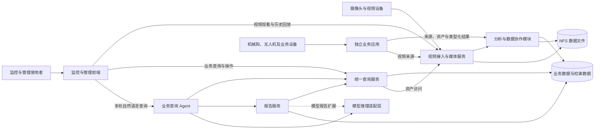
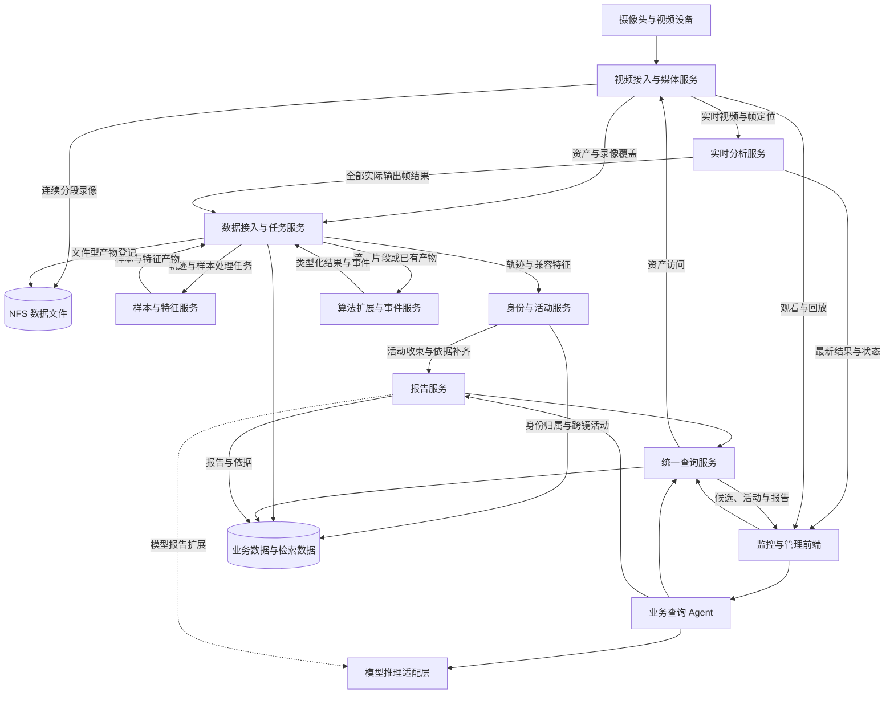
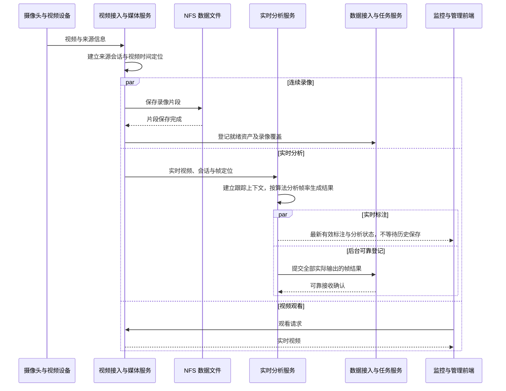
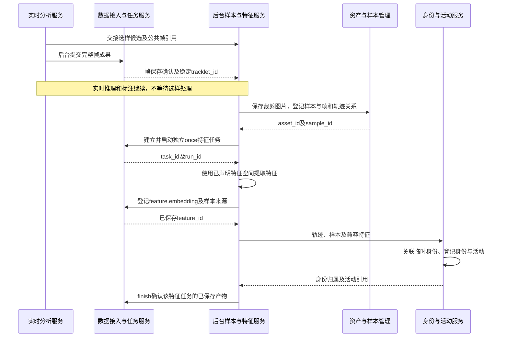
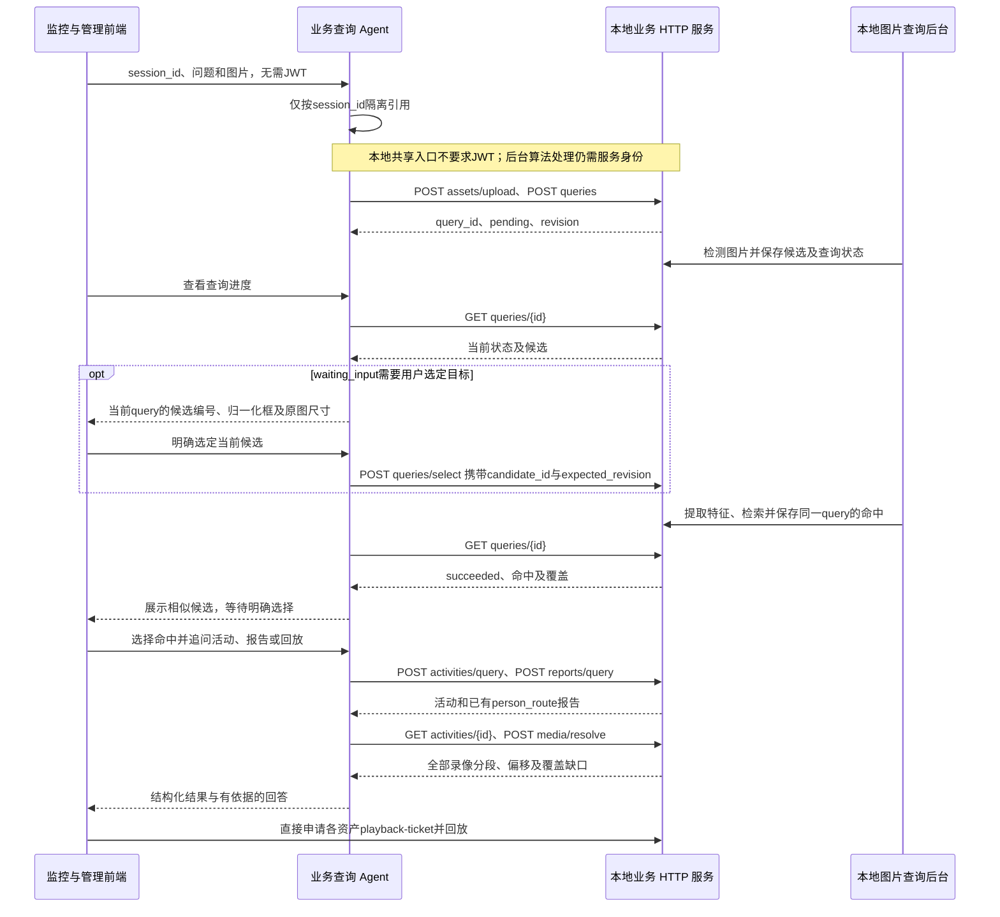
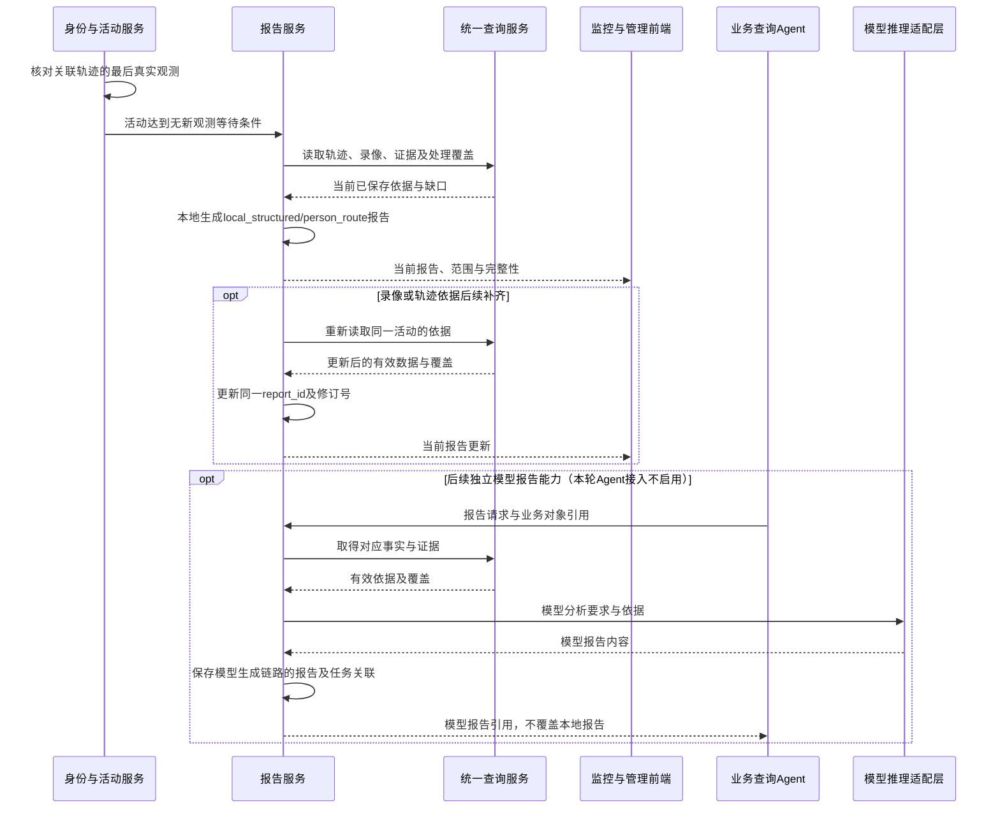
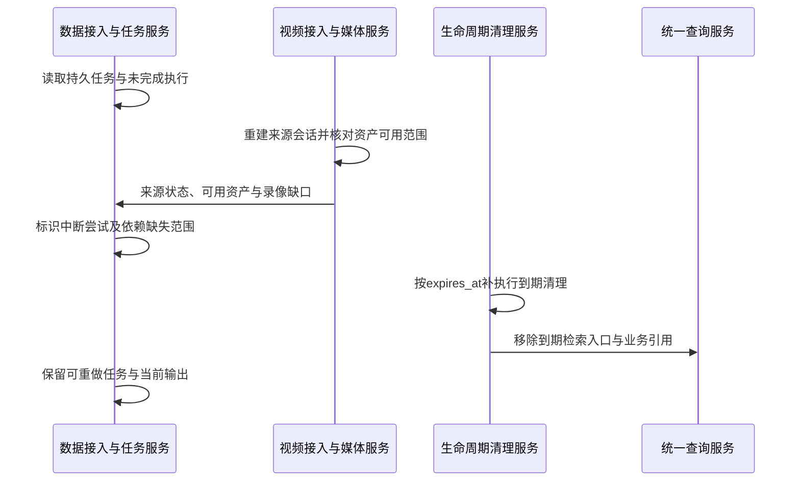
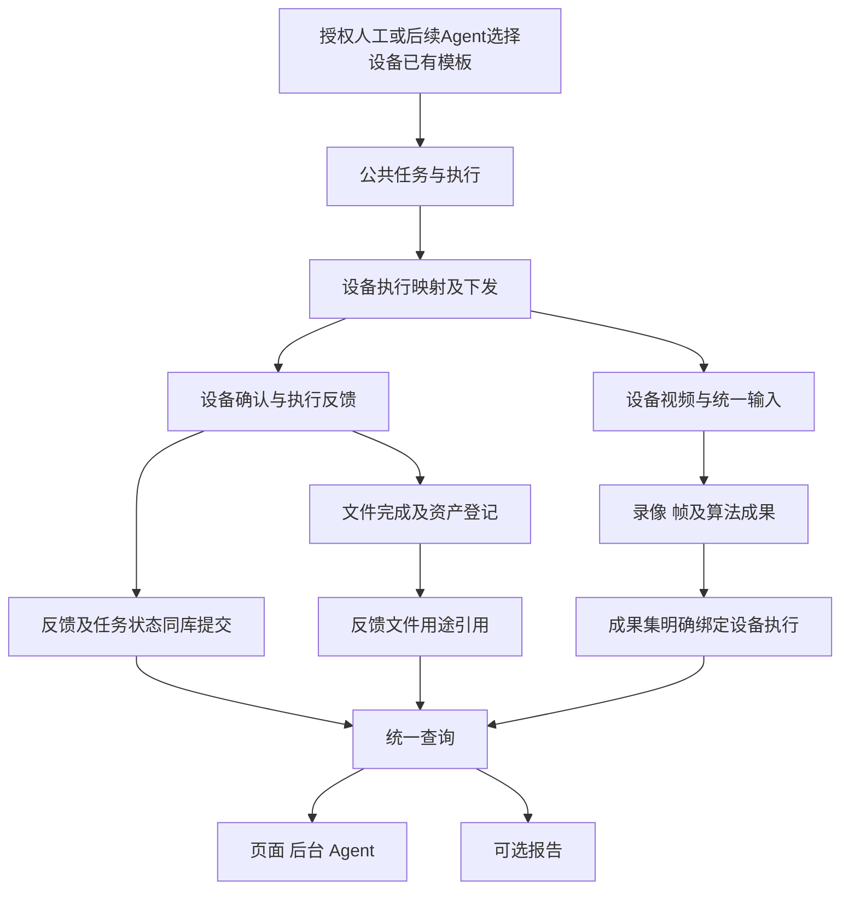

# HXJM 系统架构说明书

| 项目 | 内容 |
|---|---|
| 文档编号 | HXJM-ARCH-001 |
| 版本 | v0.2 |
| 状态 | 开发设计基线 |
| 日期 | 2026-10-29 |
| 适用范围 | 视频监控主流程、数据管理、算法协作、跨摄像头身份与活动、业务查询及报告；独立应用与设备接入边界 |
| 目标读者 | 产品、系统设计、前后端、算法、模型与数据开发人员 |
| 关联文档 | [软件需求规格说明书](软件需求规格说明书.md)、[接口文档](接口文档.md)、[数据库说明文档](数据库说明文档.md) |
| 修订记录 | v0.1：建立系统说明；v0.2：定义统一数据主链、模块协作、业务查询与生命周期，支持算法与模型编排替换；细化输入会话、跟踪上下文和物理标识映射；隔离实时发布、诊断编码与后台成果保存；明确可替换选样、独立特征任务和默认 60 秒的本地活动报告链路；落实首轮 Agent 通过共享入口调用业务 HTTP 接口、后台负责图片处理及读取已有路线报告的协作边界；2026-10-28：明确页面与Agent免登录共享范围、查询NULL归属及后台写入身份边界。；补充yh旧版能力恢复、本地图片上下文及本地查询契约。 |

## 1. 架构目标与范围

系统以视频及其派生数据为基础，支持四路摄像头连续录像、实时目标分析、历史逐帧回看、样本与特征提取、自动跨摄像头临时身份关联、活动查询、异常事件分析及报告生成。业务数据通过统一查询能力同时服务监控页面、管理页面和业务查询 Agent。

架构采用职责明确的模块和稳定数据契约组织功能。算法生成约定类型的结果，业务服务维护身份、活动、查询和报告等公共语义；替换检测、跟踪、特征或模型编排实现时，保持公共数据与服务契约一致。

本文按 arc42 的系统上下文、模块视图、运行视图和公共设计组织内容，以图示和代表场景说明模块协作。需求文档定义业务行为，接口文档维护交互契约，数据库文档维护数据对象、结构和生命周期；本文说明这些定义如何组成完整流程。

### 1.1 核心设计目标

| 目标 | 设计要求 |
|---|---|
| 连续采集 | 摄像头接入、录像及分析任务独立于浏览器观看运行 |
| 历史可用 | 保存算法实际输出的全部帧结果，关联原视频与视频时间；算法按自身能力决定分析帧率 |
| 数据复用 | 观测、轨迹、样本、特征、身份、活动、事件及报告可被多个业务共同使用 |
| 正常跨镜关联 | 自动关联兼容特征空间内的目标，形成跨摄像头临时身份、活动与活动报告 |
| 算法扩展 | 算法可消费实时流、录像片段或已有产物，按结果类型接入公共数据体系 |
| 查询独立 | 登记、历史陌生人和活动查询由业务服务提供，Agent 组织调用与对话 |
| 部分可用 | 单路或单环节故障时，正常来源和已保存数据继续服务，查询与报告表达实际覆盖范围 |
| 生命周期一致 | 数据、文件、检索入口和会话业务内容按关联规则同步过期；系统启动时补执行清理 |

### 1.2 首版边界

首版包含正常路径的自动跨摄像头、跨片段临时身份关联与跨镜活动报告。中断恢复后产生的新轨迹继续参与正常身份关联。

中断处保留数据缺口，无法补处理的观察范围以观察中断收束受影响记录。首版将复杂的已结束活动追溯合并与拆分、高度自动恢复、完整报告历史版本库作为后续扩展；通过明确的数据关联、执行记录和报告依据保留扩展入口。

### 1.3 第一阶段的公共链路

第一阶段以来源、输入会话、录像资产、公共帧、执行及成果集建立可复用的数据边界。后续算法、特征处理和Agent业务沿用这些边界，内部模型、部署位置和编排实现分别替换。第一阶段接入保留旧接口及实时消息结构；实时展示遵循本节的持续播放和标注时效规则。

| 模块 | 第一阶段输入 | 第一阶段输出与维护 |
|---|---|---|
| 统一取帧 | 已配置来源及视频流 | 每来源一份采集，共享不可变像素及source_id/session_id/frame_id/frame_seq；真实重连换输入会话 |
| 录像适配 | 已封片文件、明确来源/输入会话、真实视频区间 | 资产登记、文件大小/哈希、可用状态、录像覆盖；有真实对齐依据时补齐帧的文件内位置 |
| 算法适配 | 公共帧、算法实例、任务及执行快照 | 实际产生的全部帧及目标；跟踪器重置创建新tracking_context，不更换视频输入解释 |
| 可靠投递 | 完整帧成果及原始上下文 | 存储服务器待发送批次、保存确认、重传和批次窗口闭合 |
| 公共后端 | 共享页面查询或显式后台服务身份及来源授权 | 同库整帧事务、稳定轨迹映射、处理/保存覆盖、采用范围及outbox |
| 历史查询 | 来源/时间或明确成果引用 | 已保存帧、全部框、所有相交录像分段、定位质量及缺口 |

统一取帧的首期形态是进程内公共组件。每路输入使用一条 PyAV 连接，编码包交给后台录像，解码帧由 FrameHub 分配公共帧标识后交给算法。MediaMTX 独立承担直播分发，页面播放不等待公共取帧、录像或算法。远端或不同进程的算法通过适配器接入公共帧契约。

输入会话分别保存实际接入开始时刻 started_at 与媒体 PTS 零点对应的 time_origin_at。帧时间等于固定媒体时间原点加输入帧 PTS；解码到达时间单独保存。录像从关键帧开始分段，保留原编码包的显示与解码顺序，文件内 PTS 从零开始。封片清单通过 recording_alignment 提供输入 PTS 范围与文件时间的准确映射；公共后端在录像登记和帧结果登记两个入口补齐 media_asset_id、media_pts_ms，两种先后顺序均可使用。

录像写入、封片与资产登记分别由后台执行。文件关闭、同步、原子更名并取得大小与摘要后，生产方发布清单；登记线程先建立公共输入会话，再调用资产登记接口，成功后保存该清单的确认标记。启动时重新扫描未确认清单并重试原请求；录像回调只唤醒登记线程。停机依次停止算法读取、停止采集并封片、提交最终录像清单、排空成果投递。录像和成果登记的故障分别报告，均不等待后才发布实时检测结果。

推理完成后先通过 ResultDispatcher.defer 交接无像素帧元数据和完整检测列表，再执行实时显示的过期过滤和显示数量限制。实时事件循环只完成有界内存队列交接；历史成果载荷构造、会话/任务解析、组批、文件持久化及HTTP提交由后台执行。单个帧的像素不进入历史交接队列或结果待发送文件。所有成果ID、生产键和原始帧引用随重试保持稳定。批次全部保存确认后，另一个可靠请求闭合该批实际处理窗口；服务端核验完整清单并选择可查询范围。窗口只代表算法实际处理的帧，不代表录像每帧都已分析。

存储服务器待发送区的目录准备和文件访问均在后台执行，不作为实时分析启动的同步依赖。存储暂不可用时，可靠投递进入 retrying 并继续尝试，实时推理与发布继续运行；已交接、已写入待发送文件和已取得登记确认分别计数，不能相互代替。

实时播放与实时分析优先于后台处理。公共来源、会话和时间定义用于关联数据；模块间的实时交付不等待录像落盘、数据库确认或非实时任务。实时视频持续播放，过期标注停止显示并提示分析延迟，有效结果到达后恢复标注。实时展示不采用等待算法结果后逐张刷新图片的方式控制主监控画面的播放节奏。

结构化实时结果发布不等待 JPEG 编码。同帧图像诊断使用独立的图片任务，每路摄像头同时最多一个；已有任务未完成时跳过新诊断图片，不为图片积压后续推理。图片编码失败只影响该次诊断图像，不将成功推理改为失败，也不重置跟踪上下文。诊断图片与同次检测结果配对，发送前仍检查会话及展示有效期。

样本处理在后台等待帧可靠保存确认，取得稳定 `tracklet_id` 后登记图片和样本，使用独立的 `once` 特征任务保存特征并关联身份和活动。选样器与特征提取、成果登记分别维护，首期每条轨迹采用首个真实人员有效框。实时推理和结果发布不等待这一后台链路。

公共后端使用独立启用开关和显式PostgreSQL数据源。本版历史查询、录像读取与播放、以图查人、人员登记及人员、样本、活动、事件、报告查询均直接访问，不要求用户登录、JWT或Cookie。页面与Agent使用同一共享业务范围：全部已登记视频来源及有效共享业务数据。新查询的 `query_request.owner_user_id` 为NULL，查询图的 `media_asset.meta.owner_actor_key` 为 `shared:business`；查询图最长七天，正式登记图按登记资料保存。不同对话仍由Agent的session_id区分，session_id不是数据权限。原有非空用户归属查询及其私有查询图片不自动改为共享。算法写入、输入会话、录像登记、特征写入和后台生成、修改及管理继续校验身份、操作和来源。旧接口的路由、鉴权和响应封装保持原行为。Agent及页面通过公共历史查询复用已保存事实。

## 2. 系统上下文

| 外部参与方 | 系统接收内容 | 系统提供内容 |
|---|---|---|
| 摄像头与视频设备 | 实时视频、来源标识及视频时间信息 | 接入状态、录像与媒体访问能力 |
| 监控与管理使用者 | 查询条件、查询图片、候选选择、登记及管理操作 | 视频、检测标注、目标卡片、身份、活动、事件和报告 |
| 模型推理服务 | 模型回答、视觉分析或报告内容 | 经模型推理适配层组织的问题、图像、证据和输出要求 |
| 独立业务应用 | 视频来源、数据资产、观测、事件或其他类型化产物 | 公共查询、资产访问及业务数据关联能力 |
| 机械狗、无人机及业务设备 | 视频、位置和设备状态等业务观测 | 对应业务应用的展示与查询结果 |

设备控制与视频数据处理分开组织。设备命令、执行权限及安全约束由相应独立业务应用维护；视频与观测通过公共数据契约进入监控数据体系。

## 3. 模块视图与数据维护职责

### 3.1 核心模块

| 模块 | 主要职责 | 输入 | 输出与维护对象 |
|---|---|---|---|
| 视频接入与媒体服务 | 视频接入、会话管理、分发、连续分段录像、资产就绪登记与回放定位 | 视频源与来源配置 | `source_id`、`stream_session_id`、录像 `asset_id`、视频可用范围及接入/录像状态 |
| 实时分析服务 | 从统一取帧取得公共帧，执行目标检测/跟踪，输出帧结果并提供实时标注 | 视频、来源/会话/帧定位信息、分析配置 | 帧结果、检测框、局部跟踪结果与分析状态；历史保存通过数据接入与任务服务确认 |
| 数据接入与任务服务 | 校验公共契约，可靠接收结果，维护业务任务及执行尝试，登记输入输出与处理覆盖 | 算法提交、资产就绪信息、任务请求 | `task_id`、`run_id`、`result_set_id`、`result_id`、产物关系及保存状态 |
| 样本与特征服务 | 通过独立选样器生成轨迹样本，后台处理登记及查询素材，按独立任务提取特征并维护特征空间 | 已确认轨迹、原帧图像、真实目标框、登记样本及查询选择 | `sample_id`、`feature_id`、`feature_space_id`、特征任务及查询候选结果 |
| 身份与活动服务 | 自动跨镜临时身份关联、登记身份关联、归属维护、活动组织与业务收束 | 轨迹、兼容特征、来源及时间范围 | `tracklet_id`、`identity_id`、`assignment_id`、`activity_id` 及关联依据 |
| 算法扩展与事件服务 | 按依赖读取算法输入，将观测、特征、结论和事件分别登记 | 实时流、录像片段、骨骼、样本、特征等产物 | 类型化结果、`event_id`、参与目标、事件证据与复核结果 |
| 统一查询服务 | 提供登记、历史目标、临时身份、轨迹、活动、事件及报告查询，组织统计、媒体与候选访问 | 结构化条件、兼容特征、`query_id` 与权限范围 | 标准业务结果、出现次数与去重人数、候选卡数据、证据引用、处理覆盖及检索状态 |
| 报告服务 | 自动生成本地人员路线报告；组织活动/事件/查询报告及证据，维护当前报告与补齐更新 | 活动收束条件、有效轨迹、录像、覆盖及报告请求 | `report_id`、生成方式、内容、完整性、依据、修订及业务结束信息 |
| 业务查询 Agent | 理解问题，组织工具调用与多轮澄清，维护本轮查询及目标选择上下文 | 用户消息、查询图引用、候选选择与 `session_id` | `agent_run_id`、`query_id`、业务任务引用、流式进度和回答 |
| 模型推理适配层 | 适配模型调用和结构化输出要求，返回规范化结果 | 文本、图像、证据、工具定义及输出要求 | 推理结果或规范化调用错误 |
| 监控与管理前端 | 视频与标注展示、图片上传、多人候选选择、目标卡片管理、任务进度与报告展示 | 视频、实时结果、查询结果及通知 | 明确的查询、选择、管理操作与展示状态 |
| 生命周期清理服务 | 按到期与引用规则清理业务内容、文件和检索入口，执行启动补清理 | `expires_at`、业务结束信息、有效引用及清理进度 | 业务清理、关联更新与清理状态 |

### 3.2 数据维护边界

1. 视频接入与媒体服务维护来源会话与资产可用性，算法通过资产标识和访问能力取得数据。
2. 数据接入与任务服务维护公共任务、执行尝试与产物登记。算法提交约定结果类型，公共服务校验后接收。
3. 身份与活动服务维护公共身份和归属关系。算法局部跟踪号只在 `tracking_context_id` 内生效，通过 `(tracking_context_id, local_track_id)` 映射到稳定 `tracklet_id`，再参与公共身份关联。
4. 算法扩展与事件服务维护事件形成过程。检测观测、候选、复核结论与业务事件分别表达。
5. 统一查询服务提供业务查询，监控页面、管理页面和 Agent 使用相同数据语义。
6. 报告服务独立生成本地结构化活动报告并维护依据；需要模型分析时由模型推理适配层执行模型调用，Agent 负责问题理解与调用组织。本地报告生成不依赖 Agent 或模型服务。
7. 各模块通过其维护接口修改数据，其他模块以公共标识引用，避免重复维护身份、活动或报告。

### 3.3 数据存储职责

| 存储职责 | 保存内容 | 使用规则 |
|---|---|---|
| 业务与管理记录 | MySQL `hxjm_sm`保存管理资料；PostgreSQL `postgres.public`保存来源、资产目录、任务、执行、帧结果、轨迹、身份、活动、事件、报告与会话关联 | 双库职责分别维护，跨库通过稳定映射和业务接口组合，不建跨库外键或直接JOIN |
| 特征与检索数据 | PostgreSQL保存向量、特征空间、来源样本与贡献关系 | 按特征空间隔离，与业务对象、权限及到期状态保持一致；检索索引是可重建派生结构 |
| NFS 数据文件 | 连续录像、查询图、样本图、事件片段及已发布类型的大型文件产物与报告证据 | 统一保存到 `/data/nfs_storage/hxjm_datas`，通过 `asset_id` 及资产访问能力使用 |
| 实时展示数据 | 当前帧标注、最新处理状态与连接进度 | 按时效丢弃旧消息；历史保存独立确认 |

数据库说明文档统一定义物理库、Schema、表、字段、ID、约束、索引及增量DDL。记录、文件和检索索引通过公共标识关联，允许更换存储实现。

## 4. 公共标识与数据语义

### 4.1 标识及范围

| 标识 | 含义与范围 |
|---|---|
| `source_id` | 稳定视频来源通道的UUID，对应`camera.id`；管理设备整数ID通过映射关联 |
| `stream_session_id` | 某来源的一段连续输入视频会话；输入重连或无法延续原时间基准时建立新会话；算法重启不单独轮换此会话 |
| `tracking_context_id` | 一次连续跟踪状态的UUID；状态重置、计数器复用或图像解释基准改变时新建，可有多个上下文关联同一输入会话 |
| `asset_id` | 录像、图片、片段及文件型产物的公共资产标识 |
| `task_id` | 一项业务处理请求，生命周期独立于页面连接及单次执行 |
| `run_id` | 任务的一次执行尝试UUID，对应`task_attempt.run_id`；旧`ai_task_run.run_id`保留字符串并通过映射衔接 |
| `result_set_id` / `result_id` | 一组结果与其中单项结果，关联执行、输入与结果类型 |
| `frame_id` / `frame_seq` | 输入帧UUID对应`input_frame.id`，序号在输入会话内唯一；独立于算法采样计数及某次执行的`analysis_frame.id` |
| `tracklet_id` | 连续局部轨迹UUID；`(tracking_context_id,local_track_id)`唯一映射，关联来源、输入会话、结果与时间范围 |
| `sample_id` | 从轨迹、帧或用户图片产生的样本标识 |
| `feature_id` / `feature_space_id` | 特征及其可比较空间的标识 |
| `identity_id` | 公共身份标识；`identity_kind` 为 `temporary` 或 `registered` |
| `assignment_id` | 连续轨迹与身份之间的一次归属关系，关联相应样本及匹配依据 |
| `activity_id` / `event_id` | 跨镜活动与业务事件；`activity_id`复用`episode.id`，分别关联身份、时间范围和证据 |
| `report_id` | 稳定报告UUID，复用`llm_report.id`；补全更新同一报告的当前内容与修订号 |
| `session_id` / `agent_run_id` | 业务对话会话与 Agent 一轮执行的标识 |
| `query_id` | 一次业务查询，关联条件、图片、候选选择与结果范围 |

业务接口传递公共标识，模型名称、算法局部编号和文件绝对路径作为模块内部信息维护。持续出现的临时身份沿用原 `identity_id`，新轨迹通过新的 `assignment_id` 记录关联。

### 4.2 时间与视频定位

- `occurred_at` 表示画面或业务事实发生时间，`processed_at` 表示本次结果产生时间，`expires_at` 表示到期时间；补算保留原发生时间。
- 录像、帧结果与轨迹使用共同的视频时间语义，按来源、流会话及时间范围关联。独立解码器自行累加的帧号不能直接视为同一帧。
- 帧定位包含 `stream_session_id`、`frame_id`、`frame_seq`、视频时间及时间基准；接口保留源媒体时间与发生时间之间的定位信息。`frame_seq`来自连续输入序列，算法跳帧不重编号；同一输入帧可有多个执行产物。
- 跟踪上下文只描述算法状态连续性。跟踪器重启建立新的`tracking_context_id`，局部跟踪号可以从头开始；连续录像仍使用原输入会话，不把算法重启解释为摄像头断流。
- 处理覆盖描述已经完成且可靠保存结果的视频时间范围。录像、分析、保存和检索覆盖分别维护；处理最新画面不表示中间缺口已经补齐。

### 4.3 坐标与结果类型

公共目标框采用归一化 `xyxy`，即 `[x_min, y_min, x_max, y_max]`，范围为 `[0, 1]`，并附 `image_width`、`image_height`表示原始画面尺寸。适配环节将裁剪、缩放、旋转及 EXIF 校正后的结果转换到接口规定的图像基准。

骨骼等空间结果关联同一帧定位与图像基准，由结果类型规定关节点含义、排列及缺失点表达。算法内部坐标、向量和模型输出由适配环节转换。

结果以类型和版本声明语义。公共外壳维护生产来源、输入引用、执行、时间与状态；检测、骨骼、描述、特征和异常判断使用各自的类型化契约。新增同类算法复用结果类型；新增结果类型时补充对应契约及查询适配。

## 5. 总体数据流

主链包含以下并行关系：

1. 视频接入后，连续录像与实时分析并行，前端独立观看。
2. 实时结果分别进入可靠历史保存与实时展示，两者采用不同的交付要求。
3. 样本与特征可基于实时轨迹、就绪录像或用户图片生成。
4. 其他算法按自身依赖执行，可直接读取流、片段或已有产物。
5. 身份、活动、事件与报告逐步形成；查询使用已可用数据，并表达尚未完成或存在缺口的范围。

## 6. 任务、结果与状态协作

### 6.1 任务与执行

`task_id` 表示业务目标，`run_id` 表示一次执行尝试。任务维护输入范围、所需产物、执行状态、输出及覆盖；执行尝试维护具体算法或模型版本、处理时间及失败信息。业务任务与执行尝试分别持久保存；新执行UUID与旧布控字符串运行号通过兼容映射衔接。

任务按有限处理`once`和持续输入订阅`continuous`分别维护生命周期。持续订阅绑定来源与输入会话，控制目录期限随最后真实输入推进，心跳、预测及重试不续期，旧产物独立到期；输入会话结束后固定期限，新会话创建新的订阅任务。

| 任务状态 | 语义 |
|---|---|
| `pending` | 任务已保存，尚未开始 |
| `running` | 正在处理业务输入 |
| `waiting_input` | 等待录像就绪、依赖产物、用户选择或其他明确输入 |
| `succeeded` | 约定范围内的目标完成，结果已可靠保存 |
| `partial` | 本次任务已结束，部分范围或目标完成 |
| `failed` | 本次任务未完成目标，已记录失败原因及已有输出 |
| `cancelled` | 任务已取消，停止继续产生业务输出 |
| `expired` | 任务业务内容或必要输入到期，停止继续处理 |

由任务生成的报告在部分内容已可查看、后续处理仍继续时，任务保持 `running` 或 `waiting_input`；报告自身表达内容完整性。任务状态与报告完整性分别维护。本地结构化活动报告由报告服务直接维护，`task_id`、`run_id` 为空，其生成方式和版本写入报告元数据。

### 6.2 可靠历史与实时展示

算法实际输出的每帧结果都进入历史保存，包括成功分析但未检测到目标的空结果。预测框保留预测标记，区分真实检测与跟踪预测。

数据接入与任务服务确认接收后，该帧才计入可靠保存覆盖。重复提交通过既有任务、执行、结果集与帧引用识别，防止重复形成轨迹、活动和事件。

历史保存不可用时，保留尚未确认的结果，实时播放和实时推理继续运行；未完成保存的区间不能宣告处理完成。非实时任务可等待保存依赖恢复后继续。原录像完整的区间可以重新分析，缺失区间保留缺口。

实时展示按会话、帧序与时效更新，可以丢弃过期、乱序或发送不及时的消息。实时消息丢弃不删除已保存历史，也不替代历史接收确认。

播放、实时输入交付、实时标注发布和可靠历史保存分别维护处理通道。实时标注不等待保存确认，录像写入不在实时取帧的同步交付路径中执行。历史分析、特征提取和报告任务使用独立的任务等待与资源安排，后台处理负荷不能通过共用队列、长时间锁占用或资源争用拖慢实时通道。

### 6.3 分环节状态

前端分别获得来源接入、连续录像、分析执行、历史保存及检索可用状态。单个任务状态解释一次业务处理，不能替代各环节的健康与覆盖信息。

录像正常但算法尚未处理的区间属于“有视频、无分析结果”；结果已保存但检索尚未就绪的区间属于“可回看结果、检索尚未可用”。这些范围不能解释为没有目标出现。

## 7. 代表运行场景

### 7.1 视频接入、连续录像与实时分析

录像与分析随来源和业务配置运行，观看连接只负责订阅。录像登记实际保存成功的时间范围；片段完成写入后供后续任务读取。

实时分析保存规范框、类别、跟踪上下文、局部跟踪引用与输入帧定位。输入定位与执行帧结果分别保存，重复登记不重复生成轨迹。历史回放按录像会话和视频时间加载逐帧结果，原视频与标注分别读取并对齐。

### 7.2 样本、特征与自动跨镜身份

首期选样器采用 `first_observed` 策略：每条局部轨迹选择首个真实检测到人员、具有有效归一化目标框的图像；预测框不触发选样。候选保留公共帧和跟踪上下文引用，在帧成果收到保存确认、取得稳定 `tracklet_id` 后，后台才编码保存图片并登记样本。样本保留原帧、裁剪区域、轨迹、选样策略及期限。

选框器负责选择候选目标，采样模块维护采样去重与特征任务标识，特征提取与聚合模块生成特征，业务接口负责保存与关联。首期每条轨迹登记一份样本，特征聚合类型为single。增加多样本策略时，同步适配采样去重、特征任务标识及聚合规则，使用同一轨迹下的独立样本及特征来源关系。图片资产、样本、特征空间、任务与身份接口保持一致，实时帧成果契约不变。

每份待提取样本建立独立 `once` 特征任务和执行，特征以 `feature.embedding` 契约可靠登记；身份关联读取已保存特征，随后完成特征任务。特征任务只确认约定产物是否保存，身份归属由身份与活动服务独立维护。图像编码、上传、特征提取、身份关联及网络等待均在后台执行。

不同摄像头的轨迹通过兼容特征及关联规则自动归入临时身份。归属记录保存依据、来源与时间，局部轨迹仍保留独立标识。新目标既参与临时身份关联，也可参与登记身份检索。

临时身份与登记身份分别管理。登记匹配引用相应登记身份；临时数据按自身生命周期保存，不能因照片相似修改登记资料或延长临时数据期限。

身份与活动服务根据已保存观测形成跨镜活动。恢复后出现的新轨迹继续执行正常关联。缺口保留在活动依据中，人员最后出现时间采用真实观测的 `occurred_at`，补算时间采用 `processed_at`；跟踪预测不延长身份活跃期限。

### 7.3 类型化算法与异常复核

算法声明输入类型、依赖产物、输出类型与契约版本。数据接入与任务服务依据输入可用性推进任务，算法扩展与事件服务组织分析及复核。

以近期打架、跌倒分析为例：

1. 算法消费视频帧或片段，形成实际输出的疑似、确认、排除或证据不足判断。
2. 保存behavior.assessment成果及可用目标定位、说明和视频证据，不保存骨骼、内部张量。
3. 需要复核时使用原片段和已有业务产物，新建复核成果，不覆盖初筛。
4. 使用稳定事件标识及修订更新当前判断；人员未知不阻塞登记。
5. 页面、后台和Agent直接查询事件、成果和证据，按需生成报告。

火灾、垃圾、行为分析及其他算法使用同一生产和登记流程，专有内容由各自结果契约表达。公共来源、资产、任务、结果、身份引用与生命周期保持一致。

### 7.4 多轮查询、登记检索与历史陌生人检索

共享query_id与Agent对话会话独立：不同session_id可引用同一业务查询，但模型历史及本地选中命中各自保存。候选选择由业务侧revision控制；其他调用方推进查询后，Agent停止旧选择并要求重新确认。

本版历史查询、录像读取与播放、以图查人、人员登记及人员、样本、活动、事件、报告查询均直接访问，不要求用户登录、JWT或Cookie。页面与Agent使用同一共享业务范围：全部已登记视频来源及有效共享业务数据。新查询的 `query_request.owner_user_id` 为NULL，查询图的 `media_asset.meta.owner_actor_key` 为 `shared:business`；查询图最长七天，正式登记图按登记资料保存。不同对话仍由Agent的session_id区分，session_id不是数据权限。原有非空用户归属查询及其私有查询图片不自动改为共享。算法写入、输入会话、录像登记、特征写入和后台生成、修改及管理继续校验身份、操作和来源。

首轮 Agent 接入以[接口文档第 8、9 章](接口文档.md#8-人员业务与本地-agent-工具-http-接口)为调用约定。首轮Agent不要求用户JWT，不调用/getInfo、不发送shared:business身份头；负责理解意图、按session_id保存会话引用、组织工具调用与回答；业务侧负责查询处理、数据关联、录像定位、存储及业务规则。图片检测、特征提取和检索由业务侧已部署的后台处理器完成。

正式登记与图片查询也可由页面直接调用公共接口。后台素材处理轮询待处理登记样本和用户查询：登记样本使用已建立的独立登记资产及样本引用，提取特征后进入登记检索范围；查询图片先执行人员检测，再根据候选数量推进。两条流程均使用独立特征任务，不要求 Agent 参与。

图片查询同时支持登记资料与历史观测，历史检索包含未登记的临时身份和目标。未检测到人员时返回空候选；只有一名人员时自动选定；存在多名人员时进入 `waiting_input`，用户选择后继续提取特征和检索。时间条件、特征空间及检索可用覆盖由统一查询服务处理。

多人图片通过候选选择确定查询目标；选定后提取相应目标特征并执行查询。候选卡关联 `query_id`、候选标识及图片，提交选择时校验所属查询；多图、多任务和多轮会话分别维护选择。前端保留已返回目标卡，允许在明确的业务上下文中继续查询。

Agent 通过公共业务工具执行查询。工具定义输入、输出、权限、覆盖及错误语义；更换 Agent 框架后继续使用相同工具与业务数据，业务服务独立提供查询。

首轮后续业务请求直接访问，不设置Authorization、Cookie或Agent服务身份头，传入的Authorization不进入模型、会话或工具上下文。查询处于 pending 时只表示处理中；多人候选及相似命中等待用户明确选择。首轮接入读取并解释已有路线报告，支持查看及回放；独立 Agent 模型报告的生成、任务及报告登记保留为后续能力。当前代码适配与离线验证状态、无JWT业务侧配合及页面联调步骤见接口文档第 9 章。

单帧轨迹仍正常展示。首次和最后观测时间相同时，Agent 不扩大时间范围，也不调用要求 end_at 大于 start_at 的区间媒体解析；已有业务返回提供可用录像资产与定位时按其返回值回放，否则提示“当前记录暂无可用回放”，其他记录及后续交互继续。

### 7.5 跨镜活动与报告逐步完成

活动无新真实观测的等待间隔默认 **60 秒**，通过配置调整。报告服务依据已关联轨迹的真实观测时间更新活动起止，在达到收束条件后直接生成本地结构化人员路线报告。内容包含身份、跨摄像头出现顺序、每段起止、录像定位、证据引用、处理覆盖和缺口。

本地报告使用 `report_type=person_route`、`report_json.generator.kind=local_structured`、生成版本 `local_structured_v1`，`model_version` 同样记录 `local_structured_v1`；`task_id`、`run_id` 为空。该报告不调用远端 Agent 或模型服务，页面和 Agent 均可通过公共报告查询读取。

先按当前已完成数据生成报告并明确覆盖。后续录像登记或关联轨迹依据补齐时，更新同一 `report_id` 的内容、依据、完整性和修订号；依据没有变化时保持原修订。报告保存所属活动的业务时间与期限，更新不延长保存期限。

模型报告是独立生成链路，保存其任务、执行及模型信息；本地自动更新只处理本地生成的报告，模型生成过程也不覆盖本地报告。模型失败不影响本地结构化报告读取。首版维护各报告的当前内容和修订，不建设完整报告历史版本库，也不自动重组已结束活动。

### 7.6 页面断线与业务任务继续

HTTP 请求及 SSE 连接负责提交、查询和订阅，`task_id` 负责持久业务执行。页面关闭、网络断开或 SSE 重连不取消任务，也不删除其已保存结果。

前端重连后按 `task_id` 查询状态与输出，再订阅后续进度。用户明确取消时调用取消接口；服务根据执行阶段停止后续处理，保留已有数据及取消状态。

多轮会话通过 `session_id`、`query_id` 和目标引用衔接，Agent 一轮推理使用独立 `agent_run_id`。模型调用中断与业务任务中断分别处理，避免为展示重连重复创建业务任务。

### 7.7 历史回放与逐帧标注

调用方按来源与时间查询录像资产及结果覆盖，再请求媒体回放和帧结果。前端按公共视频时间与会话展示框、轨迹或骨骼。

成功分析且无目标的帧显示为空结果；未分析或未保存的范围显示对应状态。有录像而缺分析结果时可以播放原视频；有观测而缺录像时保留观测查询，同时说明回放素材不可用。

同一范围存在重分析结果时，统一查询服务按指定或业务选用的结果集返回，避免不同尝试的框重复叠加。

### 7.8 恢复与启动补清理

恢复后核对保存事实与输入可用性，再推进任务。可重做范围建立新的 `run_id` 并保留输入关系；到期输入停止处理。未完成执行不能因服务重启直接变为成功。

## 8. 中断与部分可用设计

| 场景 | 受影响范围与处理 | 其他链路行为 |
|---|---|---|
| 视频源断流 | 记录会话中断及视频缺口；有完整素材时可重做，无素材时以观察中断收束受影响记录 | 正常来源继续录像、分析、关联与查询 |
| 录像或 NFS 保存失败 | 记录实际保存范围及资产暂不可用状态；依赖素材的任务等待输入或以部分结果结束 | 可用实时来源按各自保存能力工作，前端分别显示录像和分析状态 |
| 算法停止而录像正常 | 保留分析缺口，恢复后继续实时处理；允许对完整录像重分析 | 观看、录像及其他独立算法继续 |
| 历史结果保存失败 | 未确认结果不计入保存覆盖；保留已交接的待确认结果，恢复后重试或根据录像重做；非实时任务可等待保存依赖 | 实时播放和实时推理继续，已保存历史可用；实时展示不能证明历史已保存 |
| 特征或依赖产物未就绪 | 任务进入 `waiting_input`，查询返回可用部分及依赖状态 | 已完成对象与其他输入继续处理 |
| 检索更新滞后 | 分别维护保存状态和检索可用状态，按标识及时间读取已保存结果 | 回放及不依赖滞后检索的查询继续 |
| 部分来源故障 | 按任务或查询的实际来源范围说明缺口；受影响活动记录保留中断原因 | 正常摄像头的跨镜身份和活动关联继续 |
| 模型调用失败 | 保留业务任务和依据，记录本次尝试失败，允许重新生成 | 已保存查询结果、活动及报告继续可用 |
| 页面或 SSE 断开 | 关闭展示连接，任务继续；重连后查询状态 | 视频源、录像及后台处理保持独立生命周期 |
| 系统整体停机 | 核对资产、已保存进度与到期状态，保留不可恢复范围，重建运行会话 | 恢复后的新轨迹正常参与身份与活动关联 |

### 8.1 活动收束与处理缺口

身份与活动服务分别维护实际最后出现时间及相关来源的处理覆盖。因算法停止没有收到新结果时，不能仅按系统当前时间推断人员离开。

录像完整但尚未分析的范围保留为处理缺口，具备后续分析条件。无法回补的范围按观察中断收束受影响记录，结束原因与有观测依据的离开或业务结束分别表达。

正常跨镜关联持续运行；恢复后新轨迹仍可归入已有临时身份。对于已经收束的活动，首版保留前后独立记录及已有身份关联，复杂追溯合并或拆分通过后续能力扩展。

### 8.2 覆盖与报告范围

查询使用明确的来源和时间范围。部分摄像头不可用时，返回其缺失范围与正常来源结果，不把单路故障默认扩大为全部活动停止。

系统依据配置的业务来源范围判断所需数据，不假设摄像头间的地理覆盖或通行关系。跨镜活动由实际关联结果形成，报告陈述已保存观测及证据支持的内容。

### 8.3 出现次数与去重人数

统一查询服务按需求文档的统计口径分别提供 `appearance_count`、`unique_identity_count` 与 `unresolved_count`：出现次数按统计范围内具有真实观测的规范轨迹计数，通过 `canonical_tracklet_id` 将已确认属于同次出现的重算轨迹归一；去重人数按当前有效身份归属及临时身份与登记身份的对应关系计算，尚未关联身份的记录单列。

统计同时返回所用摄像头范围、业务时间区间、结果来源及处理覆盖。前端和 Agent 使用这组公共统计，不把出现次数直接解释为人数，不将未分析或尚未完成身份关联的范围解释为零人。重分析通过有效结果集参与统计，避免重复累计。

## 9. 生命周期与会话清理

保留期采用以下默认值，并允许按业务配置。数据在达到 `expires_at` 后停止面向对应业务访问；处理延迟和消息重发不重置期限。

| 对象 | 默认到期规则 | 协作要求 |
|---|---|---|
| 普通录像 | 资产 `end_at` 后 7 天 | 保留实际录制区间，普通录像到期不自动删除仍有有效业务证据引用的共享物理文件 |
| 逐帧结果 | `occurred_at` 后 7 天 | 补算、重试及保存延迟不延长期限 |
| 轨迹 | `end_at` 后 7 天 | 轨迹结束时间与实际处理时间分别保存 |
| 样本与特征 | 随来源观察数据到期 | 清理样本、特征及相应检索入口，不因身份仍存在延长旧数据期限 |
| 临时身份 | 连续 7 天无新出现时清理 | 持续出现沿用同一 `identity_id`；新出现依据真实观测的 `occurred_at` 更新，旧数据独立到期 |
| 登记身份及资料 | 独立长期管理 | 通过登记管理操作维护，不跟随临时身份自动清理 |
| 查询图片 | `received_at` 后最多 7 天 | 清理原图、查询派生内容及访问入口，任务和会话不延长期限 |
| 活动、事件、报告与业务证据 | 所属业务 `end_at` 后 7 天 | 报告更新不重置业务结束时间和期限；证据独立登记为受业务引用的数据资产 |
| 会话业务内容 | 与引用对象联动过期 | 移除到期内容及访问引用，防止通过历史消息继续读取已清理数据 |

证据资产及结论所需的结构化依据按所属活动或事件的有效业务引用保留，普通历史查询仍遵循原数据到期规则。业务服务维护所需依据及来源定位，保证普通观测到期后有效报告仍能取得其业务证据。共享物理文件在全部有效业务引用解除后删除；业务引用保留文件不延长普通历史检索期限。

资产暂时不可访问与已删除分别维护。NFS 不可访问时保留资产及引用事实，恢复后核对可用性；物理删除成功后再确认对应清理完成。

清理服务周期处理到期对象，系统启动时补执行清理。查询先按到期规则限制访问，再完成文件及索引清理，避免物理清理滞后延长可访问时间。

任务所需输入到期时，根据剩余可用输入形成部分结果或进入 `expired`。会话保留必要状态说明，移除到期业务正文、图片及证据入口。

## 10. 替换与扩展边界

### 10.1 检测与跟踪替换

检测和跟踪接收统一来源、会话及帧定位，提交规范坐标、结果类型与局部跟踪引用。更换算法时建立独立执行与结果集，轨迹归属由身份与活动服务维护，前端继续使用同一帧结果契约。

### 10.2 特征实现替换

采样策略、特征提取与聚合、保存适配分别维护。首期采用每条轨迹首个真实人员有效框及single聚合；改用多样本时，在采样和特征模块内同步调整去重、任务标识及聚合规则，沿用样本来源、轨迹引用及公共接口。替换特征实现声明独立的 `feature_space_id` 与提取规则，只有契约明确兼容的空间才参与比较。旧特征与新特征保留各自输入和生产关系，重提取形成新产物，统一查询服务按业务选用空间检索。

### 10.3 其他算法接入

算法声明消费实时流、片段或已有产物，通过公共任务及结果接口提交数据。公共系统维护来源、时间、身份引用与生命周期，算法维护专有契约与处理逻辑。

新增同类算法主要增加生产实现与配置；新增类别增加类型化结果及查询能力。公共身份、活动、资产和报告沿用既有关系，不按每个算法复制业务查询与数据库模型。

### 10.4 Agent 与模型编排替换

统一查询和报告服务提供稳定业务能力，Agent 经工具适配调用。工具契约不暴露物理表名、SQL或存储连接，由业务服务维护物理数据映射。模型调用、对话组织及编排框架可以分别替换；`session_id`、`agent_run_id`、`query_id` 与 `task_id` 保持职责独立。

工具返回结构化数据、证据引用及处理状态。Agent 面向用户组织回答，不自行维护另一套身份和活动解释。

### 10.5 独立应用与后续设备

园区视觉、垃圾检测、机械狗视频与遥测、机械臂、无人机及知识库问答等应用可保留独立页面和业务服务。共享视频与数据时，接入公共来源、资产、任务及类型化结果；共享人员、活动和事件时，引用相应公共对象。

独立应用的会话、演示数据和最新帧缓存由自身管理；进入公共历史查询与报告的数据完成公共登记、保存及生命周期管理。设备指令和状态展示由对应应用组织，监控主页面按业务需要引用查询结果。

## 11. 跨模块协作规则

1. **先定义交换内容。** 每种输入输出明确类型、版本、标识、时间、坐标及错误语义，内部处理步骤由实现维护。
2. **维护单一业务语义。** 来源、资产、任务、身份、活动、事件与报告由对应模块维护，调用方通过公共服务读取和引用。
3. **结果与依据同时登记。** 关联生产执行、输入范围及证据，补算保留发生时间，重试保留执行尝试。
4. **区分计算完成与数据可用。** 计算、保存、检索更新及报告完成分别表达，外部成功响应对应已完成覆盖。
5. **支持重复交付。** 重提同一请求、帧结果或产物时识别既有对象，重做则明确建立新执行和结果集。
6. **按依赖局部推进。** 单个算法或来源失败仅影响依赖其输入的处理，其他任务按自身依赖继续。
7. **前端使用业务标识。** 卡片、候选选择、进度与报告引用明确对象，避免按消息顺序或页面位置识别目标。
8. **访问规则覆盖派生数据。** 媒体、特征、身份与报告遵循关联权限及到期状态，业务工具和普通页面采用同一规则。
9. **统一追踪业务链。** 日志关联 `query_id`、`task_id`、`run_id`、`agent_run_id` 与输出对象，定位失败环节。

## 12. 设计视图与关联文档

| 内容 | 维护位置 |
|---|---|
| 角色、业务流程、功能与验收条件 | [软件需求规格说明书](软件需求规格说明书.md) |
| 模块责任、并行与依赖、代表时序、故障及替换边界 | 本文 |
| HTTP、实时订阅、SSE、业务工具及算法交换契约 | [接口文档](接口文档.md) |
| 数据关系、结构、物理承载、生命周期与读写职责 | [数据库说明文档](数据库说明文档.md) |

编制方法参考 [arc42 模块视图](https://docs.arc42.org/section-5/)、[arc42 运行视图](https://docs.arc42.org/section-6/)及 [C4 架构图](https://c4model.com/)。

## 13. yh Agent恢复能力的协作补充（v0.2，2026-10-28）

业务HTTP模式在原七个工具上扩展至十七个，恢复本地时间解释和图片放大，以及来源目录、登记姓名、轨迹、报告发现、事件发现和本地明确选择。RestoredBusinessTools复用原BusinessTools和无凭据BusinessClient；不实例化旧版ReidService或业务数据库引擎。图片查人继续由业务后台检测、提特征和检索，Agent不运行第二套图库搜索。文字外观检索暂缓。

SessionImageAssets负责有期限/容量上限的进程内图片，SessionMemoryStore保留文字历史；业务工具保存共享对象的稳定引用、明确选择、任务和筛选条件。图片准备、查询/选择及清空在同会话锁内串行，重启后本地状态丢失，业务记录仍由另一侧管理。原始问题进入可信上下文，序号由本地已展示列表映射，业务修订由服务端校验。

身份目录姓名/分页扩展、tracklets/query、events/query和reports/search由本地业务发现服务实现；接口文档第9.8节是协调依据。未就绪时保留真实失败，不回退直查数据库。已有接口继续复用；人员与轨迹/报告关联、数据有效性和媒体定位由业务侧负责。普通/SSE复用相同编排逻辑，前端保留新增结果类型及分页和覆盖。

本轮仅离线验证恢复能力，不自动重启既有联调进程，不将适配或模拟测试写成跨服务器联合验收。

### 13.1 本地发现服务与页面接收

发现服务只读现有identity、identity_link、track_identity_assignment、tracklet、episode及其轨迹关系、business_event、event_object_link、query_request、llm_report和证据关系。规范轨迹去重，临时与登记身份按有效关系归一。姓名精确匹配允许重名；来源或出现时间条件由数据库执行，不由Agent筛掉不匹配人员。报告主题决定发生时间，不用报告生成时间代替。事件发现返回全部业务事件。

四类发现使用绑定筛选和授权范围的稳定游标分页，不提供历史快照或准确total；业务当前有效期与媒体资格持续校验。页面共用结构化结果收集器处理普通响应别名和多次SSE结果，列表、图片及录像入口在聊天内展示；不同类型不会互相覆盖，原视频播放链路不等待查询。无新增数据库表、迁移或远端模型实现。

## 14. 近期算法与设备接入架构（v0.2，目标设计）

### 14.1 职责与数据权威

本章描述近期增量架构：数据库005迁移已于2026-10-29应用，四张设备表、三项增列及结果类型定义已建立；新增业务接口和设备适配仍待实施。既有主链和组件协议继续按其真实交付状态维护。场景采用摄像头；不新增地图、区域或路线编辑服务。机器狗设备与独立组件进入device_registry，管理库仍维护原管理资料，两者通过可空逻辑映射关联，不合并或重编已有ID。

| 模块 | 输入与维护对象 | 输出与边界 |
|---|---|---|
| 设备适配器 | 设备目录、接入引用、设备侧已有任务／路线与实际协议 | 稳定设备消息键、执行反馈及文件；不以心跳推断完成，不把凭据写入业务载荷 |
| 设备状态服务 | 变化／采样，device_state_observation | 历史与最新保留记录；实时推送独立，不等待历史采样写入 |
| 公共任务与巡检适配 | business_task、task_attempt、device_task_binding | 同一任务状态体系、明确下发状态；不另建巡检完成状态权威 |
| 反馈与资产服务 | device_task_feedback、media_asset、asset_reference | 同库原子登记反馈、文件用途和状态；文件先可用再建立关系 |
| 算法成果与事件服务 | result_set、algorithm_result、business_event及证据 | 行为／垃圾类型化判断，巡检成果明确绑定执行；不要求人员、报告或骨骼 |
| 统一查询与Agent工具 | 来源、时间、类型、判断、任务ID | 直接返回事实、反馈、文件和成果；共享只读与授权控制分别校验 |

### 14.2 正常主链与事务

任务受理时，task、attempt、binding、去重和下发outbox同事务。收到反馈后，在同一事务中保存feedback、用途引用、binding水位、当前task/attempt状态及必要outbox；同键异内容冲突，旧run或低序号记录不推进当前状态，终态不被进度回退。下发确认只更新下发状态，不自动标记任务成功。

NFS与数据库没有跨系统原子提交。文件写完、校验并登记available后，反馈事务才能引用；附件未就绪时整体反馈失败并按原标识重试，没有附件的反馈可以正常提交。实时播放和实时状态展示不等待文件、历史保存或报告。普通录像到期与有效反馈用途分别判定，媒体票据必须校验明确反馈作用域。

### 14.3 扩展边界与生命周期

打架、跌倒的初筛与复核分别保存为behavior.assessment，当前事件用修订更新；垃圾使用garbage.detection或原逐帧检测契约，不重复登记同一观测。新算法通常只发布能力、结果类型及JSON版本，不增加结果主表。模型、阈值和部署地址属于实例与执行快照，不改变人员、事件或任务主键。

设备状态按观测时间七天，巡检反馈和绑定按执行结束后七天；重试不续期。清理先释放到期用途，再清反馈和无有效引用的绑定／执行，避免级联删除仍有效证据。目录持续保存且停用不删历史。数据库新增仅四张设备表，以及camera.device_id、result_set.device_task_binding_id、asset_reference.device_task_feedback_id三列；文件用途约束替换为七选一，不能同时保留旧六选一约束。

005迁移已完成隔离库约束与事务验证并应用业务库，现有数据保留。后续实现适配与接口后，还需验证运行时去重、反馈水位、权限和文件到期行为；本次未执行设备或服务联合测试。设备Demo的内存状态、组件SSE和规划控制接口不构成主系统业务已打通的证据。
