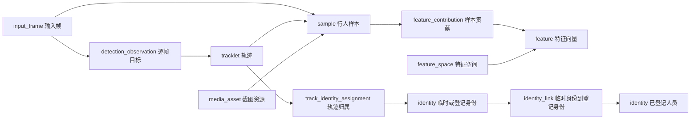

# 轨迹 ReID 与行人信息关联开发方案

编写日期：2026-11-03。状态：待实施的专项开发方案。

本文针对已经入库的 BoT-SORT 轨迹，设计“轨迹采样 → ReID 特征 → 身份关联 → 按轨迹查询人员信息”的完整开发流程。本文不代表下述新增功能已经实现。

开发目录：`/data/nfs_storage/hxjm-wsc/hxjm-monitor`。共享算法运行目录：`/data/nfs_storage/hxjm`。分支名称与目录职责分别管理；切换 Git 分支不会自动切换算法所属目录。

开发期间只做代码修改、语法检查、离线测试和编译，不启动或重启项目、数据库、模型、摄像头和容器，不执行数据库迁移或人员数据导入。实际启动、数据库核验和线上验收由使用者完成。

## 1. 目标与交付范围

### 1.1 第一期目标

1. 每条具有真实行人观测的轨迹，最多选取一张合格截图作为首期识别样本。
2. 截图和特征均能追溯到真实的 `input_frame_id`、`tracklet_id`、来源和发生时间。
3. 使用与人员图库相同的 ReID 特征空间进行匹配。
4. 匹配可信时显示已登记人员姓名、工号；没有可靠匹配时保留临时身份。
5. 通过轨迹 UUID 查询身份、识别依据、样本及处理状态。
6. 支持重试、进程恢复、权限校验、到期回收和人工纠正。
7. ReID 服务不可用或处理积压时，原有轨迹入库继续工作。

“已登记人员”必须来自有真实人员资料的图库。ReID 只能计算图像相似性，不能从陌生人的轨迹自动获得姓名或工号。

### 1.2 后续范围

多图聚合与自动重新评估、摄像头时空约束、录像回放精确叠框、大规模近似向量索引作为第二期。第一期保留样本与媒体引用，但不为每条轨迹自动生成独立 MP4。

## 2. 当前实现与待补齐能力

| 模块 | 当前可复用内容 | 本期需要完成 |
|---|---|---|
| 轨迹入库 | `result_publisher.py`、`tracking_spool.py`，逐帧登记和可靠重试 | 给采样管线提供稳定帧引用和可靠确认映射 |
| 采样流程 | `sample_pipeline.py` 已有截图、登记、提特征和关联流程 | 补齐实际分析入口、持久队列、阶段恢复与容量控制；现有内存状态不能直接视为可靠生产实现 |
| 特征计算 | `python/reid_feature_service/server.py`，CLIP-ReID RN50，3072 维 | 核验模型定义、权重与图库兼容；接入受控并发 |
| 样本特征登记 | `SampleFeatureService.java` | 校验实际帧、截图坐标、贡献样本、有效期和幂等契约 |
| 身份关联 | `IdentityBusinessService.java` | 加强候选身份分组、歧义判定、证据记录和人工纠正 |
| 查询 | 已有身份、轨迹查询接口 | 增加按轨迹 UUID 查询人员信息的入口 |
| 部署 | 共享算法目录拥有正式入库职责 | 增加独立 ReID 开关、生产者身份和健康状态 |

现有自动关联接口在轨迹已经有当前归属时，会复用原归属并更新活跃信息，不会因为新样本自动重新匹配。因此不能把“再次调用关联接口”当作改判功能。

参考资料：

- [数据库结构快照](../db/public.sql)
- [数据库说明文档](数据库说明文档.md)
- [接口文档](接口文档.md)
- [系统架构说明书](系统架构说明书.md)
- [已有轨迹持久化交接说明](../python/video_analysis/PERSISTENCE.md)

`db/public.sql` 含有 `DROP TABLE`，只用于结构核对，禁止作为此次开发的初始化脚本执行。结构快照也不能证明运行数据库已经具备所有表和索引。

## 3. 数据关系与表职责

### 3.1 核心关系



### 3.2 业务表

| 表 | 业务职责 | 本期读写内容 |
|---|---|---|
| `input_frame` | 帧的来源会话、序号、时间和尺寸 | 复用已确认帧，作为截图出处 |
| `detection_observation` | 逐帧检测框和真实/预测状态 | 采样依据及轨迹证据 |
| `tracklet` | 一段跟踪上下文中的轨迹 | 复用 UUID、来源、真实出现时间、规范轨迹引用 |
| `media_asset` | 图片或视频文件的业务元数据 | 行人截图上传和访问引用 |
| `sample` | 图片的用途及关联对象 | 历史轨迹截图用 `history`；登记图库用 `enrollment` |
| `feature_space` | 可比较特征的完整定义 | 登记模型、预处理、维数、归一化与距离定义 |
| `feature` | ReID 向量及生成执行 | 保存样本、轨迹、执行和生产键 |
| `feature_contribution` | 特征由哪些样本计算得到 | 单图也保留贡献记录，支持有效期和证据追溯 |
| `identity` | 临时身份和正式登记人员 | 临时编号，或姓名、工号等登记资料 |
| `track_identity_assignment` | 轨迹在一段有效时间内属于谁 | 轨迹与身份的当前关系及历史 |
| `identity_link` | 临时身份对应哪位登记人员 | 保留临时身份到登记身份的可撤销关联 |
| `legacy_identity_map` | 旧图库编号到统一身份的映射 | 仅在迁移旧图库时使用 |

任务、执行、能力实例、幂等记录和事务事件表继续由现有业务服务维护；身份关联现有的 `episode`、`episode_tracklet_link` 副作用必须纳入回归验证。

### 3.3 旧表与旧字段

旧 `reid_target`、`reid_target_vit`、`stranger_target`、`reid_match` 只作为兼容或迁移来源。新接口不能依赖 `tracklet.gallery_target_id`、`stranger_target_id`、`repr_embedding` 等旧字段完成身份解析。

新流程的权威查询关系是：

```text
tracklet
  → 当前有效的 track_identity_assignment
  → identity
  → 当前有效的 identity_link（临时身份存在登记关联时）
  → 登记 identity 的 display_name、employee_id
```

## 4. 必须保持的业务规则

1. BoT-SORT 的局部 `track_id` 只在其跟踪上下文中有意义，不等于人员身份。
2. 相同 UUID 的 `tracklet` 可以有归属历史，但只能有一条当前归属；历史保留、变更可追溯。
3. 当前归属、身份映射同时检查 `valid_from`、`valid_to`、到期和启用状态。
4. 查询和写入均先解析规范轨迹，再检查来源权限；不能靠原始轨迹 ID 绕过权限。
5. 只有真实行人观测能触发采样；纯预测框不能建立身份、刷新真实出现时间或延长证据期限。
6. 采样图片必须来自生成该检测框的同一分析帧，不能从稍后的展示 JPEG 反推。
7. 模型权重、预处理或输出定义不同，即使维度相同也不能直接比较。
8. 相似度不是“是同一个人的概率”；低质量、低分或候选歧义时返回未知。
9. 截图、样本、特征和身份关系的生命周期按既有规则执行，重试不续期。
10. 正式人员登记资料与七天历史截图分开管理，不把历史截图自动升级为永久图库。

## 5. 分步骤开发任务

### 第 1 步：形成只读基线与接口清单

工作内容：

1. 在个人开发目录记录当前分支、提交号及本次涉及文件的修改状态，不清理用户已有修改。
2. 核对运行库所需表、字段、唯一索引和 pgvector 扩展，形成只读 SQL 检查文件，由使用者执行。
3. 核对 `samples.register`、`features.register`、`identities.associate` 的请求、返回、权限及任务前置条件。
4. 核对四个摄像头来源映射，ReID 实例使用独立实例 UUID，不能复用跟踪实例 UUID。
5. 记录每个现有接口的兼容范围；新增字段或行为同步补充接口文档。

交付：基线记录、只读检查 SQL、接口差异清单。完成条件：明确哪些内容直接复用，哪些需要增量修改。

### 第 2 步：确定特征空间与图库准备方式

工作内容：

1. 以特征服务返回的完整定义为依据，核对权重摘要、网络、预处理、输出层、维数、L2 归一化、距离和聚合方式。
2. 当前可复用服务为 CLIP-ReID RN50、3072 维；不能将 BoT-SORT 内部 FastReID 向量直接作为同一空间使用。
3. 核对旧图库原图是否可访问、人员标签是否可信、向量生成过程是否可验证。
4. 旧向量定义无法证明一致时，从可信原图重新计算；原图缺失的记录标记为待补录，不伪造特征。
5. 准备同人、不同人的标注样本用于阈值校准；不把任意经验阈值直接作为验收依据。

交付：特征空间定义、图库兼容报告、阈值校准方法。完成条件：运行轨迹与登记图库能在同一空间比较。

### 第 3 步：建立登记人员图库

工作内容：

1. 通过现有身份登记接口建立 `registered` 类型的 `identity`，填写姓名和工号。
2. 上传可信的登记照片，建立 `enrollment` 样本，不冒用历史轨迹样本的长期保留身份。
3. 通过独立 ReID 任务计算特征，登记到同一 `feature_space`，特征关联登记身份和贡献样本。
4. 迁移旧图库时写入明确的命名空间及 `legacy_identity_map`；旧 UUID 不能未经映射就当成新身份 UUID。
5. 登记原图、样本、特征的保留策略一致；删除或禁用人员后，相应候选不可继续用于新识别。

交付：可重复执行的导入工具或接口流程、脱敏示例、只读检查方法。开发时只编写工具和离线验证，不实际导入人员数据。

### 第 4 步：实现同帧行人采样

工作内容：

1. 在分析结果产生后、展示截断和 JPEG 展示处理前，读取同一原始帧及完整检测列表。
2. 筛选真实行人框，排除预测、越界、面积过小和检测置信度不足的目标。
3. 对框做坐标裁剪和合法性检查，记录原始尺寸、坐标系、裁剪范围及质量指标。
4. 每个跟踪上下文与局部编号最多保留一个合格候选；首帧不合格时，允许后续真实观测继续尝试。
5. 阈值、最小宽高、采样预算和等待上限可配置；结束前始终无合格样本则记为未采样。
6. 图片离开采集回调前完成独立缓冲或编码，避免底层帧复用导致图片与检测框不一致。

交付：采样选择器与纯函数坐标测试。完成条件：离线固定帧能够验证“框和图片来自同一帧”，预测框不会触发采样。

### 第 5 步：打通真实帧与轨迹确认映射

工作内容：

1. 在结果入队时给采样候选附上稳定的成果 ID、公共帧 ID、上下文和局部编号。
2. 复用服务端登记返回的真实轨迹映射，不根据局部编号、文件名或时间相近猜测 `tracklet_id`。
3. 仅对服务端已确认的 `accepted_result_ids` 和 `duplicate_result_ids` 进入后续样本登记。
4. 确认映射缺失或不一致时保留候选并报出具体错误，不能偷偷生成替代轨迹。
5. 将确认与样本队列交接落盘；只有交接持久成功，才允许清理对应的轨迹确认记录。
6. 覆盖服务端已提交但响应丢失、部分确认、重复确认和进程在交接中崩溃的情况。

交付：可靠确认交接机制与恢复测试。完成条件：重放同一确认不会重复采样，也不会遗失已接受的采样任务。

### 第 6 步：实现独立的持久采样队列

建议新增 `sample_spool.py`，由本地持久磁盘保存截图和阶段状态。不要直接把现有 `LocalSamplePipeline` 的内存队列作为最终实现。

持久字段至少包括：

| 类型 | 字段 |
|---|---|
| 来源 | source、session、context、frame、result、local_track、确认后的 tracklet 标识 |
| 图片 | 文件引用、摘要、尺寸、坐标和质量信息 |
| 幂等 | job、asset、sample、feature UUID，各阶段 request_id 和生产键 |
| 执行 | 实例、模型空间快照、task、run、revision 和租约信息 |
| 恢复 | 当前阶段、冻结请求、已确认返回、重试次数、下次尝试时间 |
| 生命周期 | 原发生时间、证据到期、占用字节、错误码 |

建议阶段：

```text
captured → waiting_track_ack → track_confirmed → asset_registered
→ sample_registered → task_running → feature_ready
→ feature_registered → identity_associated → task_finished → done
```

异常分别记录可重试、永久拒绝、已到期和主动放弃原因；这些是新队列内部阶段，不是现有数据库枚举。

实现要求：稳定 UUID、冻结请求、原子写入、文件及目录同步、单所有者锁、按阶段恢复、图片先持久再引用、清理孤儿文件、明确容量上限。向量计算结果一经确认也要持久保存，响应丢失不能换 ID 重新造业务对象。

队列压力只暂停新的 ReID 采样，不阻塞轨迹持久化。磁盘耗尽或采样持久失败时释放候选帧，保留可观测错误；不能无限占用内存，也不能承诺采样零丢失。

交付：持久队列、容量策略、恢复与故障测试。

### 第 7 步：接入 ReID 提特征与业务执行

每个样本使用独立的一次性 ReID 任务，执行顺序为：

1. 上传截图资源并登记样本。
2. 获取并登记特征空间定义，拒绝定义发生变化却继续复用旧空间的情况。
3. 提交 ReID `once` 任务，输入为图片资产，输出为 `feature.embedding`。
4. 启动任务，持久保存 `task_id`、`run_id`、revision 和租约。
5. 调用特征计算服务，校验空间、维数、有限数值和归一化。
6. 登记 `feature` 及贡献样本。
7. 在执行仍为合法运行状态时调用 `identities.associate`。
8. 身份关联确认成功后，完成 ReID 任务。

现有后端会校验执行状态、任务归属和租约；不能使用已经结束的跟踪任务或先完成 ReID 任务再做身份关联。

长等待需要按接口契约维护租约与任务有效期。执行已不可恢复时，先核对已登记成果，再显式创建新的合法执行；新执行使用新的执行/请求标识，旧请求不能在换载荷后继续复用。

模型由特征服务集中加载，限制并发和排队长度，不按每条轨迹创建模型进程。离线阶段使用假提取器，不启动 GPU 服务。

交付：任务编排、冻结模型定义、执行恢复逻辑和假 HTTP 测试。

### 第 8 步：完善身份匹配与拒识

工作内容：

1. 候选只使用同一启用空间、同一对象类型、有效特征、有效身份和可用贡献样本。
2. 校验当前调用者对来源和图库的访问范围，不让越权候选通过分数或姓名泄露。
3. 将候选临时身份解析到其有效登记身份后，按最终身份分组，再计算第一与第二候选。
4. 同一人的多张图库照片不应占据前两名，制造虚假的候选差距。
5. 同时满足质量、第一候选阈值和不同身份候选差距要求时才认可匹配；无第二候选也必须满足主阈值与质量要求。
6. 低分或歧义时创建/保持临时身份，姓名、工号为空。第一期默认不因不确定的临时身份互相相似就无限扩大身份簇。
7. 事务内维护归属、临时到登记身份映射、相关活动和事件；保持现有锁与当前唯一约束。
8. 防止自动识别的低可信历史特征反向污染登记图库；登记样本与自动历史样本的候选用途明确区分。

需要保留：feature/sample/run、候选身份、分数、阈值、差距、策略版本、质量和拒识原因。现有关系表没有完整证据专栏，实施时先审查已有事务事件载荷能否满足可查询追溯；不足时提交最小增量字段和迁移方案，不能把 JSON 塞进 `basis_type` 冒充枚举。

阈值和差距参数属于新增匹配契约，现有接口目前只接受 `threshold` 等已有字段；新增前同步接口定义和参数校验。

交付：候选分组、保守拒识、并发回归和证据查询能力。

### 第 9 步：实现人工纠正和历史保留

定义两个不同操作：修改某一条轨迹的归属，以及确认/撤销整个临时身份到登记人员的映射。

1. 修改单轨迹时，关闭原归属的有效区间，再建立新归属，不能直接覆盖旧记录。
2. 修改临时身份映射时，明确影响该临时身份关联的多条轨迹；页面显示影响范围。
3. 每次纠正要求预期 revision、稳定 request_id、明确原因和操作者。
4. 新增权限操作名称及接口请求响应，使用单独的业务方法，不借用自动关联接口偷偷改判。
5. 同事务检查当前关系并处理并发冲突，保持一条当前关系；同步核对活动、身份汇总及事件。
6. 设计历史查询与当前查询的区别；有效区间起点表示关系生效时间，不伪装为采样或实际出现时间。

交付：纠正接口、权限、审计与并发测试。自动多样本改判留到第二期。

### 第 10 步：增加按轨迹查询人员信息

拟新增：`GET /api/v1/business/tracklets/{tracklet_id}/person`。此路径是待开发设计，当前不能直接调用。

处理流程：

1. 验证轨迹、解析规范轨迹、检查来源权限和有效期。
2. 查询当前有效归属和身份，再解析当前有效登记映射。
3. 返回身份、姓名、工号、识别依据、样本引用、模型空间及相关时间。
4. 图片通过受权限控制的业务资源接口获取，响应不暴露服务器文件路径。
5. 历史查询如需支持 `as_of`，另行定义时间区间语义，不能混用当前结果。

业务状态建议：

| 状态 | 含义 |
|---|---|
| `recognized` | 有有效登记身份及可信关联 |
| `temporary` | 有临时身份，尚无有效登记关联 |
| `unassigned` | 当前没有可用身份归属 |

处理阶段建议作为独立可选的 `processing_status`。只有业务端有可靠同步的任务/状态依据时才返回 `pending`、`processing`、`failed`、`no_qualified_sample` 等值；数据库中没有样本不能证明正在处理，也不能证明没有合格样本。暂时无法取得处理状态时返回 `unknown`。

请求不可见、不存在或到期时沿用项目统一错误契约，不伪造 `unassigned` 掩盖错误。后端查询不能直接遍历算法服务私有队列；如需展示细分阶段，应设计带来源权限的状态投影和恢复机制。

以下为拟定业务数据体示例，统一响应外壳沿用现有 `BusinessResponses`：

```json
{
  "requested_tracklet_id": "轨迹UUID",
  "canonical_tracklet_id": "规范轨迹UUID",
  "status": "recognized",
  "processing_status": "completed",
  "assigned_identity_id": "临时身份UUID",
  "registered_identity_id": "登记身份UUID",
  "display_name": "示例人员",
  "employee_id": "示例工号",
  "assignment_id": "归属UUID",
  "assignment_revision": 1,
  "sample_id": "样本UUID",
  "feature_id": "特征UUID",
  "feature_space_id": "实际模型空间标识",
  "score": 0.91,
  "basis_type": "feature_match",
  "sample_occurred_at": "2026-11-03T09:41:17.552Z"
}
```

示例分数不是推荐阈值；`basis_type` 需分别表达轨迹归属和登记映射的依据，最终契约避免混淆。临时或未分配状态的姓名、工号返回空值。

交付：接口说明、Java 查询实现和权限测试。

### 第 11 步：前端接入与媒体边界

1. 定位现有轨迹详情入口，携带真实 `tracklet_id` 调用新查询接口。
2. 展示姓名/工号或临时编号、识别状态、样本时间和证据图片。
3. 明确区分未知、处理中、失败和过期，不显示上一条轨迹遗留的姓名。
4. 轨迹活跃时采用受控刷新或已有通知机制，页面关闭不影响后台识别。
5. 人工纠正入口按操作权限显示，提交当前 revision，冲突时重新获取结果。
6. 播放视频继续按来源和轨迹时间范围解析已有录像资产；没有录像则显示不可用。

当前算法解码会话与独立录像会话不具备天然同帧关系，不能将算法流内 PTS 直接当作录像文件偏移。第一期不承诺录像精确叠框，截图资源也不能代替录像片段。

交付：轨迹详情状态展示及可用性处理。

### 第 12 步：配置、权限和可观测性

建议新增以下配置，名称为方案建议，实施前不能当作现有可用变量：

| 建议配置 | 用途 |
|---|---|
| `VIDEO_REID_ENABLED` | 默认关闭，独立控制新采样识别 |
| `VIDEO_REID_FEATURE_URL` | 特征计算服务地址 |
| `VIDEO_REID_INSTANCE_ID` | 已登记的 ReID 实例 UUID |
| `VIDEO_REID_SERVICE_ID`、`VIDEO_REID_SERVICE_TOKEN` | 独立服务身份与凭据 |
| `VIDEO_REID_QUEUE_DIR`、`VIDEO_REID_QUEUE_MAX_BYTES` | 本地持久队列及容量 |
| `VIDEO_REID_MAX_INFLIGHT` | 特征处理并发 |
| `VIDEO_REID_MIN_WIDTH`、`VIDEO_REID_MIN_HEIGHT` | 样本最小像素尺寸 |
| `VIDEO_REID_MIN_DETECTION_SCORE` | 检测质量门槛 |
| `VIDEO_REID_MATCH_THRESHOLD`、`VIDEO_REID_MATCH_MARGIN` | 经过校准的识别阈值与候选差距 |

能力代码、实现版本、参数契约和续租周期以实际登记实例为准，不硬编码模板默认值。

建议采用 `reid-producer` 服务身份。按实际调用授予 `instances.query`、`samples.register`、`feature_spaces.register`、`features.register`、`identities.associate`、任务提交/启动/完成及所需资产上传操作；任务完成和资产上传操作名从现有控制器核对后写入部署示例，不臆造。若需要轮询登记图库，再单独授予 `samples.process` 等权限。来源限制为实际四路，人工纠正不授予自动生产者。

配置仅由共享算法所有者加载，个人订阅项目不启动第二套正式 ReID 生产者；媒体子进程不继承服务令牌。现有文件权限不在本任务中擅自变更，配置示例不填写真实令牌。

健康状态至少包括：采样数、跳过原因、等待轨迹确认数、积压数/字节、最老等待时间、各阶段成功/失败/过期数、模型空间、处理延迟和阻塞原因。禁止输出向量全文、令牌和摄像头凭据。

关闭 ReID 时停止接收新样本，保存已有任务；重新开启按阶段恢复。旧队列使用原配置和模型空间快照，不静默绑定到新模型。关闭 ReID 不关闭轨迹入库。

交付：默认关闭的配置示例、权限清单、健康字段和操作说明。

### 第 13 步：离线验证、交接与使用者验收

开发者先完成离线检查，交付后由使用者启动单摄像头验证，再扩展四路。

| 场景 | 必须验证的结果 |
|---|---|
| 已登记人员、同空间且匹配充分 | 轨迹可查询姓名、工号及样本依据 |
| 陌生人或候选歧义 | 保留临时身份，不强行显示登记姓名 |
| 首帧不合格，后续合格 | 后续真实帧可采样，同轨迹预算受限 |
| 纯预测、空帧或丢失目标 | 不伪造真实样本或身份 |
| 相同局部编号在新上下文重用 | 不串接为旧轨迹 |
| 部分确认、重复确认 | 仅处理已确认结果且无重复业务对象 |
| 资产/样本/特征提交后丢响应 | 重试返回原确认，无重复资源 |
| 任一阶段崩溃重启 | 阶段恢复，不跳过任务完成，不丢失已持久候选 |
| 模型空间或向量维度不匹配 | 明确拒绝，不写入错误空间 |
| 队列满、磁盘写入失败、ReID 超时 | 停止或跳过新采样，轨迹入库继续 |
| 租约失效或任务已终态 | 不使用非法 run 继续身份关联 |
| 证据过期或样本不可用 | 不继续作为可信候选，历史按到期规则处理 |
| 两个线程关联同一轨迹 | 只有一条当前有效归属 |
| 同一登记人多张照片 | 按身份分组后判断不同人的候选差距 |
| 越权来源、禁用人员 | 不泄露轨迹、姓名、样本和候选信息 |
| 人工纠正、重复提交和 revision 冲突 | 历史保留，幂等正确，冲突可见 |
| 无浏览器订阅 | 采样和后台处理仍按配置工作 |

离线验证使用临时目录、固定测试图片、假 HTTP 返回、固定向量和假时钟；不读取实时摄像头，不加载真实模型。真实数据库事务、pgvector 查询、索引与并发锁仍需使用者在集成环境验证，离线通过不等于这些行为已实测。

可复用的现有回归命令如下；执行时先确认对应 Python/JDK 可用：

```bash
cd /data/nfs_storage/hxjm-wsc/hxjm-monitor

PYTHONPATH=python python3 -B -m video_analysis.persistence_check
PYTHONPATH=python python3 -B -m unittest discover -s python/video_analysis/tests -p 'test_persistence.py' -v
PYTHONPATH=python python3 -B -m unittest discover -s python/video_analysis/tests -p 'test_analyzer_persistence_offline.py' -v

JAVA_HOME=/usr/lib/jvm/java-8-openjdk-amd64 \
  mvn -o -f SmartMonitor-wangzj/pom.xml \
  -pl hxjm-algdeployment -am -DskipTests test-compile

git diff --check
```

新采样队列、身份匹配和查询测试的命令随实际文件补充到交接文档，不能在交付记录中把计划测试写成已通过。

## 6. 建议修改位置与交付文件

以下新增文件名均为建议，实施时根据职责细化。

| 位置 | 计划内容 |
|---|---|
| `python/video_analysis/analyzer.py` | 同帧采样入口、完整检测结果与帧引用 |
| `python/video_analysis/result_publisher.py` | 可靠确认交接，保持原轨迹队列语义 |
| `python/video_analysis/sample_pipeline.py` | 复用业务流程，接入持久阶段恢复 |
| `python/video_analysis/sample_spool.py`（新增） | 截图、阶段、请求与确认的持久队列 |
| `python/video_analysis/reid_config.py`（新增） | 开关、实例、阈值、容量校验 |
| `python/video_analysis/tests/` | 队列恢复、同帧、匹配与失败隔离测试 |
| `python/reid_feature_service/` | 核对接口兼容和模型定义，必要时增量修改 |
| Java `business/service/SampleFeatureService.java` | 样本、贡献、有效期校验 |
| Java `business/service/IdentityBusinessService.java` | 匹配、证据、纠正与关系维护 |
| Java `business/api/IdentityBusinessController.java` | 新查询和纠正入口 |
| Java 查询服务及测试 | 轨迹到人员聚合、来源权限和时间有效性 |
| `deploy/botsort/` | 无真实凭据的配置示例 |
| `scripts/local-common.sh` 等实际启动配置加载处 | 仅由共享算法所属目录启用 |
| 前端实际轨迹详情组件 | 身份状态、证据、纠正入口 |
| `python/base/postgresql/stage1/` | 只读检查；确需结构变更时另交增量迁移 |
| `docs/接口文档.md`、`docs/数据库说明文档.md` | 同步已确定的公共契约增量 |
| `python/video_analysis/REID_PERSISTENCE.md`（新增） | 配置、恢复、停用、验收和已知限制 |

不改写已有客户端以破坏其他业务调用，不大范围整理格式，不覆盖共享目录已有的大量修改。

## 7. 里程碑与进入条件

| 里程碑 | 包含步骤 | 可检查的结果 | 后续进入条件 |
|---|---|---|---|
| M1：图库与契约就绪 | 1～3 | 表/接口清单、兼容报告、登记与提特征流程 | 确认空间与图库来源 |
| M2：可靠轨迹采样 | 4～6 | 同帧采样、确认映射、持久队列与恢复测试 | 重放无重复，失败不阻塞轨迹 |
| M3：人员关联闭环 | 7～8、10 | 特征登记、拒识、轨迹查人接口 | 固定向量测试及权限检查通过 |
| M4：可运维交付 | 9、11～13 | 纠正、前端、配置、健康状态和验收说明 | 使用者完成真实环境验收 |

每个里程碑单独形成可审查提交，提交前核对文件范围，避免把 `node_modules.backup`、`target.backup`、本地令牌、队列截图及模型权重纳入提交。

## 8. 合并、启用与回退

1. 个人开发目录完成代码、文档和离线验证，记录准确的测试结果与未验证项。
2. 使用者审核并合并后，再按实际部署方式将功能提交同步到共享运行目录；保留该目录原有修改，不做整目录覆盖或强制重置。
3. 使用者核验数据库和能力实例。如需迁移，只执行经过审查的增量脚本，不导入完整 `public.sql`。
4. 先关闭开关配置好图库、模型空间、实例、来源、服务权限和本地队列，再由使用者启动单摄像头验收。
5. 验收身份正确性、临时身份拒识、恢复和原轨迹入库后，再扩展到四路。
6. 出现识别或积压问题时关闭 ReID 开关，保留队列和证据；原轨迹持久化继续运行。
7. 回退代码前确认队列格式兼容和正在运行的任务，不能删除队列或清空身份表来恢复服务。已产生的错误归属通过纠正流程处理，关闭功能不会自动撤销历史识别。

最终验收应能够回答：这条轨迹对应谁、依据哪张图和哪个模型、为什么接受或拒绝、失败在哪里、纠正影响哪些数据，以及到期后还能查询什么。
