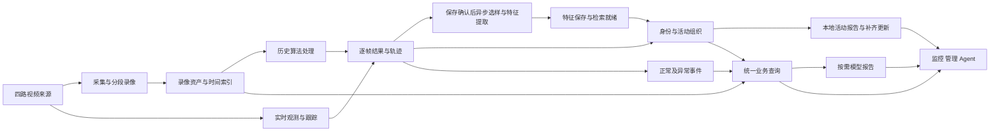

# HXJM 软件需求规格说明书

| 项目 | 内容 |
|---|---|
| 文档编号 | HXJM-SRS-001 |
| 版本 | v0.2 |
| 状态 | 开发设计基线 |
| 日期 | 2026-10-29 |
| 适用范围 | 视频监控、算法数据协作、人员与活动检索、业务问答、报告及管理功能 |
| 目标读者 | 产品、业务、系统设计、前后端、算法、模型、数据与测试人员 |
| 关联文档 | [文档导航](README.md)、[系统架构说明书](系统架构说明书.md)、[接口文档](接口文档.md)、[数据库说明文档](数据库说明文档.md) |
| 修订记录 | v0.1：定义产品功能；v0.2：合并产品需求，定义统一数据主链、身份与活动、检索报告、生命周期、统计和验收要求；明确持续播放、过期标注与后台处理隔离；细化可替换选样、独立特征任务、登记及查询素材处理和默认 60 秒的本地活动报告；明确首轮 Agent 接入的图片查询交互及已有路线报告查看回放范围；首轮改为无用户JWT的内网直接调用和session_id会话隔离；2026-10-28：明确页面与Agent免登录共享范围、查询NULL归属及后台写入身份边界。；补充yh旧版能力恢复、本地图片上下文及本地查询契约。 |

## 1. 目的、范围与术语

### 1.1 目的

本规格规定 HXJM 的业务行为、数据规则、质量要求与验收条件，作为开发、模块协作和验收的共同依据。需求使用稳定编号，功能通过可操作的输入、输出及异常分支定义。

本文负责业务规则；架构文档负责模块协作；接口文档负责交换契约；数据库文档负责库表字段、数据对象关系、唯一约束、读写及生命周期。统计口径以本文第 5.8 节为准，接口响应和数据查询采用相同定义。

### 1.2 产品范围

平台以四路摄像头为视频来源，持续保存录像和算法实际产生的逐帧结果，自动形成样本、特征、轨迹、临时身份、跨摄像头活动及业务事件。监控页面、管理页面和业务查询 Agent 共同使用这些数据，支持历史检索、录像回放、异常展示及报告生成。

平台面向检测、跟踪、特征和其他算法定义公共输入与产物约定；近期打架、跌倒仅保存已输出判断与可用证据，不保存骨骼等中间数据。平台的实时分析、录像分析和已有产物分析通过同一业务主链衔接。算法实现与模型编排可以替换，公共业务对象和查询语义保持一致。

### 1.3 扩展边界

园区视觉、垃圾检测、样本标注、知识库问答、机器狗视频与状态及其他独立演示保留独立入口。共享数据时使用来源、资产、任务和类型化结果契约；共享人员、活动、事件时引用相应公共对象。

后续机械狗和无人机等设备通过视频来源、位置与状态观测接入相应应用。设备动作控制由独立业务定义。复杂的已结束活动追溯合并与拆分、高度自动恢复、完整报告历史版本库不列入本版主链验收范围。

### 1.4 术语

| 术语 | 定义 |
|---|---|
| 来源 | 摄像头、视频设备或上传入口等数据产生位置，使用 `source_id` 标识 |
| 流会话 | 一次连续的视频采集区间，使用 `stream_session_id` 标识；重连后建立新会话 |
| 资产 | 具有标识、内容位置和使用期限的录像、图片或其他数据文件 |
| 帧观测 | 针对确定来源、流会话和视频时间的一帧分析结果，可含零个或多个目标 |
| 轨迹 Tracklet | 同一路流中一次连续跟踪产生的观测序列，使用 `tracklet_id` 标识 |
| 样本 | 从原图、观测或轨迹选出的单图或同目标多帧输入，保留来源关系 |
| 特征空间 | 定义特征表示及兼容规则的空间，使用 `feature_space_id` 标识 |
| 临时身份 | 由历史观测自动关联的目标对象，`identity_kind=temporary` |
| 登记身份 | 经显式登记操作维护的身份及独立登记样本，`identity_kind=registered` |
| 身份归属 | 轨迹与身份之间的关联结论及依据，使用 `assignment_id` 标识 |
| 活动 | 同一对象的一次业务过程，可包含跨时间、跨摄像头的多条轨迹 |
| 事件 | 根据业务规则组织的正常或异常情况，可涉及多个对象和多种算法结果 |
| 报告 | 基于活动、事件或查询范围及证据生成的结构化结论和文字说明 |
| 业务任务 | 可独立持续执行的处理请求，使用 `task_id` 标识；执行尝试使用 `run_id` 标识 |
| 处理覆盖 | 指定来源和时间范围已完成、待处理或缺失的情况 |
| Agent | 接收自然语言及图片、组织业务工具调用并呈现回答的交互模块 |
| 业务证据资产 | 为活动或事件独立登记、按所属业务期限管理的证据内容或有效资产引用 |

## 2. 角色与使用场景

### 2.1 角色

| 角色 | 使用目标 | 主要操作 |
|---|---|---|
| 监控值守用户 | 观察现场、定位目标和事件 | 查看四路视频与标注、统计、身份和告警，查询活动并回放 |
| 业务查询用户 | 通过文字或图片查找历史内容 | 选择截图目标、检索人员、追问轨迹与事件、查看报告和证据 |
| 资料维护人员 | 维护业务目录和登记资料 | 维护来源、设备、算法资料、登记身份及相关图片 |
| 系统管理员 | 控制访问与系统运行 | 管理账号、角色、组织、数据范围、参数、日志、缓存和定时任务 |
| 算法与集成人员 | 交付可复用的分析结果 | 按契约接收输入、提交结果与处理状态，验证新算法兼容性 |
| 设备接入人员 | 提供视频与业务观测 | 接入设备来源、维护状态和位置等类型化数据 |

本版历史查询、录像读取与播放、以图查人、人员登记及人员、样本、活动、事件、报告查询均直接访问，不要求用户登录、JWT或Cookie。页面与Agent使用同一共享业务范围：全部已登记视频来源及有效共享业务数据。新查询的 `query_request.owner_user_id` 为NULL，查询图的 `media_asset.meta.owner_actor_key` 为 `shared:business`；查询图最长七天，正式登记图按登记资料保存。不同对话仍由Agent的session_id区分，session_id不是数据权限。原有非空用户归属查询及其私有查询图片不自动改为共享。算法写入、输入会话、录像登记、特征写入和后台生成、修改及管理继续校验身份、操作和来源。

### 2.2 主要场景

| 场景 | 触发与输入 | 结果 |
|---|---|---|
| 日常监控 | 用户打开监控页面 | 四路独立视频、匹配画面的标注、来源和分析状态、统计与卡片 |
| 历史回看 | 用户指定来源和时间范围 | 录像区间、对应逐帧结果及处理缺口 |
| 按图找人 | 用户上传单人图或在多人截图中选定目标 | 登记库与历史观测候选、相似度、来源和证据 |
| 活动追踪 | 用户选择身份或候选并指定范围 | 跨摄像头轨迹、活动路线、可用回放和报告 |
| 事件分析 | 算法产生正常或异常业务情况 | 事件、涉及对象和证据，按业务条件生成报告 |
| 多轮问答 | 用户追问已选目标、事件或报告 | 使用结构化引用继续查询，返回相关卡片和证据 |
| 业务维护 | 授权人员提交管理操作 | 经校验的资料与配置，或明确的权限、冲突和输入错误 |

## 3. 端到端业务流程

### 3.1 采集、录像与观测

1. 视频来源接入后持续采集并在 `/data/nfs_storage` 保存录像；录像和算法处理独立于浏览器连接运行。
2. 实时算法按其分析帧率处理输入，保存实际产出的全部帧结果及全部目标框，向监控端提供相同定位的可视化结果。
3. 录像可用后完成资产登记，后续算法可读取录像或已有产物处理指定范围。来源中断、未分析帧及缺失录像分别表达。

### 3.2 样本、特征、身份与活动

1. 首期为每条轨迹选择首个真实人员有效框。帧成果可靠保存并取得稳定轨迹标识后，后台保存图片与样本，建立独立有限范围特征任务，登记特征并关联身份；特征任务完成时确认已保存产物。采样策略在后台样本处理模块内适配，实时推理和标注不等待样本处理。
2. 系统使用兼容特征空间及相关观测进行跨时间、跨摄像头关联，建立或沿用临时身份，维护轨迹归属。
3. 同一身份的关联观测按活动规则组织为跨镜活动；默认连续 60 秒无新真实观测后收束，等待时长可配置。本地自动生成包含路线、回放关联及处理覆盖的结构化报告，不依赖远端 Agent 或模型服务。
4. 显式登记操作建立或选择登记身份并保存独立登记资料。后台轮询待处理登记样本，为其提取特征；用户查询素材独立处理。上传、检索和自动匹配继续使用各自业务语义。

### 3.3 检索、问答与报告

1. 页面和 Agent 向共同的业务查询能力提交来源、时间、对象或图片条件。
2. 查询返回候选、业务对象、证据引用与处理覆盖；后续追问通过结构化标识引用目标。
3. 本地活动报告使用已完成范围的事实和证据直接生成当前内容，后续录像或关联轨迹依据补齐时更新同一报告。按需模型报告通过独立生成链路处理，两种报告互不覆盖。
4. 业务任务持续执行并保存进展。用户可在断线、重连或重新打开页面后通过任务或业务标识读取结果。

### 3.4 故障与到期

每个环节保存自己的完成情况和失败原因。已完成内容继续可用，可补范围在输入有效时重新处理；无法补齐的范围保留缺口，并以观察中断收束受影响记录。数据达到期限后停止普通访问与检索，关联任务、证据和会话业务内容按所属期限清理。

## 4. 功能需求

下表的“异常与结果”规定失败分支；对应可执行验收条件见第 7 节。

### 4.1 监控与业务展示

| 编号 | 触发与输入 | 处理及输出 | 异常与结果 |
|---|---|---|---|
| FR-MON-001 | 用户打开监控页面 | 展示四路来源及名称，每路独立播放并显示采集、录像和分析状态 | 单路不可用显示该路状态，其余路继续使用 |
| FR-MON-002 | 用户开启实时标注 | 画面持续播放，按来源、流会话、帧时间和坐标显示有效目标框、标签和跟踪引用；支持关闭标注 | 拒绝旧会话、错帧和失效结果；过期框停止显示，标注因延迟不可用时提示分析延迟，不停住画面等待；新有效结果恢复正常分析状态，零目标帧清空对应标注 |
| FR-MON-003 | 页面读取概览和统计 | 展示设备资料数量、来源运行状态、人员出现次数、去重人数、事件分类和趋势；标明单位、范围和覆盖 | 空数据与数据不可用分别显示；未归属出现数单列 |
| FR-MON-004 | 页面取得身份、活动和告警数据 | 展示照片、可用身份资料、来源、发生时间、事件类别和证据入口 | 无图片或录像时保留有效文字与状态；展示属性使用对应资料或分析结果 |
| FR-MON-005 | 页面读取报告列表或接收报告更新 | 按报告标识合并卡片，展示主题、摘要、业务时间、修订标记、完整程度及回放 | 更新失败继续展示最近有效内容；重连后重新读取当前报告 |
| FR-MON-006 | 用户查看算法能力与状态 | 展示能力目录，并分别提供配置启用情况和实际处理状态 | 未启用、处理失败和来源不可用分别显示 |

### 4.2 连续录像与历史回看

| 编号 | 触发与输入 | 处理及输出 | 异常与结果 |
|---|---|---|---|
| FR-MED-001 | 来源开始采集 | 四路分别持续录制到 `/data/nfs_storage`，保存来源、会话和实际视频区间 | 浏览器断开或算法失败时继续录像；写入故障标明受影响范围 |
| FR-MED-002 | 录像分段形成可用文件 | 登记资产标识、来源、时间区间、内容位置和可用状态 | 重复完成通知沿用同一资产；登记失败保留可重试进度 |
| FR-MED-003 | 用户指定来源和半开时间区间 | 查询录像资产、可用区间、缺段和访问入口 | 无记录、尚未就绪、已到期和文件不可用分别返回 |
| FR-MED-004 | 用户播放历史区间并开启标注 | 将已保存逐帧结果与对应录像定位匹配，支持按帧或按时间读取 | 缺段和未分析范围明确标记，画面与结果不匹配时停止叠加该结果 |

### 4.3 算法观测与类型化产物

| 编号 | 触发与输入 | 处理及输出 | 异常与结果 |
|---|---|---|---|
| FR-OBS-001 | 算法接收实时流、录像、样本或已有结果 | 通过来源、资产、任务、执行和输入引用定位处理范围，按声明类型提交产物 | 输入或类型校验失败返回明确错误，已完成结果保留 |
| FR-OBS-002 | 算法产生帧分析结果 | 保存该次分析实际产出的全部帧结果和全部目标框，保留生产者、版本及视频定位 | 有效零目标结果正常保存；未处理帧使用处理覆盖表达 |
| FR-OBS-003 | 跟踪算法形成连续轨迹 | 保存真实观测与局部跟踪引用，形成独立 `tracklet_id`，关联所属来源与会话 | 重连或新连续轨迹建立新轨迹；算法局部编号在其作用域内使用 |
| FR-OBS-004 | 骨骼、分割或其他算法产生产物 | 保存结果类型、结构版本、来源与坐标定义；按业务需要查询或叠加显示 | 非兼容类型、结构或坐标返回校验错误，保留其他有效产物 |
| FR-OBS-005 | 算法开始、完成、失败或停止处理 | 记录输入范围、可靠保存范围和缺口，分别提供处理、保存与可用状态 | 来源恢复只更新来源状态，历史缺口仍按实际处理情况保留 |

### 4.4 样本与特征

| 编号 | 触发与输入 | 处理及输出 | 异常与结果 |
|---|---|---|---|
| FR-FEA-001 | 观测或轨迹满足选样条件 | 首期每条轨迹采用首个真实人员有效框；帧保存确认并取得稳定轨迹标识后，后台保存图片及样本，关联原帧、区域、时间、轨迹和策略。采样策略在样本处理模块内适配 | 预测框不触发选样；帧未确认时不登记依赖该帧的样本；实时推理和标注继续 |
| FR-FEA-002 | 轨迹样本、登记样本或选定查询目标待提取特征 | 后台建立独立 `once` 特征任务及执行，以 `feature.embedding` 保存特征、空间、生产版本与样本来源；完成任务时确认已保存产物。登记与查询素材由后台轮询处理 | 提取失败、保存失败和检索未就绪分别表达；失败不影响实时通道，也不将未保存特征视为可用 |
| FR-FEA-003 | 特征进入检索或身份关联 | 仅比较兼容 `feature_space_id` 的特征；不同空间可并存 | 无兼容特征时返回该状态；索引未就绪不显示为无匹配 |

### 4.5 身份与人员检索

| 编号 | 触发与输入 | 处理及输出 | 异常与结果 |
|---|---|---|---|
| FR-ID-001 | 新轨迹及兼容特征可用 | 自动执行跨时间、跨摄像头关联，建立或沿用临时身份并保存归属依据 | 无足够关联依据时保留未归属轨迹或独立临时身份，输出真实归属状态 |
| FR-ID-002 | 临时身份再次出现或达到无出现期限 | 持续出现沿用 `identity_id`；连续七天无新出现时清理临时身份 | 每条旧观测、样本和特征按自身期限到期；到达时间不替代发生时间 |
| FR-ID-003 | 页面使用者直接执行登记操作，无需登录 | 创建或选择登记身份，保存独立登记资料及选定登记样本，维护身份对应关系 | 资料校验或权限失败拒绝登记；上传、查询和自动匹配不触发登记 |
| FR-ID-004 | 用户按图、描述或身份条件查询 | 支持登记库和有效历史观测检索，覆盖未登记人员；返回检索范围、候选、来源与证据 | 空范围、未处理、无兼容特征、无匹配和查询失败分别返回 |
| FR-ID-005 | 用户选择候选或查看匹配结果 | 使用稳定对象引用继续查询，展示相似度、匹配依据和当前身份关联 | 候选相似度保持候选含义；失效或越权引用返回对应结果 |

### 4.6 活动与事件

| 编号 | 触发与输入 | 处理及输出 | 异常与结果 |
|---|---|---|---|
| FR-ACT-001 | 同一身份出现新的关联观测 | 组织跨镜活动，记录真实观测起止、轨迹和来源；无新真实观测等待间隔默认 60 秒，可配置 | 预测框不推进最后真实出现时间；缺口随活动提供，复杂追溯重组遵循第 1.3 节边界 |
| FR-ACT-002 | 用户查询活动或活动达到收束条件 | 返回跨摄像头出现顺序、轨迹、来源、证据和回放；收束后直接生成本地结构化人员路线报告 | 只返回实际关联路径，缺失范围随路线与报告一起提供；远端 Agent 未启动不影响生成和读取 |
| FR-ACT-003 | 新结果补齐仍有效的活动范围 | 更新相关依据和当前结论，恢复后的新轨迹继续正常身份关联 | 已结束记录的复杂追溯合并与拆分遵循第 1.3 节边界 |
| FR-EVT-001 | 已定义业务规则识别正常或异常情况 | 建立相应事件，保留类别、发生区间、涉及对象和判断依据 | 普通算法产物按其结果类型保存；事件和报告按各自业务条件产生 |
| FR-EVT-002 | 多种算法或多个目标共同支撑事件 | 按实际可用情况关联原始结果、身份、轨迹、样本及视频证据，不要求人员或骨骼，保留来源差异 | 证据缺失与处理不足随事件提供，保留已有有效依据 |
| FR-EVT-003 | 页面、管理端或 Agent 查询事件 | 按共同的来源、时间、类别和权限规则返回事件及证据 | 单一来源不可用时返回可用结果及其覆盖 |

### 4.7 报告生成与更新

| 编号 | 触发与输入 | 处理及输出 | 异常与结果 |
|---|---|---|---|
| FR-RPT-001 | 活动收束，或事件、业务查询按相应规则请求报告 | 活动自动生成 `local_structured` 的 `person_route` 报告，直接读取有效轨迹、录像及覆盖，任务与执行引用为空；需要模型分析时使用独立报告生成链路 | 本地报告不依赖远端 Agent 或模型；模型失败不覆盖或影响已有本地报告 |
| FR-RPT-002 | 部分结果可用，或后续录像及关联轨迹依据补齐 | 先按已完成数据生成带覆盖说明的报告，再更新同一 `report_id` 的内容、依据、完整程度和修订号；依据未变化时保持原修订 | 更新失败保留当前有效报告；缺口在内容和结构化结果中表达；更新不延长期限 |
| FR-RPT-003 | 报告生成完成 | 保存摘要、正文、类型化结论、业务范围、对象、证据与生成信息；本地生成版本使用 `local_structured_v1`，模型报告保存自身模型与任务信息 | 内容校验失败保留最近有效内容；各生成链路只维护自己的报告，不相互覆盖 |
| FR-RPT-004 | 页面或 Agent 读取报告 | 返回同一当前报告、更新信息及有效证据入口 | 到期或权限不足停止访问；断线重连后可按报告标识读取 |

### 4.8 智能交互

首轮 Agent 接入优先完成“直接上传图片 → 查询进度 → 多人时明确选人 → 读取命中并选择 → 查询人员活动 → 查看已有路线报告与回放”的完整交互。调用约定以接口文档第 8、9 章为准；Agent不依赖用户JWT，不调用/getInfo，直接调用业务HTTP接口，仅按session_id隔离会话；业务侧为本轮页面与Agent提供共享查询、登记和媒体入口，后台处理服务继续校验身份。检测、提特征、检索、数据关联、录像定位及存储由业务侧负责。

同一共享query_id可被多个对话引用；Agent按session_id分别保存问答和选中命中，业务候选选择发生修订冲突时停止旧选择，重新读取并等待用户确认，不覆盖其他调用方的选择。

本轮读取并解释已有 person_route 报告，不启用独立 Agent 分析报告的生成与登记。下表及其他章节保留项目后续需求；尚无已确认接口的全局姓名、事件发现及全量报告检索不作为本轮 Agent 链路已完成的能力。单帧轨迹保留正常展示，有既有业务定位就使用，否则提示“当前记录暂无可用回放”，不自行扩展观测区间。

| 编号 | 触发与输入 | 处理及输出 | 异常与结果 |
|---|---|---|---|
| FR-AGT-001 | 用户提交文字、单图或语音 | 接收文字或图片；语音转为可检查的文字再提交 | 语音不可用时保留文字和图片入口；输入超限或非法时返回校验结果 |
| FR-AGT-002 | 页面或 Agent 接收用户查询图片 | 后台检测人员候选：单人图自动选定，多人图等待用户选择；选定后提取特征并检索登记库和有效历史数据 | 无人员时返回空候选；多人未选定时保持 `waiting_input`；候选和裁剪引用与原图绑定 |
| FR-AGT-003 | 问题需要多个业务步骤 | 组合执行检索、身份、轨迹、活动、事件与报告工具，使用统一查询能力 | 工具空结果、未处理、超时及失败分别向用户表达，保留已完成步骤 |
| FR-AGT-004 | 用户在同一会话追问 | 保存问题、选择及对象的结构化引用，支持继续查询和清空会话 | 首轮按session_id隔离，独立对话使用不同会话号；对象失效后提示失效并停止读取对应内容 |
| FR-AGT-005 | 工具返回候选、报告或图像处理结果 | 展示结构化卡片、证据、原图和增强图，支持查看与下载 | 文件不可用时保留有效结果说明；下载执行相同权限和期限检查 |
| FR-AGT-006 | 用户接收流式回答、断开或重连 | 提供处理状态、正文、结构化结果及结束状态；可重新读取业务任务进展 | 连接中断与业务任务失败分别表达，业务任务按自身生命周期执行 |
| FR-AGT-007 | 用户询问历史事实或分析结论 | 基于工具返回的来源、区间、覆盖和证据回答，并引用相关对象 | 未分析、缺数据和无匹配分别说明，视频未读取的范围不生成已观察结论 |

### 4.9 任务、重试与恢复

| 编号 | 触发与输入 | 处理及输出 | 异常与结果 |
|---|---|---|---|
| FR-TSK-001 | 接收需要持续执行的业务请求 | 保存任务、输入、范围、依赖和执行进展，任务独立于页面、流式连接及会话连接存在 | 服务恢复后读取已保存任务和进展，核对输入有效性后继续或结束 |
| FR-TSK-002 | 处理失败或用户重新执行 | 有限次数重试可恢复错误，保留完成结果；在输入有效时允许重新处理指定缺口 | 超出次数、不可恢复或输入到期后明确终止，停止无效重试 |
| FR-TSK-003 | 接收重复或迟到提交 | 按任务、执行、结果集、帧与业务引用识别重复；保存结果及业务状态一致 | 终态或到期任务不因迟到输出重新激活，返回相应处理结果 |
| FR-TSK-004 | 来源恢复或系统重新启动 | 重建流会话，分别恢复新数据处理和有效历史补处理 | 永久缺失范围保留缺口，以观察中断结束受影响记录 |

### 4.10 管理功能

| 编号 | 触发与输入 | 处理及输出 | 异常与结果 |
|---|---|---|---|
| FR-ADM-001 | 用户登录、退出或维护个人资料 | 提供登录上下文、资料、密码和头像管理，以及对应功能入口 | 登录失败、会话失效或字段错误返回明确结果 |
| FR-ADM-002 | 管理员维护账号与组织权限 | 管理用户、角色、部门、岗位、菜单权限和数据范围，支持查询、导入导出 | 唯一性、关联约束及权限校验失败时拒绝相关操作并返回原因 |
| FR-ADM-003 | 管理员维护基础配置 | 维护菜单、字典、系统参数和公告，刷新相应缓存 | 配置冲突或输入非法时保持原有效配置 |
| FR-ADM-004 | 维护人员管理来源及算法资料 | 维护设备、来源、算法类别、模型资料、封面与部署关系 | 资料启用与实际运行状态分别维护和显示 |
| FR-ADM-005 | 维护人员管理登记与人脸业务 | 维护登记身份、样本和人脸资料，查询识别信息和业务事件 | 资料对象、身份引用和事件分别校验，按权限限制删除与导出 |
| FR-ADM-006 | 管理员执行运维和开发辅助操作 | 查询在线用户、日志、资源及缓存，维护定时任务，使用开发辅助功能 | 操作执行对应权限与输入校验，返回结果和失败原因 |

### 4.11 生命周期

| 编号 | 触发与输入 | 处理及输出 | 异常与结果 |
|---|---|---|---|
| FR-LIF-001 | 普通录像、观测及派生内容达到期限 | 按第 5.7 节关闭普通访问与检索并清理记录、文件和索引 | 删除失败仍保持不可访问，保留清理进度后重试 |
| FR-LIF-002 | 活动或事件结束并达到业务期限 | 一并清理所属报告、业务证据及业务会话引用；共享资产按有效引用管理 | 业务证据的有效引用保留其业务访问，普通历史入口继续遵守原期限 |
| FR-LIF-003 | 清理任务重试或服务重新启动 | 补执行已到期数据清理，核对共享引用与索引状态 | 部分清理失败单独记录并重试，其他到期内容继续清理 |
| FR-LIF-004 | 查询输入到期或关联业务被清理 | 停止相关任务、后续重试和内容读取，清理图片、摘要、复制内容与结构化引用 | 报告更新、索引重建及会话追问保持原到期时间 |

## 5. 业务规则

### 5.1 公共标识与时间

| 编号 | 规则 |
|---|---|
| BR-001 | 来源使用 `source_id`；重连后使用新的 `stream_session_id`。算法局部编号以来源、会话及执行范围解释，公共轨迹使用 `tracklet_id`。 |
| BR-002 | `task_id` 表示业务任务，`run_id` 表示一次执行；`result_set_id`、`result_id` 与 `frame_id` 定位产物及所属帧。执行重试保留业务任务关系。 |
| BR-003 | `asset_id`、`sample_id`、`feature_id`、`feature_space_id`、`identity_id`、`assignment_id`、`activity_id`、`event_id`、`report_id` 分别标识对应业务对象。Agent 使用 `session_id`、`agent_run_id` 和 `query_id` 关联对话与查询。 |
| BR-004 | `occurred_at` 为实际发生时间，`processed_at` 为处理时间，`expires_at` 为到期时间。补算与迟到结果使用原发生时间；相对时间按配置的业务时区解释。查询使用明确时区和半开区间 `[start_at, end_at)`。 |

### 5.2 观测与坐标

| 编号 | 规则 |
|---|---|
| BR-005 | 保存算法实际产出的全部逐帧结果及全部目标框。算法自行决定分析帧率，未分析帧在覆盖中表达；零目标结果表示本帧已完成分析。 |
| BR-006 | 目标框使用源图归一化 `xyxy`，同时保留源宽高。骨骼、分割及其他结果声明类型、结构版本、坐标系和图像对应关系。 |
| BR-007 | 实时与历史叠加同时匹配来源、流会话、帧定位及坐标定义；检测、预测和插值结果保留各自性质。 |

### 5.3 特征、身份与登记

| 编号 | 规则 |
|---|---|
| BR-008 | 特征比较以兼容特征空间为前提。模型名称或向量维度相同不足以建立兼容关系；结果保留样本、生产版本及处理来源。 |
| BR-009 | 临时身份按实际关联观测更新最后出现时间；持续出现沿用稳定身份。代表特征仅使用仍有效的样本贡献，过期贡献退出匹配与检索。 |
| BR-010 | `identity_link` 表达临时身份与登记身份的有效对应；轨迹归属和原始观测分别保存，身份关系修正保留依据。 |
| BR-011 | 登记由显式操作触发；从历史数据登记时保存选定内容为独立登记样本，其余历史内容按原期限清理。检索和自动匹配不增加登记资料。 |
| BR-012 | 同名身份通过不同 `identity_id` 区分。相似度与候选排序用于检索和匹配依据；界面与回答同时展示候选性质及当前身份关联。 |

采样策略与特征表示分别管理。首期每条轨迹采用首个真实人员有效框，特征聚合类型为single。增加多样本时，在采样及特征处理模块内同步调整采样去重、特征任务标识和聚合规则；选框器负责候选选择。调整策略保持样本、轨迹和保存接口，替换特征表示声明对应特征空间，身份及查询不依赖具体采样实现。

### 5.4 活动、事件与报告

| 编号 | 规则 |
|---|---|
| BR-013 | 活动按配置的无再出现等待间隔组织，默认 60 秒，以最后真实观测时间判断；预测和处理完成时间不刷新最后真实出现时间。活动结束位置以实际观测和业务依据确定，等待完成时刻属于处理时间，覆盖缺口随活动提供。 |
| BR-014 | 活动可跨摄像头，路线由已关联观测构成。永久缺口以观察中断收束受影响活动、事件或轨迹，保留已知区间和缺口。 |
| BR-015 | 类型化算法产物、业务事件和报告分别维护。事件包含正常和异常类别，按各类型规则产生；活动收束后默认直接生成本地结构化人员路线报告，事件及按需模型报告依各自规则产生。 |
| BR-016 | 同一报告使用稳定 `report_id`；录像或轨迹依据补齐后更新当前内容、依据、完整程度、修订号和更新时间，依据不变则不增加修订。本地与模型报告按生成链路分别维护，不互相覆盖；更新失败保留最近有效内容。 |
| BR-017 | 查询、事件及报告包含来源集合、业务区间、已完成范围和缺口；内容与所用证据一致。未读取或未分析范围不作为已完成观察。 |

### 5.5 查询与交互

| 编号 | 规则 |
|---|---|
| BR-018 | 页面、管理端和 Agent 使用同一业务查询语义与数据权限；证据文件访问执行对应对象的有效性及权限检查。 |
| BR-019 | 查询同时支持登记资料与有效历史观测，可通过来源、时间、对象和特征条件限定范围。未处理、无匹配、无兼容特征、超时、失败、数据缺失与到期分别表达。 |
| BR-020 | 多轮追问使用结构化业务引用；多人截图选择绑定原图及区域。不同会话分别保存上下文，业务对象到期后清理其引用及派生内容。 |

### 5.6 任务与故障

| 编号 | 规则 |
|---|---|
| BR-021 | 业务任务独立于浏览器、SSE 及会话连接。提取、保存、检索就绪、来源运行和历史处理覆盖分别表达完成情况。 |
| BR-022 | 可恢复失败执行有界重试；输入到期、永久缺失或重试耗尽时明确结束。已完成结果保留；重放、重试和迟到输出按稳定引用防止重复业务记录。 |
| BR-023 | 实时来源恢复与历史缺口补齐分别判断。新会话产生的新轨迹继续正常身份关联；无法补齐的范围按观察中断结束。 |

### 5.7 生命周期

业务保留期可配置，默认规则如下。普通历史内容和业务证据分别执行所属期限。

| 编号 | 对象 | 默认到期依据与处理 |
|---|---|---|
| BR-024 | 普通录像资产 | `asset.end_at + 7 天`；普通历史访问、回放与补算按该期限停止 |
| BR-025 | 逐帧结果、轨迹 | 帧结果为 `occurred_at + 7 天`；轨迹为 `end_at + 7 天` |
| BR-026 | 样本和特征 | 继承来源观测的期限；多帧样本按有效贡献维护，提取、聚合及索引重建不新增保留期 |
| BR-027 | 临时身份 | 连续 7 天无新出现后清理；持续出现沿用身份，旧观测及派生内容仍按自身期限清理 |
| BR-028 | 登记身份 | 按登记业务持续维护；登记样本独立保存，关联历史观测继续按历史期限清理 |
| BR-029 | 查询图片 | `received_at + 7 天`，同时清理原图、查询派生内容和访问入口 |
| BR-030 | 活动、事件、对应报告与独立业务证据 | 以所属活动或事件 `end_at + 7 天` 为默认期限；结论所需的结构化依据和媒体证据按业务引用保持有效；报告生成、更新不延长期限 |
| BR-031 | 业务会话引用及派生内容 | 随所属业务数据到期清理，包括引用、摘要、图片与复制内容；会话追问不续期 |
| BR-032 | 共享资产及清理 | 业务证据引用按所属业务期限有效，普通历史入口仍按原期限关闭；物理内容在全部有效引用解除后清理。到期立即停止对应访问和检索，删除失败重试，系统启动时补清理。 |

查询范围报告继承所采用业务数据的有效期限；对证据和内容分别维护引用，相关业务到期后清理其贡献。任务及重试遵守输入期限，到期输入不会因重新执行、生成报告或建立索引而重新有效。

### 5.8 统计口径

人员统计同时提供出现次数与去重人数，并明确区分计量单位。

| 编号 | 指标 | 口径 |
|---|---|---|
| BR-033 | 出现次数 `appearance_count` | 在请求来源集合及半开区间内有真实观测、并与该区间相交的有效不同 `tracklet_id` 数量（重算轨迹先解析为规范轨迹，不重复累计）。轨迹起点可以早于请求区间；仅有预测或插值跨越区间不计入。重连或跟踪重建可产生新轨迹。单位为次。 |
| BR-034 | 去重人数 `unique_identity_count` | 在请求来源集合及半开区间内有真实观测的有效身份数量；先按有效 `identity_link` 归一身份键，再去重。临时身份及其登记映射仅计一次。单位为人。 |
| BR-035 | 未归属出现数 `unresolved_count` | 在请求来源集合及半开区间内有真实观测、尚无有效身份归属的不同 `tracklet_id` 数量，单列展示。该值保留未归属性质，不作为已去重人数。 |
| BR-036 | 范围及覆盖 | 三项人员指标使用同一请求来源集合和 `[start_at, end_at)`；返回并展示时区、来源、范围及处理覆盖。计入依据为区间内真实观测，允许其对应轨迹起点早于区间。 |
| BR-037 | 其他统计 | 设备资料数、来源在线状态、算法处理帧数、目标实例数、事件数和报告数分别定义单位与时间范围；报告修订不新增报告数，重复执行不新增事件。 |

出现次数反映跟踪片段出现，重连后可再次计次。目标框和轨迹点不能直接换算为人数；处理缺口与未归属情况随统计展示。趋势图采用与指标相同的时间、来源及身份语义，并明确时间桶边界。

## 6. 质量要求

| 编号 | 主题 | 要求 | 验证方式 |
|---|---|---|---|
| NFR-001 | 通道独立性 | 四路来源、录像、分析、查询和报告分别维护状态，单环节失败保留其他有效能力 | 单路断流、算法故障、页面断线和模型失败场景 |
| NFR-002 | 结果一致性 | 帧定位、坐标、对象关系和范围可追踪；重复和迟到提交不能产生重复业务记录 | 错帧、跨会话、重复回调和迟到结果场景 |
| NFR-003 | 可恢复性 | 任务保存进展，重启后核对有效输入；重试有终止条件，已完成结果可读取 | 进程恢复、依赖故障和输入到期场景 |
| NFR-004 | 扩展与兼容 | 替换同类算法及模型编排时遵循公共契约；新增结果类别声明结构和查询语义 | 替换生产者、并存特征空间和类型校验 |
| NFR-005 | 数据访问控制 | 页面与Agent免登录使用共享业务范围；后台写入与管理继续校验身份和来源；媒体及派生数据保留期限检查 | 共享查询、后台越权与过期访问 |
| NFR-006 | 容量与输入校验 | 图片、帧数、结果大小、并发任务、订阅积压及等待时间具有明确限制；超限返回可识别结果 | 边界输入、资源繁忙和慢客户端场景 |
| NFR-007 | 可解释性 | 查询及报告提供依据、范围、覆盖和完整程度，候选与确定业务关联分别表达 | 检索卡片、报告和缺口场景 |
| NFR-008 | 生命周期一致性 | 到期同时影响数据库读取、文件入口、索引和业务会话内容；清理失败不继续暴露到期内容 | 删除失败、共享引用与启动补清理 |
| NFR-009 | 实时体验优先 | 实时视频播放不等待算法结果、录像写入、数据库提交或报告生成；实时算法的输入交付和结果发布不等待录像及历史保存确认。过期标注退出实时展示，实际产出结果仍按完整保存规则处理 | 四路播放基线对照、标注延迟、录像及数据库保存变慢场景；分别记录播放帧率、停顿、视频延迟及算法以外的输入和结果交付耗时 |
| NFR-010 | 实时与非实时处理隔离 | 实时算法、历史分析、特征提取和报告任务按业务时效分别安排处理；非实时任务可排队或降低处理速度，资源使用不得拖慢实时播放和实时分析 | 比较后台任务关闭及运行时的四路播放与实时结果交付；算法自身处理耗时单独统计 |

## 7. 可执行验收条件

### 7.1 验收准备

准备四路可区分的视频来源、含人员与零目标区间的录像、可控制中断的输入、同目标跨镜样本、兼容及不兼容特征空间、登记及未登记目标、两组不同数据范围的账号，以及可调整业务时钟或到期数据的隔离验证环境。准备完整和缺段区间，记录各样本的预期来源、帧定位和人员关联。

使用实际输入与输出核对下表。验收结果由执行人员记录；本规格定义预期行为。

### 7.2 验收场景

| 编号 | 前置与操作 | 预期结果 |
|---|---|---|
| AC-001 | 接入四路来源，打开页面；依次关闭页面、停止一路算法和断开一路来源 | 页面断开及算法停止后录像继续；单路来源故障只影响该来源，状态分别显示 |
| AC-002 | 提交目标帧、零目标帧、未处理区间及旧流会话结果，查看实时与历史画面 | 实际产生的目标及零目标帧均可读取；未处理区间有覆盖状态；错帧和旧会话结果不叠加 |
| AC-003 | 完成一段录像并重复通知；查询覆盖该段和缺段的范围，执行回放 | 资产标识与记录不重复；实际录像可播放，缺段、未就绪和到期分别返回 |
| AC-004 | 使观测形成轨迹，分别提交框、行为判断及另一种类型产物；重复提交相同结果 | 全部有效产物按来源与结构保存，可定位原图；结构或坐标错误被拒绝，重复提交不新增业务对象 |
| AC-005 | 轨迹先产生预测框、再产生真实人员有效框；延后该帧保存确认，确认后执行后台样本及特征处理，并用另一兼容采样策略重复相同流程 | 预测框不选样，首个真实有效框成为候选；确认前不登记样本，确认后样本关联稳定轨迹，独立 `once` 任务可靠保存 `feature.embedding` 并完成；策略在采样及特征模块内适配后保持样本和特征接口，实时推理与标注不等待该流程 |
| AC-006 | 使用相同维度但不同特征空间的样本执行检索，再使用兼容空间执行 | 不兼容空间被识别；兼容查询返回相应候选，索引未就绪与无匹配分开 |
| AC-007 | 同一目标跨时间和两路摄像头出现，并使其早期观测先到期 | 自动建立或沿用同一临时身份；当前有效观测保持关联，早期观测与派生特征停止普通检索 |
| AC-008 | 为临时身份设置最后真实出现时间，跨过连续七天无出现期限；另对登记身份执行相同操作 | 临时身份及对应到期内容清理；登记身份按登记业务持续存在；补算处理时间不刷新最后真实出现时间 |
| AC-009 | 上传或检索未登记目标，再执行一次显式登记，并检查选定与未选定历史内容 | 上传和检索不增加登记资料；登记后存在独立资料和选定样本，其他历史数据继续按原期限处理 |
| AC-010 | 使用登记人员及未登记人员的查询图，在登记库和有效历史范围检索并选择候选 | 两类范围均可查询，候选提供相似度和证据；选择后可读取活动，候选与当前身份关联表达清楚 |
| AC-011 | 让关联人员跨镜出现，随后不再产生真实观测；使用默认等待值及修改后的配置值分别执行，远端 Agent 与模型服务保持关闭 | 默认 60 秒无新真实观测后收束活动，修改配置后遵循新等待值；可读取跨镜路线、回放和本地 `person_route` 报告，生成信息为 `local_structured`，任务及执行引用为空 |
| AC-012 | 分别产生普通算法产物、正常事件和异常事件，并让两种算法支撑同一事件 | 产物、事件和报告使用各自对象；事件可关联多种依据，重复执行不重复计数 |
| AC-013 | 先以部分录像及轨迹依据生成本地报告，随后补齐，再不改依据重复处理；另验证模型报告链路失败 | 先得到带覆盖与缺口的本地报告，补齐后同一 `report_id` 更新修订；无变化时修订不增且期限不延长；模型报告失败不覆盖本地内容，本地报告仍可读取 |
| AC-014 | 无登录状态访问历史、以图查人、人员登记、人员活动报告和媒体；无身份请求结果写入及后台管理 | 页面与Agent使用全部已登记来源和有效共享数据；新查询owner_user_id为NULL；后台写入和管理拒绝无身份；原私有查询不向共享主体开放；到期和修订校验保持有效 |
| AC-015 | 提交文字、无人员图、单人图、多人截图和语音输入；直接页面查询与 Agent 查询分别使用相同图片契约；关闭语音能力，查看及下载图片增强结果 | 文字与图片仍可用；无人员图返回空候选，单人图自动选定并继续，多人图等待选择后继续；候选区域对应原图；原图与增强结果可区分，引用受相同权限和期限约束 |
| AC-016 | 在同一会话依次检索、选择候选并追问跨镜活动；另开会话并清空原会话 | 多步工具使用结构化目标引用，原会话可继续查询；会话间选择隔离，清空后对应上下文移除 |
| AC-017 | 分别准备无匹配、尚未处理、无兼容特征、超时、处理失败、缺数据和已到期输入 | 取得各自状态、有效范围和原因；回答不把这些情况统一解释为目标不存在 |
| AC-018 | 启动特征或报告任务后断开页面及流式连接，再重启处理服务并读取任务 | 任务及已完成进展可读取，按输入有效性恢复或明确结束，断线状态与任务状态可区分 |
| AC-019 | 制造历史处理缺口，恢复实时来源；使一部分缺口可补、一部分永久缺失 | 实时状态恢复后历史缺口仍可见；有效输入可补，永久缺失明确结束，重试达到限制后停止 |
| AC-020 | 对已成功、失败终态及已到期任务分别重复提交和迟到提交 | 有效结果不重复，终态及到期任务不被重新激活，返回明确处理结果 |
| AC-021 | 按第 5.7 节准备各种到期对象，延迟物理删除并重启系统；同时准备有效业务证据引用 | 到期普通入口、检索及业务会话内容立即停止访问；启动补清理，删除失败可重试；有效业务证据依所属期限访问，普通历史期限保持原值 |
| AC-022 | 在数据到期前后分别执行补算、重试、报告更新、索引重建和会话追问 | 操作不刷新原到期时间；输入到期后停止任务与重试，复制内容和摘要按所属业务清理 |
| AC-023 | 执行各管理模块查询、合法与非法维护、导入导出、权限和关联约束操作 | 合法操作可读取结果；非法、冲突、越权或受限删除返回原因，原有效数据保持一致 |
| AC-024 | 提交尺寸、数量及并发边界输入，制造慢客户端；以另一兼容生产者和模型编排处理相同业务输入 | 超限和繁忙可识别，既有有效业务继续服务；替换后公共对象、查询及报告读取契约保持兼容 |
| AC-025 | 在 `[t0,t1)` 内放置同一身份的两条新轨迹、一条起于 `t0` 前但区间内有真实观测的轨迹、身份映射及未归属轨迹；另放置仅预测跨越区间的轨迹、仅在 `t1` 出现的轨迹和范围外来源 | 出现次数统计区间内有真实观测的有效不同轨迹；去重人数按真实观测及归一身份键计数，临时与登记映射不重复；未归属出现数单列；仅预测跨界、仅在 `t1` 出现及范围外来源不进入统计，展示范围和覆盖 |
| AC-026 | 查询同一范围的概览、趋势、身份卡、告警卡和报告；移除部分图片或录像后重连页面 | 数值单位与时间桶清楚，卡片业务引用一致；有效文字仍显示，缺失证据有状态；重连读取当前对象和当前报告 |
| AC-027 | 四路实时播放并开启标注，使检测结果延迟超过展示有效期，再分别恢复有目标和零目标的有效结果 | 视频持续前进，过期框退出展示并提示分析延迟；有效结果到达后恢复正常分析状态，有目标时显示相应标注，零目标时保持无标注；未展示的实际算法产出仍进入历史保存流程 |
| AC-028 | 记录四路播放及实时分析的基线，依次开启录像、成果保存、历史分析和报告任务，并使录像或成果保存变慢 | 播放和实时算法不等待后台处理完成；后台压力不形成持续增长的实时画面或结果积压。记录各阶段帧率、停顿和延迟，区分算法耗时与系统交付耗时 |

## 8. 需求追踪与维护

### 8.1 需求追踪矩阵

| 需求范围 | 业务模块 | 主要逻辑操作或内部处理 | 主要数据对象 | 验收条件 |
|---|---|---|---|---|
| FR-MON-001～006 | 监控展示、统一查询 | `sources.list`、`observations.subscribe`、`statistics.people`、`business.subscribe` | 来源、帧结果、身份、事件、报告 | AC-001、002、025～028 |
| FR-MED-001～004 | 视频接入、资产管理 | `streams.open/update`、`assets.register/query`、`media.resolve_history` | 流会话、资产、帧定位、处理覆盖 | AC-001～003、021 |
| FR-OBS-001～005 | 实时及历史分析、成果登记 | `capabilities.describe`、`results.register`、`observations.query`、`tracklets.query` | 任务、执行、结果集、帧结果、轨迹 | AC-002、004、019、020 |
| NFR-009～010 | 视频播放、实时分析、后台处理 | 实时视频分发、帧交付、标注发布、异步历史保存及后台任务资源安排 | 来源、帧结果、录像资产、任务、处理覆盖 | AC-027～028 |
| FR-FEA-001～003 | 样本与特征处理 | 可替换选样、`samples.register`、独立 `once` 特征任务、`features.register`、`tasks.finish` | 样本、特征、特征空间、任务、资产引用 | AC-005、006、022 |
| FR-ID-001～005 | 身份业务、人员检索 | `identities.associate/query/enroll`、`search.by_image/by_description` | 身份、归属、identity_link、登记样本 | AC-007～010、025 |
| FR-ACT-001～003 | 身份与活动服务 | `activities.update/query`、真实观测等待收束、本地路线报告 | 轨迹、身份、活动、证据、覆盖 | AC-007、011、019 |
| FR-EVT-001～003 | 算法扩展、事件业务 | `events.register/query`、`evidence.attach` | 类型化结果、事件、涉及对象、证据 | AC-004、012、014 |
| FR-RPT-001～004 | 报告服务 | 本地自动生成、依据补齐更新、`reports.generate/get/query` | 报告、生成信息、活动、事件、依据及模型报告任务 | AC-011、013、018、022、026 |
| FR-AGT-001～007 | Agent、工具适配及交互展示 | `agent.chat/stream/clear_context`、`tools.describe`、`search.select_candidate` | 查询、候选、会话、Agent执行、业务引用 | AC-010、014～018、022 |
| FR-TSK-001～004 | 业务任务管理 | `tasks.submit/get/retry/cancel`及启动恢复 | 任务、执行、结果集、处理覆盖 | AC-005、018～020、022 |
| FR-ADM-001～006 | 管理业务 | 接口文档第10.1节管理契约及身份登记契约 | 账号、角色、数据范围、来源、登记资料 | AC-014、023 |
| FR-LIF-001～004 | 生命周期清理 | 到期资格判断、有效引用维护、周期及启动补清理 | 期限、资产引用、清理进度、业务会话引用 | AC-008、009、021、022 |
| BR-001～023 | 主链业务模块 | 公共标识、坐标、兼容特征、身份、报告及故障契约 | 主链各业务对象 | AC-002～020、024、026 |
| BR-024～032 | 生命周期及共享引用 | 普通访问、业务证据解析、清理与过期输入校验 | 普通数据、业务证据、任务、会话派生内容 | AC-007～009、021、022 |
| BR-033～037 | 统一业务统计 | `statistics.people`及对应业务统计 | 轨迹、真实观测、identity_link、事件、报告 | AC-012、025、026 |
| NFR-001～008 | 主链各模块 | 独立性、一致性、恢复、扩展、权限、容量及生命周期检查 | 主链各业务对象及状态 | AC-001、002、004、013、014、017～024 |

### 8.2 变更规则

需求调整保留原编号并更新修订记录；新增需求同时定义触发、输入、行为、输出、异常和验收条件。业务规则变更同步影响其接口、数据对象和验收场景。本轮持续使用v0.2，只有明确决定发布新版本时才更改版本号。

需求和验收条件在本文维护，架构协作、交换参数及数据字典分别在关联文档维护，避免在多处定义同一规则。实现、联调和验收使用同一文档版本及对应功能范围。

## 9. yh Agent旧版能力恢复补充（v0.2，2026-10-28）

本次在原图片查询主链之上恢复原有人员和报告入口：正式登记名单、完整姓名解析、按人员查轨迹和已有报告、无人员条件的时间报告查询，以及最新/时段异常。姓名必须从业务目录解析，重名由用户明确选择。文字外观搜人暂缓；不增加登记、独立报告生成或写入。

看图、计数、读图和2/4倍Bicubic插值放大属于Agent本地能力；会话图片支持历史引用、明确序号、容量/期限限制、歧义澄清、清空隔离。放大不得宣称恢复真实缺失细节。未附带有效图片时不得凭历史文本回答画面事实。

用户不必输入内部UUID，选择当前展示的人员/命中/活动序号即可继续；选人后沿用原任务及已明确来源/时间，不重复创建同图同条件的有效查询。最新事件不限定为今天或上次窗口；时间范围报告按业务发生时间筛选。截断列表不表示全量人数，partial报告和录像缺口必须保留。

Agent已实现适配不代表另一侧接口已就绪。验收覆盖普通/SSE、重名、空结果、分页、失败/到期、历史图片、选人后继续原任务和原有回放链。本地查询契约见接口文档第9.8节；不改变本地业务存储与算法职责，版本保持v0.2。

### 9.1 本地查询交付验收补充（v0.2）

- 登记名单不要求历史轨迹；完整姓名精确筛选支持重名和分页。指定来源或出现时间后，登记与临时身份均须符合真实出现条件。
- 用户明确人员和时间后可查询跨摄像头轨迹，保留原观测边界及实际活动关系；同一规范轨迹不重复展示。
- 最新与时段查询返回全类型业务事件，保留事件类型和结论，页面及Agent不得统一称为异常。
- 无须先知道活动或事件ID即可按业务发生时间发现已有报告；同份报告只返回当前修订，空正文仍展示结构化内容和证据。
- 普通与SSE响应均保留本轮全部结果；候选编号、分段录像、分页与处理缺口可展示，图片放大结果不因采用SSE而丢失。
- 参数或游标错误、来源越权、业务到期及依赖失败保留实际错误；无凭据查询开放不扩大后台写入权限。

本地代码、隔离验证及远端联合验收分别记录；本轮不自动重启运行中的服务。

## 10. 近期算法与机器狗业务需求（v0.2，目标设计）

### 10.1 范围与使用方式

本章业务需求仍待接口和设备适配实施；对应四张设备表、三处关联字段及两类结果定义已于2026-10-29建立并完成隔离数据库验证，不表示组件演示已经接入这些表。场景先按摄像头表示；固定摄像头和机器狗视频共用来源、输入会话、录像、逐帧及历史回放链路。设备本身、设备状态和巡检任务可以没有摄像头。页面、后台和Agent直接读取已有结构化事实，报告不是其前置步骤。

### 10.2 功能与业务规则

| 编号 | 场景与输入 | 系统行为与输出 | 边界 |
|---|---|---|---|
| FR-NEAR-001 | 打架或跌倒算法输出初筛／复核 | 分别保存成果，事件保留当前判断和修订，可按摄像头、时间、类型、判断发现 | 保存疑似、确认、排除和证据不足；不要求骨骼或已识别人员，不把执行失败解释为证据不足 |
| FR-NEAR-002 | 垃圾分析完成 | 保存是否检出、类别、框和实际提供的说明及分数 | 未检测不能用未检出替代；建议不自动触发机器狗动作 |
| FR-NEAR-003 | 新算法输出同类或新类型 | 登记能力、类型和版本，使用公共成果及文件引用 | 通常不新增算法结果主表；新类型仍需发布结构并接入校验，不保证任意插件零代码接入 |
| FR-NEAR-004 | 设备接入及视频通道配置 | 保留稳定设备标识、组件从属关系、可选管理映射，摄像头明确关联设备 | 停用保留历史；名称、地址不是主键，不强制先重复登记管理库 |
| FR-NEAR-005 | 设备状态推送 | 实时展示原频率；历史保存状态变化及周期采样，默认采样建议30秒可配置 | 同次变化和采样只存一条；无时间用首次接收估计并标注；未知电量、位置、进度不能填零 |
| FR-NEAR-006 | 授权人工或后续Agent选择已有路线／任务模板 | 创建公共任务、执行及设备映射，发送确认后继续接收反馈 | 不编辑路线、地图和导航坐标；受理／下发确认不等于完成；共享只读不开放设备控制 |
| FR-NEAR-007 | 设备返回进度、阶段产物或终态 | 保存反馈与明确文件用途，更新当前执行，可按任务查询全部文件及算法成果 | 重传不重复下发；旧执行、乱序反馈不覆盖当前结论；文件不可用不返回播放成功 |
| FR-NEAR-008 | 历史查询和到期清理 | 状态按观测时间保留七天，巡检反馈按执行结束后七天保留；有效用途保护所需文件 | 重复接收不续期，删除失败不恢复到期访问，普通录像到期不破坏有效独立用途 |

事件的结束状态与是否确认异常分别展示。未知身份事件可以没有人员关系，查询不从文本推测人物。巡检期间算法成果须明确绑定执行，不通过同摄像头和时间重合猜测归属。状态最新记录需结合接收活动判断新鲜度，旧站立记录不证明设备现在正常。

### 10.3 验收条件与交付状态

| 编号 | 验收输入 | 预期结果 |
|---|---|---|
| AC-NEAR-001 | 无人员、无骨骼的四类行为判断及一次复核 | 各成果可查，稳定事件更新当前修订，初筛依据可追溯 |
| AC-NEAR-002 | 新增烟火等一种结果类型 | 公共成果表不变，可按摄像头、时间和类型发现，未发布结构拒绝 |
| AC-NEAR-003 | 状态变化、周期采样及同消息重传 | 不重复保存；实时展示不受历史采样限制，未测字段保持缺失 |
| AC-NEAR-004 | 巡检重复受理、确认、完成、失败及迟到反馈 | 同一请求只有一份任务，确认不是完成，历史反馈保留但不回退当前状态 |
| AC-NEAR-005 | 同一反馈引用多个文件及巡检算法结果 | 从任务追到真实设备、反馈、全部有效文件和成果，无须报告 |
| AC-NEAR-006 | 普通录像到期、共享引用及文件删除失败 | 有效独立用途仍可按作用域读取；已到期入口不可访问，未就绪文件不可播放 |

建库已通过005迁移完成，数据库约束、关系和事务回滚已在临时隔离库验证；接口实现、设备协议适配和端到端验收仍待后续实施，不把数据库验证记作上述业务验收通过。
