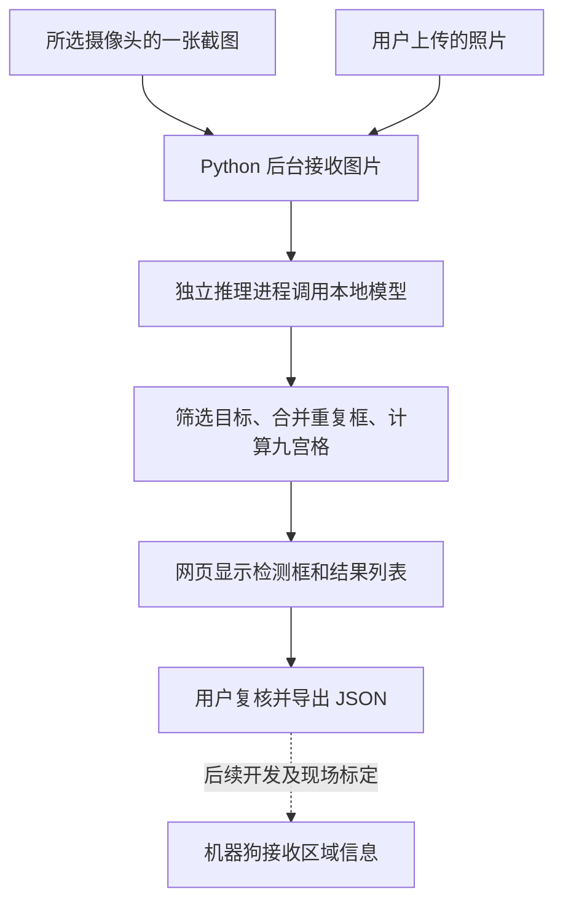

# 垃圾检测项目使用与原理说明（新手版）

这份文档从“怎样打开网页”讲到“程序怎样识别垃圾”。不懂编程，可以先看第 1～5 节；想了解实现方法，再看后面的章节。

项目所在文件夹：`/home/guest/hxjm-dk/garbage_detection`。

## 1. 这个项目能做什么

项目提供一个独立网页，支持两种检测方式：

- **摄像头检测**：在摄像头 1～4 之间切换画面，点击按钮取出一张照片进行检测。
- **图片检测**：从自己的电脑上传照片，测试纸屑、瓶罐、塑料袋等目标的检测效果。

检测结束后，网页会画出物体所在的方框，并显示类别、模型评分和九宫格区域。结果也可以导出为 JSON 文件，供后续其他程序读取。

目前是“点击一次，检测一张图”，不是持续分析视频中的每一帧。机器狗的通知和移动控制尚未接入。

### 先认识三个组成部分

| 组成 | 可以理解成什么 | 负责的工作 |
| --- | --- | --- |
| 网页，也叫前端 | 操作台 | 显示图片、提供按钮、展示检测结果 |
| Python 服务，也叫后台 | 调度员 | 读取摄像头、接收上传、安排检测、返回结果 |
| 检测模型 | 看图的助手 | 根据物体外观，给出类别、位置和评分 |

模型名称是 **Grounding DINO Tiny**。它已经由模型提供方训练完成，本项目使用它做检测，没有在本项目中重新训练模型。

“模型权重”是保存模型所学能力的大文件，并不是可以随便删除的临时缓存。

## 2. 怎样启动、打开和停止

### 2.1 命令应该在哪里输入

在保存本项目的 **Linux 服务器**上打开“终端”，也就是输入命令的窗口。如果用远程连接工具登录服务器，就在远程终端操作。

下面的命令可以整行复制，粘贴后按回车。它们使用完整路径，不要求先切换文件夹。

### 2.2 启动

```bash
bash /home/guest/hxjm-dk/garbage_detection/start.sh
```

看到“垃圾检测服务已后台启动”表示启动成功。首次打开时，根据当前网络选择一个地址：

| 电脑的连接方式 | 网页地址 |
| --- | --- |
| 能访问服务器的局域网 | [http://192.168.109.191:23071/](http://192.168.109.191:23071/) |
| 已连接并有权限访问服务器的 Tailscale | [http://100.127.237.7:23071/](http://100.127.237.7:23071/) |

`23071` 是网页端口。服务默认监听所有网卡，网页接口和摄像头预览自动使用当前访问地址，无需修改前端 IP。

**以后只用一个入口：** 在网页右上角点击“保存自动访问入口”，将 `垃圾检测入口.html` 保存到自己的电脑。以后双击这个文件，它会同时检测两个地址，最多等待 5 秒，再跳转到可用地址；两个地址都可用时优先局域网。浏览器询问本地网络访问权限时，请允许。也可以将本项目的 `open.html` 复制到自己的电脑，直接使用默认端口 `23071`。

自动入口是独立文件，需要保存在电脑上。仅收藏某个 IP 的网页，在该 IP 不可达时，浏览器无法加载网页来切换地址。入口文件不会启动服务器，仍需先执行 `start.sh`；两个地址都不可达时会保留手动链接和重试按钮。修改服务器 IP 后需要同步更新 `open.html` 并重新保存；修改端口后需要从网页重新下载入口。

如果浏览器就在服务器本机，也可以访问 `http://localhost:23071/`。其他电脑上的 `localhost` 指的是它自己，不能用来访问本服务器。

启动后服务在后台运行，关闭终端或关闭浏览器标签页，都不会停止服务。重复执行启动命令会提示已经运行，不需要连续启动。

如果服务仍在运行，但 `.runtime/service.json` 记录丢失或过期，启停脚本会核对当前用户、本目录程序路径、工作目录及进程启动时间，自动找回管理记录；不会仅凭端口号结束其他服务。

### 2.3 停止

```bash
bash /home/guest/hxjm-dk/garbage_detection/stop.sh
```

这条命令会停止网页后台、摄像头读取和正在运行的检测进程。浏览器标签页可以手动关闭。重复停止会提示无需重复操作。

**正常使用时，通过 `stop.sh` 停止服务，不能靠关闭网页或在新终端按 Ctrl+C 停止后台服务。**

### 2.4 重新启动

修改配置或代码后，先执行停止命令，再执行启动命令，然后刷新网页。

目前没有设置开机自动运行。服务器重新开机后，需要再次执行启动命令。

## 3. 怎样检测摄像头画面

1. 打开网页，点击“摄像头检测”。
2. 在画面上方点击“摄像头 1 / 2 / 3 / 4”，等待对应状态显示“已连接”，确认能看到现场画面。
3. 点击“截帧并检测”。“截帧”就是从视频中取出当前这一张照片。
4. 等待检测完成，查看目标列表、物体方框和九宫格区域。
5. 可以切换“现场画面”和“检测截图”，对照原图检查结果。

默认显示**摄像头 3**，可以随时点击四个摄像头按钮切换。每个按钮下方显示该路在线或离线状态。

| 编号 | 摄像头内网地址 | 场景 |
| --- | --- | --- |
| 摄像头 1 | `192.168.124.158` | 机器狗区域 |
| 摄像头 2 | `192.168.118.85` | 大屏区域 |
| 摄像头 3 | `192.168.116.115` | 办公室门口 |
| 摄像头 4 | `192.168.118.148` | 大厅入口 |

四路目前采用 **UDP 传输 RTSP 视频**，与 `/data/nfs_storage/hxjm/scripts` 对应主项目的取流方式一致。2026-10-21 修复后，四路均已恢复网页画面：摄像头 1、3、4 使用 `101` 主码流，实际画面为 `1280×720`；摄像头 2 使用低带宽的 `102` 子码流，实际画面为 `640×360`。摄像头 2 的清晰度较低，远处小垃圾可能更难识别；网络条件改善后，可在 `.env` 中将第二路地址末尾的 `102` 改回 `101`，重启后重新验证稳定性。

修复包括：连接等待由 5 秒延长至 15 秒，读取等待延长至 10 秒；为 UDP 视频增加接收缓冲和乱序包等待；每路限制为一个解码线程；启动脚本允许支持 pthreads 的 FFmpeg 独立建立四路连接，避免一台摄像头连接缓慢时，让其他摄像头也排队等待。断线仍会自动重连，过期截图仍不能用于检测。

服务器的局域网配置为 `192.168.109.191/20`，直连网段是 `192.168.96.0～192.168.111.255`；四个摄像头均在此范围之外，当前路由均经过网关 `192.168.96.1`。检查中曾发现摄像头链路延迟超过 2 秒，而网关约 1 毫秒。若再次长时间离线，应检查服务器到摄像头的跨网段链路及设备状态。端口超时发生在账号验证和视频解码之前，不能仅据此认定密码错误。Tailscale 网页能打开，不代表摄像头内网一定可达。

可以在服务器上重新检查（不会打印摄像头账号密码）：

```bash
cd /home/guest/hxjm-dk/garbage_detection
python3 -B check_cameras.py
# 已连通的摄像头继续尝试解码 10 秒视频，需要系统安装 ffmpeg：
python3 -B check_cameras.py --video --transport udp --timeout 15
```

检测期间也能切换画面；检测结果始终属于提交时的摄像头，不会变成新选择的摄像头。当前网页会分别暂存各路检测结果，切回对应摄像头即可查看。不同浏览器可以选择不同摄像头，互不影响。刷新网页会清空这些暂存，后台只保留最近一次成功结果。

检测框属于点击检测时保存的那张照片。现场物体后来移动时，旧框不会直接叠加到新视频画面上。

摄像头断线时，后台会尝试重连；没有新画面或画面已经过期时，会提示错误，不会使用过期截图启动新检测。

## 4. 怎样上传照片检测

1. 点击页面上方的“图片检测”。
2. 点击“选择图片”，从电脑里选择一张照片。
3. 确认预览正确，再点击“检测这张图片”。
4. 检测结束后，切换“上传原图 / 检测截图”，检查是否漏检或误检。
5. 想测试另一张图片时，重新选择即可，旧图标注会清除。

支持 JPG、PNG、WebP；单张不超过 **10 MB、2000 万像素**。照片太大时，可以先裁剪出需要检测的区域。纯色图片缺少场景细节，会显示错误提示。

摄像头离线时，图片检测仍能使用。摄像头检测和图片检测共用一个任务名额，同一时间只能运行一次检测。

### 照片和结果会保存吗

上传照片和最近的检测结果保存在后台内存中，不按上传文件名写入硬盘。**停止或重启服务后，这些内容会丢失。** 要保留记录，请自行保存原始照片，并点击页面上的“导出检测结果 JSON”。

刷新页面后可以查看后台最近一次成功结果，但重新检测本地照片时，仍需重新选择文件。

### 检测选项怎么调

先使用默认设置。效果不理想时，建议对同一张照片一次只改一个选项，方便比较。

| 设置 | 是什么意思 | 怎样选择 |
| --- | --- | --- |
| 普通检测 | 基础类别、扩展类别各看一次全图，共 2 遍 | 日常先使用；扩展后单张样本实测约 35 秒 |
| 局部放大复检 | 基础类别看全图和四个重叠区域，扩展类别看一次全图，共 6 遍 | 小纸屑、小瓶子漏检时尝试；本次样本实测约 90 秒，也可能增加误检 |
| 检测阈值，默认 0.25 | 候选物体评分达到这个值，才保留结果 | 漏检时可试 0.20；误检多时可试 0.35 或 0.40 |

阈值可在 0.15～0.60 之间调整。降低阈值会保留更多候选物体，也可能把背景误当垃圾；提高阈值会更严格，也可能漏掉真实垃圾。

单次推理最多等待 **120 秒**。超过后会终止推理进程、释放任务，可以使用普通模式或裁剪照片后重试。耗时会受照片尺寸和服务器负载影响，上述实测时间不是固定保证。

## 5. 怎么看懂结果

### 方框、类别和评分

方框表示模型判断的物体位置。右侧显示物体类别、评分和区域。

目前设置了 **14 类外观目标**：瓶罐类、纸屑、塑料袋、纸板/纸箱、一次性杯、包装袋/包装纸、餐盒/外卖盒、烟头、纸巾、果皮、食物残渣、口罩、手套、废电池。展开右侧“检测范围”可以查看完整列表；识别后会按类别统计数量。

瓶子和罐子合并为“瓶罐类”，避免把容易混淆的细分类当作确定结论。这些是根据外观寻找的目标，不能证明物品已被丢弃，也不等于当地的“可回收物、厨余、有害、其他垃圾”投放分类。“一次性杯”可能误框普通杯子；果皮目前主要通过 `banana peel`（香蕉皮）提示寻找，不能保证所有果皮都能检出。烟头、电池等小目标尤其需要对照原图检查。

**模型评分不等于准确率。** 例如“80%”是模型对这个候选物体的匹配评分，不代表这次判断一定有 80% 的正确概率。评分高也可能误检。

“未检出目标”也不能证明照片里一定没有垃圾，特别小或被遮挡的目标可能没有被发现。

### 九宫格是什么

画面平均分成九块，按照**物体方框中心点**所在的位置分配区域：

| | 左边 | 中间 | 右边 |
| --- | --- | --- | --- |
| 上面 | 左上 `r1c1` | 中上 `r1c2` | 右上 `r1c3` |
| 中间 | 左中 `r2c1` | 中央 `r2c2` | 右中 `r2c3` |
| 下面 | 左下 `r3c1` | 中下 `r3c2` | 右下 `r3c3` |

例如“塑料袋，左下，r3c1”，表示该方框的中心位于图片左下方。这里的上下左右，以你看到的画面为准。

### JSON 是什么

JSON 是一种保存结构化信息的文本格式，可以把它理解成方便其他程序读取的“检测结果表”。用记事本也能打开。

下面是简化示例，不是某次实际检测结果：

```json
{
  "source": "camera",
  "camera_id": "camera_3",
  "coordinate_space": "image_0_1000",
  "map_calibrated": false,
  "targets": [
    {
      "label": "塑料袋",
      "confidence": 0.72,
      "bbox": [100, 700, 250, 900],
      "region_id": "r3c1",
      "region_name": "左下"
    }
  ]
}
```

| 字段 | 含义 |
| --- | --- |
| `source` | 来源：`camera` 是摄像头，`upload` 是上传照片 |
| `camera_id` | 摄像头检测为所选的 `camera_1`～`camera_4`；上传照片为 `null`，表示没有对应现场摄像头 |
| `targets` | 检出的目标列表，空列表表示本次没有检出 |
| `label` | 类别 |
| `confidence` | 模型评分，`0.72` 在页面中显示为 72% |
| `bbox` | 方框的左边、上边、右边、下边，统一换算到 0～1000 |
| `region_id`、`region_name` | 九宫格编号和中文名称 |
| `map_calibrated` | 是否已经与现场地图建立对应关系，目前为 `false`，表示没有 |

框坐标使用 0～1000，是为了让不同尺寸的图片使用同一种表示方法。例如横坐标 `100` 表示距离图片左边约为图片宽度的 10%。它不是实际地面上的厘米数。

导出的 JSON 不含图片，原始照片需自行保存。

## 6. 程序内部是怎么工作的

### 6.1 整体流程



### 6.2 摄像头画面怎样进入网页

摄像头使用 RTSP 提供视频。RTSP 可以理解成“从网络摄像头取视频的通信方式”，它与浏览器打开的网页地址不同。

后台通过 OpenCV 分别读取四路视频，持续获取新画面，再将所选摄像头最近的一帧压缩成 JPEG 图片供浏览器显示。摄像头账号保存在 `.env` 中，完整 RTSP 地址不会返回网页。

点击检测时，后台保存当前帧，将这张固定照片送去检测。因此结果图片和方框能保持对应。

### 6.3 上传照片之后，后台先做什么

后台检查文件格式、文件大小、像素数；修正手机照片自带的旋转方向；将透明部分合成为白色背景。文件损坏、格式不支持或尺寸过大时，会显示错误。

检测使用上传原图经过模型所需缩放后的内容。返回网页的结果预览会另外缩成最长边不超过 2048 像素的 JPEG，以减少大图传输等待，框仍按图片比例显示。

### 6.4 模型怎样找物体

模型接收两样东西：**图片**和**要寻找的物体名称**。本项目传入：

| 英文名称 | 含义 |
| --- | --- |
| `bottle` | 瓶子 |
| `paper` | 纸张 |
| `plastic bag` | 塑料袋 |
| `can` | 罐子 |
| `cardboard` | 纸板/纸箱 |
| `cup` | 一次性杯候选 |
| `wrapper` | 包装袋/包装纸 |
| `food container` | 餐盒/外卖盒 |
| `cigarette butt` | 烟头 |
| `tissue` | 纸巾 |
| `banana peel` | 果皮候选，主要是香蕉皮 |
| `food scraps` | 食物残渣 |
| `face mask` | 口罩 |
| `glove` | 手套 |
| `battery` | 废电池 |

模型根据已有训练经验，在图片中给出候选物体的位置和匹配评分。这叫“目标检测”，回答的是“是什么、在哪里”。它无法仅凭外观可靠判断物品是否已经废弃，所以桌上的瓶子或手里拿着的罐子也可能被框出来。

为了减少类别之间互相干扰，前四个英文名称作为基础组，其余名称作为扩展组，分开运行再合并结果。普通模式两组分别看一次全图，按短边约 800 像素、长边最多 1333 像素的规则缩放。局部复检还让基础组看四个宽高约为原图 60% 的重叠区域，再把局部坐标换算回整张图片；扩展组仍只看全图，因此新增的小目标类别也可能漏检。

模型输出后，程序继续做五件事：

1. 去掉评分低于阈值的候选物体。
2. 去掉被局部裁切边缘切断的不完整物体碎片。
3. 合并高度重叠的重复框，优先保留全图检出的完整目标；同一位置的全图框按评分择优，避免将同一物体按不同类别重复计数。
4. 把框位置换算为 0～1000，计算框中心所在九宫格。
5. 整理成统一结果，让网页画框、列出类别和区域。

### 6.5 为什么单独启动一个推理进程

模型计算要等几十秒，网页后台仍需响应用户操作。因此每次检测单独启动一个推理进程，可以理解成临时安排一个专门看图的工人。

后台最多等待它 120 秒，超时就结束该进程并报告错误。停止整个服务时，推理进程也会退出，避免一直占用计算资源。

网页提交任务后，会定期查询“是否完成”，而不是让同一个网页请求一直等待模型。这就是页面能显示检测进度和等待时间的原因。

### 6.6 使用了哪些技术

| 技术 | 在本项目中的作用 |
| --- | --- |
| HTML | 定义网页内容和结构 |
| CSS | 控制颜色、布局等外观 |
| JavaScript | 处理按钮、上传、状态查询和检测框 |
| Python 自带 HTTP 服务 | 提供网页和后台接口 |
| OpenCV | 读取摄像头视频、生成预览 |
| Pillow | 处理照片格式、方向和尺寸 |
| PyTorch、Transformers | 加载并运行模型 |
| Linux 进程管理 | 后台启停、进程身份核对、推理超时终止 |

当前配置使用 CPU，Torch 使用四个计算线程。此前检查发现 GPU 驱动不可用，因此暂未启用 GPU。项目不需要启动主项目、数据库或其他视频中转服务。

## 7. 每个文件有什么作用

名称前有点的文件或文件夹，例如 `.env`、`.runtime`，可能默认隐藏，需要在文件管理器中开启“显示隐藏文件”。

```text
garbage_detection/
├── README.md                 本说明文档
├── start.sh                  一键启动命令
├── open.html                 可保存到电脑的自动选址入口
├── check_cameras.py          TCP / RTSP 连通性与可选视频解码检查
├── stop.sh                   一键停止命令
├── manage.py                 管理后台进程、核对身份、安全停止
├── server.py                 摄像头、上传、网页接口和任务调度
├── inference_worker.py       运行独立推理进程、处理超时和错误
├── detector.py               模型检测、筛选去重、区域计算
├── requirements.txt          Python 依赖清单
├── .env                      当前服务器的实际配置，含摄像头账号
├── .env.example              不含真实密码的配置示例
├── static/
│   ├── index.html            网页结构
│   ├── style.css             网页样式
│   └── app.js                网页交互、状态查询和画框
├── test_*.py                 Python 自动检查程序
├── check_upload_browser.py   生成测试图片并启动临时测试服务
├── test_upload_browser.cjs   图片上传界面的浏览器检查
├── test_browser.cjs          摄像头预览和结果展示的浏览器检查
└── .runtime/
    ├── grounding-dino-tiny/  当前模型和配套文件，必须保留
    ├── cache/                程序自动生成的缓存
    ├── service.log           日志，记录运行和错误信息
    ├── service.json          服务进程记录，由启停命令管理
    └── service.lock          避免多个启停操作同时执行
```

`test_*.py` 表示名字以 `test_` 开头、以 `.py` 结尾的文件。它们不参与日常检测，但可以帮助检查修改代码后功能是否仍正常，因此保留。

**不要删除 `.env` 和模型目录。不要在服务运行时手动删除 `service.json` 或 `service.lock`。** 模型中的 `model.safetensors` 是约 689 MB 的权重，配套 JSON 和词表文件也需要保留。

此前清理已删除约 4.28 GB 的旧模型、历史测试图片、截图、临时评测脚本和导出结果。当前代码不依赖旁边 `llm-service` 项目的工具文件。运行浏览器检查后，可能再次产生测试图片和截图。

## 8. 怎样修改配置

日常使用无需修改。需要时，用文本编辑器打开本项目 `.env`，保存后停止并重新启动服务。

| 配置名 | 用途 | 当前使用方式 |
| --- | --- | --- |
| `GARBAGE_RTSP_URL_1`～`GARBAGE_RTSP_URL_4` | 四路摄像头视频地址，含账号和密码 | 数字分别对应摄像头 1～4；没有地址的路显示未配置 |
| `GARBAGE_RTSP_URL` | 兼容以前的单路配置 | 只在未设置 `_3` 时作为摄像头 3 的地址 |
| `GARBAGE_PORT` | 网页端口 | `23071` |
| `GARBAGE_DEVICE` | 使用什么设备计算 | `cpu` |
| `GARBAGE_RTSP_TRANSPORT` | 摄像头传输方式 | `udp`（当前网络验证配置） |
| `GARBAGE_MODEL_PATH` | 模型存放路径 | 本项目 `.runtime/grounding-dino-tiny` |
| `GARBAGE_PYTHON` | 使用哪个 Python 环境 | 未填写时使用服务器已有的 `reid` 环境 |

RTSP 地址格式见 `.env.example`，其中“用户名”“密码”需要替换成真实账号。不要公开带真实密码的 `.env`。

要调整寻找的垃圾类别，修改 `detector.py` 中的 `CORE_LABELS`（基础组）或 `EXTRA_LABELS`（扩展组）。左侧英文是发给模型的物体名称，右侧中文是网页显示名称。例如 `"face mask": "口罩"`。这只是改变模型要寻找什么，并没有重新训练模型；增加名称不保证能准确识别。修改后先用包含该物体和不包含该物体的照片测试，再重启服务。

摄像头地址、服务器网页地址、网页端口各有不同用途，不要把三者混淆。

## 9. 遇到问题怎么办

| 现象 | 处理方法 |
| --- | --- |
| 网页打不开 | 先执行启动命令，确认服务器地址、端口和网络连接正确 |
| 提示端口被占用或 `Address already in use` | 不要反复启动。先确认网页是否已打开；本项目需要重启时使用停止命令。如果其他程序占用端口，修改本项目端口并重启，不要随意结束其他进程 |
| 摄像头连接失败 | 检查供电、网络和 `.env` 的摄像头地址与账号；可以先用图片检测 |
| 照片无法检测 | 检查格式、大小和像素数，换一张清晰且有实际场景内容的照片 |
| 检测等待很久 | 先关闭局部复检；必要时裁剪照片。超过 120 秒会释放任务 |
| 小纸屑没被框出 | 尝试局部复检、适当降低阈值，或让物体在照片中更大、更清楚 |
| 把背景或正常物品识别为垃圾 | 提高阈值，并人工对照原图；模型无法保证判断物品是否已被丢弃 |
| 关闭浏览器后服务还在运行 | 属于后台运行的正常行为，需要执行停止命令 |
| 修改配置或代码后没有变化 | 先停止再启动，并刷新网页；必要时强制刷新浏览器 |

查看最近 50 行后台日志，在服务器终端输入：

```bash
tail -n 50 /home/guest/hxjm-dk/garbage_detection/.runtime/service.log
```

日志是程序运行的文字记录，排查错误时很有用。

## 10. 以后怎样告诉机器狗“垃圾在哪”

现在的“左下角”是**画面区域**，不是现场地面上的距离或机器狗能直接行走到的地图坐标。后续需要：

1. 固定摄像头位置，确定画面区域分别对应现场哪块地面。
2. 把区域与现场地图、机器狗巡检点建立对应关系，这一步叫标定。
3. 明确机器狗接收任务的接口，将 `camera_3 + r3c1` 等信息换成它认识的区域或巡检点。
4. 加入多次确认和重复任务处理，避免同一物体反复触发任务，再验证机器狗实际行动是否正确。

上传照片用于测试，不能直接当成摄像头现场事件下发给机器狗。目前项目只提供区域展示和导出，未接入通知或移动指令。

## 11. 已做过的验证与识别局限

2026-10-19 的先前验证中，摄像头 3 预览、图片上传、模式切换、检测框、九宫格、JSON 导出和手机布局均已检查。清理文件后，真实摄像头检测也完成一次，使用 Grounding DINO Tiny，后台耗时约 23.3 秒。

先前在三张公开 TACO 标注图片中，普通模式定位到塑料瓶、气雾罐、纸张、饮料罐和塑料袋五个目标，耗时约 20～24 秒；也出现瓶盖漏检、白色篷布误报。局部复检约 72 秒，仍可能增加误报。历史原始样本和截图已经清理，不随项目保留。

2026-10-20 扩展到 14 类后，再次使用一张公开 TACO 瓶子样本检查真实模型：普通模式 2 遍约 34.6 秒，局部复检 6 遍约 90 秒，均未超过 120 秒上限。原有瓶子目标仍可检出，但也存在篷布误报等问题；新增类别尚未逐类统计准确率。另一次通过实际上传接口检测 TACO 杯子图片约 54 秒，流程正常，但塑料杯被误分成塑料袋，说明细分类仍不可靠。

这些只是少量样本的运行检查，部分样本包含桌面物品或手持物品，**不能视为地面散落垃圾场景的整体准确率**。小目标、遮挡、反光和复杂背景仍可能造成误检或漏检。

要进一步提高现场效果，应收集本摄像头的真实照片，同时包含“有垃圾”和“没有垃圾”的情况，人工标注正确答案，再统计漏检、误检，并决定是否需要针对现场重新训练模型。

### 自动检查（给维护人员）

现有 26 项 Python 检查覆盖图片处理、纯色校验、坐标、去重、超时后重试、进程身份核对、摄像头断线后恢复和清除旧帧、摄像头编号与截图绑定、非法或离线摄像头处理及分类合并。`test_browser.cjs` 实测四路真实画面，其他浏览器检查还覆盖检测中切换、不同浏览器独立选择、分类数量、各路结果与导出和手机布局。运行命令：

```bash
cd /home/guest/hxjm-dk/garbage_detection
PYTHONDONTWRITEBYTECODE=1 /home/guest/anaconda3/envs/reid/bin/python -B -m unittest discover -s . -p 'test_*.py' -v
node --check static/app.js
```

浏览器检查需要安装 Playwright 和 Chromium。当前服务器已有环境，可使用以下命令检查上传流程：

```bash
cd /home/guest/hxjm-dk/garbage_detection
mkdir -p .runtime/browser-tmp
TMPDIR="$PWD/.runtime/browser-tmp" PLAYWRIGHT_MODULE=/home/guest/.npm/_npx/f15a2c6009a805b8/node_modules/playwright PYTHONDONTWRITEBYTECODE=1 /home/guest/anaconda3/envs/reid/bin/python -B check_upload_browser.py
```

检查已运行服务的摄像头页面：

```bash
cd /home/guest/hxjm-dk/garbage_detection
mkdir -p .runtime/browser-tmp
TMPDIR="$PWD/.runtime/browser-tmp" PLAYWRIGHT_MODULE=/home/guest/.npm/_npx/f15a2c6009a805b8/node_modules/playwright node test_browser.cjs
```

自动检查验证的是程序流程，不等于模型准确率评估；上传界面检查使用替代检测结果。测试可能重新产生截图等临时文件。其他服务器的 Playwright 安装路径可能不同，需要调整。

## 12. 换一台服务器怎样部署（给维护人员）

普通使用者可以跳过这一节。目前使用已有 `/home/guest/anaconda3/envs/reid/bin/python` 的依赖，不修改共享环境。模型和缓存放在本项目内。

1. 将项目复制到另一台 Linux 服务器，包含隐藏的 `.env.example` 和 `.runtime/grounding-dino-tiny`。没有复制模型时，需要重新获取下面列出的完整模型文件。
2. 在新项目文件夹中建立自己的 Python 环境，再安装依赖：

   ```bash
   python3 -m venv .venv
   .venv/bin/python -m pip install -r requirements.txt
   ```

3. 没有实际配置时，将 `.env.example` 复制为 `.env`。填写四路摄像头账号、端口、模型路径，并将 `GARBAGE_PYTHON` 设置为新环境 Python 的绝对路径。例如项目路径不变时，为 `/home/guest/hxjm-dk/garbage_detection/.venv/bin/python`。复制来的旧绝对路径也要同步修改。
4. 确认服务器能访问摄像头，允许内网访问网页端口，再执行 `bash start.sh`，用新服务器地址打开网页。

安装依赖和首次获取模型需要联网，CPU 推理需要足够内存。当前已验证环境为 Python 3.10、Torch 2.5.1、Transformers 5.5.4；其他环境需重新验证。服务目前没有登录认证，适合可信内网使用。

模型来源：[IDEA-Research/grounding-dino-tiny](https://huggingface.co/IDEA-Research/grounding-dino-tiny)，固定版本为 `a2bb814dd30d776dcf7e30523b00659f4f141c71`。模型目录中保留同一版本的以下文件：

```text
model.safetensors
config.json
preprocessor_config.json
tokenizer.json
tokenizer_config.json
special_tokens_map.json
added_tokens.json
vocab.txt
```

服务只从本地加载模型，不会启动时自动下载。

## 13. 后台接口说明（给后续接入程序的人员）

“接口”是网页或其他程序向后台发送请求的入口。日常点击按钮时，网页会自动调用，无需手动操作。

| 请求 | 用途 |
| --- | --- |
| `GET /api/state?camera_id=camera_1` | 查询所选摄像头、四路在线状态、支持类别和当前任务 |
| `GET /api/frame.jpg?camera_id=camera_1` | 获取所选摄像头预览；断线或过期返回 503 |
| `POST /api/detect` | 用 `X-Camera-Id: camera_1` 请求头指定截帧摄像头并提交检测 |
| `POST /api/detect-image` | 上传图片字节并提交检测 |
| `GET /api/result` | 获取最近一次成功结果及对应预览 |

提交成功返回 202 和任务 ID，已有任务返回 409；图片或阈值非法返回 400，图片过大返回 413。

查询参数和 `X-Camera-Id` 接受 `camera_1`～`camera_4`，省略时默认摄像头 3；非法编号返回 400，不会偷偷使用其他摄像头。摄像头检测共用一个任务名额。

图片上传支持这些请求头：

- `X-File-Name`：经过 URL 编码的文件名。
- `X-Detection-Detail: 1`：启用局部复检。
- `X-Detection-Threshold: 0.25`：设置检测阈值。

任务状态为 `idle`（空闲）、`loading`（准备）、`running`（检测中）、`done`（完成）、`error`（失败）。失败原因查看任务的 `error` 字段。

结果接口仍可能保留上一次成功结果，调用方应核对任务 ID。上传图片结果的 `camera_id` 为 `null`，现场摄像头结果为实际提交时所选的 `camera_1`～`camera_4`。区域坐标类型为 `image_0_1000`，地图标定状态为 `map_calibrated: false`。
