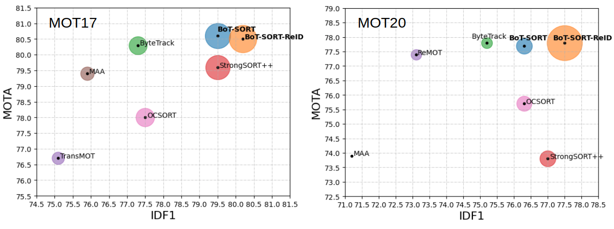

# BoT-SORT

> [**BoT-SORT: Robust Associations Multi-Pedestrian Tracking**](https://arxiv.org/abs/2206.14651)
> 
> Nir Aharon, Roy Orfaig, Ben-Zion Bobrovsky

[](https://paperswithcode.com/sota/multi-object-tracking-on-mot17?p=bot-sort-robust-associations-multi-pedestrian)

[](https://paperswithcode.com/sota/multi-object-tracking-on-mot20-1?p=bot-sort-robust-associations-multi-pedestrian)
> 
> *[https://arxiv.org/abs/2206.14651](https://arxiv.org/abs/2206.14651)*

<p align="center"></p>

## Highlights 🚀

- YOLOX & YOLOv7 support
- Multi-class support
- Camera motion compensation
- Re-identification

## Coming Soon
- [ ] Trained YOLOv7 models for MOTChallenge.
- [x] YOLOv7 detector.
- [x] Multi-class support.
- [x] Create OpenCV VideoStab GMC python binding or <u>write Python version<u>.
- [ ] Deployment code.

## Abstract

The goal of multi-object tracking (MOT) is detecting and tracking all the objects in a scene, while keeping a unique identifier for each object. In this paper, we present a new robust state-of-the-art tracker, which can combine the advantages of motion and appearance information, along with camera-motion compensation, and a more accurate Kalman filter state vector. Our new trackers BoT-SORT, and BoT-SORT-ReID rank first in the datasets of MOTChallenge [29, 11] on both MOT17 and MOT20 test sets, in terms of all the main MOT metrics: MOTA, IDF1, and HOTA. For MOT17: 80.5 MOTA, 80.2 IDF1, and 65.0 HOTA are achieved.


### Visualization results on MOT challenge test set


https://user-images.githubusercontent.com/57259165/177045531-947d3146-4d07-4549-a095-3d2daa4692be.mp4

https://user-images.githubusercontent.com/57259165/177048139-05dcb382-010e-41a6-b607-bb2b76afc7db.mp4

https://user-images.githubusercontent.com/57259165/180818066-f67d1f78-515e-4ee2-810f-abfed5a0afcb.mp4

## Tracking performance
### Results on MOT17 challenge test set
| Tracker       |  MOTA |  IDF1  |  HOTA  |
|:--------------|:-------:|:------:|:------:|
| BoT-SORT      |  80.6   |  79.5  |  64.6  |
| BoT-SORT-ReID |  80.5   |  80.2  |  65.0  |

### Results on MOT20 challenge test set
| Tracker       | MOTA   | IDF1 | HOTA |
|:--------------|:-------:|:------:|:------:|
|BoT-SORT       | 77.7   | 76.3 | 62.6 | 
|BoT-SORT-ReID  | 77.8   | 77.5 | 63.3 | 


## Installation

The code was tested on Ubuntu 20.04

BoT-SORT code is based on ByteTrack and FastReID. <br>
Visit their installation guides for more setup options.
 
### Setup with Anaconda
**Step 1.** Create Conda environment and install pytorch.
```shell
conda create -n botsort_env python=3.7
conda activate botsort_env
```
**Step 2.** Install torch and matched torchvision from [pytorch.org](https://pytorch.org/get-started/locally/).<br>
The code was tested using torch 1.11.0+cu113 and torchvision==0.12.0 

**Step 3.** Install BoT-SORT.
```shell
git clone https://github.com/NirAharon/BoT-SORT.git
cd BoT-SORT
pip3 install -r requirements.txt
python3 setup.py develop
```
**Step 4.** Install [pycocotools](https://github.com/cocodataset/cocoapi).
```shell
pip3 install cython; pip3 install 'git+https://github.com/cocodataset/cocoapi.git#subdirectory=PythonAPI'
```

Step 5. Others
```shell
# Cython-bbox
pip3 install cython_bbox

# faiss cpu / gpu
pip3 install faiss-cpu
pip3 install faiss-gpu
```

## Data Preparation

Download [MOT17](https://motchallenge.net/data/MOT17/) and [MOT20](https://motchallenge.net/data/MOT20/) from the [official website](https://motchallenge.net/). And put them in the following structure:

```
<dataets_dir>
      │
      ├── MOT17
      │      ├── train
      │      └── test    
      │
      └── MOT20
             ├── train
             └── test
```

For training the ReID, detection patches must be generated as follows:   

```shell
cd <BoT-SORT_dir>

# For MOT17 
python3 fast_reid/datasets/generate_mot_patches.py --data_path <dataets_dir> --mot 17

# For MOT20
 python3 fast_reid/datasets/generate_mot_patches.py --data_path <dataets_dir> --mot 20
```
Link dataset to FastReID ```export FASTREID_DATASETS=<BoT-SORT_dir>/fast_reid/datasets```. If left unset, the default is `fast_reid/datasets` 
 
## Model Zoo
Download and store the trained models in 'pretrained' folder as follow:
```
<BoT-SORT_dir>/pretrained
```
- We used the publicly available [ByteTrack](https://github.com/ifzhang/ByteTrack) model zoo trained on MOT17, MOT20 and ablation study for YOLOX object detection.

- Ours trained ReID models can be downloaded from [MOT17-SBS-S50](https://drive.google.com/file/d/1QZFWpoa80rqo7O-HXmlss8J8CnS7IUsN/view?usp=sharing), [MOT20-SBS-S50](https://drive.google.com/file/d/1KqPQyj6MFyftliBHEIER7m_OrGpcrJwi/view?usp=sharing).

- For multi-class MOT use [YOLOX](https://github.com/Megvii-BaseDetection/YOLOX) or [YOLOv7](https://github.com/WongKinYiu/yolov7) trained on COCO (or any custom weights). 

## Training

[//]: # (### Training the Detector)

[//]: # ()
[//]: # (Please refer to [ByteTrack]&#40;https://github.com/ifzhang/ByteTrack&#41; for training detector.)

### Train the ReID Module

After generating MOT ReID dataset as described in the 'Data Preparation' section.

```shell
cd <BoT-SORT_dir>

# For training MOT17 
python3 fast_reid/tools/train_net.py --config-file ./fast_reid/configs/MOT17/sbs_S50.yml MODEL.DEVICE "cuda:0"

# For training MOT20
python3 fast_reid/tools/train_net.py --config-file ./fast_reid/configs/MOT20/sbs_S50.yml MODEL.DEVICE "cuda:0"
```

Refer to [FastReID](https://github.com/JDAI-CV/fast-reid)  repository for addition explanations and options.

## Tracking

By submitting the txt files produced in this part to [MOTChallenge](https://motchallenge.net/) website and you can get the same results as in the paper.<br>
Tuning the tracking parameters carefully could lead to higher performance. In the paper we apply ByteTrack's calibration.

* **Test on MOT17**

```shell
cd <BoT-SORT_dir>
python3 tools/track.py <dataets_dir/MOT17> --default-parameters --with-reid --benchmark "MOT17" --eval "test" --fp16 --fuse
python3 tools/interpolation.py --txt_path <path_to_track_result>
```

* **Test on MOT20**

```shell
cd <BoT-SORT_dir>
python3 tools/track.py <dataets_dir/MOT20> --default-parameters --with-reid --benchmark "MOT20" --eval "test" --fp16 --fuse
python3 tools/interpolation.py --txt_path <path_to_track_result>
```

* **Evaluation on MOT17 validation set (the second half of the train set)**

```shell
cd <BoT-SORT_dir>

# BoT-SORT
python3 tools/track.py <dataets_dir/MOT17> --default-parameters --benchmark "MOT17" --eval "val" --fp16 --fuse

# BoT-SORT-ReID
python3 tools/track.py <dataets_dir/MOT17> --default-parameters --with-reid --benchmark "MOT17" --eval "val" --fp16 --fuse
```

* **Other experiments**

Other parameters can be used __without__ passing --default-parameters flag. <br>
For evaluating the train and validation sets we recommend using the official MOTChallenge evaluation code from [TrackEval](https://github.com/JonathonLuiten/TrackEval). 

```shell
# For all the available tracking parameters, see:
python3 tools/track.py -h 
```

* **Experiments with YOLOv7**

Other parameters can be used __without__ passing --default-parameters flag. <br>
For evaluating the train and validation sets we recommend using the official MOTChallenge evaluation code from [TrackEval](https://github.com/JonathonLuiten/TrackEval). 

```shell
# For all the available tracking parameters, see:
python3 tools/track_yolov7.py -h 
```

## Demo

### Short missed-detection prediction

`tools/demo.py` updates BoT-SORT on every image/video frame, including frames
with no detections. Confirmed lost tracks keep their ID and can be displayed
from the existing Kalman prediction for up to `--prediction-max-age 5` updates
(the default; 0 disables prediction output). At 20 FPS, five updates are 0.25 s.
After this window, boxes disappear but tracks remain eligible for normal
reassociation until the independent `track_buffer` timeout. Prediction does not
update appearance features, refresh the last detection frame, or create/confirm
tracks. Actual detections correct the motion state only after a successful
association. Predicted and detected boxes use the same solid outline and ID
label, without a `PRED` suffix. Other entrypoints retain detection-only output
unless they explicitly set `prediction_max_age`.

Keep the existing Demo command and add `--fps 20 --prediction-max-age 5` for the
local 20 FPS sample. `--fps` is source/update FPS, not inference throughput.
The MOT text output keeps its ten columns and uses confidence `-1` for predicted
rows. A neighboring `<timestamp>.predictions.jsonl` records each predicted row's
frame ID (same numbering as the text file), track ID, `bbox_tlwh`,
`is_prediction`, `missed_frames`, and null confidence. Invalid, fully off-screen,
or area/aspect-filtered boxes are not drawn. The change applies to
`tracker/bot_sort.py` and the YOLOX Demo, not the
separate multi-class tracker.

Prediction can drift and does not guarantee identity recovery after crossing,
turning, or long occlusion.

### Small-target occlusion recovery

Add `--recover-lost` to enable a recovery association before new IDs are
created. Normal associations, including low-score updates of active tracks,
have priority. Remaining high/low-score detections can then reactivate a
confirmed lost track using size-normalized center distance, a Kalman position
gate with a four-pixel noise floor, and a maximum twofold size change. Recovery
rejects competing candidates whose costs differ by less than 0.1.

For high-score boxes at least 24 pixels wide and 64 pixels tall on both sides,
valid ReID features also constrain recovery. Smaller/low-score boxes rely on
the stricter geometry gate. Recovery preserves the pre-occlusion appearance;
later normal associations can update it. Low-score boxes cannot create IDs.
Other entrypoints keep recovery disabled unless they set `recover_lost`.

The Demo now defaults to `--track_buffer 120`: at 20 FPS this keeps 80 lost
updates (about four seconds), while prediction output still stops after five
updates. Expired tracks are removed before association. Geometry and feature
thresholds are initial settings; real-video ID-switch improvements still need
to be measured, especially for similar people crossing in the same area.

Run from this directory after activating `botsort39`:

```shell
PYTHONPATH="$PWD" python tools/demo.py video \
  --path videos/test.mp4 \
  -f yolox/exps/example/mot/yolox_x_mix_det.py \
  -c pretrained/bytetrack_x_mot17.pth.tar \
  --with-reid \
  --fast-reid-config fast_reid/configs/MOT17/sbs_S50.yml \
  --fast-reid-weights pretrained/mot17_sbs_S50.pth \
  --device gpu --fps 20 --track_buffer 120 \
  --prediction-max-age 5 --recover-lost \
  --fuse-score --fp16 --fuse --save_result \
  -expn small_target_recovery
```

Results are saved under `YOLOX_outputs/small_target_recovery/track_vis/` in a
timestamped subdirectory. Omit `--recover-lost` to compare without the recovery
association while keeping the same buffer and prediction settings.

### Crossing protection

The YOLOX Demo enables crossing protection by default. Keep the command above;
optionally change the experiment name to `crossing_guard` to separate results.
Use `--no-crossing-guard` for a comparison. Other callers of `BoTSORT` must set
`crossing_guard=True` explicitly to enable it.

Protection starts only when at least two confirmed tracks are involved.
High overlap means IoU at least 0.6 or coverage of the smaller box at least 0.7;
predicted tracks, overlapping detections and a merged detection can trigger it.
In that group, association uses Kalman motion and reliable, unoccluded ReID
features together. Similar-cost candidates are left unmatched, so neither
appearance nor motion is corrected from an ambiguous detection. Confident
position updates can continue during overlap, while appearance stays frozen.
Two consecutive unoccluded high-score associations end the protection, and
subsequent normal associations can refresh appearance.

The same checks cover high/low-score association and lost-track recovery.
Ambiguous nearby detections cannot confirm or create another ID, and protected
tracked/lost pairs are not deleted as duplicate tracks. Lost tracks still expire
normally; prediction output remains five frames with solid outlines and no
`PRED` suffix. An isolated small target keeps its previous association and
recovery rules, even when other people cross elsewhere in the image.

These checks are conservative: crowded groups can temporarily lose displayed
boxes after the prediction window. Completely hidden people, similar clothing
and abrupt turns can still cause identity errors. Synthetic regression checks
do not replace comparing ID switches on the actual video.

Regression checks (run from this directory in the `botsort39` environment):

```shell
PYTHONPATH="$PWD" python -B -m unittest discover -s tests -p test_prediction.py -v
```

Demo with BoT-SORT(-ReID) based YOLOX and multi-class.

```shell
cd <BoT-SORT_dir>

# Original example
python3 tools/demo.py video --path <path_to_video> -f yolox/exps/example/mot/yolox_x_mix_det.py -c pretrained/bytetrack_x_mot17.pth.tar --with-reid --fuse-score --fp16 --fuse --save_result

# Multi-class example
python3 tools/mc_demo.py video --path <path_to_video> -f yolox/exps/example/mot/yolox_x_mix_det.py -c pretrained/bytetrack_x_mot17.pth.tar --with-reid --fuse-score --fp16 --fuse --save_result
```

Demo with BoT-SORT(-ReID) based YOLOv7 and multi-class.
```shell
cd <BoT-SORT_dir>
python3 tools/mc_demo_yolov7.py --weights pretrained/yolov7-d6.pt --source <path_to_video/images> --fuse-score --agnostic-nms (--with-reid)
```

## Note

Our camera motion compensation module is based on the OpenCV contrib C++ version of VideoStab Global Motion Estimation, 
which currently does not have a Python version. <br>
Motion files can be generated using the C++ project called 'VideoCameraCorrection' in the GMC folder. <br> 
The generated files can be used from the tracker. <br>

In addition, python-based motion estimation techniques are available and can be chosen by passing <br> 
'--cmc-method' <files | orb | ecc> to demo.py or track.py. 

## Citation

```
@article{aharon2022bot,
  title={BoT-SORT: Robust Associations Multi-Pedestrian Tracking},
  author={Aharon, Nir and Orfaig, Roy and Bobrovsky, Ben-Zion},
  journal={arXiv preprint arXiv:2206.14651},
  year={2022}
}
```


## Acknowledgement

A large part of the codes, ideas and results are borrowed from 
[ByteTrack](https://github.com/ifzhang/ByteTrack), 
[StrongSORT](https://github.com/dyhBUPT/StrongSORT),
[FastReID](https://github.com/JDAI-CV/fast-reid),
[YOLOX](https://github.com/Megvii-BaseDetection/YOLOX) and
[YOLOv7](https://github.com/wongkinyiu/yolov7). 
Thanks for their excellent work!


